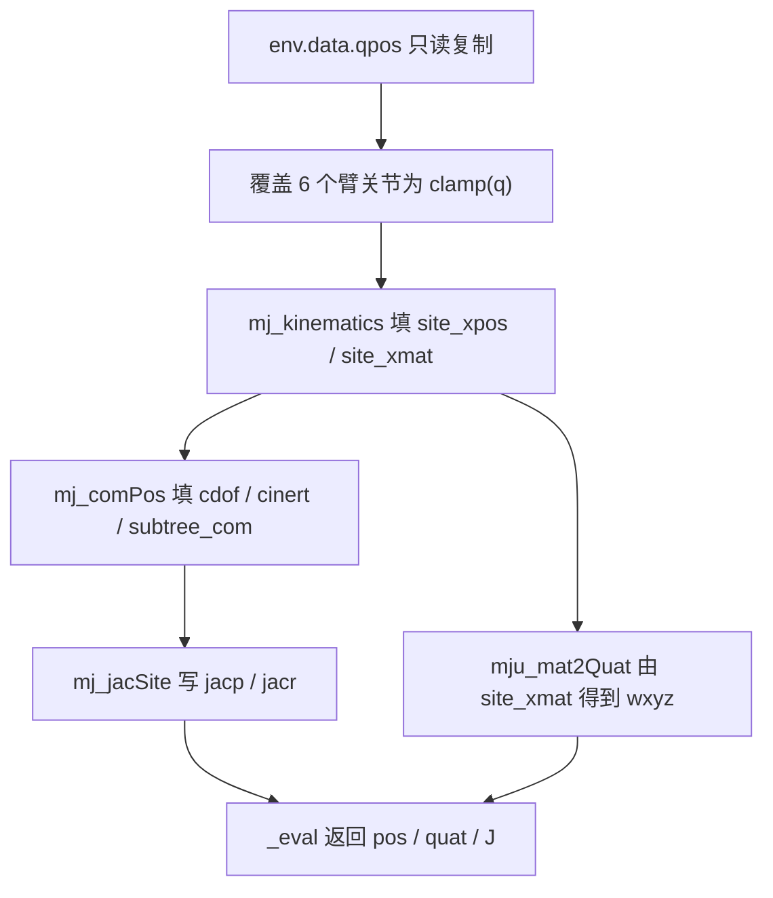
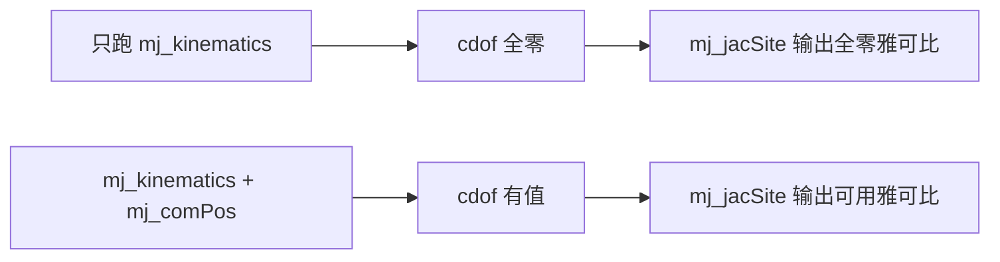

# TCP 正运动学与雅可比

本文对应公开项目 `TC635807/vlm-admittance`（https://github.com/TC635807/vlm-admittance）的 `control/`。正解与雅可比都落在 `control/kinematics.py` 的 `Kinematics` 类里，四元数工具来自 `control/trajectory.py`。这两个结果同时被下游两处消费：规划器 `planning/planner.py` 用 `fk()` 复核 IK 给出的关节角，运动执行器 `control/motion.py` 用 `jacobian()` 把参考笛卡尔速度映射成关节速度。

机器人的装配方式写在 `sim/scene.py`：`assets/ur5e/ur5e.xml`（Menagerie）与 `assets/robotiq_2f85/2f85.xml` 通过 `MjSpec.attach(grip, prefix="g_", site=arm.site("attachment_site"))` 组合，夹爪元素统一带 `g_` 前缀。工具中心点取 site `g_pinch`，这个名字定义在 `core/types.py` 的 `TCP_SITE`，法兰 site 是 `attachment_site`。

## 私有 MjData 与只读契约

`Kinematics` 不直接往 `env.data` 上算。构造时它建了一份自己的 **私有 MjData**：

```python
self._data = mujoco.MjData(self.model)
self._jacp = np.zeros((3, self.model.nv))
self._jacr = np.zeros((3, self.model.nv))
```

之后每次求解都走同一条路：先把 `env.data.qpos` 整个复制进 `_data`，再覆盖 6 个臂关节。复制整份 qpos 而不是只写臂关节，是为了保留夹爪内部 8 个自由度与场景物体自由关节的当前值；这些值不参与 IK，但 `_data` 必须与真实场景同构，否则读出来的 site 位姿没有意义。

这条只读约束有专门的断言。`control/smoke.py` 的 `TestKinematics` 在调用 `fk / jacobian / ik` 前后各存一份 `env.data.qpos`，要求逐位相等。设计上成立的原因是所有写操作都只落在 `_data`，`env.data` 全程只出现在 `d.qpos[:] = self.env.data.qpos` 这条右值读取里。

## 两级前向：mj_kinematics 与 mj_comPos

IK 内循环一步要算数千次前向，前向开销直接决定逆解耗时。`_sync()` 因此只跑两级轻量接口，不跑 `mj_forward`：

```python
def _sync(self, q):
    d = self._data
    d.qpos[:] = self.env.data.qpos          # 只读复制：保留夹爪 8 个自由度（场景里的物体状态一并保留）
    d.qpos[self.arm_qpos_idx] = self.clamp(q)
    mujoco.mj_kinematics(self.model, d)
    mujoco.mj_comPos(self.model, d)
```

`mj_kinematics` 填 `xpos / xmat / site_xpos / site_xmat` 这一类与位姿直接相关的字段。`mj_comPos` 继续填 `cdof / cinert / subtree_com` 这一类质心与运动学导数相关的字段。第二步不能省：`mj_jacSite` 依赖 `cdof`，而 `cdof` 由 `mj_comPos` 产生。

这一步在 MuJoCo 3.12 上实测过，本轮复核又独立复现了一次。同一组关节角下只跑 `mj_kinematics`，`data.cdof` 全零，`mj_jacSite` 写出来的 `jacp` 也全零；补上 `mj_comPos` 之后再取雅可比，第 0 列平动分量从全零变成 `[-0.492, -0.134, 0.0]`，与有限差分一致。复核只需要几行：把 `env.data.qpos` 读进私有 `MjData`、覆盖臂关节，先 `mj_kinematics` 后取一次 `jacp`（全零），再调 `mj_comPos` 重取（`[-0.492, -0.134, 0.0]`）。





`mj_forward` 被排除的理由是它还会做碰撞检测与约束求解，而这些结果对 site 位姿与雅可比没有贡献。IK 单次求解内层迭代上限是 300 步，每步还要为试探解再算一次前向，量级上省下的就是这个检测开销。

## 六个臂关节的下标位置

`Kinematics.__init__()` 从环境取两个下标数组：

```python
self.arm_qpos_idx = np.asarray(getattr(env, "arm_qpos_idx", np.arange(6)), dtype=int)
self.arm_dof_idx = np.asarray(getattr(env, "arm_dof_idx", np.arange(6)), dtype=int)
```

真实环境里这两个数组由 `sim/env.py` 的 `_resolve_ids()` 生成，取自 `core/types.py` 的 `ARM_JOINT_NAMES` 六个关节在 `jnt_qposadr` 与 `jnt_dofadr` 中的地址。本机场景实测两者都是 `[0 1 2 3 4 5]`，因为臂关节在模型里排在最前。两个数组都要求正好 6 个元素，不满足直接抛 `ValueError`。

关节限位在构造时一并读入，来自 `core/config.py` 的 `ARM_JOINT_LIMITS`：

| 关节 | 下限 | 上限 |
| --- | --- | --- |
| shoulder_pan_joint | -6.28319 | 6.28319 |
| shoulder_lift_joint | -6.28319 | 6.28319 |
| elbow_joint | -3.14150 | 3.14150 |
| wrist_1_joint | -6.28319 | 6.28319 |
| wrist_2_joint | -6.28319 | 6.28319 |
| wrist_3_joint | -6.28319 | 6.28319 |

`q_center` 取上下限的中点。六组限位都关于 0 对称，所以 `q_center` 是全零向量。IK 的零空间项正是往这个点回拉，这一条在下一篇展开。

`arm_qpos_idx` 与 `arm_dof_idx` 的语义不同：前者是 `qpos` 下标，后者是 `qvel / qfrc` 下标。本机模型里两者数值相同只是巧合（nq 与 nv 都从 0 开始给臂关节编号）。夹爪有 8 个内部自由度，臂关节之后的下标会被它们与物体自由关节占走，混用两个数组会在别的模型上直接错位。

## 雅可比的形状、坐标系与列含义

`jacobian()` 返回 `(6, nv)`，前 3 行是 TCP 平动速度对关节速度的偏导，后 3 行是角速度部分，全部在世界系下表达。取法是把两个缓冲拼起来：

```python
mujoco.mj_jacSite(self.model, d, self._jacp, self._jacr, sid)
J = np.vstack([self._jacp, self._jacr]).copy()
```

列数 `nv` 是模型的速度维数，不是 6。装配后的臂加夹爪模型 `nq = nv = 14`（INTERFACES 记录的编译结果），运行时场景再挂上 5 个带自由关节的物体，按 `14 + 7N` 与 `14 + 6N` 得到 `nq = 49`、`nv = 44`、`nu = 7`（`sim/test_env.py` 的维度断言；本轮复现一致）。所以 `jacobian()` 在这些场景下返回 `(6, 44)`。

对 TCP 位姿有贡献的只有前 6 列。夹爪 8 个内部自由度与物体自由关节对应的列，实测全部为 0：TCP 挂在夹爪底座上，手指开合不改变 `g_pinch` 的位置。IK 需要的是方阵，于是有一层薄封装：

```python
def jacobian_arm(self, q=None):
    return self.jacobian(q)[:, self.arm_dof_idx]
```

`_solve()` 内部就是这么取的，拿到 `(6, 6)` 之后再算 `J Jᵀ`。速度前馈用的也是同一形状，`control/motion.py` 的 `_joint_vel_ref()` 里同样先切列再求伪逆。

## 源码核对

两条交叉验证写在 `control/smoke.py` 的 `TestKinematics` 里，另两项是本轮直接做的属性与只读检查，合起来是本机运行 `python -m control.smoke` 的输出。这些数字取自打印结果，没有落盘；可复现的判据阈值写在 smoke 的断言里：

| 检查项 | 做法 | 实测结果 |
| --- | --- | --- |
| fk 与场景一致 | `fk(q)` 对比 `env.site_pose("g_pinch")` | 位置差 < 1e-12，姿态差 < 1e-12 |
| 雅可比正确性 | 对 6 个关节做 1e-6 前向差分 | 平动最大偏差 2.16e-07，转动 4.81e-10 |
| 只读契约 | 调用前后比对 `env.data.qpos` | 逐位相等 |
| 姿态表示 | `hasattr(data, "site_xquat")` | False |

最后一行解释了 `_eval()` 为什么绕一道：MuJoCo 3.12 的 MjData 没有 `site_xquat` 字段，姿态得由 `site_xmat` 转换。用的是 `mujoco.mju_mat2Quat`，输出顺序为 wxyz，与 MuJoCo 的 `qpos` 四元数约定一致：

```python
quat = np.zeros(4)
mujoco.mju_mat2Quat(quat, np.asarray(d.site_xmat[sid]).reshape(9))
```

`fk()` 在返回前还会过一遍 `normalize_quat()`，模长过小（< 1e-12）时回退单位四元数。这是防御性写法，正常 `mju_mat2Quat` 的输出已经是单位四元数。

## 易错点与调试

| 现象 | 原因 | 处理 |
| --- | --- | --- |
| 雅可比全零 | 只跑了 `mj_kinematics`，`cdof` 为空 | 补上 `mj_comPos` |
| `AttributeError: site_xquat` | MuJoCo 3.12 的 MjData 没有该字段 | 由 `site_xmat` 走 `mju_mat2Quat` |
| 四元数符号看起来相反 | 把 wxyz 当成 xyzw 读 | 全库统一 wxyz，`quat_mul` 是 Hamilton 乘积 |
| 取错列导致 `(6, 44)` 方阵运算报错 | 忘了切 `arm_dof_idx` | 用 `jacobian_arm()` |
| `env.data.qpos` 被改动 | 直接把 `_data` 换成了 `env.data` | 保持私有 MjData，跑 smoke 的断言 |
| 规划器复核通过但执行失败 | 复核只用 `fk` 看位置，`ok` 可能因姿态置 False | 见同单元《多重启、限位与收敛判据》 |

排查顺序建议先确认前向链条完整：在 `_sync()` 之后打印 `_data.cdof` 是否非零，再打印 `jacp`。这两步就能区分是前向没跑够，还是列取错了。

`sim/env.py` 的 `site_pose()` 与 `Kinematics.fk()` 是两条独立实现（前者直接读 `env.data`，后者读 `_data`），两者一致这条断言同时覆盖了私有数据同步是否正确。改动机器人装配方式后先跑这条断言，而不是等下游的跟踪误差变大。

## 小结

### 核心结论

- TCP 位姿由 site `g_pinch` 给出，四元数约定是 wxyz，经 `mju_mat2Quat` 从 `site_xmat` 得到。
- 前向只跑 `mj_kinematics` 加 `mj_comPos`：前者给位姿，后者给 `cdof`，雅可比依赖后者。
- 雅可比是世界系 `(6, nv)`，前 3 行平动、后 3 行转动；IK 与前馈都只取 `arm_dof_idx` 六列。
- 所有计算在私有 MjData 上完成，`env.data` 全程只读，smoke 有逐位断言。

### 设计权衡

| 权衡点 | 选择 | 收益与代价 |
| --- | --- | --- |
| 前向接口 | `mj_kinematics + mj_comPos` | 省掉碰撞检测，适配 IK 内循环；代价是必须自己记住两步的顺序 |
| 数据空间 | 私有 MjData 复制整份 qpos | 不污染环境、结果与场景同步；代价是每次求解多一次全量拷贝 |
| 雅可比形状 | 返回 `(6, nv)` 原始列 | 保持与 `mj_jacSite` 同构；代价是调用方要自己切列 |

### 附：本页引用的路径

| 路径 | 用途 |
| --- | --- |
| `control/kinematics.py` | `Kinematics` 的 fk / jacobian / 私有 MjData |
| `control/trajectory.py` | `normalize_quat` 与四元数工具 |
| `control/smoke.py` | `TestKinematics` 交叉验证 |
| `sim/env.py` | `arm_qpos_idx / arm_dof_idx / site_pose` |
| `sim/scene.py` | 臂加夹爪的 `MjSpec.attach` 装配 |
| `core/config.py` | `ARM_JOINT_LIMITS`、`HOME_QPOS` |
| `core/types.py` | `TCP_SITE / FLANGE_SITE / ARM_JOINT_NAMES / ARM_NDOF` |
| `INTERFACES.md` | §1 机器人模型与 §2.2 control 契约 |

上游仓库：https://github.com/TC635807/vlm-admittance
