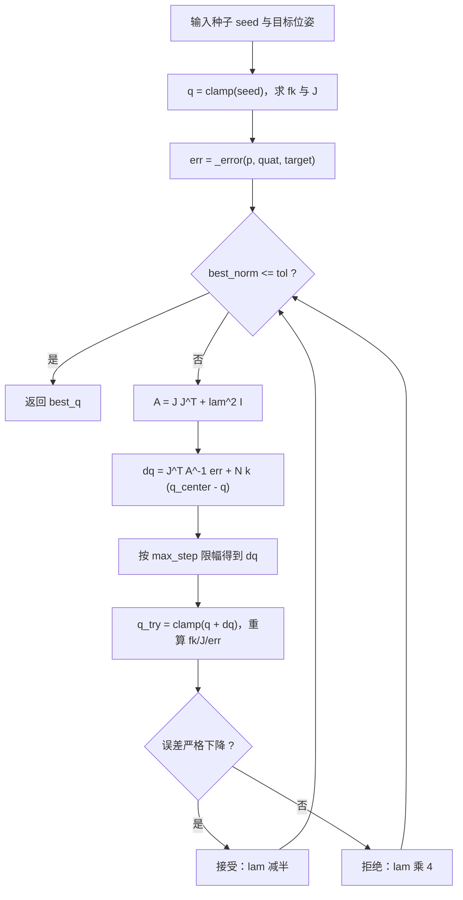
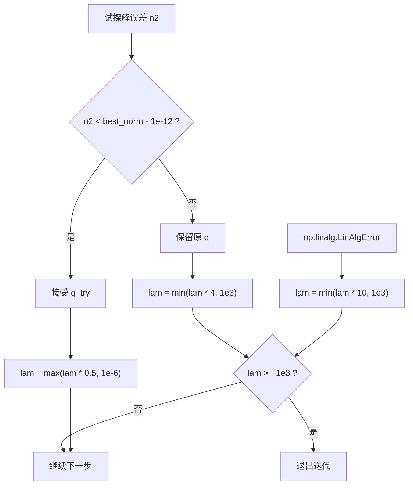

# DLS 逆解与零空间

`control/kinematics.py` 的 `Kinematics.ik()` 是控制环里调用最频繁的运动学接口。`control/motion.py` 每个仿真步都要用它把导纳修正后的笛卡尔目标换成关节角，规划器 `planning/planner.py` 还要在一组初始角上做多次预热求解。这两处的共同要求是：单次求解够快，迭代过程不发散，失败要能明确报出来。

求解策略是阻尼最小二乘（DLS）加零空间回中，外覆一层由 LM 思路来的自适应阻尼。整个过程只依赖 `fk`、`jacobian` 与关节限位，不引入二次规划或解析逆解。

## 误差向量的组装

迭代需要的是一个 6 维误差：前 3 维是目标位置减当前位置，后 3 维是姿态误差的旋转向量。`_error()` 负责这件事，位置与姿态分别处理：

```python
ep = target_pos - p
if target_quat is None:
    eo = np.zeros(3)
else:
    eo = rotvec_from_quat(quat_mul(target_quat, quat_conj(quat)))
```

`quat_mul(a, b)` 是 Hamilton 乘积，语义与矩阵乘积 $R(a)R(b)$ 一致。因此 `quat_mul(target_quat, quat_conj(quat))` 等于 $R_{target}R_{cur}^{-1}$，也就是把当前姿态转到目标姿态所需的旋转，表达在世界系下。旋转向量与雅可比的转动行在同一套坐标系里，两者可以直接相乘。

`rotvec_from_quat()` 负责最短分支。它先把 w 为负的四元数整体取反（四元数 $q$ 与 $-q$ 表示同一旋转），再取 $\theta = 2\arctan_2(|v|, w)$，得到 $|\theta| \le \pi$ 的表示。角度接近零时（$|v| < 10^{-12}$）直接返回 $2v$，避开 $v/|v|$ 的除零。

误差向量把米与弧度拼在一起，`tol` 与 `best_norm` 都直接对这个拼接向量取二范数。这等于给平动与转动相同的权重，源码里没有量纲归一化。

`target_quat=None` 时后 3 维置零，迭代只约束位置。此时 DLS 在姿态方向没有误差可以下降，解会在位置子空间里取阻尼最小的方向。规划器 `plan_pose` 依赖这一形态：只给位置时 IK 是欠约束的，`ok` 可能因为姿态误差未达标而为 False，而位置已经到达。

## 阻尼最小二乘的更新式

雅可比是 $6 \times 6$，直接求逆在奇异位形附近会爆掉。DLS 给 $J J^T$ 加一个正定项：

$$\dot q = J^T \left(J J^T + \lambda^2 I\right)^{-1} e + \left(I - J^{+} J\right) k \left(q_{center} - q\right)$$

第一项对应原式里 `A = J6 @ J6.T + (lam * lam) * I6` 之后的 `dq = J6.T @ solve(A, err)`。第二项是零空间投影，$J^{+} = J^T (J J^T + \lambda^2 I)^{-1}$ 就是代码里的 `Jpinv`。

阻尼 $\lambda$ 在 0 附近时该式退化为最小范数解的最小二乘近似；$\lambda$ 变大则关节增量整体收缩，靠近奇异位形时不会给出巨大的关节速度。代价是误差下降变慢，收敛需要的迭代步数变多。

零空间投影 $N = I - J^{+}J$ 把任意关节增量映射到不改变末端误差的方向。这一项在冗余构型上才有非零空间，对 6 自由度的 UR5e 而言，只有在雅可比退化（有效秩小于 6）时才起作用。



## 自适应阻尼系数

阻尼按每步的试探结果调整，并非固定值。初值取自构造时写死的 `lam0 = 1e-3`：

| 分支 | 条件 | 动作 | 上限 |
| --- | --- | --- | --- |
| 试探解有效 | 新误差比历史最优小超过 1e-12 | $\lambda \leftarrow \max(\lambda/2,\ 10^{-6})$ | 下限 1e-6 |
| 试探解被拒 | 误差没有下降 | $\lambda \leftarrow \min(4\lambda,\ 10^{3})$ | 到 1e3 直接退出 |
| 线性方程组奇异 | `np.linalg.LinAlgError` | $\lambda \leftarrow \min(10\lambda,\ 10^{3})$ | 到 1e3 直接退出 |

`1e3` 被当作卡死的判据：阻尼大到这个量级时，$\lambda^2 = 10^6$ 已经彻底压死关节增量，继续迭代没有意义，直接跳出返回当前最优解。此时 `best_norm` 通常远大于 `tol`，最终 `ok=False`。

接受判据用 `n2 < best_norm - 1e-12` 而不是单纯的 `n2 < best_norm`。这一条 1e-12 的余量过滤掉数值噪声导致的假下降：误差只差最后几位有效数字时继续接受，会让阻尼一路减到下限、步长抖起来，也拖长迭代。



## 单步关节增量限幅

求解出来的 `dq` 在写回之前统一限幅：

```python
n = float(np.linalg.norm(dq))
if n > self.max_step:
    dq = dq * (self.max_step / n)
q_try = self.clamp(q + dq)
```

`max_step` 是构造时设的 0.25 rad/迭代，按整段关节增量的二范数缩放，不是逐关节截断。整段缩放保持增量方向不变，避免逐关节截断改变搜索方向。限幅的直接作用是让迭代轨迹平滑：奇异位形附近 DLS 仍可能给出较大的方向分量，不限制的话单步就能跳到构型的另一端，后面的求解虽然可能收敛，但关节角在相邻控制步之间来回跳，对位置伺服不友好。

`clamp` 作用在加完增量之后，把试探解拉回 `ARM_JOINT_LIMITS`。关节角顶到限位时，`clamp` 之后的误差可能不再下降，迭代会走「试探被拒、阻尼增大」的分支，最终以 `ok=False` 结束。这是设计上认可的行为：求解器不越限，失败交给调用方判断。

## 零空间项与限位中心

零空间项的写法是 `dq = dq + N @ (self.nullspace_gain * (self.q_center - q))`，增益 `nullspace_gain` 默认 0.05。`q_center` 在构造时由上下限中点算出：

```python
self.q_min = np.array(ARM_JOINT_LIMITS[:, 0], dtype=float)
self.q_max = np.array(ARM_JOINT_LIMITS[:, 1], dtype=float)
self.q_center = 0.5 * (self.q_min + self.q_max)
```

`core/config.py` 的六组限位都关于 0 对称，所以 `q_center` 是全零向量，零空间项实际把关节往「六个角都回到 0」的位形拉。这个位形对 UR5e 而言并不在关节中位（`HOME_QPOS` 是另一组角），它只是限位区间的几何中心。作用是把冗余方向上的自由漂移压住，避免多次调用后关节角在零空间里慢慢游走。

这一项不会破坏末端误差：$N$ 的像空间与 $J$ 的行空间正交，$J N = 0$，所以零空间增量对当前误差的一阶贡献为零。它影响的是「同一个末端位姿由哪组关节角实现」。

增益取 0.05 偏小，单个迭代步的回拉量有限。这个值与 `max_step` 一起决定了迭代不会因为零空间项而震荡：零空间增量混在 `dq` 里之后同样受 0.25 rad 限幅。

## 一次迭代的完整实现

把上面几段拼起来就是 `_solve()` 的主循环。为了控制篇幅，这里保留更新与判据部分，去掉异常兜底的分支书写：

```python
q = self.clamp(seed)
p, quat, J = self._eval(q)
err = self._error(p, quat, target_pos, target_quat)
best_q, best_norm, lam = q.copy(), float(np.linalg.norm(err)), self.lam0
I6 = np.eye(6)
for _ in range(max_iters):
    if best_norm <= tol:
        break
    J6 = J[:, self.arm_dof_idx]
    A = J6 @ J6.T + (lam * lam) * I6
    dq = J6.T @ np.linalg.solve(A, err)
    Jpinv = J6.T @ np.linalg.inv(A)
    dq = dq + (I6 - Jpinv @ J6) @ (self.nullspace_gain * (self.q_center - q))
    n = float(np.linalg.norm(dq))
    if n > self.max_step:
        dq = dq * (self.max_step / n)
    q_try = self.clamp(q + dq)
    p2, quat2, J2 = self._eval(q_try)
    err2 = self._error(p2, quat2, target_pos, target_quat)
    n2 = float(np.linalg.norm(err2))
```

两点实现细节单独记下：其一，主项用 `np.linalg.solve` 解方程组，只有零空间需要显式逆矩阵，这样主路径少一次矩阵求逆；其二，接受试探解时 `q / J / err` 三个变量一起更新，下一轮直接用新雅可比，不用重算。

每轮迭代的前向开销是两次 `_eval`（当前解与试探解），这也是 `_sync()` 不跑 `mj_forward` 的原因。`max_iters` 默认 300，控制环里由 `control/motion.py` 压到 120，`tol` 也从 1e-3 收到 5e-4。

## 易错点与调试

| 现象 | 原因 | 处理 |
| --- | --- | --- |
| 迭代原地不动、误差恒定 | 阻尼已经顶到 1e3，增量被压死 | 看 `best_norm`，判为卡死换种子 |
| 关节角在控制步之间跳 | 增量限幅被改动或 `max_step` 放大 | 保持整段范数限幅 |
| 姿态误差长期在 ±π 附近 | 用了绝对旋转向量而非最短分支 | 保留 `rotvec_from_quat` 的翻分支逻辑 |
| 解出负的零空间效果 | 把 `q_center` 当成 HOME | `q_center` 是限位中点，本机为全零 |
| `LinAlgError` 直接抛出 | 少了异常分支 | 捕获后升阻尼继续 |
| 位置到了但 `ok=False` | 误差范数同时含姿态 | 只约束位置时传 `target_quat=None` |

调试时优先打印两个量：`best_norm` 与 `lam` 的末值。`best_norm` 停在 1e-2 量级通常意味着限位或奇异位形，`lam` 顶到 1e3 意味着搜索方向已经被完全压死。两者组合能区分「够不着」与「算不动」。

## 权衡与参数表

| 参数 | 值 | 作用 |
| --- | --- | --- |
| `lam0` | 1e-3 | 初始阻尼 |
| 阻尼减半 | 误差下降时 | 靠近解时放开步长 |
| 阻尼乘 4 | 误差未下降时 | 收缩搜索 |
| 阻尼上限 | 1e3 | 卡死判据 |
| `max_step` | 0.25 rad | 单步关节增量范数上限 |
| `nullspace_gain` | 0.05 | 零空间回中速率 |
| `max_iters` | 300 | 单种子迭代上限 |
| `tol` | 1e-3 | 位置与姿态的联合收敛阈值 |

| 权衡点 | 选择 | 收益与代价 |
| --- | --- | --- |
| 求解方法 | DLS 而非解析逆解 | 奇异位形附近稳定；代价是误差下降慢、需要自适应阻尼 |
| 阻尼策略 | LM 式乘除而非固定值 | 靠近解时步长大；代价是每步多一次试探前向 |
| 误差权重 | 平动与转动同权 | 实现简单；代价是量纲不统一，阈值需要按场景调 |
| 零空间 | 回限位中心 | 关节角不漂；代价是回拉方向与任务无关 |

### 附：本页引用的路径

| 路径 | 用途 |
| --- | --- |
| `control/kinematics.py` | `_error` 与 `_solve` 的完整实现 |
| `control/trajectory.py` | `quat_mul / quat_conj / rotvec_from_quat` |
| `control/motion.py` | 调用 `ik` 时的 `max_iters / tol` |
| `core/config.py` | `ARM_JOINT_LIMITS`（限位与中点来源） |
| `core/types.py` | `ARM_NDOF` |
| `INTERFACES.md` | §2.2 `Kinematics` 签名 |

上游仓库：https://github.com/TC635807/vlm-admittance
