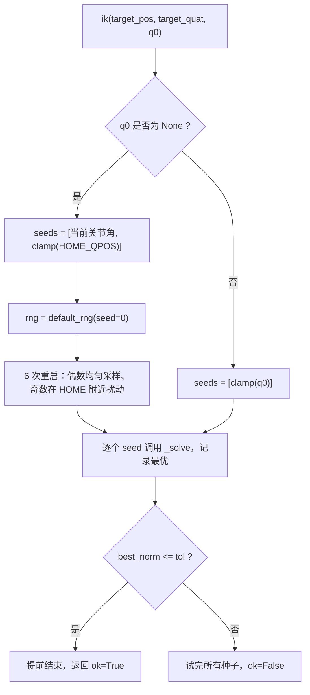
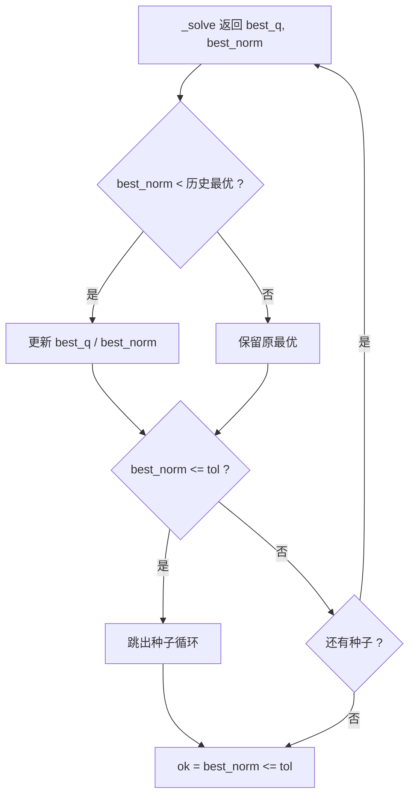
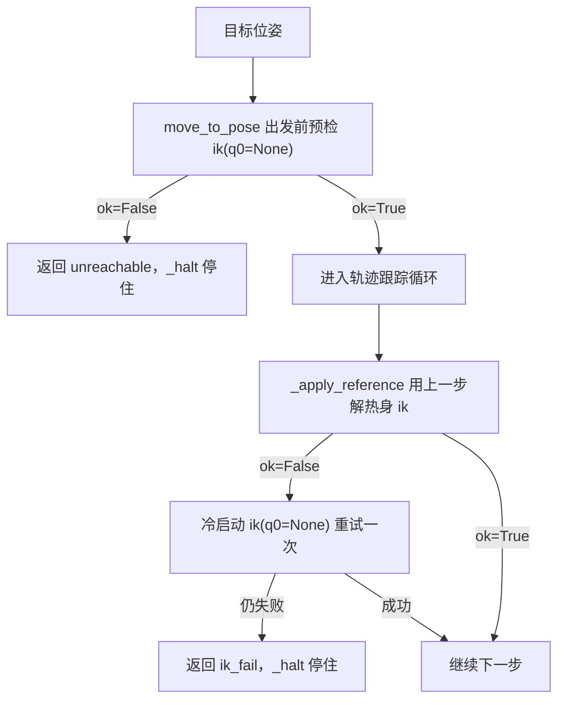

# 多重启、限位与收敛判据

`Kinematics.ik()` 的签名里，`q0` 决定走哪条求解路径，`tol` 决定什么时候算收敛，返回值里的 `ok` 决定上层继续走还是改判失败。这三个点连起来构成逆解的对外行为，比 `_solve()` 内部的迭代细节更影响系统表现。

## 两种调用形态

`ik()` 的入口有两种形态，差别只在 `q0` 是否为 None：

```python
if q0 is not None:
    seeds = [self.clamp(np.asarray(q0, dtype=float).reshape(ARM_NDOF))]
else:
    seeds = [self.arm_qpos(), self.clamp(HOME_QPOS)]
    rng = np.random.default_rng(self.rng_seed)
    for k in range(self.n_restarts):
        if k % 2 == 0:
            seeds.append(self.clamp(rng.uniform(self.q_min, self.q_max)))
        else:
            seeds.append(self.clamp(HOME_QPOS + rng.uniform(-0.8, 0.8, ARM_NDOF)))
```

给出 `q0` 时只构造一个种子，`_solve()` 只跑一遍。控制环需要的是这种形态：`control/motion.py` 的 `_apply_reference()` 把上一步的 IK 解作为 `q_seed` 传进来，利用关节角的连续性减少迭代步数。多一次随机重启意味着多 6 次完整求解，500 Hz 的控制环承受不了。

缺省时不传 `q0`，走多重启：先试当前关节角与 `HOME_QPOS` 两个确定性种子，再补 6 个随机种子。规划器的 `plan_pose` 走的是这条路径，它先做一次 `q0=None` 的多重启求解，再按 `[当前位形] + 19 个随机角` 逐个热身求解；`n_seeds` 默认 20。



## 八个种子的构造规则

`q0=None` 时共 8 个种子，顺序固定：

| 序号 | 来源 | 覆盖的意图 |
| --- | --- | --- |
| 1 | `arm_qpos()` 当前关节角 | 就近求解，连续运动的首选 |
| 2 | `clamp(HOME_QPOS)` | 复位位形，日常任务命中率高 |
| 3、5、7 | 限位盒内均匀采样 | 覆盖不同的解分支 |
| 4、6、8 | `HOME_QPOS` 加 ±0.8 内均匀扰动 | 在已知好位形附近细查 |

两类随机种子交替出现，顺序由 `k % 2` 决定。均匀采样覆盖整个关节限位盒，代价是绝大多数随机点离目标很远；`HOME` 附近的扰动点则更可能落在可解区域内。交替排列让迭代在前几次尝试里就能碰到一个可用解，不必等均匀采样的点全部试完。

`HOME_QPOS` 取自 `core/config.py`，值是 `[-1.5708, -1.5708, 1.5708, -1.5708, -1.5708, 0.0]`。扰动幅度 0.8 rad 是硬编码值，没有暴露成可调属性；可调的只有 `n_restarts`（默认 6）。

重启循环的写法是「逐个求解、随时更新最优、达到阈值就提前跳出」。这意味着顺序有意义：命中率高的种子排在前面，平均迭代步数更少。把随机种子放在前面也能得到同样的解，只是更慢。

## 固定随机种子带来的可复现性

构造函数里写了 `self.rng_seed = 0`，`ik()` 每次调用都用它新建一个生成器：

```python
rng = np.random.default_rng(self.rng_seed)
```

注意这行在 `ik()` 内部而不是构造时执行一次。每次调用都重新播种，因此「同一个目标位姿、同一个当前关节角」的两次 `ik()` 调用产生完全相同的 8 个种子序列，求解结果逐位一致。测试与回归依赖这一点：`control/smoke.py` 的 `TestKinematics.test_ik_roundtrip` 用固定的一组目标位姿断言收敛，不需要为随机性留容差。

如果把生成器改成实例属性、只在构造时播种一次，行为会变成「同一进程里多次求解依次消耗随机流」，结果随调用次数漂移，回归测试会时好时坏。这是重启机制里最容易被误改的一处。

## 收敛判据：位置与姿态同时达标

`_error()` 把位置误差与姿态误差拼成一个 6 维向量，收敛判据只对这个拼接向量的二范数取阈值：

$$\|\,[e_p\,;\,e_o]\,\| \le \text{tol}$$

`tol` 默认 1e-3。二范数不超过 1e-3 意味着每一个分量都不超过 1e-3，因此这条判据同时保证位置误差不超过 1 mm、姿态误差不超过 1e-3 rad（约 0.057 度）。反过来说，位置达标而姿态差一点，整个判据仍然为假，这是设计上要求的行为：末端夹爪的朝向决定抓取方向，姿态不到位会直接影响抓取。

`target_quat=None` 时姿态部分置零，判据退化成纯位置条件，此时任何姿态都算合格。

提前退出的位置在 `ik()` 的种子循环里：某个种子求解后 `best_norm <= tol` 就 `break`，不再尝试后面的种子。`_solve()` 内部也有一处同样的判断，位于每轮迭代开头，作用是在已经收敛时不再多做一次前向与试探。



## 限位在求解中的位置

关节限位来自构造时读入的 `ARM_JOINT_LIMITS`。它出现在三个地方：

| 位置 | 用法 | 影响 |
| --- | --- | --- |
| `clamp()` | 把任意关节角拉回区间 | 种子与试探解都受限 | 
| 随机种子采样 | `rng.uniform(q_min, q_max)` | 重启点落在可行域内 |
| `q_center` | 上下限中点 | 零空间回拉的目标位形 |

限位本身只按关节角比较，不涉及速度或力矩限制。`clamp()` 也用在别的模块上：`MotionRunner.follow_joint_path()` 对规划器给出的路点逐个 `clamp`，速度前馈叠加之后再 `clamp` 一次，保证前馈偏移不把命令推出限位。

限位区间对 UR5e 而言并不都对称：只有 `elbow_joint` 是 ±3.1415，其余五个是 ±6.28319。这是 Menagerie 的 `ur5e.xml` 给出的值，直接抄进 `core/config.py`。求解器把限位当作硬边界，顶到边界仍不收敛就报失败。

## 失败的两种出口

`ik()` 返回 `(best_q, ok)`，`ok=False` 时 `best_q` 仍是迭代过程中误差最小的那组关节角，不是种子本身。上层拿到这个解要看是否可用，不能假设它是有效解。

两条失败路径对应不同的错误码：



`control/motion.py` 的控制步内调用带更严的参数：`max_iters=120`、`tol=5e-4`。前者把单步耗时压住，后者比 IK 默认值更紧，原因是控制环每一步都会重新求解，单步精度稍差可以由后续步补上，而迭代次数直接决定 500 Hz 能否维持。热身失败后代码会退回一次完整的 `ik()`（`q0=None`，默认 `max_iters=300`、`tol=1e-3`），这次允许用随机重启换一个解分支。

`move_to_pose()` 在构造轨迹之前先做一次预检，用的是 `q0=None` 的完整求解。预检失败直接返回 `unreachable`，一步都不走。这条预检的存在让「目标在可达空间之外」与「执行途中 IK 失败」分成了两个错误码，上层重试策略可以据此区分。

规划器对 `ok` 的态度更谨慎：`plan_pose` 不直接信任 IK 的 `ok`，而是用 `fk()` 复核位置误差是否小于 `pos_tol = 5 mm`，显式给了 `quat` 时才额外检查姿态误差小于 `rot_tol = 0.05 rad`。原因是 `target_quat=None` 时 IK 欠约束，`ok` 可能因姿态项置 False，而位置已经到达。

## 易错点与调试

| 现象 | 原因 | 处理 |
| --- | --- | --- |
| 控制环单步耗时忽高忽低 | 给 `q0` 的位置传了 None，每步都在多重启 | 控制环内始终传上一步解 |
| 同一目标两次求解结果不同 | 把 `default_rng` 提到了构造期 | 保持每次 `ik()` 内重新播种 |
| `ok=True` 但位置有偏差 | 只看 `ok`，没看误差量级 | `ok` 只保证联合范数达标，精确值要看复核 |
| 规划器认为可达、执行报 `ik_fail` | 规划只查位置 5 mm、执行要求 5e-4 | 两处判据不同，属预期 |
| 解出的关节角贴限位 | 目标靠近工作空间边界 | 检查 `clamp` 后误差是否真的下降 |
| 重启次数改大后变慢 | 8 个种子每次都跑满 | 收敛时循环会提前跳出，只有难解目标才跑满 |

排查时先看 `best_norm` 而不是 `ok`。`best_norm` 在 1e-2 量级说明迭代被限位或奇异位形挡住，在 1e-3 附近说明只差一点精度。前者换种子或改目标，后者收紧 `tol` 或增加迭代次数。

## 参数表与权衡

| 参数 | 默认 | 可调 | 说明 |
| --- | --- | --- | --- |
| `n_restarts` | 6 | 是 | 随机重启次数，总种子数为 8 |
| `rng_seed` | 0 | 是 | 生成器种子，每次 `ik()` 重新播种 |
| `max_iters` | 300 | 调用时传入 | 单个种子的迭代上限 |
| `tol` | 1e-3 | 调用时传入 | 位置与姿态的联合阈值 |
| `max_step` | 0.25 rad | 是 | 单步增量范数上限 |

| 权衡点 | 选择 | 收益与代价 |
| --- | --- | --- |
| 种子形态 | `q0` 给出即单次求解 | 控制环可维持 500 Hz；代价是丢掉换分支的机会 |
| 重启分布 | 均匀采样与 HOME 扰动交替 | 兼顾全局覆盖与近解细查；代价是两种都不是最优采样 |
| 收敛判据 | 位置与姿态联合范数 | 两个量一次判断；代价是无法单独放松其中一个 |
| 失败语义 | 返回 `ok=False` 而不抛异常 | 调用方可按错误码分流；代价是失败解仍需被调用方检查 |

### 附：本页引用的路径

| 路径 | 用途 |
| --- | --- |
| `control/kinematics.py` | `ik()` 种子构造与收敛判断 |
| `control/motion.py` | 预检、控制步内调用与两个错误码 |
| `planning/planner.py` | `plan_pose` 的种子展开与 `fk` 复核 |
| `core/config.py` | `HOME_QPOS / ARM_JOINT_LIMITS` |
| `control/smoke.py` | IK 往返用例与阈值 |

上游仓库：https://github.com/TC635807/vlm-admittance
