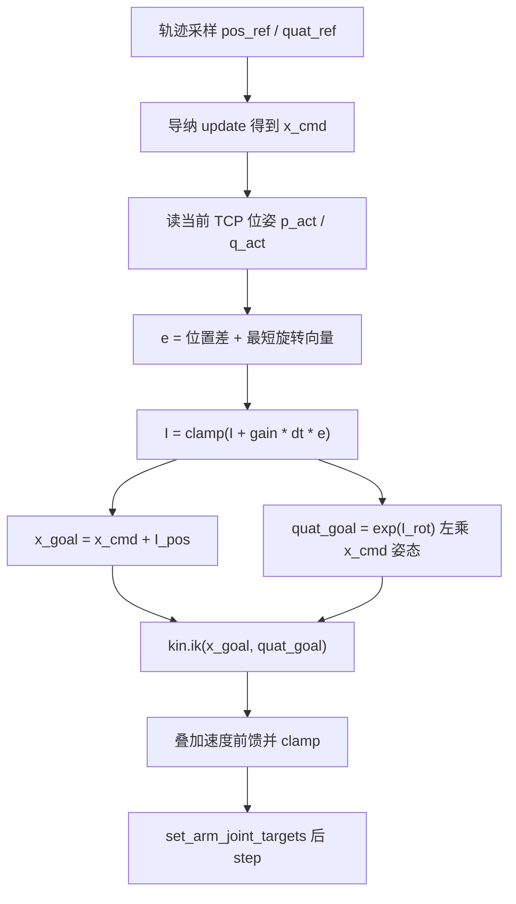
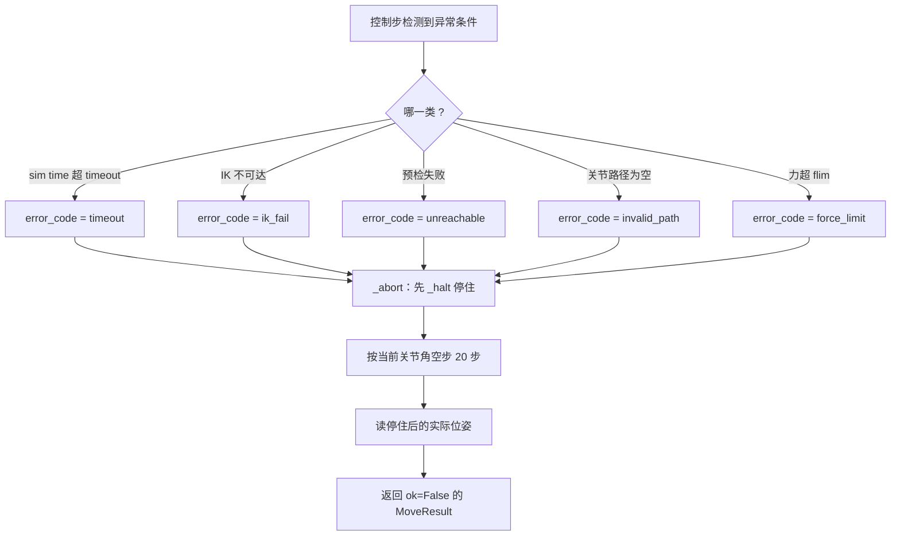

# 位置伺服与任务空间积分外环

`control/motion.py` 的 `MotionRunner` 把三种东西串成一条控制链：轨迹采样给出的参考位姿、导纳控制器给出的让位量、以及本文要讲的任务空间积分补偿。三者叠加之后才送去 `kin.ik()` 解关节角。验收要求末端误差小于 5 mm，而位置执行器自身的静差在自由空间里就有 1 cm 量级，不补这一层达不到指标。

## 位置执行器的静差

Menagerie 的 UR5e 用位置执行器驱动。这类执行器的力矩形式是 $\tau = k_p(\text{ctrl} - q) - k_v\dot q$，只有比例与微分两项，没有重力前馈。本机读模型实测的增益：

| 执行器 | `gainprm[0]` 即 $k_p$ | `biasprm[2]` 即 $-k_v$ | $k_v/k_p$ |
| --- | --- | --- | --- |
| shoulder_pan / shoulder_lift / elbow | 2000 | -400 | 0.2 s |
| wrist_1 / wrist_2 / wrist_3 | 500 | -100 | 0.2 s |

腕部三个执行器的增益比前三个小四倍，但 $k_v/k_p$ 六个通道统一是 0.2 s。这个比值在后面算速度前馈系数时被直接使用。

没有重力补偿的直接后果是稳态静差。`control/motion.py` 的模块注释记录了两组本机实测：把 `ctrl` 固定在 `HOME_QPOS` 时 TCP 静止下沉约 11 mm；命令另一组关节角时稳态静差约 14 mm。两者都不是小量，单靠「IK 解出目标关节角、写进 ctrl、步进」这套朴素的链路，末端永远停在目标下方一厘米附近。

静差的位置依赖在别的单元也出现过：`README.md` 记录 `can_yellow` 抓取不稳时提到「位置伺服无重力补偿，随位形漂约 1 cm」，与这里的量级一致。

## 慢速任务空间积分外环

补偿做法是在笛卡尔空间加一个慢速积分项，把「命令点与真实末端点之间的偏差」累加起来，叠加到下发给 IK 的目标上：

$$e = \left[\,p_{cmd} - p_{act}\;;\; \mathrm{rotvec}\left(q_{cmd} \otimes q_{act}^{*}\right)\,\right]$$

$$I \leftarrow \mathrm{clamp}\left(I + g\,\Delta t\, e\right)$$

$$x_{goal} = x_{cmd} + I_{pos},\qquad q_{goal} = \exp\left(I_{rot}\right) \otimes q_{cmd}$$

代码在 `_integral_step()` 里，参数是 `integral_gain = 5.0`（单位 1/s）与 `integral_limit = [0.06, 0.06, 0.06, 0.20, 0.20, 0.20]`：

```python
p_act, q_act = self._pose()
e_pos = x_cmd[:3] - p_act
e_rot = rotvec_from_quat(quat_mul(quat_cmd, quat_conj(q_act)))
self._cart_int = self._cart_int + (self.integral_gain * self.dt) * np.concatenate([e_pos, e_rot])
for g0 in (0, 3):
    g = np.arange(g0, g0 + 3)
    n = float(np.linalg.norm(self._cart_int[g]))
    lim = float(self.integral_limit[g0])
    if n > lim:
        self._cart_int[g] *= lim / n
x_goal = np.concatenate([x_cmd[:3] + self._cart_int[:3], x_cmd[3:6]])
```

积分限幅按平动组与转动组分别取模长，超过上限时按比例缩放整组，与 IK 的单步限幅同一个思路。上限本身是经验值：0.06 m 比实测静差（0.011 到 0.014 m）大一个量级，留出应对负载变化的余量，同时不至于让目标点偏出工作空间。

积分在每次笛卡尔运动开始时清零，`_reset_integral()` 把 `_cart_int` 置零。这一条防的是跨动作的 windup：抓取下降时累积的补偿量如果带到下一次抬升，起点目标会带着上一次的偏差。



## 姿态修正的左乘与右乘

姿态部分的修正写成了左乘：

```python
quat_goal = quat_mul(quat_from_rotvec(self._cart_int[3:6]), quat_cmd)
```

写成左乘是必须的，因为误差的取法决定的坐标系是世界系。$e_{rot} = q_{cmd} \otimes q_{act}^{*}$ 相当于 $R_{cmd}R_{act}^{-1}$，它是世界系下的一个旋转，把它转成旋转向量后也在世界系表达。修正量要作用在同一边：$\exp(I_{rot}) \otimes q_{cmd}$ 对应 $R(I_{rot})R_{cmd}$，两个旋转都在世界系里复合。

改成右乘 `quat_mul(quat_cmd, quat_from_rotvec(...))` 会变成体坐标系修正，与误差的坐标系不匹配。源码注释记录了后果：参考姿态转动较大时会收敛到错误的固定点，实测姿态残留 0.217 rad。这个量级在抓取上足以让夹爪朝向偏掉十几度，指垫对不准物体。

平动部分不存在这个问题，位置本身就是世界系绝对量，直接相加即可。整套积分外环的转动通道都建立在「误差世界系、修正左乘」这一对配套关系上。

## 速度前馈：消掉斜坡滞后

积分补的是稳态静差，跟踪移动目标时还有一项由速度引起的滞后。对 $\tau = k_p(\text{ctrl} - q) - k_v\dot q$ 做稳态分析，跟踪斜坡的静差约为 $(k_v/k_p)\dot q$。模型里 $k_v/k_p = 0.2$ s，参考速度取 0.15 m/s 量级时，单通道滞后就有 30 mm 量级。

前馈系数直接从模型读，不写死：

```python
kp = float(model.actuator_gainprm[aid][0])
kv = -float(model.actuator_biasprm[aid][2])
if kp > 0.0 and kv > 0.0:
    lead[i] = kv / kp
```

`biasprm[2]` 存的是 $-k_v$，所以取负号还原成正值。判据 `kp > 0 and kv > 0` 同时兜住非位置执行器（此时 `biasprm[2]` 为 0）与模型异常：两种情况下前馈系数保持 0，行为自动退化为无前馈。

参考关节速度由 `_joint_vel_ref()` 算：对轨迹做 $\pm 0.5\Delta t$ 的中心差分得到笛卡尔 twist，再用雅可比伪逆映射到关节空间：

$$\dot q_{ref} = J^{T}\left(JJ^{T} + 10^{-4} I\right)^{-1}\left[v_{ref}\,;\,\omega_{ref}\right]$$

阻尼固定取 $10^{-4}$，不参与自适应，这里的目的是避免奇异位形导致前馈项爆掉。最后一步是 `q_cmd = q_ik + self.vel_lead * qd_ref`，叠加之后再 `clamp` 一次，避免前馈把命令推出关节限位。

前馈用的是上一轮 IK 解作为种子，而返回给下一轮的热身种子是 `q_ik` 本身，不含前馈偏移。这样做保持姿态连续：种子始终来自纯 IK 解，不会被前馈项带偏累积。

### 前馈的实测收益

`control/smoke.py` 的三次 `move_to_pose` 用例在本机的输出：

| 位移方向 | 终态误差 | 轨迹段最大跟踪误差 | 步数 |
| --- | --- | --- | --- |
| `[0.0, -0.12, 0.05]` | 0.94 mm | 12.03 mm | 543 |
| `[0.1, 0.06, 0.0]` | 0.75 mm | 6.13 mm | 500 |
| `[-0.06, 0.02, 0.1]` | 0.98 mm | 27.65 mm | 886 |

模块注释给出的对比是「轨迹中段最大误差 28 mm 降到 12 mm，收尾后小于 1 mm」，与上表的量级一致：轨迹段的最大跟踪误差仍在毫米到厘米之间，靠收尾伺服把终态压到 1 mm 以内。`track_max` 是整段轨迹的峰值，出现在加速或减速相位，不是稳态指标。

## 收尾伺服与仿真时间超时

轨迹跑完之后还有一段收尾，用来把末端从「伺服滞后处」挪到目标点。循环条件是平动误差不超过 `settle_tol = 1e-3` m 且姿态误差不超过 `settle_rot_tol = 0.01` rad，上限是 `settle_time = 1.5` s：

```python
for _ in range(max(1, int(round(self.settle_time / self.dt)))):
    pos_act, quat_act = self._pose()
    e_pos = float(np.linalg.norm(pos_act - np.asarray(pos_end)))
    e_rot = float(np.linalg.norm(rotvec_from_quat(
        quat_mul(np.asarray(quat_end), quat_conj(quat_act)))))
    if e_pos <= self.settle_tol and e_rot <= self.settle_rot_tol:
        break
    q_seed, fmax, fail = self._apply_reference(pos_end, quat_end, flim, q_seed, steps, None)
```

收尾段继续按最终参考跑导纳与积分，但不再有轨迹推进，`qd_ref` 传 None，速度前馈关闭。收尾与轨迹段共用同一个 timeout 预算，超出同样中止。

所有超时都用仿真时间判断，即 `steps * self.dt`，不是墙钟。仿真时间只由步数决定，物理步进确定可复现，同一段轨迹在不同负载的机器上给出的 timeout 判定一致。`MoveResult.duration` 字段填的也是这个量。

`move_to_pose()` 在 `duration=None` 时按直线距离估算轨迹时长：`clip(max(0.6, dist / 0.15), 0.6, 6.0)`。分母 0.15 是参考速度量级，下限 0.6 s 保证短距离移动也有完整的 min-jerk 加减速，上限 6 s 防止远距离运动把 timeout 撑爆。

## 错误码与中止即停住

`MotionRunner` 对外只有一套错误码：`timeout | force_limit | ik_fail | unreachable | invalid_path`。任何一个非成功返回都会先经过 `_abort()`，它做了两件事：先 `_halt()` 停住，再用停住后的实际位姿构造 `MoveResult`。

```python
def _halt(self) -> None:
    q_hold = np.asarray(self._arm_q(), dtype=float).reshape(ARM_NDOF)
    for _ in range(max(1, int(self.halt_steps))):
        self.env.set_arm_joint_targets(q_hold)
        self.env.step()
```

停住的动作由两部分组成。目标设为当前关节角，位置伺服不再继续往接触方向压，残留的压入指令被撤销；同时照常 `step`，让新命令实际作用到物理上。模块注释写明只用前者不够：接触仍按旧穿透演化，实测不这么做时，一次失败的预检返回会让上一帧的压入指令继续生效，0.2 s 内末端力冲到 7471 N。

`halt_steps` 默认 20 步，即 40 ms 仿真时间。这段步数不计入 `MoveResult.steps` 与 `duration`，安全动作不额外占用上层的步数预算。`_halt()` 内部的所有异常都被吞掉，中止路径必须能返回结果，不能因为清场动作再抛异常。



力的上限有两层。第一层是柔顺参数自带的 `force_limit`（`z_only` 默认 8 N，抓取档 15 N，放置档 20 N）；第二层是 `force_limit_cap`，默认 200 N，只作用于调用方显式传入的 `force_limit`。显式值超过上限时被钳制并 `warnings.warn`，不依赖调用方自律。两个保留的口子：`force_limit=None` 用柔顺参数自带值、不受 cap 约束；`force_limit_cap=float("inf")` 显式关闭这层保护。

力读数的符号取自 `adm_force_sign = -1.0`。`env.contact_force_on_ee()` 返回的是作用在末端上的力，而导纳方程右边是 $-f_{ext}$，直接喂原值会让参考点继续压向接触面。取负之后末端沿力的方向让位，接触力保持有界。自由空间力读数为 0，这个符号对无接触运动没有影响。

## 易错点与调试

| 现象 | 原因 | 处理 |
| --- | --- | --- |
| 末端稳定停在目标下方约 1 cm | 位置伺服无重力补偿，积分外环没生效 | 检查 `_reset_integral` 是否被误用、`integral_gain` 是否为 0 |
| 姿态收敛到错误朝向 | 姿态修正改成了右乘 | 保持 `quat_mul(exp(I_rot), quat_cmd)` 的左乘形式 |
| 终点误差忽大忽小 | 收尾被跳过或 `settle_tol` 被放大 | 保持 1 mm 平动、0.01 rad 转动的收尾阈值 |
| 超时判定随机器负载变化 | 用了墙钟时间 | 用 `steps * self.dt` 判断 |
| 中止后力继续上涨 | 只改了 ctrl 没有 step | `_halt` 必须包含空步循环 |
| 传入 `force_limit=1e9` 仍然被中止 | cap 生效并钳到 200 N | 要放开需显式设 `force_limit_cap=inf` |
| 轨迹段误差达标但终态不达标 | 只看 `track_max`，没看 `final_pos` | `move_to_pose` 返回后对比 `final_pos` 与目标 |

调试顺序建议从静差开始：先跑一次纯位置伺服（`hold`），打印 TCP 位姿随时间的变化，确认下沉量级在 1 cm 附近；再打开积分外环看稳态是否收敛到命令点。这样能把执行器问题与运动学问题分开。

`target_state()` 提供了同一时刻的三个位置：`ref_pos` 是轨迹参考、`adm_pos` 是纯导纳输出、`cmd_pos` 是实际下发给 IK 的点。三者之差可直接读出导纳让位量与积分补偿量。判断有没有外力要用 `force_norm`，自由空间里 `|adm_pos - ref_pos|` 也有毫弧级别的导纳稳态滞后，不能当柔顺让位的判据。

## 权衡

| 权衡点 | 选择 | 收益与代价 |
| --- | --- | --- |
| 静差补偿 | 笛卡尔积分外环 | 与导纳共用同一套目标接口；代价是引入积分限幅与跨动作清零的额外状态 |
| 前馈系数 | 从模型 `gainprm / biasprm` 读 | 换执行器不用改代码；代价是依赖模型字段语义，读错就静默退化 |
| 超时口径 | 仿真时间 | 判定可复现；代价是墙钟耗时不可控，实时性要靠步数估算 |
| 中止策略 | 先停住再返回 | 不留下压入指令；代价是每次失败多 20 步仿真开销 |
| 力上限 | 柔顺值与独立 cap 双层 | 调用方失误也不会压到危险量级；代价是显式大值会被静默钳制 |

### 附：本页引用的路径

| 路径 | 用途 |
| --- | --- |
| `control/motion.py` | 积分外环、前馈、收尾、`_halt` 与错误码 |
| `control/trajectory.py` | `quat_mul / quat_conj / quat_from_rotvec / rotvec_from_quat` |
| `control/kinematics.py` | `ik()` 与前馈用的 `jacobian` |
| `control/admittance.py` | 导纳输出 `x_cmd` 的来源 |
| `core/types.py` | `MoveResult` 与错误码承载字段 |
| `core/config.py` | `SIM_DT / DEFAULT_COMPLIANCE / HOME_QPOS` |
| `sim/env.py` | `set_arm_joint_targets / contact_force_on_ee / site_pose` |
| `control/smoke.py` | 静差、终态误差与中止行为用例 |

上游仓库：https://github.com/TC635807/vlm-admittance
