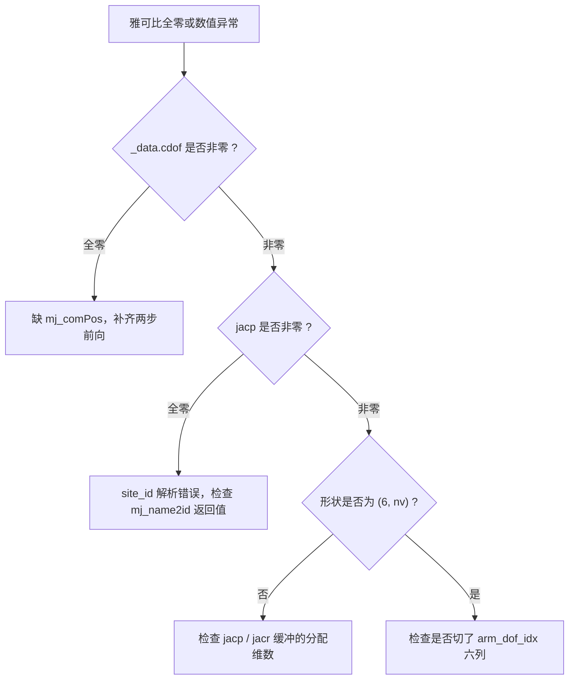
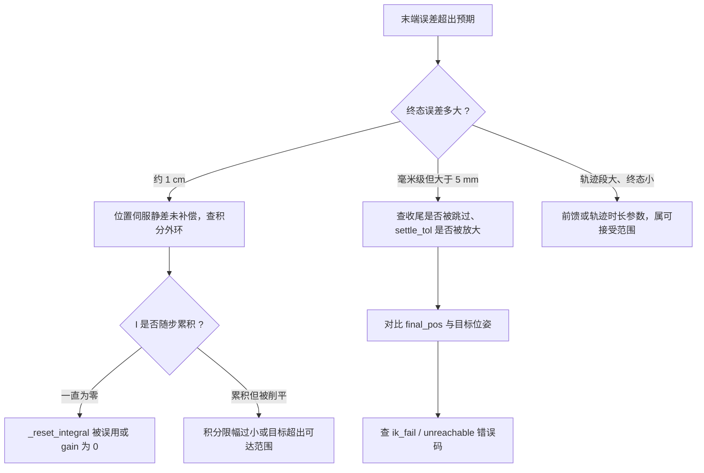
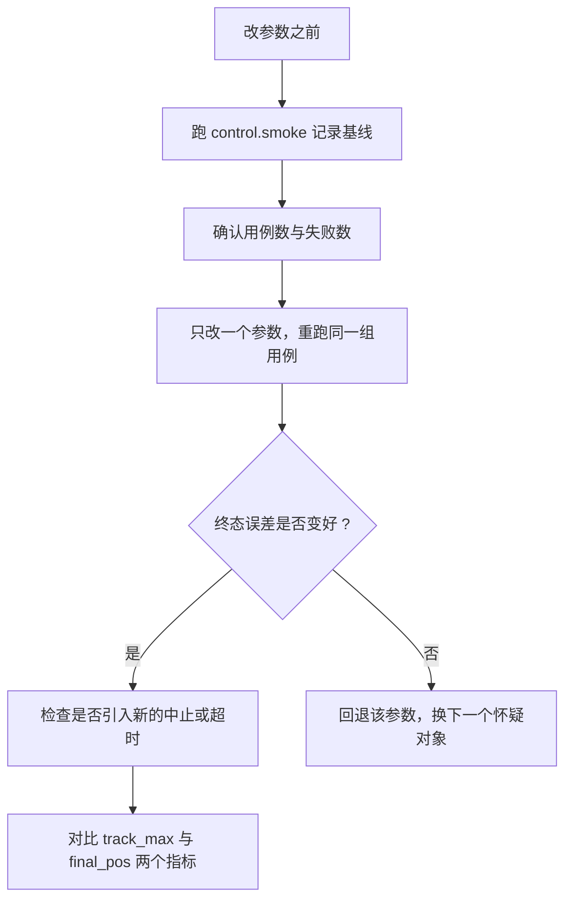

# 易错点与调试

本单元的四篇文档分别讲了正解与雅可比、DLS 迭代、多重启与收敛判据、位置伺服与积分外环。这一篇把散落在各处的误用集中起来，按「现象、原因、定位手段」组织，并给出可复现的检查命令与基线数字。所有条目都能在 `control/kinematics.py`、`control/motion.py`、`control/trajectory.py` 与 `control/smoke.py` 里找到对应实现或断言。

## 私有数据与场景同步

`Kinematics` 的私有 MjData 是整条链上最容易被破坏的不变量。它的契约是：`env.data` 只读，所有前向计算在 `self._data` 上完成。破坏方式多是调试时的顺手改动：把 `self._data = self.env.data` 写成一行捷径，或在外面直接改 `env.data.qpos` 之后忘了重新 `mj_forward`。

| 现象 | 原因 | 定位手段 |
| --- | --- | --- |
| 调用运动学后场景状态变了 | 私有 MjData 被替换成 `env.data` | 跑 `TestKinematics.test_env_data_not_polluted` |
| `fk` 结果与 `env.site_pose` 不一致 | 私有数据没同步场景（物体或夹爪状态不同） | 对同一组关节角同时打印两条实现的结果 |
| 前向算出来全是 0 | `_sync` 里漏了 `mj_comPos` | 打印 `_data.cdof` 是否非零 |
| 物体位置变了导致 IK 结果变 | 私有数据复制的是复制时刻的场景，属预期 | 对比两次调用之间场景是否被 step |

`_sync()` 复制整份 `env.data.qpos`，所以私有数据看到的是「调用瞬间」的场景。这在正常控制流里没问题：每个控制步先 step 再求解，复制到的就是当前状态。异步调用（例如 viewer 线程直接调 `fk`）会读到上一次 step 的状态，需要把调用与主循环放在同一把锁下。交互式查看器那一路并发读 `data` 曾实测触发 SIGABRT，处理方式记录在 `sim/render.py` 的同步说明里。

## 前向链条的完整性

`_sync()` 只跑两级前向接口，顺序固定：`mj_kinematics` 再 `mj_comPos`。第二步的产物 `cdof` 是 `mj_jacSite` 的输入。这一步在 MuJoCo 3.12 上本机实测过：只跑 `mj_kinematics` 时 `cdof` 全零、`jacp` 也全零；补上 `mj_comPos` 后第 0 列平动分量变成 `[-0.492, -0.134, 0.0]`。



`site_id` 在构造时解析一次，找不到 `g_pinch` 直接抛 `ValueError`。所以运行到取雅可比时 `site_id` 一般是对的；链条里容易断的是 `cdof` 与列切片。

## 四元数约定与误差坐标系

全库统一 wxyz，与 MuJoCo 的 `qpos` 约定一致。外部库习惯 xyzw，两边混用是这一块最常见的错误：读入的姿态顺序错了，`rotvec_from_quat` 会给出一个看起来合理但方向错误的旋转向量，迭代能收敛到某个位姿，只是朝向不对。

| 现象 | 原因 | 定位手段 |
| --- | --- | --- |
| 姿态误差符号相反 | 把 wxyz 当成 xyzw | 用单位四元数与 90 度旋转对照 `fk` 输出 |
| 姿态长期停在 ±π 附近 | 用了绝对旋转向量而非最短分支 | 检查是否绕过 `rotvec_from_quat` 直接算绝对角 |
| 积分补偿后姿态偏向一侧 | 姿态修正写成右乘 | 对比 `quat_mul(exp(I_rot), q_cmd)` 与右乘的残留角 |
| `mju_mat2Quat` 报字段不存在 | 访问 `site_xquat` | MuJoCo 3.12 无该字段，改从 `site_xmat` 转换 |

关于误差坐标系，一条可操作的判据是：误差由 `quat_mul(target, quat_conj(cur))` 给出时，修正必须左乘；由 `quat_mul(quat_conj(cur), target)` 给出时，修正才右乘。两者只能配一对。源码注释记录了右乘的不匹配后果：参考姿态转动较大时收敛到错误固定点，实测残留 0.217 rad。

## 限位、种子与迭代参数

限位是硬边界，`clamp` 出现在种子构造、试探解回写与前馈偏移三处。种子的构造顺序影响平均耗时：`q0` 给出时只有一个种子，缺省时是 8 个，两类随机种子交替排列。

| 现象 | 原因 | 定位手段 |
| --- | --- | --- |
| 控制环单步耗时波动大 | 控制步内传了 `q0=None` | 打印每步 `_solve` 实际迭代次数 |
| 同一目标两次求解不同 | `default_rng` 移到了构造期 | 确认播种在 `ik()` 每次调用内 |
| 迭代卡住不动 | 阻尼顶到 1e3 的上限 | 打印 `lam` 末值，判为卡死换种子 |
| 关节角在控制步之间跳 | 单步限幅被改成逐关节截断 | 保持整段范数限幅 `max_step=0.25` |
| `ok=True` 但位置有偏差 | 判据是位置与姿态的联合范数 | 单独打印位置误差与姿态误差 |
| 规划通过、执行报 `ik_fail` | 规划复核位置 5 mm、执行要求 5e-4 | 两处阈值不同，属预期行为 |

把 `ok` 当作唯一判据是这一块最容易踩的一步。`ok` 只说明联合误差范数达标；要判断精度，得看 `best_q` 对应的位置误差与姿态误差。`plan_pose` 正是因此不信任 `ok`，改用 `fk` 复核。

## 时间与力的口径

`MotionRunner` 里所有超时都用仿真时间 `steps * self.dt`，不是墙钟。混用会让同一个测试在不同负载的机器上给出不同结论。力有两层上限：柔顺参数自带的 `force_limit`，以及只约束显式传入值的 `force_limit_cap`（默认 200 N）。

| 现象 | 原因 | 定位手段 |
| --- | --- | --- |
| 超时判定随机器负载变化 | 用了墙钟时间 | 检查 `steps * self.dt` 与 timeout 的比较处 |
| 传入 1e9 的力上限仍被中止 | cap 钳到 200 N 并告警 | `warnings.warn` 会打印钳制后的值 |
| 中止后力继续上涨 | `_halt` 缺 `step`，只改了 ctrl | 检查空步循环是否存在 |
| 判断柔顺让位时数字偏大 | 用了 `|adm_pos - ref_pos|` | 改用 `force_norm` |
| `v_max` 模式下 timeout 不够 | 限速模式忽略 duration、耗时变长 | 按 `dist / v_max + 1 s` 放大 timeout |

最后一条与 `v_max` 有关：`follow()` 在限速模式下把参考推进交给 `_RateLimitedTraj`，轨迹时长由 `v_max` 决定而不是 `duration`，同时关闭速度前馈。调用方传的 duration 在这一模式下被忽略。

## 一条按现象的排查路径

`control/smoke.py` 的三次 `move_to_pose` 用例给出了一组可对照的基线：终态误差 0.94 / 0.75 / 0.98 mm，轨迹段最大跟踪误差 12.03 / 6.13 / 27.65 mm。新写的调用方如果终态误差超出 1 mm 一个量级，可以先与这组数字对比，再决定往哪个方向查。





## 可复现的检查命令

控制模块自带 smoke，覆盖运动学、导纳、安全中止与目标状态展示。在源工程根目录执行：

```bash
cd /home/tc63/mujoco/vlm_admittance
MUJOCO_GL=glfw /home/tc63/mujoco/.venv/bin/python -m control.smoke
```

本机最近一次运行的结论是 44 个用例、失败 0、错误 0、跳过 0。输出里与本单元直接相关的行：

| 输出行 | 含义 | 实测值 |
| --- | --- | --- |
| `[kin] 私有 MjData` | `env.data.qpos` 逐位未变 | OK |
| `[kin] fk == env.site_pose` | 两条实现一致 | 位置与姿态差均小于 1e-12 |
| `[kin] jacobian 有限差分误差` | 雅可比正确性 | 平动 2.16e-07，转动 4.81e-10 |
| `[kin] IK 往返 10 次` | 逆解精度 | 最差位置 0.3829 mm、姿态 4.90e-04 rad |
| `[motion] 直线运动终态最差误差` | 伺服与积分外环 | 0.98 mm |
| `[motion] 姿态跟踪` | 平动与转动同时看 | 姿态 0.0027 rad、位置 1.00 mm |

`MUJOCO_GL=glfw` 是离屏渲染的前置条件（WSL 加 WSLg，需要 DISPLAY），写在 `INTERFACES.md` 的环境事实里。只跑运动学用例时也要保留这个变量，因为环境构造会创建渲染相关资源。

## 本单元引用的实测数字

| 数字 | 含义 | 来源 |
| --- | --- | --- |
| 0.3829 mm / 4.90e-04 rad | IK 往返最差误差（10 组目标） | `control/smoke.py` 本机运行 |
| 0.98 mm | `move_to_pose` 终态最差误差（3 组位移） | `control/smoke.py` 本机运行 |
| 0.011 m / 0.014 m | 位置伺服静态下沉与稳态静差 | `control/motion.py` 模块注释记录 |
| 28 mm 降到 12 mm | 速度前馈前后轨迹中段最大误差 | `control/motion.py` 模块注释记录 |
| 0.217 rad | 姿态积分右乘的残留误差 | `control/motion.py` 模块注释记录 |
| 7471 N | 中止不做 `_halt` 时 0.2 s 内的末端力 | `control/motion.py` 模块注释记录 |
| 200 N | `force_limit_cap` 默认硬上限 | `control/motion.py` 构造函数 |
| 0.2 s | 六个执行器统一的 `kv / kp` | 本机读模型 `gainprm / biasprm` |

前四条由本机运行 smoke 复现，中间三条来自源码注释里记录的实测，最后两条由读模型字段得到。`can_yellow` 随位形漂移约 1 cm 的记录写在 `README.md`，与本表的静差数字量级一致。

### 附：本页引用的路径

| 路径 | 用途 |
| --- | --- |
| `control/kinematics.py` | 私有 MjData、前向链条、`ik` 的种子与判据 |
| `control/motion.py` | 积分外环、前馈、收尾、中止与力上限 |
| `control/trajectory.py` | 四元数工具与最短分支 |
| `control/smoke.py` | 全部基线断言与输出行 |
| `sim/env.py` | `site_pose / contact_force_on_ee / set_arm_joint_targets` |
| `planning/planner.py` | `plan_pose` 的 `fk` 复核口径 |
| `README.md` | 已知问题里的位形漂移记录 |
| `INTERFACES.md` | 环境事实与 control 契约 |

上游仓库：https://github.com/TC635807/vlm-admittance
