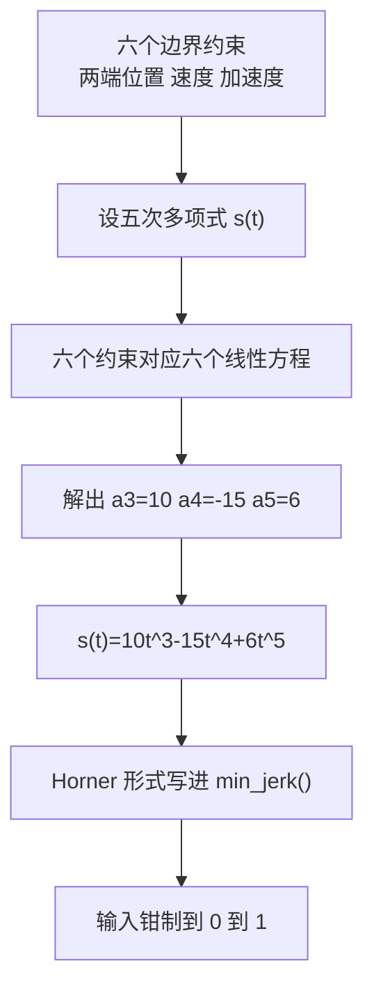

# 五次 min-jerk 时间律

本单元对应公开仓库 [TC635807/vlm-admittance](https://github.com/TC635807/vlm-admittance) 的 `control/`，源码在 WSL 下的位置是 `/home/tc63/mujoco/vlm_admittance`。这一篇只看轨迹的时间参数化，即 `control/trajectory.py` 的 `min_jerk()` 与 `CartesianTrajectory`，以及 `control/motion.py` 的 `follow_joint_path()` 如何在关节空间复用同一条时间律。

机械臂的点位运动由两件事决定：沿哪条几何路径走，以及路径进度随时间怎么变。几何路径取直线段；进度曲线需要让起点与终点的速度、加速度都为零，否则位置伺服在启动和停止的瞬间要提供一个跳变的加速度指令，末端会抖、关节会响，接触工况下还会多出一段不可控的冲击。五次最小加加速度多项式就是给这条进度曲线用的。

## 起点与终点的零冲击要求

点位运动的两端是静止状态：启动前机械臂停在某个位形，到达后要停在目标位姿上。把归一化进度记作 $s(\tau)$，$\tau=t/T\in[0,1]$ 是归一化时间，要求可以写成

$$s(0)=0,\quad s(1)=1,\quad \dot s(0)=\dot s(1)=0,\quad \ddot s(0)=\ddot s(1)=0$$

前两条保证进度从 0 走到 1；第三条保证速度在两端为零，即起停时没有速度跳变；第四条保证加速度在两端为零，即没有加速度跳变。速度连续对应 C1，加速度也连续对应 C2。

如果只要求位置和速度的端点条件（四条约束），四次多项式就够；再补上加速度两端为零，才需要第五次。约束数与多项式系数数相等，解唯一，这也是为什么这里不需要做数值优化。

## 六个约束定出系数

把时间律设为五次多项式

$$s(\tau)=a_0+a_1\tau+a_2\tau^2+a_3\tau^3+a_4\tau^4+a_5\tau^5$$

把六条边界条件代入，得到 $a_0=a_1=a_2=0$、$a_3=10$、$a_4=-15$、$a_5=6$，于是

$$s(\tau)=10\tau^3-15\tau^4+6\tau^5=\tau^3\left(10-15\tau+6\tau^2\right)$$

`control/trajectory.py` 的 `min_jerk()` 用 Horner 形式写这个式子，并把输入先钳制到 $[0,1]$：

```python
def min_jerk(s: float) -> float:
    s = float(np.clip(float(s), 0.0, 1.0))
    return s * s * s * (10.0 + s * (-15.0 + 6.0 * s))
```

写成连乘而不是幂运算，是源码的书写习惯，数学上等价。输入钳制带来一个有用的副作用：调用方传入超界的归一化时间不会外推，$\tau<0$ 得 0，$\tau>1$ 得 1。



## C2 连续性给出的形状

对上式求导：

$$\dot s(\tau)=30\tau^2(1-\tau)^2,\qquad \ddot s(\tau)=60\tau(1-\tau)(1-2\tau)$$

一阶导在 $[0,1]$ 内处处非负，且在两端为零，所以进度单调、速度从零起、到零止。二阶导是三次式，零点在 $\tau=0$、$\tau=1/2$、$\tau=1$：前半段加速、$\tau=1/2$ 处换号为减速，两端加速度为零。三阶导是

$$\dddot s(\tau)=60\left(1-6\tau+6\tau^2\right)$$

它在两端取 60，在 $\tau=1/2$ 附近取负值。满足六个端点约束的五次多项式唯一确定，仓库里的 `min_jerk()` 就是这一条。“最小加加速度”这个名字来自控制理论中“以加加速度平方的时间积分最小为目标”的经典解正好是五次多项式（按手册；本仓库未对该最优性做数值验证）。

`control/smoke.py` 的 `TestTrajectory.test_min_jerk` 把这几条性质做成了断言：端点值 0/1/0.5，200 个采样点单调不降，$[-5,9]$ 的输入被钳到 0 和 1，并用差分 $v_0=(s(h)-s(0))/h$、$v_1=(s(1)-s(1-h))/h$ 检查两端速度小于 $10^{-6}$。

## 位置与姿态共用同一个进度

笛卡尔轨迹的几何部分只有一条直线段，位置插值直接乘进度：

$$p(s)=p_0+(p_1-p_0)\,s$$

姿态用球面线性插值，传进去的是同一个 $s$：

```python
def sample(self, t: float) -> tuple[Array, Array]:
    s = min_jerk(float(t) / self.duration)
    pos = (self.p0 + (self.p1 - self.p0) * s).astype(float)
    if self.rot0 is not None and self.rot1 is not None:
        quat = slerp(self.rot0, self.rot1, s)
    elif self.rot0 is not None:
        quat = self.rot0.copy()
    else:
        quat = IDENTITY_QUAT.copy()
    return pos, quat
```

位置与姿态共用 $s$ 的直接结果是二者同时启停：$s=0$ 时位置在起点、姿态在起始朝向；$s=1$ 时两者同时到终点。如果姿态另取一条时间律，就可能出现位置已经停住而姿态还在转的状态，末端在到位点画一小段弧。姿态插值只在 `rot0` 与 `rot1` 都给出时进行，细节见同单元《四元数工具与 slerp》。

$t$ 的钳制不在 `sample()` 里，而在 `min_jerk()` 的 `np.clip` 里：`sample(-1.0)` 得到 $p_0$，`sample(99.0)` 得到 $p_1$，不会外推。`control/smoke.py` 的 `TestTrajectory.test_cartesian_trajectory` 断言了这两个端点，并检查 100 个采样点到直线段的垂距小于 $10^{-12}$，即插值确实落在直线上。

有一个容易看错的接口是 `sample_at(s)`。它实现为 `sample(min_jerk(s) * duration)`，而 `sample()` 内部又会对 $t/T$ 套一次 `min_jerk()`，所以实际得到的是 $\mathrm{min\_jerk}(\mathrm{min\_jerk}(s))$：一条两端更平缓的曲线，而非按进度线性取点。仓库内没有任何调用点，保留它不影响行为。

## 时长估算与峰值速度

`control/motion.py` 的 `move_to_pose()` 在 `duration=None` 时按直线距离估时长：

```python
if duration is None:
    duration = float(np.clip(max(0.6, dist / 0.15), 0.6, 6.0))
```

0.15 m/s 是这里设定的平均速度。min-jerk 的峰值进度速度出现在 $\tau=1/2$：

$$\dot s(1/2)=30\cdot\frac{1}{4}\cdot\frac{1}{4}=1.875$$

峰值速度是平均速度的 1.875 倍，所以长距离移动的峰值线速度约 $1.875\times0.15=0.28$ m/s。距离不足 0.09 m 时时长被 0.6 s 下限兜住，峰值退化为 $1.875\cdot\mathrm{dist}/0.6$：$\mathrm{dist}=0.06$ m 时约 0.19 m/s。这就是 `INTERFACES.md` 第 6 节写的“平均 0.15 m/s、min-jerk 峰值 0.19~0.28 m/s”的来历。上限 6.0 s 则兜住超长距离，避免单次移动吃掉整个 timeout 预算。

这个峰值速度也是接触段要单独处理的原因：500 Hz 下每控制步前进 $v_\mathrm{peak}\cdot\mathrm{dt}$，0.28 m/s 对应 0.56 mm，力检查又发生在 `step()` 之后，刚性面上的单步压入会给出很大的首触力。参考限速的做法见同单元《轨迹采样与参考限速》。

## 关节空间复用同一条时间律

`control/motion.py` 的 `follow_joint_path()` 执行规划器给出的关节路点，它不做笛卡尔导纳，只把同一条 min-jerk 时间律套在关节折线的弧长上。流程分四步：折线细分、累计弧长、按弧长取点、末端收尾。

细分由 `_densify_joint_path()` 完成：把当前关节角放在首点，每个路点先按关节限位钳制，再按 $\lceil\|q_\mathrm{wp}-q_\mathrm{prev}\|/\mathrm{max\_step}\rceil$ 段线性细分，默认 `max_step_rad=0.05`。累计弧长存进 `cum`，按弧长取点由 `_joint_point_at()` 用 `np.searchsorted` 完成。

```python
duration = max(length / max(float(self.joint_vel_limit), 1e-3), 1e-3)
n_steps = max(1, int(round(duration / self.dt)))
for k in range(1, n_steps + 1):
    t = min(k * self.dt, duration)
    q_cmd = self._joint_point_at(arr, cum, length * min_jerk(t / duration))
    ...
    ctrl = q_cmd + (self.vel_lead * qd if use_ff else 0.0)
```

`joint_vel_limit` 默认 1.0 rad/s，时长取 $\mathrm{length}/1.0$；取点位置是弧长 $L\cdot\mathrm{min\_jerk}(t/T)$，于是各关节速度按自己在弧长里的占比分配，整体形状与笛卡尔段一样两端为零。$\mathrm{qd}$ 由 $t\pm\mathrm{dt}/2$ 两点的弧长位置做中心差分得到，再乘执行器的 $k_v/k_p$ 作为速度前馈。收尾段固定把关节伺服到终点，直到 $|q_\mathrm{act}-q_\mathrm{end}|\le0.05$ rad 或累计 0.06 s 仿真时间。


源码注释里给了三组实测对比，说明为什么不再逐路点等待伺服：

| 执行方式 | 仿真步数 | 仿真时长 | 终点关节误差 |
| --- | --- | --- | --- |
| 逐点等待 tol=0.02 rad、0.30 s/点 | 2888 | 5.78 s | 0.020 rad |
| 逐点等待 tol=0.05 rad、0.06 s/点 | 630 | 1.26 s | 0.134 rad |
| 弧长 min-jerk + 关节速度前馈 | 528 | 1.06 s | 0.012 rad |

测试条件是 1.055 rad 的关节路径、23 个路点、UR5e 位置执行器。逐点等待在路点变多时步数线性上涨，正是端到端遇到的 7458 步、14.9 s 超时的来源；放宽等待阈值虽然快，但命令持续甩开伺服，终点误差涨到 0.134 rad，抓取会夹空。

## 参数速查

| 量 | 取值 | 出处 |
| --- | --- | --- |
| 时间律 | $10\tau^3-15\tau^4+6\tau^5$ | `control/trajectory.py` 的 `min_jerk()` |
| 峰值进度速度 | 1.875 | 上式在 $\tau=1/2$ |
| 端点速度与加速度 | 0 | 六个边界约束 |
| 加加速度峰值 | $60/T^3$ | 三阶导在两端取 60 |
| 默认时长估算 | $\mathrm{clip}(\max(0.6,\ \mathrm{dist}/0.15),\ 0.6,\ 6.0)$ | `control/motion.py` 的 `move_to_pose()` |
| duration 兜底 | 1e-9 | `control/trajectory.py` 的 `CartesianTrajectory` |
| 关节路径速度 | 1.0 rad/s | `control/motion.py` 的 `follow_joint_path()` |
| 关节路点细分 | 0.05 rad | 同上 |
| 关节收尾阈值 | 0.05 rad / 0.06 s | 同上 |

本页引用的路径：

| 路径 | 用途 |
| --- | --- |
| `control/trajectory.py` | `min_jerk()` 与 `CartesianTrajectory` 的时间参数化 |
| `control/motion.py` | `move_to_pose()` 的时长估算、`follow_joint_path()` 的关节实现 |
| `control/smoke.py` | `TestTrajectory` 的端点、单调性、直线性断言 |
| `INTERFACES.md` | 第 6 节的接触段限速背景与验证口径 |
| 仓库根 | https://github.com/TC635807/vlm-admittance |
