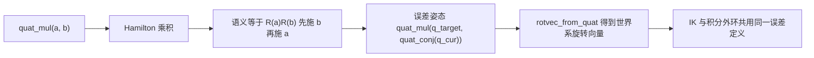
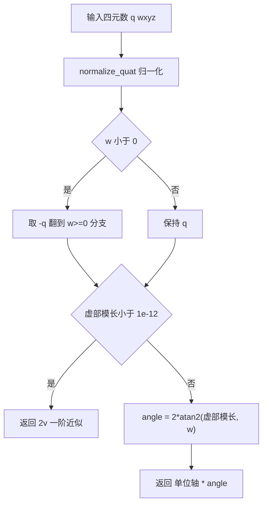
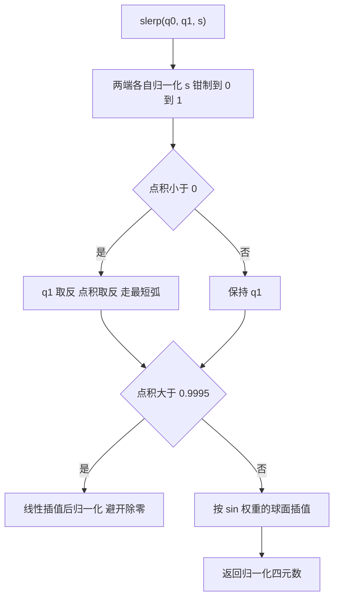
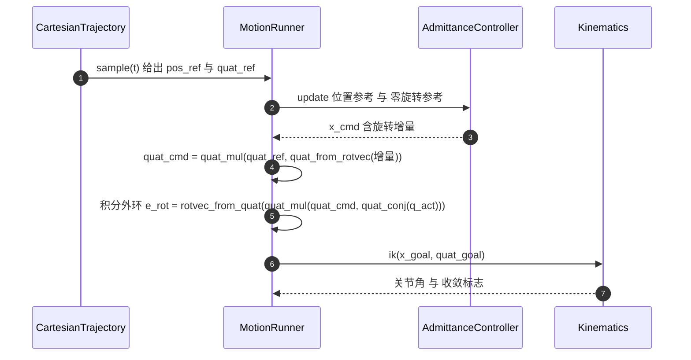

# 四元数工具与 slerp

`control/trajectory.py` 除了 `min_jerk()` 与 `CartesianTrajectory`，还提供一组四元数基础函数。它们是全项目姿态运算的公共底座：`control/kinematics.py` 的 IK 误差、`control/motion.py` 的任务空间积分外环与导纳姿态命令都调用这组函数，没有第二套实现。

四元数用四个分量表达三个旋转自由度，没有欧拉角的万向锁；代价是四元数加倍覆盖（$q$ 与 $-q$ 表示同一个旋转），插值与误差计算必须处理分支。这一篇把六个函数逐个拆开，再说明项目里怎么用。

## wxyz 约定与单位四元数

源码统一使用 wxyz 顺序，与 MuJoCo 的 `qpos` 四元数一致。源码里写明了这条约定：

```python
#: 单位四元数（wxyz）
IDENTITY_QUAT = np.array([1.0, 0.0, 0.0, 0.0], dtype=float)
```

`normalize_quat()` 负责归一化，并对退化输入兜底：

```python
def normalize_quat(q: Array) -> Array:
    q = np.asarray(q, dtype=float).reshape(4)
    n = float(np.linalg.norm(q))
    if n < 1e-12:
        return IDENTITY_QUAT.copy()
    return q / n
```

传入模长接近 0 的四元数不会得到 NaN，而是得到单位四元数。这一层保护让上游即使从仿真里读到一个清零的四元数，姿态通道也不会把 NaN 扩散到 IK。

`CartesianTrajectory` 构造时对 `rot0`/`rot1` 各调用一次 `normalize_quat()`，`slerp()` 内部也会再归一化一次。调用方传入非单位四元数不会改变轨迹语义。

## Hamilton 乘积与共轭

`quat_mul()` 实现 Hamilton 乘积，语义与旋转矩阵相乘一致：

```python
aw, ax, ay, az = a
bw, bx, by, bz = b
return np.array([
    aw * bw - ax * bx - ay * by - az * bz,
    aw * bx + ax * bw + ay * bz - az * by,
    aw * by - ax * bz + ay * bw + az * bx,
    aw * bz + ax * by - ay * bx + az * bw,
])
```

乘法顺序有实际含义：`quat_mul(a, b)` 对应矩阵 $R(a)R(b)$，作用在向量上时先施加 $b$ 的旋转，再施加 $a$ 的旋转。误差姿态写成 `quat_mul(q_target, quat_conj(q_cur))` 时，得到的是把当前姿态转到目标姿态所需的世界系旋转，因为

$$q_\mathrm{err}=q_\mathrm{target}\otimes q_\mathrm{cur}^{-1}$$

`quat_conj()` 只翻转虚部：

```python
def quat_conj(q: Array) -> Array:
    q = np.asarray(q, dtype=float).reshape(4)
    return np.array([q[0], -q[1], -q[2], -q[3]])
```

对单位四元数，共轭等于逆。源码保留 `quat_conj()` 这个更窄的名字，是为了让调用点读起来就是“取逆”，而不是每次都写一遍归一化除法。如果传入的四元数没有归一化，共轭与逆不再相等，这是该函数唯一的隐含前提。



## 旋转向量的换算与小角近似

旋转向量是单位轴乘转角，长度就是转角（弧度）。`quat_from_rotvec()` 的常规分支是

$$q=\left[\cos\frac{\theta}{2},\ \sin\frac{\theta}{2}\,\mathbf{u}\right],\qquad \theta=\|\mathbf{r}\|,\ \mathbf{u}=\mathbf{r}/\theta$$

源码在 $\theta<10^{-12}$ 时走一阶展开：

```python
if theta < 1e-12:
    # 一阶展开：sin(theta/2)/theta -> 1/2
    return normalize_quat(np.array([1.0, 0.5 * rv[0], 0.5 * rv[1], 0.5 * rv[2]]))
axis = rv / theta
half = 0.5 * theta
return np.concatenate([[np.cos(half)], np.sin(half) * axis])
```

$\sin(\theta/2)/\theta\to1/2$，所以小角下 $q\approx[1,\ 0.5\mathbf{r}]$，再归一化。不走这一支就要做 $\mathbf{r}/\theta$，$\theta=0$ 时除零。

反变换 `rotvec_from_quat()` 多两步分支处理：

```python
q = normalize_quat(q)
if q[0] < 0.0:                       # 翻到 w>=0 的分支，保证最短
    q = -q
v = q[1:]
nv = float(np.linalg.norm(v))
if nv < 1e-12:
    return 2.0 * v                   # 小角度一阶近似，避免除零
angle = 2.0 * float(np.arctan2(nv, q[0]))
return v / nv * angle
```

先把 $w<0$ 的分支翻正，保证结果满足 $|\mathrm{angle}|\le\pi$；再用 $2\arctan2(nv,w)$ 求转角，比 $2\arccos(w)$ 在 $w$ 接近 1 时数值更稳；虚部接近 0 时用 $2\mathbf{v}$ 一阶近似，避免 $\mathbf{v}/\|\mathbf{v}\|$ 除零。

`\mathbf{v}/\|\mathbf{v}\|\cdot\mathrm{angle}` 这个写法在 $w$ 翻正之后仍然会出现转角恰为 $\pi$ 的情形，此时旋转轴的方向由数值误差决定，正负号可能在相邻两次调用间跳变。项目里避免在控制回路中直接使用接近 $\pi$ 的绝对旋转向量，做法见后文。



## slerp 的最短弧与近平行退化

`slerp(q0, q1, s)` 在单位球面上按等角速度插值。两个分支决定了它的健壮性：

```python
d = float(np.dot(q0, q1))
if d < 0.0:                          # 最短弧
    q1 = -q1
    d = -d
if d > 0.9995:                       # 近平行：线性插值 + 归一化
    return normalize_quat(q0 + s * (q1 - q0))
theta0 = float(np.arccos(np.clip(d, -1.0, 1.0)))
theta = theta0 * s
sin_theta0 = float(np.sin(theta0))
w0 = np.sin(theta0 - theta) / sin_theta0
w1 = np.sin(theta) / sin_theta0
return normalize_quat(w0 * q0 + w1 * q1)
```

最短弧分支处理四元数的符号冗余。若两个姿态的夹角超过 $\pi$，直接用 $q_0\to q_1$ 插值会让末端绕远路，甚至看起来转了一整圈。把 $q_1$ 取反在旋转上是同一个姿态，却让点积非负，插值走短边。`control/smoke.py` 的 `TestTrajectory.test_slerp` 用 90 度旋转断言 `slerp(q0, -q1, 0.5)` 与 `slerp(q0, q1, 0.5)` 的角度差小于 $10^{-9}$，中点与 $q_0$ 的夹角等于 $\pi/4$（误差 $10^{-6}$ 量级）。

近平行分支处理 $d\to1$ 时 $\sin\theta_0\to0$ 的除零。阈值 0.9995 对应夹角约 0.0316 rad（1.81 度），此时线性插值后归一化与球面插值的差异在角速度上很小，视觉与伺服都分辨不出。阈值以下的常规分支用 $\sin$ 权重做球面插值，$s$ 先被钳制到 $[0,1]$，返回值再归一化一次。



## 项目里的四处用法

第一处在 `control/kinematics.py` 的 `ik()`。姿态误差由目标与当前姿态的误差四元数换算：

```python
eo = rotvec_from_quat(quat_mul(target_quat, quat_conj(quat)))
```

这个 $6$ 维误差向量 $[p_\mathrm{target}-p,\ \mathrm{eo}]$ 被送进 DLS 更新式，同时用于收敛判据。换算细节见同领域《运动学与 DLS IK》。

第二处在 `control/motion.py` 的 `_integral_step()`，任务空间积分外环用它算姿态误差与左乘修正：

```python
e_rot = rotvec_from_quat(quat_mul(quat_cmd, quat_conj(q_act)))
...
quat_goal = quat_mul(quat_from_rotvec(self._cart_int[3:6]), quat_cmd)
```

误差定义在世界系，修正也必须左乘到世界系。源码注释记录了右乘的后果：参考姿态转动较大时会收敛到错误固定点，实测残留 0.217 rad。

第三处在 `control/motion.py` 的 `_joint_vel_ref()`，速度前馈的角速度分量由两次采样的姿态差求出：

```python
twist = np.concatenate([
    (np.asarray(p1) - np.asarray(p0)) / span,
    rotvec_from_quat(quat_mul(q1, quat_conj(q0))) / span,
])
```

这里对轨迹在 $t\pm\mathrm{dt}/2$ 两点采样，姿态差换算成世界系角增量，再除以时间得到角速度。

第四处在 `control/motion.py` 的 `_apply_reference()`，导纳姿态通道用相对增量：

```python
x_cmd = self.adm.update(np.concatenate([np.asarray(pos_ref, dtype=float), np.zeros(3)]), adm_wrench)
quat_cmd = quat_mul(quat_ref, quat_from_rotvec(x_cmd[3:6]))
```

传给导纳的旋转参考恒为 0，导纳输出的是一个增量旋转向量，再左乘到轨迹参考姿态上。这样做的原因是绝对旋转向量的模长在末端朝下时接近 $\pi$，接近 $\pi$ 时轴方向的数值敏感性会带来跳变；用相对增量表达就没有这个问题。导纳方程本身的细节见同领域《六维导纳控制》。



## 验收与数值结论

`control/smoke.py` 的 `TestTrajectory` 覆盖了这组函数的边界行为：

| 用例 | 检查内容 | 结果 |
| --- | --- | --- |
| `test_slerp` | 端点、90 度中点、最短弧、近平行分支 | 中点误差 $10^{-6}$，最短弧差 $<10^{-9}$ |
| `test_rotvec_roundtrip` | 200 组随机轴角做 四元数 往返 | 分量最大误差 $<10^{-9}$ |
| `test_rotvec_roundtrip` | 单位四元数换算旋转向量 | 模长 0（$10^{-12}$） |
| `test_cartesian_trajectory` | 采样姿态端点 | 与 `rot0`/`rot1` 夹角 $<10^{-12}$ |

往返测试的角度范围是 $[10^{-4},\ \pi-10^{-3}]$，也就是故意避开 $0$ 与 $\pi$ 两个端点奇异，这两处由小角近似和平行分支单独覆盖。

| 函数 | 输入 | 输出 | 关键分支 |
| --- | --- | --- | --- |
| `normalize_quat()` | 任意 4 维 | 单位四元数 | 模长 $<10^{-12}$ 返回单位四元数 |
| `quat_mul()` | 两个四元数 | Hamilton 乘积 | 无分支 |
| `quat_conj()` | 四元数 | 共轭 | 无分支，假定单位化 |
| `quat_from_rotvec()` | 旋转向量 | 四元数 wxyz | 小角用 $0.5\mathbf{v}$ 展开 |
| `rotvec_from_quat()` | 四元数 | 旋转向量 $|\theta|\le\pi$ | $w<0$ 翻正、虚部小用 $2\mathbf{v}$ |
| `slerp()` | 两姿态与 $s$ | 插值姿态 | 最短弧、近平行 |

本页引用的路径：

| 路径 | 用途 |
| --- | --- |
| `control/trajectory.py` | 六个四元数函数与 `CartesianTrajectory` |
| `control/kinematics.py` | `ik()` 的姿态误差构造 |
| `control/motion.py` | 积分外环、速度前馈、导纳姿态命令 |
| `control/smoke.py` | `TestTrajectory` 的四元数断言 |
| 仓库根 | https://github.com/TC635807/vlm-admittance |
