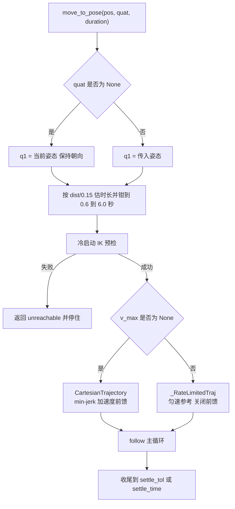
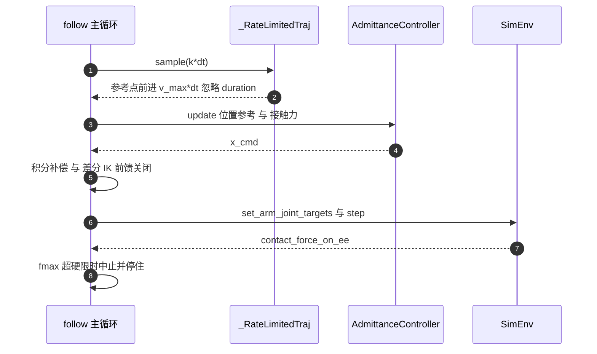

# 轨迹采样与接触段参考限速

`CartesianTrajectory` 负责给出每个控制步的参考位姿，`control/motion.py` 的 `move_to_pose()` 与 `follow()` 负责把参考位姿变成关节命令。点位运动用 min-jerk 时间律；接触段的下降改用另一条参考轨迹 `_RateLimitedTraj`，把参考速度压到 `v_max`，从而把每步压入量按比例压小。这一篇按采样接口、调用链、限速实现、标定数据四块来写。

## CartesianTrajectory 保存的状态

类在构造时把端点全部复制或归一化，之后只读：

| 成员 | 含义 | 处理方式 |
| --- | --- | --- |
| `p0` / `p1` | 起止位置 | `reshape(3).copy()`，与调用方数组解耦 |
| `rot0` / `rot1` | 起止姿态 wxyz | `normalize_quat()`，`None` 原样保留 |
| `duration` | 轨迹总时长 | `max(duration, 1e-9)` 兜底 |
| `dt` | 采样周期 | 只记录，本类不参与推进 |
| `length` | 直线段长度 | $\|p_1-p_0\|$，供调用方估算速度 |

`duration` 用 1e-9 兜底是因为 `sample()` 要做 `t / duration` 的除法。上层传入 0 或负数不会得到除零，代价是轨迹退化成瞬时到位，需要调用方自己保证时长合理。源码注释也写明了 `dt` 只作记录，推动时间轴的是 `follow()` 的循环计数。

`p0`/`p1` 复制而不是引用，避免调用方在轨迹执行期间改动自己的数组而悄悄改变参考。

## sample 的钳制与姿态三种形态

`sample(t)` 返回 `(pos, quat)`，$t$ 的钳制藏在 `min_jerk()` 的 `np.clip` 里：

| 传入 | 行为 |
| --- | --- |
| `t < 0` | $s=0$，返回 `p0` 与起始姿态 |
| `0 <= t <= duration` | 按 $s=\mathrm{min\_jerk}(t/\mathrm{duration})$ 插值 |
| `t > duration` | $s=1$，返回 `p1` 与终止姿态 |

姿态按构造参数分三种形态：

| `rot0` | `rot1` | `sample()` 的姿态输出 |
| --- | --- | --- |
| 给出 | 给出 | `slerp(rot0, rot1, s)`，随进度插值 |
| 给出 | 未给出 | 恒定 `rot0` |
| 未给出 | 任意 | 恒定单位四元数 `IDENTITY_QUAT` |

第三行有一个不对称：只给 `rot1` 不给 `rot0` 时，`rot1` 被忽略，输出是单位四元数而不是 `rot1`。源码的分支只检查 `rot0`。要固定姿态，需要把同一个四元数同时传给 `rot0` 和 `rot1`，或者传给 `rot0` 并留空 `rot1`。

`sample_at(s)` 的语义见同单元《五次 min-jerk 时间律》：它对传入进度再套一次 `min_jerk()`，仓库内没有调用点。

## 从 move_to_pose 到 follow 的调用链

`move_to_pose()` 只做四件事：取当前位姿、补全目标姿态、估时长、做可达性预检，然后把轨迹交给 `follow()`。

```python
q_now = self._arm_q()
p0, q0 = self.kin.fk(q_now)
p1 = np.asarray(pos, dtype=float).reshape(3)
q1 = q0 if quat is None else np.asarray(quat, dtype=float).reshape(4)
dist = float(np.linalg.norm(p1 - p0))
if duration is None:
    duration = float(np.clip(max(0.6, dist / 0.15), 0.6, 6.0))
_, ok = self.kin.ik(p1, q1, q0=None)     # 出发前预检可达性
if not ok:
    return self._abort("unreachable", f"目标位姿不可达 pos={np.round(p1, 4).tolist()}", 0.0, 0)
traj = CartesianTrajectory(p0, p1, duration, self.dt, rot0=q0, rot1=q1)
```

`quat=None` 表示保持当前姿态，此时 `q1 = q0`，轨迹的两个姿态相同，`slerp()` 输出恒定姿态。预检用冷启动 IK（`q0=None`，内部走多次随机重启），失败即返回 `unreachable` 并停住，不会先动再失败。

`follow()` 的循环按仿真步推进。每个控制步的顺序是：采样参考位姿、读接触力、导纳修正、任务空间积分补偿、差分 IK（上一步的解作热身）、关节速度前馈、下发并 `step()`。轨迹段之后是收尾段，继续按最终参考跑，直到平动误差不大于 `settle_tol`（1e-3 m）且姿态误差不大于 `settle_rot_tol`（0.01 rad），或累计到 `settle_time`（1.5 s）。轨迹段与收尾段共用同一个 timeout 预算，timeout 用仿真时间 `steps * dt` 计。



## 方法 A：匀速参考与 _RateLimitedTraj

接触段的单步压入量等于参考速度乘控制周期。`INTERFACES.md` 第 6 节给出的背景数字是：`move_to_pose` 平均 0.15 m/s、min-jerk 峰值 0.19~0.28 m/s，控制周期 2 ms，所以每步前进 0.4~0.6 mm；力检查发生在 `step()` 之后，刚性面上的单步压入会直接变成很大的首触力。方法 A 只做一件事：把参考速度压下来。

`follow()` 在 `v_max>0` 时用 `_rate_limited_traj()` 替换传入的轨迹。后者先用 `traj.sample(0.0)` 与 `traj.sample(traj.duration)` 取出端点，所以任何具备 `.duration` 与 `.sample(t)` 的对象都能被接管，`CartesianTrajectory` 只是其中一种。

`_RateLimitedTraj` 与 `CartesianTrajectory` 鸭子类型等价，可以直接喂给同一个 `follow()` 主循环，导纳、积分、IK、力检查都不需要新增分支。它的时长由 `v_max` 决定，构造时传入的 `duration` 被忽略：

```python
step = max(self.v_max * self.dt, 1e-12)
self.n = max(1, int(np.ceil(self.length / step))) if self.length > 1e-12 else 1
self.duration = float(self.n) * self.dt
self._step_s = 1.0 / float(self.n)
```

`n` 是所需控制步数，`duration = n * dt`，第 `n` 步正好到目标。`sample()` 只做一次乘加，不做迭代：

```python
k = min(max(int(round(float(t) / self.dt)), 0), self.n)
s = k * self._step_s
pos = (self.p0 + (self.p1 - self.p0) * s).astype(float)
```

位置沿直线恒速推进，姿态按同一个归一化进度 `s = k/n` 做 `slerp()`，所以角速度也是恒定的。`v_max=0.008`、`dt=2` ms 时单步前进 16 µm。

`follow()` 在切换到限速模式时把速度前馈关掉：

```python
if v_max is not None:
    if not (float(v_max) > 0.0):
        raise ValueError("v_max 必须 > 0 或 None，收到 %r" % (v_max,))
    traj = self._rate_limited_traj(traj, float(v_max))
    use_vel_ff = False
else:
    use_vel_ff = True
```

前馈项 `q_cmd = q_ik + (kv/kp)*qd` 是按 0.15 m/s 量级算出的速度超前量，接触段会把参考顶进接触面。限速本身已经把步进压到微米级，这个超前带来的跟踪收益不到 1 mm，却增加冲击风险。`stop_on_force` 模式出于同样的理由也关闭前馈。`v_max<=0` 在返回 `MoveResult` 之前抛 `ValueError`，所以错误码集合不变。

收尾段在限速模式下只把误差收到 `settle_tol`，终点就是目标参考，不会再加速一段。调用方需要按 `dist/v_max` 放大 timeout，做法见后文。



## 参考限速下的首触力标定

`control/motion.py` 的模块注释给出一组在真实刚性桌面上的标定。条件是 `sim/env.py` 的桌面 $z=0.40$、`z_only` 柔顺档、`force_limit=3.0`、起始 TCP $z=0.45$ 位于 $(0.30,\ 0.02)$、下降 60 mm：

| `v_max` (m/s) | 首触力 (N) |
| --- | --- |
| 未限速 | 171.2 |
| 0.016 | 28.36 |
| 0.008 | 13.42 |
| 0.004 | 6.58 |
| 0.0035 | 4.88 |
| 0.003 | 7.23 |
| 0.0025 | 6.74 |
| 0.002 | 3.44 |

规律分两段。`v_max >= 0.008` 时首触力近似正比于 `v_max`，符合 `首触力 ≈ 接触刚度 × v_max × dt` 的估计，因为接触面上单步压入量就是 `v_max*dt`。`v_max <= 0.004` 之后接触恰好落在哪个控制步带来 ±3 N 量级的离散：`0.0035` 的 4.88 N 落在相位有利的一侧，`0.003` 与 `0.0025` 反而更高。这条曲线在低端不是单调函数，单次测量不能当作稳定上界。要稳定不大于 5 N，取 `v_max<=0.002`。

`control/smoke.py` 的 `test_v_max_rigid_table_descent` 对这一点做了如实断言：`v_max=None` 与 `v_max=0.003` 各跑一次，断言限速后首触力小于常速的十分之一，并只要求 $\le8$ N（实测 7.23 N），不写成 5 N。同一用例里 `v_max=None` 的条件是 `force_limit=200`，实测首触 216 N，与上表 171.2 N 的差别来自力限与 timeout 取值不同，两组数据都是本机实测，未重新跑过。

`skills/library.py` 把标定用到了具体动作上，常量包括 `CONTACT_VMAX=0.003`、`PICK_VMAX_SLENDER=0.008`、`PICK_CRUISE_VMAX_SLENDER=0.03`、`PLACE_APPROACH_VMAX=0.006`、`PLACE_VMAX=0.003`，并只对最后一段接触下降限速。源码注释记录了原因：把 `v_max` 套到所有移动上会让端到端从 8 s 涨到 300 s 以上。技能层的选择策略见同领域《技能库与仿真集成》。

## 调用侧怎么放大 timeout

限速模式的时长是 $L/v_\mathrm{max}$，比原来的 min-jerk 时长长得多，而轨迹段与收尾段共用 timeout 预算。调用方必须显式放大 `timeout`，否则会在收尾阶段返回 `error_code="timeout"`。

`skills/library.py` 的 `_vmax_timeout()` 采用

$$\mathrm{timeout}=\max\left(\mathrm{minimum},\ \frac{\mathrm{dist}}{v_\mathrm{max}}+5.0\right)$$

源码注释记录了两个中间值：加 1 s 太紧；加 2 s 会刚好撞上收尾（实测报出“收尾超时 8.668s > 8.667s”），所以改成加 5 s。`INTERFACES.md` 第 6.1 节写的是 `dist/v_max + 1s`，实际落地值以 `skills/library.py` 的 +5 s 为准。

| 参数 | 取值 | 出处 |
| --- | --- | --- |
| 参考单步前进量 | $v_\mathrm{max}\cdot\mathrm{dt}$ | `control/motion.py` 的 `_RateLimitedTraj` |
| 限速模式时长 | $\lceil L/(v_\mathrm{max}\cdot\mathrm{dt})\rceil\cdot\mathrm{dt}$ | 同上 |
| 速度前馈 | 关闭 | `control/motion.py` 的 `follow()` |
| 收尾阈值 | 1e-3 m / 0.01 rad / 1.5 s | `MotionRunner` 实例属性 |
| 力硬上限 | 200 N | `force_limit_cap` |
| 推荐接触段速度 | $\le0.002$ m/s（稳定 $\le5$ N） | `control/motion.py` 的标定 |
| 技能层接触段速度 | 0.003 m/s | `skills/library.py` 的 `CONTACT_VMAX` |
| timeout 放大 | $\mathrm{dist}/v_\mathrm{max}+5$ s | `skills/library.py` 的 `_vmax_timeout()` |

本页引用的路径：

| 路径 | 用途 |
| --- | --- |
| `control/trajectory.py` | `CartesianTrajectory` 的采样与状态 |
| `control/motion.py` | `move_to_pose()`、`follow()`、`_RateLimitedTraj` |
| `control/smoke.py` | 限速参考步长、时长、前馈关闭的断言 |
| `skills/library.py` | `v_max` 常量的落地取值与 timeout 放大 |
| `INTERFACES.md` | 第 6 节的方法 A 契约与使用约定 |
| 仓库根 | https://github.com/TC635807/vlm-admittance |
