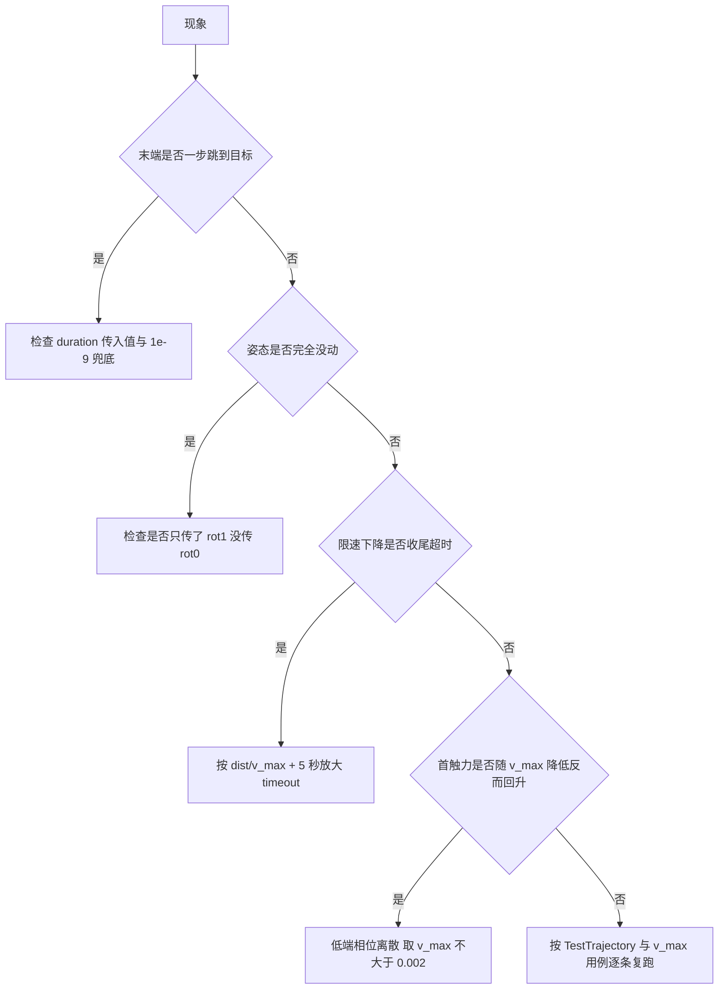
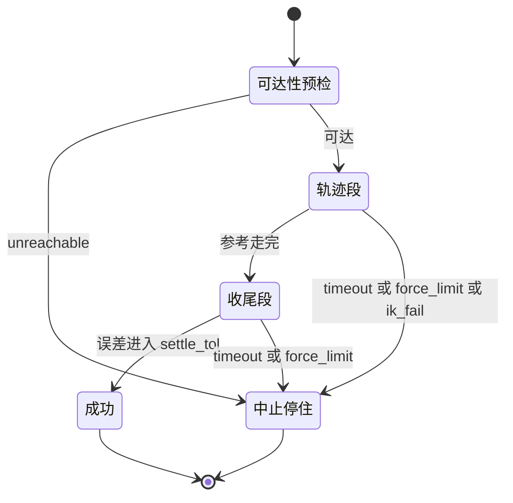
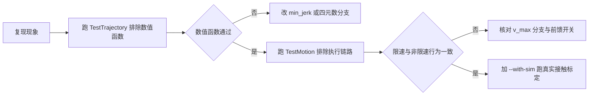

# 轨迹与限速的排查路径

这一篇把前面三篇里容易被读错的接口集中起来，按“现象 → 检查点 → 对应断言”的顺序组织。所有结论都能在 `control/trajectory.py`、`control/motion.py` 与 `control/smoke.py` 里核对；标注“由源码推得”的条目没有实机复跑。

## 先按现象分流

同一段轨迹出问题，先判断症状落在采样、姿态还是限速上，再去看对应的分支，能省掉大量无差别读码。



`follow()` 的状态与出口可以画成一张状态图，中止路径的出口统一走 `_halt()`：



## 采样与插值偏差

`duration` 传入 0 或负数不会报错。`CartesianTrajectory` 用 `max(duration, 1e-9)` 兜底，于是 `n_steps = max(1, round(1e-9/dt)) = 1`，第一步采样时 `t = min(dt, duration) = 1e-9`，`min_jerk(1) = 1`，参考直接落到终点，随后进入收尾段。表现是末端一步跳到目标，接触工况下这一步的首触力由位置伺服的整段行程决定。由源码推得，未实测。

`sample_at(s)` 是对 `sample(min_jerk(s) * duration)` 的包装，`sample()` 内部又套一次 `min_jerk()`，实际进度是 $\mathrm{min\_jerk}(\mathrm{min\_jerk}(s))$。仓库内没有调用点，改动它不影响现有行为。

`sample()` 的 $t$ 钳制依赖 `min_jerk()` 内部的 `np.clip`。这一层钳制意味着传入超界的 $s$ 会被静默饱和到 0 或 1，而不是报错；把 `min_jerk()` 换成不带钳制的版本会让负时间产生负进度，位置跑到直线段的反向延长线上。

姿态只在 `rot0` 和 `rot1` 都给出时插值。只传 `rot1` 时源码走的是 `else` 分支，输出单位四元数，`rot1` 被忽略。要固定姿态，把同一个四元数传给 `rot0` 并留空 `rot1`，或者两个都传。

| 现象 | 原因 | 核对位置 |
| --- | --- | --- |
| 末端一步到目标 | `duration` 为 0 或负数，被 1e-9 兜底 | `CartesianTrajectory` 构造 |
| 传了进度曲线却更慢 | `sample_at()` 双层 `min_jerk()` | `control/trajectory.py` |
| 传负时间得到起点 | `min_jerk()` 内部钳制 | `min_jerk()` |
| 姿态恒定为单位四元数 | 只给了 `rot1` | `sample()` 的姿态分支 |
| 采样点不在直线上 | 调用了 `sample_at()` 之外的插值路径 | `CartesianTrajectory.sample()` |

## 姿态与旋转向量偏差

`slerp()` 的最短弧分支在点积为负时把 `q1` 取反，这一步是内部完成的。调用方如果自己先把姿态取反再传入，不会改变结果；如果调用方用欧拉角或旋转矩阵另做一套插值，就绕过了这条保护，超过 180 度的姿态变化会走长边。

近平行分支的阈值是 0.9995。去掉这一支，`theta0` 接近 0 时 `sin(theta0)` 做分母会让权重变成 NaN 或极大值，姿态出现跳变。阈值对应的夹角约 1.81 度，此范围内的线性插值加归一化与球面插值的角速度差异很小。

`rotvec_from_quat()` 先把 $w<0$ 的分支翻正，结果满足 $|\mathrm{angle}|\le\pi$。转角接近 $\pi$ 时旋转轴方向的数值敏感，相邻两次调用可能给出相反的轴。项目在控制回路里不直接使用接近 $\pi$ 的绝对旋转向量：`control/motion.py` 的 `_apply_reference()` 把传给导纳的旋转参考固定为 0，用增量旋转向量左乘轨迹参考姿态。

`control/motion.py` 的 `_integral_step()` 里，姿态修正必须左乘到世界系。源码注释记录了右乘的后果：参考姿态转动较大时收敛到错误固定点，实测残留 0.217 rad。这一处的误差定义与修正方向必须成对，改其一就会重新引入该偏差。

| 现象 | 原因 | 核对位置 |
| --- | --- | --- |
| 姿态绕远路 | 外部绕过了 `slerp()` 的最短弧分支 | `slerp()` |
| 姿态出现 NaN 或跳变 | 近平行分支被去掉 | `slerp()` |
| 姿态收敛到错误固定点 | 积分修正右乘而非左乘 | `_integral_step()` |
| 旋转向量在 $\pi$ 附近跳号 | 直接使用绝对旋转向量 | `_apply_reference()` |
| 非单位四元数的共轭被当逆用 | `quat_conj()` 假定单位化 | `quat_conj()` |

## 参考限速与 timeout

限速模式下构造参数 `duration` 被忽略，总时长由 $\lceil L/(v_\mathrm{max}\cdot\mathrm{dt})\rceil\cdot\mathrm{dt}$ 决定。同时传 `duration` 与 `v_max` 时，`duration` 不参与任何计算，轨迹只按 `v_max` 推进。把 `v_max` 当成“时长下限”来用会得到完全不同的时长。

timeout 是仿真时间上限，轨迹段与收尾段共用。限速模式的时长约为 $L/v_\mathrm{max}$，比 min-jerk 时长长得多，调用方必须按 `dist/v_max + 5` 放大；只加 1 s 会在收尾段报出“超时”，加 2 s 会刚好撞上收尾（源码注释里记录了 8.668 s 对 8.667 s 的一次超时）。

速度前馈在限速模式下必须关闭。`control/smoke.py` 的 `test_v_max_reference_rate_limit_and_feedforward_off` 用替身统计 `_joint_vel_ref()` 的调用次数，断言限速模式下为 0、`v_max=None` 时大于 0。前馈是按 0.15 m/s 量级算出的超前项，接触段会把参考顶进接触面。

`v_max<=0` 在返回 `MoveResult` 之前抛 `ValueError`，不属于 `MoveResult.error_code` 的五个取值。上层若用错误码统一处理失败，需要额外捕获这个异常。

首触力在 $v_\mathrm{max}\le0.004$ 之后受接触落在哪个控制步影响，有 ±3 N 量级的离散。$v_\mathrm{max}=0.0035$ 实测 4.88 N，$0.003$ 与 $0.0025$ 反而更高。用单点测量判断“这个速度足够安全”会得到错误结论，稳定不大于 5 N 需要 $v_\mathrm{max}\le0.002$。

| 现象 | 原因 | 核对位置 |
| --- | --- | --- |
| 轨迹比设定时长久 | `v_max` 忽略 `duration` | `follow()` 与 `_RateLimitedTraj` |
| 限速下降报 timeout | timeout 未按 `dist/v_max+5` 放大 | `skills/library.py` 的 `_vmax_timeout()` |
| 限速段跟踪超前 | 速度前馈未关闭 | `follow()` 的 `use_vel_ff` |
| 错误码集合被改 | 把 `ValueError` 当成新的 `error_code` | `follow()` 的参数校验 |
| 首触力不随速度单调 | 低端相位离散 | `control/motion.py` 的标定表 |
| 时间预算与墙钟不符 | timeout 用仿真时间 `steps*dt` | `follow()` 的循环条件 |

## 用 smoke 用例定位

`control/smoke.py` 与轨迹相关的断言集中在两个类：`TestTrajectory` 覆盖纯数值函数，`TestMotion` 覆盖运动执行，刚性桌面标定在 `TestWithSim`。运行命令取自该文件的文档字符串：

```bash
cd /home/tc63/mujoco/vlm_admittance
MUJOCO_GL=glfw /home/tc63/mujoco/.venv/bin/python -m control.smoke
MUJOCO_GL=glfw /home/tc63/mujoco/.venv/bin/python -m control.smoke control.smoke.TestTrajectory
MUJOCO_GL=glfw /home/tc63/mujoco/.venv/bin/python -m control.smoke --with-sim -v
```

`--with-sim` 会在内置替身之外再加载 `sim.env.MuJoCoArmEnv`，刚性桌面标定用例需要真实环境。全链路验收用 `MUJOCO_GL=glfw /home/tc63/mujoco/.venv/bin/python -m tests.run_acceptance`，README 记录的最近一次结果是 9/10 通过，唯一失败在导纳让位方向，与轨迹单元无关。

| 用例 | 覆盖点 | 断言口径 |
| --- | --- | --- |
| `test_min_jerk` | 端点、单调、钳制、端点速度 | 端点值 $10^{-12}$，端点速度 $<10^{-6}$ |
| `test_slerp` | 端点、90 度中点、最短弧、近平行 | 中点误差 $10^{-6}$，最短弧差 $<10^{-9}$ |
| `test_rotvec_roundtrip` | 200 组随机轴角的往返 | 分量误差 $<10^{-9}$ |
| `test_cartesian_trajectory` | 端点、钳制、直线性 | 垂距 $<10^{-12}$ |
| `test_v_max_reference_rate_limit_and_feedforward_off` | 单步步长、总时长、前馈关闭 | 单步 $\le v_\mathrm{max}\cdot\mathrm{dt}$，前馈调用数为 0 |
| `test_v_max_none_reproducible_and_no_new_error_codes` | 可复现性、参数校验 | 两次 `final_pos` 逐位相同，`v_max<=0` 抛 `ValueError` |
| `test_v_max_rigid_table_descent` | 刚性桌面 60 mm 下降 | 限速首触力 $\le8$ N 且小于常速的 1/10 |



## 排查清单

按顺序核对以下条目，每条都能落到一个具体函数或断言：

1. `duration` 的实际取值来自调用方还是 `move_to_pose()` 的距离估算，是否落进 `[0.6, 6.0]`。
2. 目标姿态是否显式传入；留空表示保持当前姿态。
3. 姿态插值需要的两个四元数是否都给齐，顺序为 wxyz。
4. `v_max` 是否与 `duration` 同时传入，后者会被忽略。
5. timeout 是否按 `dist/v_max+5` 放大。
6. 限速模式下的前馈调用次数是否为 0。
7. 首触力是否来自多次测量，低端取值是否留到 $\le0.002$。
8. 失败返回的 `final_pos` 是否可用，中止是否走了 `_halt()`。

本页引用的路径：

| 路径 | 用途 |
| --- | --- |
| `control/trajectory.py` | `min_jerk()`、`slerp()`、四元数换算 |
| `control/motion.py` | `follow()`、`_RateLimitedTraj`、积分修正 |
| `control/smoke.py` | 轨迹与限速的全部断言 |
| `skills/library.py` | timeout 放大与限速常量 |
| `tests/run_acceptance.py` | 全链路验收入口 |
| 仓库根 | https://github.com/TC635807/vlm-admittance |
