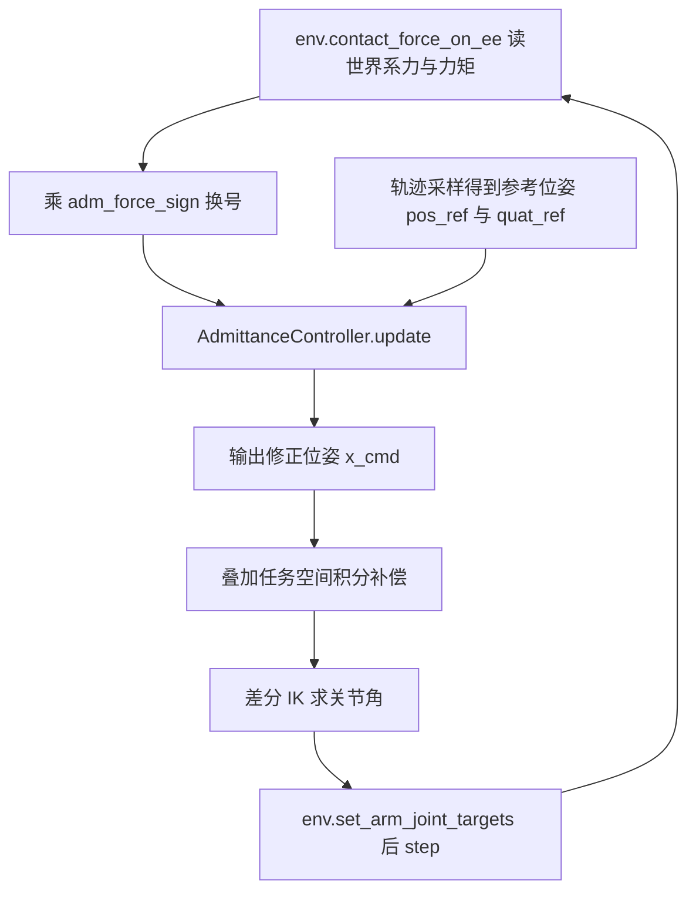
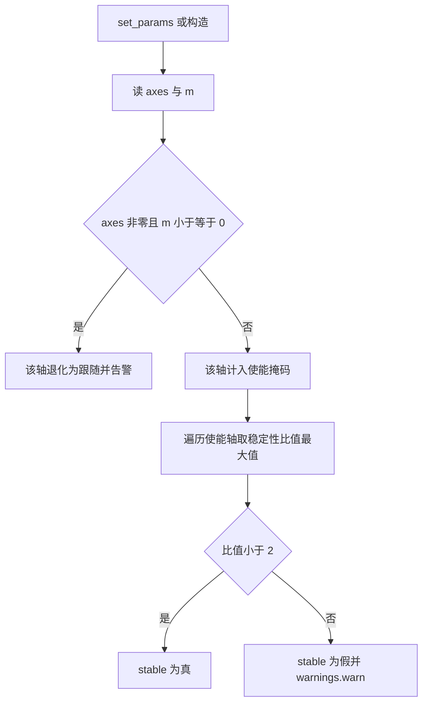

# 导纳方程与半隐式欧拉离散

本文对应 `TC635807/vlm-admittance` 的 `control/`，主体是 `control/admittance.py` 的 `AdmittanceController`。控制器每个物理步被调用一次：输入参考位姿与末端力旋量，输出修正后的命令位姿。把它接入控制环、并叠加任务空间积分补偿的部分在 `control/motion.py` 的 `MotionRunner._apply_reference()`，本文只讲控制律本身。

## 六维位姿与力旋量

导纳控制器把末端当作一个六自由度弹簧阻尼质量系统。状态量 x 是世界系下的 6 维向量，顺序固定为 [x, y, z, rx, ry, rz]：前 3 维是位置（米），后 3 维是旋转向量（弧度）。外力旋量 f_ext 同样 6 维，顺序为 [force(3), torque(3)]，力作用在 TCP 上。

| 符号 | 含义 | 维度 | 单位 |
| --- | --- | --- | --- |
| x | 末端位置与旋转向量 | 6 | m, rad |
| x_ref | 参考位姿（未受力的目标） | 6 | m, rad |
| f_ext | 世界系外力与力矩 | 6 | N, N·m |
| K | 每轴刚度 | 6 | N/m, N·m/rad |
| D | 每轴阻尼 | 6 | N·s/m |
| M | 每轴虚拟质量 | 6 | kg, kg·m² |

三个增益向量都按轴独立给出。`core/types.py` 的 `ComplianceParams` 把 `k` / `d` / `m` / `axes` 都定义为长度 6 的数组，取值与档位见同单元《柔顺档位与轴掩码》。

转动通道存在两种用法。控制器内部按绝对旋转向量处理，而 `MotionRunner._apply_reference()` 传给它的参考是相对增量：把 `x_ref[3:6]` 置零，再把输出的 `x_cmd[3:6]` 通过四元数指数映射叠到命令姿态上。

```python
x_cmd = self.adm.update(np.concatenate([pos_ref, np.zeros(3)]), adm_wrench)
quat_cmd = quat_mul(quat_ref, quat_from_rotvec(x_cmd[3:6]))
```

这样做的原因是绝对旋转向量在末端朝下时模长接近 π，直接使用会出现跳变。方程是线性的，绝对量与增量两种输入都成立。



## 被控方程与稳态刚度

控制律是一条二阶线性微分方程：

$$M\ddot{x} + D\dot{x} + K(x - x_{ref}) = -f_{ext}$$

`control/admittance.py` 的模块注释把它标注为与 `INTERFACES.md` 冻结一致。方程右侧取 `-f_ext`，含义是外力推动末端、末端沿力的反方向偏移。进入稳态后速度与加速度为零，位移与力的关系退化为弹簧公式：

$$x - x_{ref} = -\frac{f_{ext}}{K}$$

这就是验收里使用的口径：纯导纳阶跃响应的稳态位移等于 $-f/k$。`control/smoke.py` 的 `TestAdmittance.test_step_force_bounded_and_converges()` 用 z 轴 $k = 200$、$f = -5\,\mathrm{N}$ 跑 2 s，检查终值接近 0.025 m，并确认峰值不超过稳态值的 1.2 倍。

刚度越大，同样的外力产生的让位越小。`stiff()` 档把 `axes` 全置零，导纳不参与，控制退化为纯位置伺服；让位量与接触力的权衡由档位选择承担。

## 半隐式欧拉的离散形式

离散采用半隐式（symplectic）欧拉：先用当前速度更新加速度与速度，再用更新后的速度推进位置。

$$a_k = \frac{-f_{ext} - D v_k - K(x_k - x_{ref})}{M}$$

$$v_{k+1} = v_k + dt \cdot a_k, \qquad x_{k+1} = x_k + dt \cdot v_{k+1}$$

`control/admittance.py` 的 `update()` 把这三行写成向量化的 NumPy 运算，只对使能轴计算：

```python
acc = np.zeros(6, dtype=float)
idx = np.where(en)[0]
acc[idx] = (-f[idx] - d[idx] * v[idx] - k[idx] * (x[idx] - x_ref[idx])) / m[idx]
v_new = np.zeros(6, dtype=float)
v_new[idx] = v[idx] + dt * acc[idx]
delta = np.zeros(6, dtype=float)
delta[idx] = dt * v_new[idx]
```

先算速度再算位置，与显式欧拉的区别在于位置使用的是区间末的速度。显式欧拉在无阻尼弹簧上每步放大振幅，半隐式欧拉的振幅在有界范围内振荡，因此相同刚度下能容忍更大的步长。

## 稳定条件

无阻尼时把速度消掉可以得到位置的三项递推。记 $w = \sqrt{K/M}$，代入 $v_k = (x_k - x_{k-1})/dt$：

$$x_{k+1} - (2 - dt^2 w^2)\,x_k + x_{k-1} = 0$$

特征多项式为 $L^2 - (2 - dt^2 w^2)L + 1 = 0$。两个根落在单位圆内的条件是 $|2 - dt^2 w^2| \le 2$，即：

$$dt \cdot \sqrt{\frac{K}{M}} < 2$$

`control/admittance.py` 的模块注释把这个比值推荐限制到 0.5 以内以保证精度。默认参数下 $dt = 0.002\,\mathrm{s}$、$K = 5000$、$M = 5$，比值为：

$$0.002 \times \sqrt{5000 / 5} \approx 0.063$$

远低于边界。`_refresh_params()` 在构造与 `set_params()` 时遍历使能轴，取 $dt\sqrt{k/m}$ 的最大值存入 `stability_ratio`，并设置 `stable` 标志。超限时只调用 `warnings.warn` 抛出 `RuntimeWarning`，不抛异常，原因是控制环里抛异常会直接打断技能执行。



注意 $k \le 0$ 的使能轴在稳定性计算里被跳过。源码把它视为无穷稳定，但这不代表该轴安全：没有回复力时外力会让位置持续漂移，项目里这种轴只应出现在 `axes = 0` 的关闭轴上。

## 单步限幅与抗积分饱和

接触瞬间外力可能突变，一个步长内的位移修正必须封顶。`STEP_LIMITS` 定义前 3 个平动轴限 0.05 m、后 3 个转动轴限 0.15 rad：

```python
STEP_LIMITS = np.array([0.05, 0.05, 0.05, 0.15, 0.15, 0.15], dtype=float)
```

限幅按平动组与转动组分别取向量模长，再整体缩放，只统计使能轴：

```python
for g0 in (0, 3):
    gidx = np.arange(g0, g0 + 3)
    sel = gidx[en[gidx]]
    if sel.size == 0:
        continue
    norm = float(np.linalg.norm(delta[sel]))
    lim = float(STEP_LIMITS[g0])
    if norm > lim:
        delta[sel] *= lim / norm
        self._clipped = True
```

限幅之后必须把速度按实际位移回算，否则速度会继续按未限幅的加速度累积，离开接触时把储存的能量一次性释放：

```python
v_out = np.zeros(6, dtype=float)
v_out[idx] = delta[idx] / dt
```

`control/smoke.py` 的 `test_step_clamp()` 注入 $-10^6\,\mathrm{N}$ 的 z 向力，断言位移不超过 0.05 m；再用 $10^6\,\mathrm{N\cdot m}$ 的力矩检查转动修正模长不超过 0.15 rad，两种情况下 `state()["clipped"]` 都为真。

## 非使能轴与非法轴

轴掩码在 `_refresh_params()` 里解析，使能条件是 `axes[i] != 0` 且 `m[i] > 0`：

```python
raw = axes != 0.0
bad = raw & (m <= 0.0)
if np.any(bad):
    warnings.warn("导纳轴 ... 虚拟质量 m<=0，已退化为纯位置跟随", RuntimeWarning)
self._enabled = raw & ~bad
```

`axes[i] == 0` 的轴不参与导纳，每步精确跟随参考并清零速度，等价于纯位置控制。`z_only` 档只让 z 轴使能，就是这个机制的直接用法。`axes[i] == 1` 但 `m[i] <= 0` 属于参数配置非法，控制器不抛异常也不做除法，而是把该轴退化为跟随并给出一次警告。

轴掩码变化后，非使能轴的位置状态会在下一次 `_refresh_params()` 里吸附到 `x_ref`，避免旧状态在重新使能时突然生效。

## 状态快照与调用接口

`AdmittanceController` 对外只有四个方法：`update(x_ref, wrench)` 推进一个 `dt` 并返回长度 6 的命令位姿；`reset(x_ref)` 复位位置与速度；`set_params(params)` 切换档位并保留位置状态；`state()` 返回可直接放进 `SkillResult.metrics` 的字典，含 `x`、`xd`、`x_ref`、`enabled`、`clipped`、`steps`、`stability_ratio`、`stable`。

`update()` 对输入做两处容错。旋量不足 6 维时补零，非有限值用 `np.nan_to_num` 归零：

```python
if f.size < 6:
    f = np.concatenate([f, np.zeros(6 - f.size)])
f = np.nan_to_num(f[:6], nan=0.0, posinf=0.0, neginf=0.0)
```

`MotionRunner` 注入自定义控制器时会检查其 `dt` 与 `env.dt` 是否一致，不一致只警告，因为导纳按自身 `dt` 离散，与物理步不同频的结果无法在类内部修正。

## 易错点与调试

| 现象 | 原因 | 处理 |
| --- | --- | --- |
| 接触后位移一路增大 | $dt\sqrt{K/M}$ 超过 2，或该轴使能但 $k = 0$ | 降低刚度、提高虚拟质量或减小 dt |
| 离开接触瞬间末端弹开 | 限幅后没有把速度按 delta/dt 回算 | 保留抗饱和那一步 |
| 切换档位后某轴跳变 | 非使能轴状态未吸附到参考 | 调用 set_params 后再 update |
| 单步位移远小于预期 | delta 触发了分组模长限幅 | 查看 state 里的 clipped |
| 姿态让位方向异常 | 参考用了绝对旋转向量而非增量 | 在调用处把 x_ref 转动部分置零 |

排查时可以直接构造控制器做纯数值实验，不依赖仿真：

```python
import numpy as np
from core.config import DEFAULT_COMPLIANCE, SIM_DT
from control.admittance import AdmittanceController

ctrl = AdmittanceController(DEFAULT_COMPLIANCE, SIM_DT)
ctrl.reset(np.zeros(6))
x = ctrl.update(np.zeros(6), np.array([0.0, 0.0, -5.0, 0.0, 0.0, 0.0]))
print(x[2], ctrl.state()["stability_ratio"], ctrl.state()["clipped"])
```

`control/smoke.py` 的 `TestAdmittance` 覆盖修正方向、非使能轴跟随、单步限幅、阶跃稳态与不可稳参数告警五项，可作为回归入口。

## 设计取舍

| 取舍 | 选择 | 代价 |
| --- | --- | --- |
| 转动通道表达 | 调用处用相对增量 | 控制器要兼容两种语义 |
| 不可稳参数 | 警告后照常运行 | 需要人工看日志，不能指望异常中止 |
| 单步限幅 | 平动 0.05 m、转动 0.15 rad | 大偏差下收敛变慢 |
| 非法轴 | 退化为跟随 | 参数写错不会立刻暴露 |

导纳只负责受力后如何让位。让位之后能否精确停在命令点，由 `control/motion.py` 的任务空间积分外环负责，这部分见运动学与位置伺服单元。
