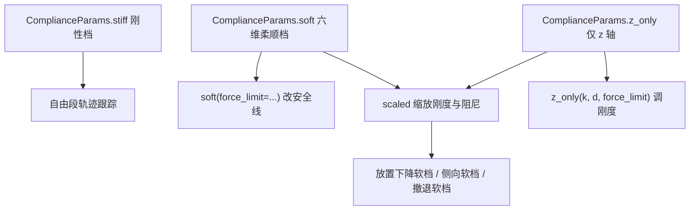
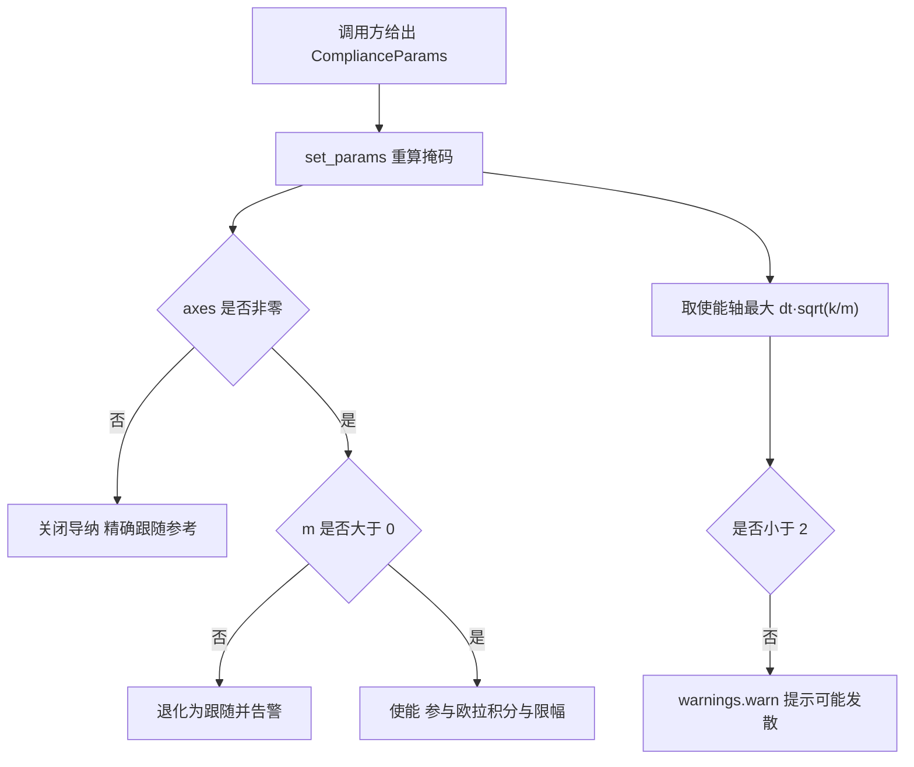

# 柔顺档位与轴掩码

上一篇讲控制律的数值形式，本文讲参数怎么来。参数契约在 `core/types.py` 的 `ComplianceParams`，默认档位在 `core/config.py`，抓取与放置用的专用档在 `skills/library.py`。`MotionRunner.follow()` 每次执行前调用 `AdmittanceController.set_params()`，把当次动作的档位装进控制器。

## 六个参数的职责

`ComplianceParams` 是普通 dataclass，字段长度都是 6，顺序与导纳状态一致，为 [x, y, z, rx, ry, rz]。

| 字段 | 默认值 | 作用 |
| --- | --- | --- |
| k | 无默认，必须给 | 每轴刚度；越大越"顶住"，让位越小 |
| d | 无默认，必须给 | 每轴阻尼；决定让位过程的振荡与超调 |
| m | 无默认，必须给 | 每轴虚拟质量；与 k 共同决定带宽 |
| axes | 无默认，必须给 | 1.0 启用导纳、0.0 关闭该轴 |
| force_limit | 10.0 | 接触力中止阈值，属于安全线而非柔顺度 |

`to_json()` 把六个字段序列化成带 `k` / `d` / `m` / `axes` / `force_limit` 的字典，用于 VLM 观察与日志。`force_limit` 单独有默认值 10.0 N，其余四个字段没有默认值，写错顺序或漏字段会在构造时直接报错。

## 三档基础档位

三个便捷构造覆盖了大部分场景：

| 档位 | k | d | m | axes | force_limit |
| --- | --- | --- | --- | --- | --- |
| `stiff()` | 全 5000 | 全 200 | 全 5 | 全 0 | 15 |
| `soft()` | 平动 300 / 转动 30 | 平动 30 / 转动 6 | 平动 2 / 转动 0.2 | 全 1 | 8 |
| `z_only(k=200, d=25)` | 仅 z 为 200 | 仅 z 为 25 | 仅 z 为 1.5 | 仅 z 为 1 | 8 |

`stiff()` 用 `axes` 全零关闭导纳，而不是把刚度调到极大。这样控制器每步直接把 `x = x_ref`、速度清零，自由空间的移动精度不受虚拟质量影响，等价于纯位置伺服。

`soft()` 全 6 维使能，转动通道的刚度只有平动的十分之一、虚拟质量只有十分之一，因此姿态比位置更容易被外力带偏。它用于接触方向不确定的场合，例如撤退和侧向接近。

`z_only` 只让 z 轴使能，水平方向与姿态保持刚性。抓取对准下降用的是这一档：若换成全 6 维柔顺，接触反力会把末端推横、指垫夹偏，`core/config.py` 的注释记录 30 mm 圆柱在这条路径上必然失败。

按 $dt\sqrt{k/m}$ 计算，三档的稳定性比值分别为：`stiff()` 没有使能轴，比值为 0；`soft()` 平动与转动都是 0.0245；`z_only` 默认参数为 0.0231（$dt = 0.002$）。三者都远低于 2 的边界。

## scaled 缩放规则

`scaled(factor)` 在已有档位上调柔顺度，规则是刚度乘 $f$、阻尼乘 $\sqrt{f}$、虚拟质量与力上限保持不变：

```python
def scaled(self, factor: float) -> "ComplianceParams":
    f = float(np.clip(factor, 0.01, 100.0))
    return ComplianceParams(
        k=self.k * f, d=self.d * np.sqrt(f), m=self.m, axes=self.axes.copy(),
        force_limit=self.force_limit,
    )
```

阻尼取平方根是为了保持阻尼比不变。阻尼比定义为 $\zeta = d / (2\sqrt{k m})$，代入 $k' = f k$、$d' = \sqrt{f} d$ 后得到 $\zeta' = \zeta$。若阻尼也线性缩放，档位变软的同时会变得过阻尼，退让过程变慢。

输入先被钳制到 [0.01, 100]。传 0 不会得到零刚度，而是拿到 0.01 倍的下限；传负数同样落到 0.01。缩放后的对象是新构造的，`axes` 做了拷贝，但 `force_limit` 是标量复制，两者不共享内存。



## 轴掩码的计算方式

`axes` 在构造与 `set_params()` 时被解析成布尔掩码 `_enabled`。判据是"非零且虚拟质量为正"：

- `axes[i] == 0`：该轴不参与导纳，每步 `x = x_ref`、速度清零。
- `axes[i] != 0` 且 `m[i] > 0`：该轴使能，参与半隐式欧拉与单步限幅。
- `axes[i] != 0` 且 `m[i] <= 0`：配置非法，该轴退化为跟随并抛出一次 `RuntimeWarning`。

源码用 `raw = axes != 0.0` 判断，所以 `axes` 取 2 或 0.5 都按使能处理，不会做真假归一化。掩码变化后，被关闭的轴立即吸附到 `x_ref`，防止旧位置状态在下次使能时生效。



## config 与技能库里的专用档

`core/config.py` 定义了默认档与两个专用档：

| 名称 | 定义 | force_limit | 用途 |
| --- | --- | --- | --- |
| `DEFAULT_COMPLIANCE` | `z_only()` | 8 | 默认档，也是 `MotionRunner` 自建控制器时的参数 |
| `SOFT_COMPLIANCE` | `soft()` | 8 | 六维柔顺 |
| `STIFF_COMPLIANCE` | `stiff()` | 15 | 自由空间运动 |
| `PLACE_COMPLIANCE` | `z_only(k=120, d=20)` | 20 | 早期放置下降，注释记录 20 N 档先 21.6 N 中止 |
| `GRASP_COMPLIANCE` | `z_only(k=200, d=25)` | 15 | 抓取对准下降 |

`skills/library.py` 在技能层再定义一批专用档，它们都从上面的档派生：

| 名称 | 派生方式 | 结果要点 |
| --- | --- | --- |
| `PLACE_TOUCH_COMPLIANCE` | `z_only(k=120, d=20, force_limit=6)` | 守卫式放置下降，6 N 轻触即停 |
| `PLACE_DESCENT_SOFT_COMPLIANCE` | 上一档 `scaled(0.35)` | $k_z = 42$、$d_z \approx 11.83$，力上限仍 6 |
| `PLACE_APPROACH_SOFT_COMPLIANCE` | `soft(force_limit=15).scaled(0.35)` | 平动 $k = 105$，转动 $k = 10.5$ |
| `PLACE_SIDE_SOFT_COMPLIANCE` | `soft(force_limit=6).scaled(0.6)` | 平动 $k = 180$，侧向推进专用 |
| `PLACE_PICK_DESCEND_COMPLIANCE` | `z_only(k=200, d=25, force_limit=6)` | 抓取下降，刚度与旧实现一致 |
| `RETREAT_COMPLIANCE` | 手工构造全 6 维 | 平动 $k = 120$、转动 $k = 20$，力上限 45 |

缩放的算术结果按 `scaled` 的规则算出：$0.35$ 档的刚度乘 0.35、阻尼乘 0.5916。派生过程不改 `force_limit`，安全线由各档自己指定，与柔顺度解耦。

技能库用 `PROFILES` 字典把三个基础档名映射到对象，供 `set_compliance` 技能按名字取用：

```python
PROFILES: dict[str, ComplianceParams] = {
    "stiff": STIFF_COMPLIANCE,
    "soft": SOFT_COMPLIANCE,
    "z_only": DEFAULT_COMPLIANCE,
}
```

调用方给出的 `force_limit` 不会被直接采用。技能库按技能基准档取二者的较大值作为下界，原因是 `force_limit` 属于接触异常中止保护，若允许 VLM 把阈值降到 8 N，正常贴面放置都会被判超限。

## 档位选择速查

| 场景 | 档位 | 依据 |
| --- | --- | --- |
| 自由空间移动、抬升 | `stiff()` | 不需要让位，位置精度优先 |
| 抓取对准下降 | `z_only(k=200, d=25)` | 水平与姿态刚性，只吸收 z 向误差 |
| 接触式放置下降 | `z_only(k=120, d=20, force_limit=6)` | 轻触即认为到位 |
| 叠放 / 容器内落放 | 放置下降软档 | 更软的刚度压低接触峰值 |
| 卡滞撤退 | `RETREAT_COMPLIANCE` | 方向不确定，需要六维让位 |
| 侧向夹持推进 | 侧向软档 | `GRASP_COMPLIANCE` 水平方向没有导纳，硬顶会冲高力 |

## 易错点与调试

| 现象 | 原因 | 处理 |
| --- | --- | --- |
| 某轴完全不柔顺 | 该轴 `axes = 0`，或 `m = 0` 被判非法 | 检查 axes 与 m 是否配套 |
| 换了软档仍硬顶 | 只改了 k，axes 仍指向原轴 | 档位要连同 axes 一起换 |
| 档位变软后接触峰值没降 | 峰值由限速与力看门狗决定，不由刚度决定 | 改 `v_max` 与看门狗阈值 |
| VLM 说"轻一点"后放置失败 | 力阈值被当成柔顺度调低 | 保留技能基准力限作为下界 |
| 修改默认档后其它技能也变了 | 模块级对象被原地改写 | 用 `scaled` 派生新对象 |

模块级的 `DEFAULT_COMPLIANCE`、`SOFT_COMPLIANCE` 等是共享对象，测试与技能都可能读到。要调整参数应通过 `scaled()` 或新建 `ComplianceParams`，不要直接改字段。

查看某次动作实际使用的档位，可以读控制器的状态快照：

```python
from control.admittance import AdmittanceController

snap = ctrl.state()
print(snap["enabled"], snap["params"], snap["stability_ratio"], snap["stable"])
```

## 档位与安全线的分离

柔顺度与安全线是两个独立的旋钮。k / d / m 决定受力后让位多少，`force_limit` 决定多大接触力算异常。项目的做法是：调柔顺度只动前三个，安全线由每个技能单独指定，并在技能层设置下界。抓取下降的档位刚度与原实现一致，把接触峰值压下来的是限速与每步力看门狗，这部分见同单元《力看门狗与接触安全》。
