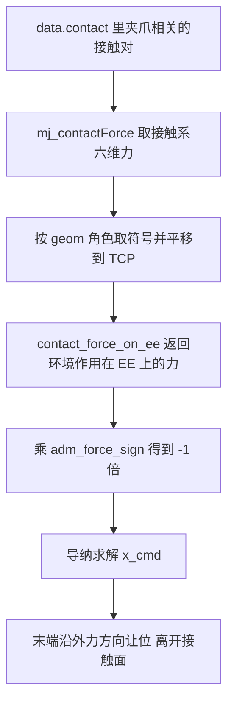
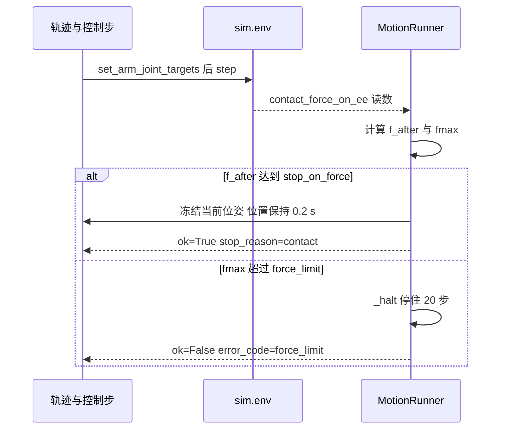

# 力看门狗与接触安全

导纳解决"受力后让位多少"，力看门狗解决"失控时怎么停"。两者都在 `control/motion.py` 的 `MotionRunner` 里，与 `control/admittance.py` 的控制器配合。力读数来自 `sim/env.py` 的 `contact_force_on_ee()`，独立验证在 `tests/test_admittance_safety.py`。技能层还有一层撤退与合爪的力封顶，放在 `skills/library.py`。

## 力的来源与符号约定

`contact_force_on_ee()` 遍历 `data.contact`，只保留至少一个 geom 属于夹爪 body 的接触对，用 `mj_contactForce` 取接触系里的 6 维力，再转回世界系。MuJoCo 给的力作用在 `geom2` 上，因此该函数按 geom 的角色取正负号，最后把力矩从接触点平移到 TCP 的 `g_pinch`。没有接触时返回全零。

它返回的语义是"环境施加在末端上的力"。下压桌面时末端受力朝 +z。冻结方程右侧是 $-f_{ext}$，直接把该读数喂进导纳会让参考点继续往接触面里压。`MotionRunner` 因此留了一个符号：

```python
#: 默认 -1.0 = 正确语义：EE 沿 +f 方向让位（离开接触面）
self.adm_force_sign = -1.0
...
wrench = self._wrench()                      # 原始读数：|F| 与 metrics 沿用 sim 约定
adm_wrench = wrench * float(self.adm_force_sign)
x_cmd = self.adm.update(np.concatenate([pos_ref, np.zeros(3)]), adm_wrench)
```

取负之后，环境给末端的力方向就是让位方向：桌面把末端往上推，末端就往上离开。源码注释记录旧符号（+1.0）在接触中会把力一路顶到 11 N、38 N、60 N。自由空间里 $f_{ext} = 0$，符号对轨迹没有任何影响，`control/smoke.py` 与 `tests/test_admittance_safety.py` 都用逐位比较确认了这一点。



## 两级力上限

力阈值有两个层次。第一层是柔顺档自带的 `force_limit`，表示这次动作允许多大接触力。第二层是执行器自己的硬上限 `force_limit_cap`，默认 200 N。

| 入口 | 行为 |
| --- | --- |
| `force_limit=None` | 采用柔顺参数的 `force_limit`，不经过硬上限 |
| 显式传入数值 | 超过 `force_limit_cap` 时钳到 200 N 并 `warnings.warn` |
| `force_limit_cap=float('inf')` | 显式关闭硬上限，原值直接使用 |

`_resolve_force_limit()` 实现这条规则：

```python
if force_limit is None:
    return float(params.force_limit)
value = float(force_limit)
cap = float(self.force_limit_cap)
if np.isfinite(cap) and value > cap:
    warnings.warn("force_limit 超过底层硬上限，已钳制到 cap", RuntimeWarning, stacklevel=2)
    return cap
return value
```

硬上限存在的理由是调用方不自律：技能层曾经传过 $10^9$ 作为力限。它不限制柔顺参数自带的值，因此把档位里的 `force_limit` 写成 6 N 或 20 N 不需要改这个上限。

## 每步力检查与接触即停

`follow()` 的每个控制步在 `env.step()` 之后读一次力，先判接触即停，再判硬限：

```python
if stop_on_force is not None:
    f_after = float(np.linalg.norm(self._wrench()[:3]))
    if f_after >= stop_on_force:
        return self._freeze_and_return(pos_ref, quat_ref, flim, q_seed,
                                       steps, max_force, f_after)
if fmax > flim:
    return self._abort("force_limit", "接触力超限", max_force, steps)
```

顺序是关键。一次单步撞击可能同时超过两个阈值，若硬限先判就永远没有机会做接触即停。源码注释记录的现场数据是同一时刻 18.66 N 同时大于 2.5 N 与 15 N，结果被 `force_limit` 掐掉。`stop_on_force=None` 时保持原有行为，硬限先判，逐位不变。

`stop_on_force` 必须大于 0，启用后会关闭速度前馈：任何让参考提前一点点到达的项都可能在接触瞬间多压一点。阈值本身不是错误码，它是到位接触的判据。

## 参考冻结与安全网

`_freeze_and_return()` 在触发的瞬间读取当前 TCP 位姿作为冻结点，然后按 `stop_settle_time`（默认 0.2 s 仿真时间）做位置保持：

- 用触发点的位置与姿态反复调 `kin.ik()`，IK 失败就用上一步解兜底，然后 `set_arm_joint_targets` 加 `step`。
- 把 `target_state` 的 `skill_hint` 记为 `contact_stop`，供查看器显示。
- 安全网只在力继续上涨、超过 `max(force_limit, 2.0 * 触发力)` 时才中止。

系数取 2.0 的原因写在源码注释里：接触后机械臂会因重力静差轻微下沉，实测触发值 11 N 可能静置到 19 N，属于物理静置；旧符号那种一路涨到 60 N 到 200 N 的失控才是要拦的对象，2 倍仍有足够余量。

正常返回走 `_stop_result()`，构造 `ok=True` 的 `MoveResult`，把 `stop_reason` 设为 `contact`，并在 `metrics` 里写入 `force_at_stop` 与 `z_at_stop`。它不调用 `_halt()`，也不产生错误码。



`tests/test_admittance_safety.py` 用真实仿真加可注入力读数覆盖了三条判据：注入 20 N 且硬限 15 N 时，开 `stop_on_force=2.5` 必须正常返回 `contact`，关掉则必须 `force_limit` 中止；冻结后力从 3 N 静置到 11 N 不得被安全网误杀；从 3 N 涨到 20 N 必须中止。

## 中止即停住

任何非成功返回都经过 `_abort()`，它先调用 `_halt()`：把 6 个臂关节目标设成当前关节角，再空步 `halt_steps`（默认 20）步。两个动作缺一不可：

- 目标等于当前关节角，位置伺服不再继续往接触方向压，残留的压入指令被撤销。
- 仍然调用 `step()`，让新命令作用到物理上；只改 `data.ctrl` 而不步进时，接触仍按旧穿透演化。

源码注释记录的现场数据是：不做 `_halt` 时，一次失败的预检返回会让上一帧的压入指令继续生效，0.2 s 内末端力冲到 7471 N 并把物体抛飞。`_halt` 里所有异常都被吞掉，中止路径必须能返回 `MoveResult`，不能因为清场再抛异常。halt 的步数不计入返回结果的 `steps` 与 `duration`，不额外占用上层预算。

## 限速下降与速度前馈

接触段的冲击与单步压入量成正比。`follow()` 支持 $v_{max} > 0$，此时 `_RateLimitedTraj` 忽略原轨迹时长，按 $n = \lceil length / (v_{max} \cdot dt) \rceil$ 重新划分，参考点每步只前进 $v_{max} \cdot dt$。$v_{max} = 0.008$、$dt = 0.002$ 时单步压入 16 µm。该模式同时关闭速度前馈，因为前馈是按 0.15 m/s 量级算出的超前项，接触段会把参考顶进接触面。

真实刚性桌面 60 mm 下降的首触力标定（z_only、`force_limit=3.0`、桌面 z = 0.40）记录如下：

| v_max | 首触力 |
| --- | --- |
| None | 171.2 N |
| 0.016 | 28.36 N |
| 0.008 | 13.42 N |
| 0.004 | 6.58 N |
| 0.0035 | 4.88 N |
| 0.003 | 7.23 N |
| 0.0025 | 6.74 N |
| 0.002 | 3.44 N |

总体上力随 `v_max` 下降，0.008 以上近似正比。0.004 以下不再是单调函数，因为接触落在哪一个控制步会带来 ±3 N 的离散。要把首触力稳定压到 5 N 以内，需要 $v_{max} \le 0.002$。技能库据此给不同场景分配速度：

| 常量 | 值 | 用途 |
| --- | --- | --- |
| `CONTACT_VMAX` | 0.003 | 放置最后 10 mm 的接触下降 |
| `PLACE_APPROACH_VMAX` | 0.006 | 叠放与容器落放的接近段 |
| `PICK_VMAX_SLENDER` | 0.008 | 细高物体抓取最后 10 mm |
| `PICK_CRUISE_VMAX_SLENDER` | 0.03 | 细高物体巡航段 |
| `PICK_VMAX_BOX` | 0.03 | 方块等低矮物体的抓取下降 |

## 技能层的力封顶

除执行器外，技能库还设了几条独立的安全线：

| 常量 | 值 | 含义 |
| --- | --- | --- |
| `PLACE_TOUCH_COMPLIANCE.force_limit` | 6 N | 放置下降的轻触即停阈值 |
| `RETREAT_FORCE_CAP_N` | 45 N | 任何撤退与脱身的力限硬封顶 |
| `RETREAT_MIN_FORCE_N` | 40 N | 撤退力限下界，配合 1.5 倍余量取进入力 |
| `PICK_CLOSE_FORCE_MAX_N` | 45 N | 合爪过程中的力看门狗 |
| `HOME_SAFE_FORCE_N` | 5 N | 瞬移归位的前置条件之一 |

撤退的旧实现传 $10^9$ 作为力限，理由是别被现有接触力中止，结果是位置伺服与导纳积分形成正反馈：撤退期间 TCP 从 0.412 掉到 0.384，力从 20 N 涨到 8437 N。现在取进入力的 1.5 倍并夹到 [40, 45] N；正常脱身时力在下降，不会误触发，卡死则立即中止，交给执行器的 `_halt` 与关节空间退化接管。用户实测日志里那套 5 方向、逐级抬高到 40 / 43.5 / 52.4 / 60.7 / 68.6 N 的阶梯已废弃，力反而从 16 N 涨到 59.8 N。

放置下降的旧档位是 20 N，实测先以 21.6 N 中止，随后卡死、接触力到 400 到 500 N。现在改成 6 N 档的守卫式下降，并把因 `force_limit` 中止解释为轻触到位，不判失败。

## 验证入口与已知问题

执行器侧的安全回归入口是 `control/smoke.py` 的导纳与符号用例、`tests/test_admittance_safety.py` 的独立复核，以及 `tests/run_acceptance.py` 的全链路验收。后者在 2026-10-12 实跑 9/10 通过，唯一失败项是 `tests/test_target_overlay.py` 的 `test_injected_force_pure_compliance`：该用例注入 +z 方向的力后，期望 `adm_pos - ref_pos` 的 z 分量为负，而 `MotionRunner` 默认把旋量乘 -1，稳态位移方向与之相反。这个方向约定冲突的归因见同单元《导纳控制的易错点与调试》。

## 安全边界汇总

| 边界 | 数值 | 触发后果 |
| --- | --- | --- |
| 档位 force_limit | 6 至 20 N | 非成功返回 force_limit，先 halt |
| 接触即停阈值 | 调用方给出，常用 1 至 2.5 N | 正常返回 stop_reason=contact |
| 冻结窗安全网 | max 硬限与 2 倍触发力 | 继续上涨才中止 |
| force_limit_cap | 200 N | 钳制显式传入的超大阈值 |
| halt_steps | 20 步 | 撤销残留压入指令 |
| 撤退力封顶 | 45 N | 卡死时中止并退化脱身 |
