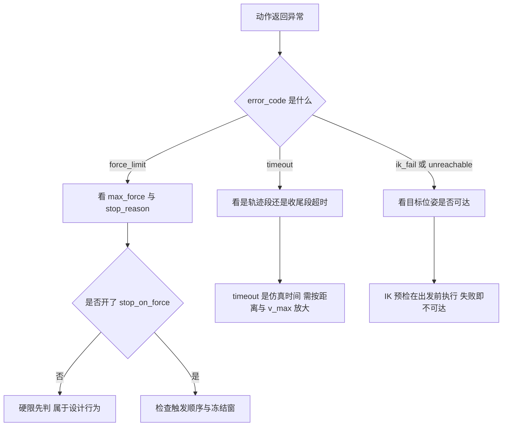
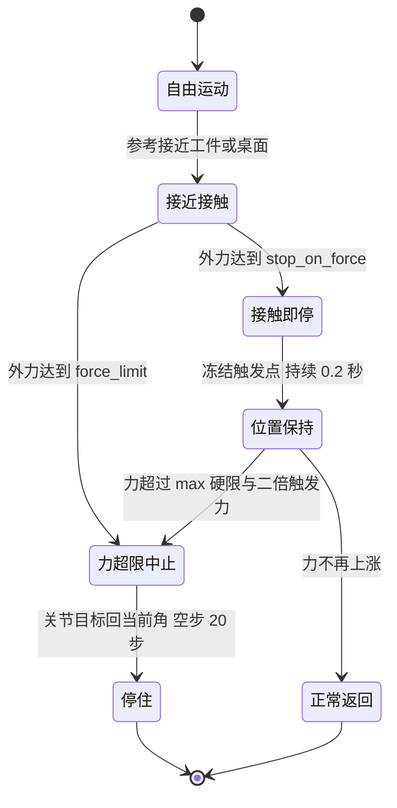

# 导纳控制的易错点与调试

前几篇分别讲控制律、档位与安全机制。本文汇总把它们接进技能与仿真时出现过的故障、排查顺序，以及可以复现的验证入口。涉及 `control/`、`core/`、`sim/env.py`、`skills/library.py` 与 `tests/`。

## 排查顺序

出现异常时按固定顺序定位，避免一上来就改增益：

1. 看 `MoveResult.error_code`。`timeout` / `force_limit` / `ik_fail` / `unreachable` / `invalid_path` 五个码分别指向超时、力超限、IK 失败、预检不可达与路径非法。
2. 看 `stop_reason` 与 `metrics`。`stop_reason=contact` 配 `force_at_stop` 表示正常接触即停，不是失败。
3. 看 `MotionRunner.target_state()`。`ref_pos` 是轨迹参考，`adm_pos` 是纯导纳输出，`cmd_pos` 是实际下发的命令，`force_norm` 是本步外力模长。
4. 最后看 `AdmittanceController.state()`。`enabled`、`clipped`、`stability_ratio` 分别回答轴是否使能、是否触顶、离散是否接近边界。



## 让位方向与符号

力符号是集成阶段最容易搞反的一处。`sim.contact_force_on_ee()` 返回的是环境施加在末端上的力，而冻结方程右侧是 $-f_{ext}$。执行器默认 `adm_force_sign = -1.0`，含义是末端沿这个读数指示的方向让位。判断方向是否正确可以用自由空间做对照：无接触时读数为零，符号对轨迹没有任何影响，两次运行的终态可以逐位比较。

判外力要用 `target_state()` 的 `force_norm`，不要用 $|adm\_pos - ref\_pos|$。后者含导纳的稳态滞后 $(D/K) \cdot v$，自由空间里也有 5 mm 量级的数值，把它当让位判据会误报。

转动通道的让位只在姿态轴使能时出现。`z_only` 档关闭了转动轴，自由空间里的旋转让位应当接近零；若观察到明显的姿态偏移，先确认 `axes` 的后三维是不是被误开。

## 已知的方向口径冲突

`tests/run_acceptance.py` 在 2026-10-12 实跑 9/10 通过，唯一红项是 `tests/test_target_overlay.py` 的 `test_injected_force_pure_compliance`。该用例对注入力 +8 N 与 -8 N 两种情形，检查 `adm_pos - ref_pos` 的 z 分量中位数的符号，期望它与注入力相反。

执行器把旋量乘 -1 后再送入导纳，稳态关系是 $x - x_{ref} = f_{injected}/K$，符号与用例期望相反。按现有实现，该用例的方向断言与 `adm_force_sign = -1.0` 的口径不一致。归因属推断：可能是用例仍按旧符号写成，也可能是符号修正只应作用于接触判断而不应改变纯导纳的参考方向，需要现场确认后再决定改测试还是改控制律。同一文件里其余让位用例（自由空间停稳后让位趋零、真实接触让位超过阈值）与执行器的符号修正是一致的。

## 参数配置

| 现象 | 原因 | 处理 |
| --- | --- | --- |
| 导纳按错误步长离散 | 注入的控制器 dt 与 env.dt 不一致 | 构造时传 env.dt，不一致会有告警 |
| 位移缓慢发散 | $dt\sqrt{K/M}$ 接近或超过 2 | 降低 k、提高 m 或减小 dt |
| 某轴完全不动 | axes 关闭，或 m 小于等于 0 被判非法 | 补上配套的 k / d / m |
| 使能轴的 k 为 0 | 稳定性计算跳过该轴，但没有回复力 | 关闭该轴或给出正的 k |
| 改了默认档影响别的技能 | 模块级对象被原地修改 | 用 scaled 派生或新建对象 |
| 缩放倍率传 0 没有变零刚度 | 输入被钳到 [0.01, 100] | 用关闭轴而不是零刚度表达 |

`force_limit` 与柔顺度是两件事。把它当作轻一点的旋钮调低，会让正常贴面放置被判超限；技能库已经把技能基准力限作为下界，调用方给出的更小值不会生效。

## 集成行为

- 接触即停要先于硬限判定。若把 `stop_on_force` 关掉，单步撞击会直接以 `force_limit` 中止，看起来像接触即停失效，实际是判定顺序被跳过。
- 冻结窗的安全网按继续上涨触发，静置下沉不算上涨。触发值本身可能已经高于硬限，此时不中止是设计行为。
- 中止路径必须同时改关节目标并步进。只恢复 `data.ctrl` 而不 `step`，接触仍按旧穿透演化；这是 7471 N 那次事故的直接原因。
- `timeout` 是仿真时间。启用 `v_max` 后总时长由距离决定，调用方要按距离除以 `v_max` 再留余量放大，否则一定超时。
- 收尾伺服与轨迹段共用同一个 `timeout` 预算，收尾也受力和超时约束。
- 每次笛卡尔运动开始时会清零任务空间积分，跨动作不会累积。

抓取下降只用 z 向柔顺。`GRASP_COMPLIANCE` 是 `z_only`，水平与姿态保持刚性；换成六维柔顺档时，接触反力会把末端推横、指垫夹偏，30 mm 圆柱在这条路径上失败。侧向推进是例外：`z_only` 在水平方向没有导纳，硬推进会顶出极高的接触力，所以侧向专用档是全六维使能。

## 验证入口

| 入口 | 覆盖内容 |
| --- | --- |
| `control/smoke.py` 的 `TestAdmittance` | 修正方向、非使能轴跟随、单步限幅、阶跃稳态、不可稳告警 |
| `control/smoke.py` 的符号用例 | 自由空间逐位一致、接触时让位方向与力有界 |
| `tests/test_admittance_safety.py` | 真实仿真下的符号、接触即停优先序、冻结窗安全网 |
| `tests/test_target_overlay.py` | `target_state` 语义与让位量级，含上面那条红项 |
| `tests/run_acceptance.py` | 各模块 smoke 与端到端抓放 |

单独跑导纳相关用例：

```bash
MUJOCO_GL=glfw python -m control.smoke
MUJOCO_GL=glfw python -m tests.test_admittance_safety
MUJOCO_GL=glfw python -m tests.test_target_overlay
```

## 调试探针

不启动查看器也能读到三个层次的量：

```python
st = runner.target_state()
print(st["force_norm"], st["adm_delta"], st["skill_hint"])
print(st["ref_pos"], st["adm_pos"], st["cmd_pos"])

snap = runner.adm.state()
print(snap["enabled"], snap["clipped"], snap["stability_ratio"], snap["stable"])
```

`adm_delta` 等于 $|cmd\_pos - ref\_pos|$，它把导纳让位与积分静差补偿加在一起；要单独看导纳让位应使用 `adm_pos - ref_pos`，要单独看积分补偿应使用 `cmd_pos - adm_pos`。三个量的这个关系在查看器的目标点显示里也是按此区分的。

接触过程的阶段可以用状态机描述：



## 现象与探针对照

| 观察到 | 优先查 | 常见结论 |
| --- | --- | --- |
| 接触力冲高后中止 | `stop_reason` 是否为空 | 未开接触即停，或判定顺序被跳过 |
| 末端朝接触面里压 | `adm_force_sign` 与力读数语义 | 符号弄反，需保持 -1 |
| 让位量随速度增大 | `force_norm` 与 `adm_pos - ref_pos` | 后者含稳态滞后，不是让位判据 |
| 动作结束后末端没到点 | 收尾段是否提前超时 | `timeout` 是仿真时间，需按距离放大 |

## 边界与不确定项

| 条目 | 状态 |
| --- | --- |
| 稳定判据 $dt\sqrt{K/M} < 2$ | 从源码注释的离散推导与特征多项式可得 |
| 三档与专用档的缩放数值 | 按源码公式直接计算 |
| 首触力随 v_max 的表格 | 源项目注释记录的实测值，未在本轮重跑 |
| 让位方向红项的归因 | 属推断，需现场确认改测试还是改实现 |
| 各技能的超时与速度常量 | 源项目注释记录为实测，属经验值 |

最后一处冲突在执行器内部：`_freeze_and_return()` 的 docstring 写继续用同一个 `pos_ref` / `quat_ref` 调 `_apply_reference`，参考不再前进但导纳仍让位，而函数体实际是读取触发点 `pos_stop` 后反复做 IK 位置保持，两个入参并未被使用。以代码为准：冻结窗内是位置保持，不是导纳继续让位。该 docstring 属待更新项。

另有一处字段注释与实现不一致：`core/types.py` 的 `MoveResult.stop_reason` 注释把默认值写成 `target`，而 `control/motion.py` 的正常到位路径不设置该字段，读出为 `None`；只有接触即停会写 `contact`。读取这个字段时应按 `None` 与 `contact` 区分，不要依赖 `target`。

## 集成检查表

接手或修改导纳相关代码时，按这张表过一遍即可覆盖本轮验证过的边界：

| 检查项 | 期望 |
| --- | --- |
| 控制器 dt 与 env.dt | 一致，不一致有告警 |
| 使能轴 m | 全部大于 0 |
| 稳定性比值 | 远低于 2 |
| 力符号 | 自由空间两符号逐位一致，接触时末端离开接触面 |
| 接触即停优先序 | 开 stop_on_force 时硬限不抢先中止 |
| 冻结安全网 | 静置不误杀，继续上涨才中止 |
| 中止停住 | 非成功返回前已完成 halt |
| 限速模式 | 速度前馈关闭，timeout 已放大 |
| 档位 | 抓取下降为 z_only，侧向推进为六维 |
