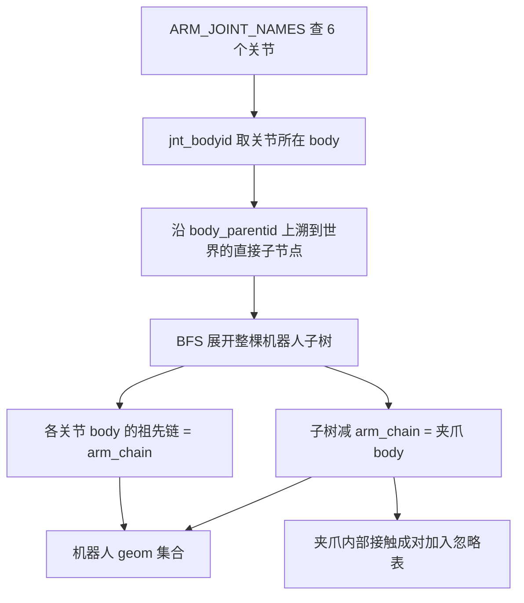
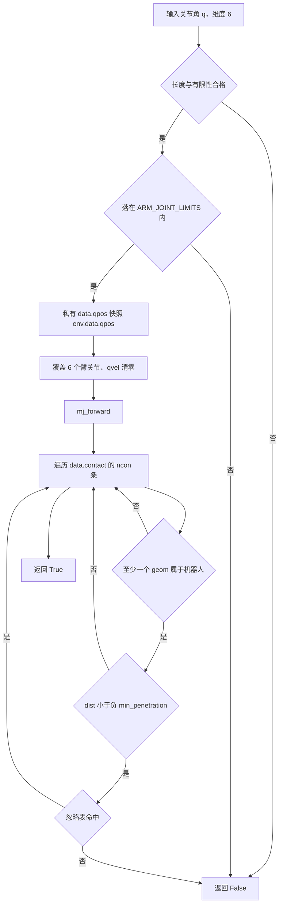

# 关节空间碰撞检测

本单元对应 `TC635807/vlm-admittance` 的 `planning/` 目录。RRT-Connect 每扩展一步都要问两件事：这组关节角能不能用，两个关节角之间能不能直线走过去。`planning/collision.py` 的 `CollisionChecker` 负责回答，它的输出决定整棵树往哪个方向长。

MuJoCo 的碰撞由位置决定，给定完整 `qpos` 跑一次 `mj_forward`，所有接触对就写进 `data.contact`。检测器把这条性质直接当查询原语，一次位形查询等于一次前向计算。判断逻辑有两层：先建出「哪些 geom 属于机器人」的集合，再在接触对列表上按三条判据筛选。

## 位置决定的碰撞与私有 MjData

查询用的数据对象在构造时新建，与仿真主状态分开：

```python
self.model = env.model
#: 私有临时 MjData —— 全程只读写它，绝不碰 env.data
self.data = mujoco.MjData(self.model)
```

`_collision_free()` 每次都先把 `env.data.qpos` 整份拷贝进私有对象，再只覆盖 6 个臂关节，最后清空速度：

```python
data.qpos[:] = self.env.data.qpos[:]
data.qpos[self.qpos_idx] = q
data.qvel[:] = 0.0
mujoco.mj_forward(self.model, data)
```

拷贝整份 qpos 说明规划看到的是**当前场景**：物体已经滚到哪儿、夹爪开合多少，都按查询时刻的真实状态算，而不是复位时的初始场景。只覆盖 6 个臂关节说明夹爪自由度与物体位姿留在仿真里，规划过程不推进它们中的任何一个。速度清零与接触几何无关，作用是让同一组关节角每次得到同样的接触列表。

`planning/smoke.py` 把「不污染 `env.data`」写成断言：连续 30 轮 `is_state_valid` 与 `is_edge_valid` 之后，`env.data.qpos` 与 `env.data.qvel` 必须逐元素不变。之所以用测试而不是注释来固定这条约束，是因为状态被污染之后的表现是物体缓慢漂移，离调用点很远，靠读代码难以定位。

前向计算的选择另有一层考虑：这里用 `mj_forward` 而不是 `mj_step`。前者只算运动学、碰撞与约束派生量，不做积分，单次开销小且不改任何状态。规划阶段只需要接触信息，用 `mj_step` 会顺手推进仿真。

## 机器人几何集合怎么建出来

「至少一个 geom 属于机器人」是筛选接触对的第一条判据，集合本身从关节名反推，不依赖硬编码的 body 编号：

```python
joint_bodies = []
for jname in ARM_JOINT_NAMES:
    jid = mujoco.mj_name2id(model, mujoco.mjtObj.mjOBJ_JOINT, jname)
    if jid >= 0:
        joint_bodies.append(int(model.jnt_bodyid[jid]))
```

得到 6 个关节所在的 body 之后，从第一个 body 沿 `body_parentid` 上溯到世界的直接子节点，得到机器人根节点；再用 BFS 展开整棵子树。子树的 body 集合被切成两半：各关节 body 的祖先链是 `arm_chain`，子树里剩下的部分就是挂上来的夹爪。

| 集合 | 构造方式 | 用途 |
| --- | --- | --- |
| `subtree` | 从机器人根节点 BFS 展开 | 界定「机器人 body」的边界 |
| `_arm_bodies` | 各关节 body 的祖先链（含根节点） | 区分连杆与夹爪 |
| `_gripper_bodies` | `subtree - arm_chain` | 默认忽略夹爪内部接触 |
| `_is_robot_geom` | geom 所在 body 落在 subtree 内 | 接触对筛选第一条判据 |
| `_is_gripper_geom` | geom 所在 body 落在夹爪集合内 | 构造默认忽略表 |

这个划分方式是「按结构」而不是「按名字前缀」，因此不依赖 `g_` 前缀。UR5e 的碰撞 geom 在 XML 里没有 `name`，只有 visual mesh 才命名过，靠名字前缀认机器人会漏掉整条连杆；2F85 侧只有指垫有名字（`g_right_pad1`、`g_left_pad` 一类）。从关节名出发的划分对模型改名、加物体都不敏感。



## 接触对筛选：ncon 只说明有接触

`data.ncon` 是接触对总数，直接拿它判合法性会让所有位形都非法：桌面上永远有物体压着桌子的接触，堆叠物体之间也有接触。真实场景在物体沉到桌面之后实测 `ncon=21`，下沉量约 1.6e-4 m；如果把这些接触算成碰撞，连 HOME 位形都会被判非法。

筛选在接触列表上逐条走，三条判据全过才判碰撞：

$$\text{collide}(g_1,g_2) \iff \big(\text{robot}(g_1)\lor\text{robot}(g_2)\big)\land \mathrm{dist} < -\text{min\_penetration} \land \lnot\text{ignore}[g_1,g_2]$$

| 判据 | 条件 | 不满足时的实际含义 |
| --- | --- | --- |
| 机器人参与 | 两个 geom 至少一个属于机器人 | 物体压桌面、物体互相堆叠 |
| 穿透深度 | `contact.dist < -min_penetration` | 默认只统计实际穿透，相切与分离不算 |
| 忽略表 | `ignore_mask[g1, g2]` 为假 | 夹爪内部自接触、调用方显式指定的对 |

```python
for i in range(int(data.ncon)):
    c = data.contact[i]
    g1, g2 = int(c.geom1), int(c.geom2)
    if not (is_robot[g1] or is_robot[g2]):
        continue
    if c.dist >= -min_pen:
        continue
    if ignore[g1, g2]:
        continue
    return False
return True
```

`min_penetration` 默认 0.0，即只要出现实际穿透就判碰撞；构造之后可以调大，比如 1e-4，用来吸收网格数值噪声带来的误报。它作用在 `dist` 上，不是作用在接触对数量上。

还有一条语义约定来自 `INTERFACES.md`：规划默认要求不碰任何东西，包括不碰桌上的目标物体。贴近与抓取阶段的接触由 `control` 的笛卡尔运动负责，规划器不替它放行。这条约定让 `planning` 的合法性判据保持单一，代价是带载时手持物与指垫的持续接触会被算成碰撞，需要调用方临时忽略。

## 限位判据与直线段采样

位形合法性与边合法性的分工写在两个方法里。`is_state_valid()` 先做长度、有限性与限位检查，再把位形交给碰撞查询：

```python
if q.size != self.n_arm:
    return False
if not np.all(np.isfinite(q)):
    return False
if np.any(q < self.q_min) or np.any(q > self.q_max):
    return False
return self._collision_free(q)
```

限位边界取 `core/config.py` 的 `ARM_JOINT_LIMITS`，比较用的是严格不等号，因此端点算在限位内。六个关节里只有 elbow 是 ±3.1415，其余五关节是 ±6.28319，采样盒因此不是超立方体。

`is_edge_valid()` 默认 `steps=12`，采样 `steps+1` 个点含两端，中间点用线性插值：

```python
if not self.is_state_valid(q1) or not self.is_state_valid(q2):
    return False
for k in range(1, steps):
    s = k / steps
    if not self.is_state_valid(q1 + s * (q2 - q1)):
        return False
return True
```

关节空间里的直线段一定落在限位盒内，因为限位盒是凸集，两端都在盒内时整条线段也在盒内。中间点仍然逐个走 `is_state_valid`，目的是让语义统一并支持提前退出。碰撞判定的空间分辨率完全由 `steps` 决定，这个参数由调用方传入：RRT-Connect 传的是按边长度反推的段数，比默认 12 更细，原因见本单元《双向 RRT-Connect》。



## 忽略表的构造与运行时增补

忽略表是一张 `ngeom × ngeom` 的布尔矩阵，构造分两步：

```python
mask = self._is_gripper_geom[:, None] & self._is_gripper_geom[None, :]
for a, b in self.ignore_pairs:
    for g in self._geoms_named(a):
        for h in self._geoms_named(b):
            mask[g, h] = True
            mask[h, g] = True
np.fill_diagonal(mask, False)
```

第一步把「夹爪 geom × 夹爪 geom」整块置真，覆盖夹爪内部四杆机构的自接触与手指互插。第二步把调用方给的 `ignore_pairs` 展开：`_geoms_named()` 同时匹配 geom 名与 body 名，所以 `("forearm_link", "upper_arm_link")` 这类按 body 写的对也能命中，不需要知道连杆上的 geom 有没有名字。最后清掉对角线，避免某个 geom 与自身配成忽略对。

`ignore_pair()` 支持运行时追加并按需重建掩码。上层还用了另一种增补方式：`skills/library.py` 的 `_ignore_contacts_with()` 直接对 `checker._ignore_mask` 求快照、在上下文里把「手持物 geom × 夹爪 geom」置真，`finally` 里整块还原。它服务于带载归位：夹爪夹着物体时起始位形会被判非法，`plan_joint` 直接返回 `None`。只在规划窗口内置位，其它模块看到的碰撞语义不变。

这条协作也说明忽略表是「调用方可以临时改写」的结构，改动范围必须限定在一次规划调用内。

## 调试接口与自检覆盖

`debug_contacts()` 返回某个关节角处所有涉及机器人的接触，每条含 `geom1`、`geom2`、`dist` 与 `ignored` 四个字段，名字取不到时退回 body 名。它不做穿透与忽略过滤，把判断交给调用方，因此适合回答「这个位形为什么被判非法」。

`planning/smoke.py` 的自检覆盖了检测器的几条边界：HOME 位形合法；某个关节加 100 之后非法；全 NaN 非法；长度 5 的数组非法；自环边合法；含超限端的边非法；左右指垫的接触默认被忽略，而 `upper_arm_link` 与 `forearm_link` 之间不被忽略；按 body 名传的 `ignore_pairs` 生效；静态环境接触不影响合法性；`env.data` 不被污染。

绕障用例还用到两个辅助函数：`_direct_line_blocking()` 沿关节直线采样找到第一个非法点，再用 `debug_contacts()` 确认是不是障碍墙造成的；`_find_barrier_goal()` 用「无墙时可直连、有墙时被墙挡死」这个条件反查一个目标位形，保证绕障测试真的绕了东西。

## 易错点与调试

| 现象 | 原因 | 处理方式 |
| --- | --- | --- |
| 所有位形都判非法 | 直接用了 `ncon > 0` | 按机器人几何集合过滤接触对 |
| 忽略某些连杆接触不生效 | 只按 geom 名匹配，而连杆 geom 无名 | 用 body 名，`_geoms_named()` 已同时支持 |
| 带载规划起点非法 | 手持物与指垫持续接触 | 调用 `_ignore_contacts_with()` 临时忽略 |
| 网格噪声导致误报 | 贴合面存在微小穿透 | 调大 `min_penetration`（例如 1e-4） |
| 相邻连杆接触缺失 | MuJoCo 默认 `filterparent=true` | 属预期行为，非相邻连杆仍会生成接触 |
| 同一位形两次结果不同 | 私有数据里残留了上一次速度 | 每次查询前清 `qvel` |

`filterparent` 的默认值需要单独说明：同一 body 内的 geom、以及父子 body 之间的 geom 不会生成接触。因此 `upper_arm_link` 与 `forearm_link` 这种相邻连杆本来就不出现在接触列表里，检测器不需要额外忽略它们；会出现的、也应当判非法的，是**非相邻连杆**的自碰撞。

## 边界与取舍

| 取舍点 | 本工程选择 | 收益 | 代价 |
| --- | --- | --- | --- |
| 计算对象 | 私有 `MjData` | `env.data` 与仿真状态不被改动 | 每次查询复制整份 qpos |
| 前向计算 | `mj_forward` | 单次开销小、无积分副作用 | 只得到接触层派生量 |
| 机器人界定 | 从关节名推 body 子树 | 不依赖 geom 命名与前缀 | 关节名或树结构改动时要重新核对 |
| 碰撞判据 | 接触对加三条筛选 | `ncon` 不再直接决定合法性 | 需维护几何集合与忽略表 |
| 忽略策略 | 默认忽略夹爪内部 | 四杆自接触不误判 | 带载时需调用方临时忽略 |

## 附：本页引用的路径

| 路径 | 用途 |
| --- | --- |
| `planning/collision.py` | `CollisionChecker`：位形与边合法性、接触筛选、调试接口 |
| `planning/smoke.py` | 检测器边界用例与绕障用例的辅助函数 |
| `core/config.py` | `ARM_JOINT_LIMITS` 采样与限位边界 |
| `core/types.py` | `ARM_JOINT_NAMES` 六个臂关节名 |
| `core/interfaces.py` | `PlannerProtocol` 的 `plan_joint` / `plan_pose` 签名 |
| `skills/library.py` | `_ignore_contacts_with()` 规划窗口内临时忽略接触 |
| `INTERFACES.md` | §2.3 规划模块契约 |
