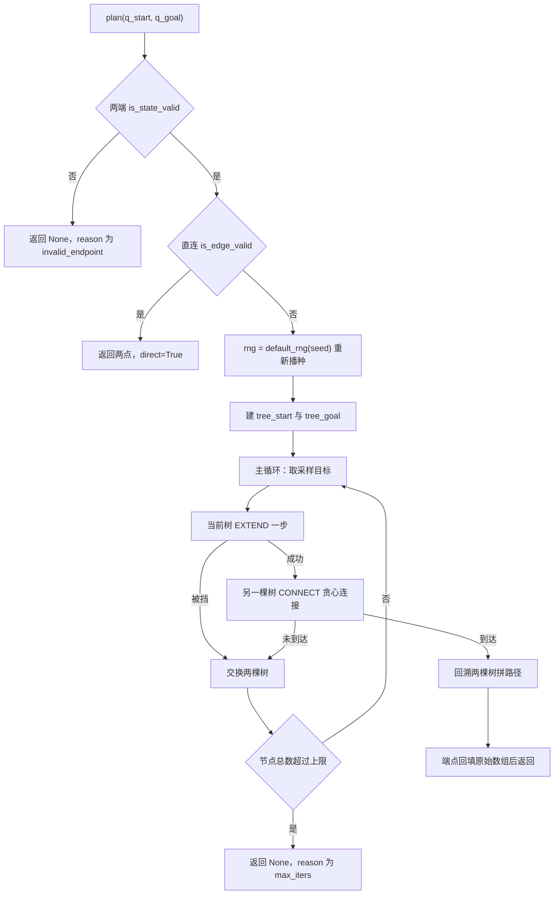
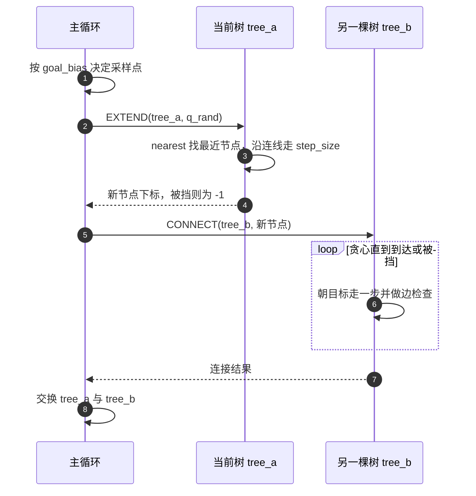
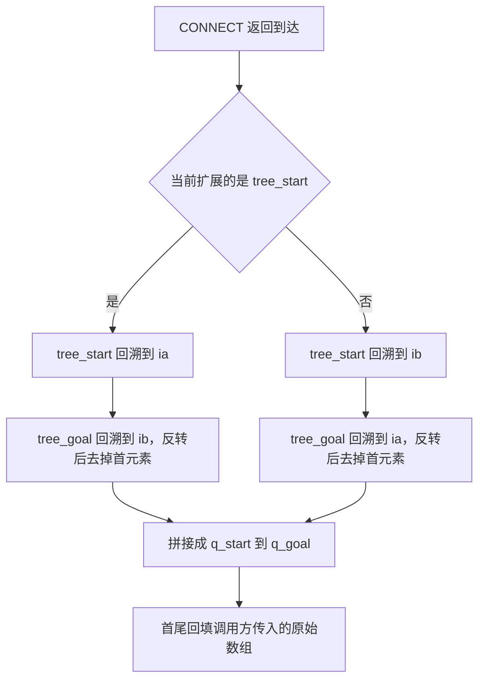

# 双向 RRT-Connect

`planning/rrt_connect.py` 实现双向 RRT-Connect（Kuffner 与 LaValle，2000）。单向 RRT 只从起点长一棵树，靠随机采样逐步逼近目标；双向版本同时从起点和终点各长一棵，任意一棵树朝采样目标扩展成功之后，让另一棵朝新节点做贪心连接，两棵树交替生长直到相遇。

相遇后的路径由两段回溯拼接，天然满足「起于起点、止于终点」。整个模块只依赖 `checker` 提供的 `is_state_valid` 与 `is_edge_valid`，与 MuJoCo 解耦，这也是 `planning/smoke.py` 能用解析式二维障碍做确定性单测的前提。

## 两棵树交替生长

主循环每轮做一件事：让当前树朝一个采样目标走一步；若成功，就让另一棵树朝这个新节点贪心连接。无论成功与否，两棵树交换角色，交换用两个变量轮换完成：

```python
ta, tb = tree_s, tree_g
for it in range(self.max_iters):
    q_rand = tb.q[0] if rng.random() < self.goal_bias else self._sample(rng)
    ia, _reached = self._extend(ta, q_rand)
    if ia >= 0:
        ib, connected = self._connect(tb, ta.q[ia])
        ...
    ta, tb = tb, ta
```

`tb.q[0]` 是另一棵树的根节点。两棵树交换之后，`tb` 始终指向不是当前正在扩展的那一棵。把对方的根直接当扩展目标，等于每隔一段时间强行把两棵树往彼此身上拉，缩短相遇所需的轮数。

树用预分配数组保存节点，容量按 `min(max_iters + 2, 4096)` 起步，不足时翻倍。最近邻是一次向量化算完的：

```python
def nearest(self, target: np.ndarray) -> int:
    arr = self.q[: self.n]
    d = arr - target
    return int(np.einsum("ij,ij->i", d, d).argmin())
```

`einsum` 一次算出全部节点的平方距离，避免逐个节点建临时数组。最近邻是 RRT 里调用最频繁的操作，数组化之后单次查询是一段 O(n) 的向量运算。



## EXTEND 与 CONNECT 的分工

两个方法结构相近，差别在循环次数。**EXTEND** 只走一步，走不动就放弃，返回新节点下标与「是否恰好到达」：

```python
def _extend(self, tree, target):
    i = tree.nearest(target)
    delta = target - tree.q[i]
    d = float(np.linalg.norm(delta))
    if d <= self.connect_eps:
        return i, True
    newq = tree.q[i] + delta * (min(self.step_size, d) / d)
    if not self._valid(tree.q[i], newq):
        return -1, False
    return tree.add(newq, i), bool(d <= self.step_size)
```

新节点落在「从最近节点指向目标」的方向上，长度取 $\min(s, d)$，因此不会越过目标。$d$ 是最近节点到目标的距离，$s$ 是 `step_size`：

$$q_{\text{new}} = q_i + \frac{\min(s, d)}{d}\,\bigl(q_{\text{target}} - q_i\bigr)$$

**CONNECT** 把同样的三步包成循环，反复朝同一个目标走，直到到达或被挡：

```python
while True:
    i = tree.nearest(target)
    delta = target - tree.q[i]
    d = float(np.linalg.norm(delta))
    if d <= self.connect_eps:
        return i, True
    newq = tree.q[i] + delta * (min(self.step_size, d) / d)
    if not self._valid(tree.q[i], newq):
        return -1, False
    i = tree.add(newq, i)
    if d <= self.step_size:
        return i, True
```

两个「到达」判定各有用处。进入函数时 $d \le \mathrm{connect\_eps}$ 说明两棵树已经重合，直接返回当前节点；扩展一步之后 $d \le s$ 说明这一步正好落到目标上。`connect_eps = 1e-9` 是数值守卫：没有它，两棵树根几乎重合时最近节点不再变化，循环会不停添加同一个点。

两者的目标不同。EXTEND 瞄准随机采样点或另一棵树的根，CONNECT 瞄准对方刚生成的新节点，后者的贪心连接是双向版本相对单向版本多出来的核心机制。



## 采样目标：goal_bias 与限位盒

两个采样来源按 `goal_bias` 分配概率，默认 0.1。均匀采样在关节限位盒内进行：

```python
def _sample(self, rng) -> np.ndarray:
    return rng.uniform(self.q_min, self.q_max)
```

上下界来自 `core/config.py` 的 `ARM_JOINT_LIMITS`。六个关节的范围不同，elbow 只有 ±3.1415，其余五关节是 ±6.28319，所以采样区域不是超立方体，靠近 elbow 边界的方向上采样密度更高。

`goal_bias` 在构造时被钳到 $[0, 1]$。取 0 表示完全靠均匀采样，取 1 表示每轮都把另一棵树的根当目标。0.1 是折中：多数轮次保持探索性，少量轮次直接朝对方推进。

| 参数 | 默认值 | 作用 |
| --- | --- | --- |
| `step_size` | 0.15 rad | 单次扩展的关节空间步长 |
| `max_iters` | 4000 | 双向主循环最大轮数 |
| `seed` | 0 | 每次 `plan` 重新播种用的种子 |
| `goal_bias` | 0.1 | 直接取另一棵树根节点的概率 |
| `edge_resolution` | 0.02 rad | 边离散化的采样分辨率 |
| `connect_eps` | 1e-9 | 判定「已经到达」的距离阈值 |

## 边的离散化与穿墙分辨率

每条新边都要离散采样后逐点做碰撞检测，段数由距离和分辨率反推：

```python
def _edge_steps(a, b, resolution: float = 0.02, max_steps: int = 64) -> int:
    d = float(np.linalg.norm(np.asarray(b, float) - np.asarray(a, float)))
    return int(np.clip(int(np.ceil(d / max(resolution, 1e-9))), 2, max_steps))
```

$$n_{\text{edge}} = \mathrm{clip}\!\left(\left\lceil \frac{d}{\rho} \right\rceil,\ 2,\ 64\right), \qquad \rho = 0.02\ \mathrm{rad}$$

固定的是每段的关节空间长度 $\rho$，段数随距离变化。下限 2 保证很短的边也有一个中间采样点，上限 64 防止超长边把时间全花在采样上。`step_size = 0.15` 的普通扩展边得到 $\lceil 0.15 / 0.02 \rceil = 8$ 段，每段约 0.019 rad；而 shortcut 里可能出现的长边按同一分辨率会切到几十段。

这么做的动机是细障碍物。障碍墙的几何厚度是 24 mm，两端采样点都落在合法侧、中间横穿墙体的边在关节空间里完全可能发生，采样越疏越容易漏判。把分辨率固定下来，长边的采样密度就不随长度下降。

需要知道的一点是 `is_edge_valid` 的默认 `steps=12` 是固定段数，与边长无关。对长度 1 rad 的边，它只取 12 个中间点，比按 0.02 rad 分辨率切出的 50 段粗得多；而对长度 0.15 rad 的边，它反而切成 12 段，比 8 段略细。规划器把段数显式算好再传进去，两种情况都按统一的分辨率处理。

## 交汇判定与路径回溯

CONNECT 返回「到达」即认为两棵树相遇，此时沿 `parent` 数组回溯两条链：

```python
def _path_from(self, tree, idx):
    out = []
    while idx != -1:
        out.append(tree.q[idx].copy())
        idx = int(tree.parent[idx])
    out.reverse()
    return out
```

回溯方向是从给定节点走到根，反转之后就是根到节点。相遇时的拼接按「当前扩展的是哪棵树」分两种：

```python
if ta is tree_s:
    path = self._path_from(tree_s, ia) + self._path_from(tree_g, ib)[::-1][1:]
else:
    path = self._path_from(tree_s, ib) + self._path_from(tree_g, ia)[::-1][1:]
```

第二段用 `[::-1][1:]` 去掉一个节点。`_path_from(tree_g, ib)` 的末元素是 `tree_g` 的根，也就是终点；反转后首元素是连接点，它与第一段的末元素重合，保留会出现重复节点。去掉之后拼接点唯一。

交汇判定用 `connect_eps` 而不是精确相等。两棵树的节点由不同的扩展路径生成，浮点上不会精确相等，阈值判定是必需项。



## 每次 plan 都重新播种

随机源在 `plan()` 内部构造，构造器里只保存种子：

```python
rng = np.random.default_rng(self.seed)
```

同种子加同查询的结果完全一致。反过来，如果只在构造器里播种一次，rng 状态会跨多次 `plan` 累积前进，第二次规划走的是另一条随机序列，同一个目标位形可能一次成功一次失败。`JointPlanner` 的重试逻辑正是依赖这条性质：第 $k$ 次尝试把种子设成 `seed + k`，每次都是干净的一轮。

`shortcut` 的随机源同样接受 seed，`JointPlanner` 传的是同一个 `seed + k`，因此「RRT 加后处理」整条链路在给定种子下稳定复现。`planning/smoke.py` 用一个解析式二维障碍直接验证这条：同一个 seed 建两个规划器，两次输出的节点数与每个节点的坐标都一致。

## 快路径、节点上限与统计字段

`plan()` 在开树之前先试一次起点到终点的直连：

```python
if self._valid(qs, qg):
    self.last_stats = {
        "iters": 0, "nodes_start": 1, "nodes_goal": 1,
        "time": time.perf_counter() - t0, "direct": True,
    }
    return [qs.copy(), qg.copy()]
```

近距离目标在实际调用里占多数，省掉整棵树带来的收益最大。返回的两点已经过边检查，可以直接交给后处理。

主循环还有一个节点总量上限，条件是两棵树节点数之和：

```python
if ta.n + tb.n > max_nodes:
    break
```

`max_nodes = max_iters * 2 + 64`。`max_iters` 限制的是轮数，而一轮里 CONNECT 的贪心扩展可能添加很多节点，因此需要额外的总量约束。

结果与失败原因都写进 `last_stats`：

| 字段 | 含义 |
| --- | --- |
| `iters` | 实际执行的轮数，快路径为 0 |
| `nodes_start` / `nodes_goal` | 两棵树各自的节点数 |
| `time` | 墙钟耗时，仅用于打印与验收 |
| `direct` | 是否走了直连快路径 |
| `reason` | 失败原因：`invalid_endpoint` 或 `max_iters` |

端点回填用调用方传入的原始数组：

```python
found[0] = qs.copy()
found[-1] = qg.copy()
```

新节点经过多次向量运算生成，与原始起点、终点存在浮点级差异。回填之后调用方可以按精确相等断言端点，`planning/smoke.py` 的 `np.allclose(path[0], start)` 与 `JointPlanner.plan_joint()` 的端点断言都建立在这条约定上。

## 参数速查与取舍

| 取舍点 | 本工程选择 | 收益 | 代价 |
| --- | --- | --- | --- |
| 树的数量 | 双向 | 窄通道与长距离目标成功率更高 | 每轮多一次贪心连接 |
| 目标采样 | `goal_bias = 0.1` | 保留探索性又定期朝对方推进 | 单一取值对不同场景不是最优 |
| 边采样 | 固定 0.02 rad 分辨率 | 长边采样密度不随长度下降 | 长边最多切 64 段，单次检查更贵 |
| 节点存储 | 预分配数组加翻倍扩容 | 最近邻查询可以向量化 | 容量与内存按轮数上限预留 |
| 随机源 | 每次 `plan` 重新播种 | 同种子可复现 | 调用方需要显式管理种子 |

验收口径来自 `planning/smoke.py` 的五个用例：解析式二维障碍上绕障成功、同种子的两次结果一致、shortcut 只减不增、densify 步长不超过 0.05 rad、真实场景绕障 0.12 s 且路径上障碍接触为 0。这些数字由 `tests/run_acceptance.py` 汇总到 README 的结果表。

## 附：本页引用的路径

| 路径 | 用途 |
| --- | --- |
| `planning/rrt_connect.py` | `RRTConnect`、`_Tree`、`shortcut`、`densify`、`joint_path_length` |
| `planning/planner.py` | 种子管理与多轮重试的调用方 |
| `planning/collision.py` | `is_state_valid` 与 `is_edge_valid` 实现 |
| `planning/smoke.py` | 二维解析障碍用例与真实场景绕障用例 |
| `core/config.py` | `ARM_JOINT_LIMITS` 采样边界 |
| `README.md` | `planning.smoke` 验收数字与已知限制 |
