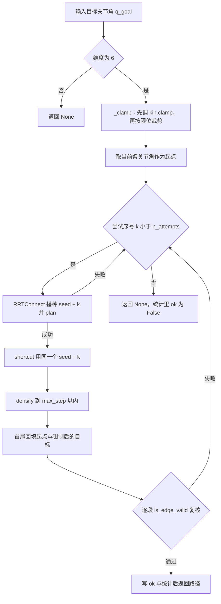
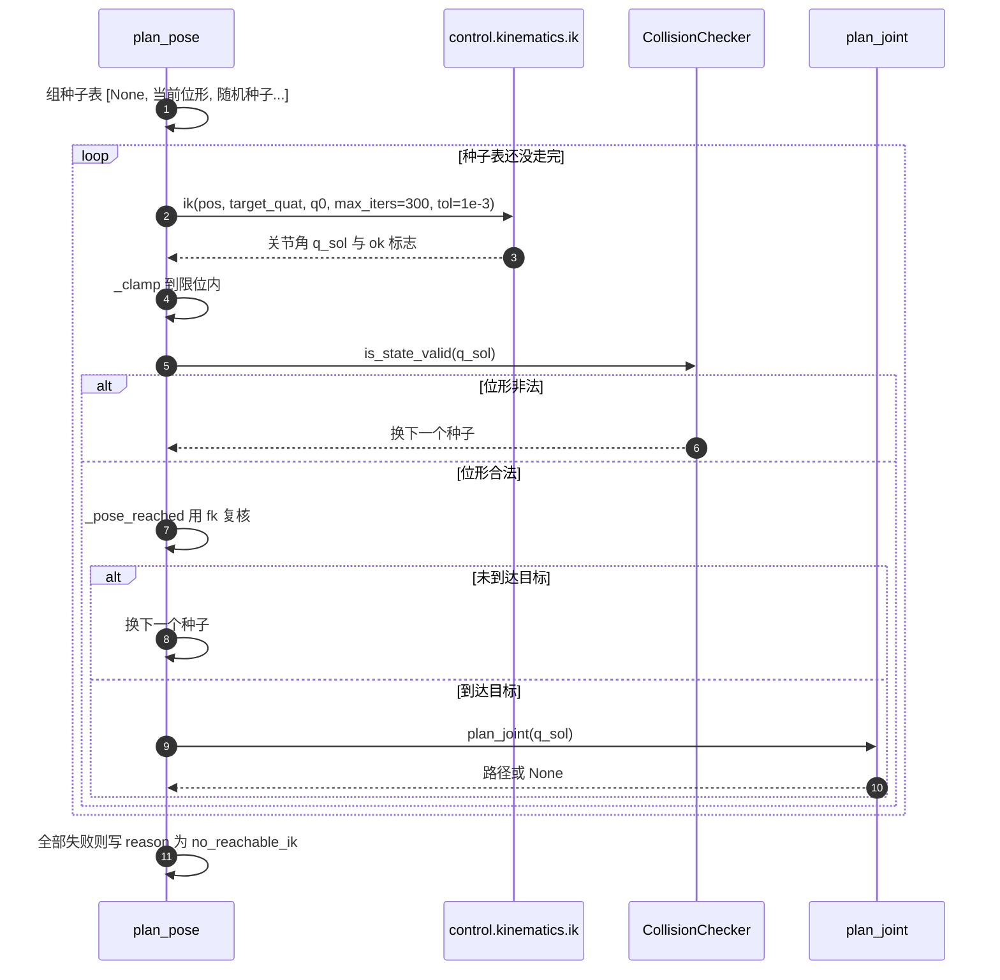
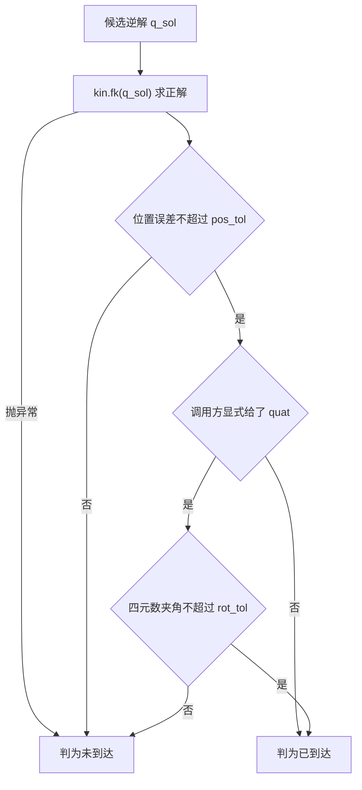

# shortcut、densify 与位姿规划

`planning/rrt_connect.py` 的 `shortcut()` 与 `densify()` 负责把 RRT 的原始输出收拾成可跟踪的路径，`planning/planner.py` 的 `JointPlanner` 负责调度它们，并把「目标 TCP 位姿」翻译成「目标关节角」。

RRT 的输出有两个特点：节点之间的连线是折线，锯齿多；节点间距不均匀，短边只有 0.15 rad 量级。前者让跟踪时的速度方向频繁突变，后者让按关节空间等步长下发的执行器难以处理。后处理的两步分别对付这两个问题，之后再进入多轮重试与位姿求解。

## RRT 输出的两个问题：锯齿与稀疏

RRT-Connect 的扩展方向由随机采样点决定，路径会绕着障碍来回拐。这些拐点全部满足碰撞约束，但按关节路径跟踪时，每一段都要减速再加速，整体耗时被拉长。

节点间距不均是另一半问题。RRT 的每条新边长度不超过 `step_size = 0.15` rad，但 CONNECT 的贪心扩展会连续添加节点，而两棵树拼接处的边可能很短。`control/motion.py` 的 `follow_joint_path()` 按关节空间插值执行，边太长会导致单次插值跨度大、速度前馈不准，边太短则浪费控制周期。


## shortcut 的随机删点

`shortcut()` 的思路是随机取路径上的两个节点，试一次直连；连得通就把中间节点删掉。重复固定次数之后，路径总长只减不增：

```python
for _ in range(max(0, int(iters))):
    n = len(cur)
    if n <= 2:
        break
    i = int(rng.integers(0, n - 1))
    j = int(rng.integers(i + 1, n))
    if j == i + 1:
        continue
    steps = _edge_steps(cur[i], cur[j])
    if checker.is_edge_valid(cur[i], cur[j], steps=steps):
        cur = cur[: i + 1] + cur[j:]
```

两个下标有约束：`i` 取到 `n - 2`，`j` 从 `i + 1` 起，保证 `i < j`。`j == i + 1` 的情况直接跳过，这种相邻节点之间删不出东西。

每次尝试都按 `_edge_steps()` 算采样段数，也就是按 0.02 rad 的分辨率离散化这条候选边。短路会尝试跨度很大的直连，段的数目可能到上限 64；如果用固定的 12 段，长边上的细障碍物就可能被跨过。

`iters` 默认 200，注释里给的理由是一次只删一段，200 次足够把 RRT 的锯齿磨平。算法本身是随机的，`seed` 默认 0 让它可复现。

## densify 的等步长切分

`densify()` 把每段切成不超过 `max_step` 的小段：

```python
out = [pts[0].copy()]
for a, b in zip(pts[:-1], pts[1:]):
    d = float(np.linalg.norm(b - a))
    k = max(1, int(np.ceil(d / max_step)))
    for i in range(1, k + 1):
        out.append(a + (b - a) * (i / k))
out[0] = pts[0].copy()
out[-1] = pts[-1].copy()
```

每一段按 $k = \max(1, \lceil d / s_{\max} \rceil)$ 均分，段内节点等距，因此整条路径的关节空间步长被压在 $s_{\max}$ 以内。$s_{\max}$ 默认 0.05 rad。

参数做了兜底：`max_step` 不是有限数或小于等于 0 时，回落到 0.05。这个兜底让调用方即使传了 `None` 或零，也不会出现除零或无穷循环。

切分的两个端点用原数组的副本覆盖，因此返回值首尾与输入严格相等。`planning/smoke.py` 对这条性质有直接断言：`np.allclose(dense[0], start)`、`np.allclose(dense[-1], goal)`，并且逐段检查长度不超过 `0.05 + 1e-9`。

## 端点不变量：三条回填规则

端点稳定是这套后处理的硬约束，三处各做一次回填：

| 位置 | 回填内容 | 原因 |
| --- | --- | --- |
| `shortcut()` | `out[0]` / `out[-1]` 换成输入首尾的副本 | 删点过程可能改动首尾节点 |
| `densify()` | 同样覆盖首尾 | 浮点插值会让首尾偏离原值 |
| `JointPlanner.plan_joint()` | `path[0] = q_start`、`path[-1] = q_goal` | 钳制与后处理之后对齐调用方的输入 |

`plan_joint()` 的第三处回填最关键：目标关节角先经过 `_clamp()`，如果原值超限，返回路径的末节点是钳制后的值而不是原值。路径首节点同样取「规划开始时刻的当前关节角」，而不是 RRT 树的根节点副本。`planning/smoke.py` 用 `atol=1e-9` 断言这两端。

```python
path = densify(smooth, self.max_step)
path[0] = q_start.copy()
path[-1] = q_goal.copy()
```

## plan_joint 的换种子重试

RRT 单次失败在窄通道里很常见，`plan_joint()` 用换种子重试提高成功率，默认三次：

```python
for k in range(max(1, int(self.n_attempts))):
    planner = RRTConnect(
        self.checker, self.q_min, self.q_max,
        step_size=self.step_size, max_iters=self.max_iters,
        seed=self.seed + k, goal_bias=self.goal_bias,
    )
    raw = planner.plan(q_start, q_goal)
    if raw is None:
        self.last_stats = {"ok": False, "attempt": k, **planner.last_stats}
        continue
    smooth = shortcut(raw, self.checker, iters=self.shortcut_iters, seed=self.seed + k)
    path = densify(smooth, self.max_step)
```

第 $k$ 次尝试的种子是 `seed + k`，后处理用同一个种子。同种子加同查询完全可复现，因此一次失败的重试序列也是确定的，不是每次都换一套随机路径。

起点取自 `env.data.qpos` 的臂关节切片：

```python
def current_qpos(self) -> np.ndarray:
    return np.asarray(self.env.data.qpos, dtype=np.float64)[self._qpos_idx].copy()
```

规划过程只读 `env.data`，读写都落在 `CollisionChecker` 的私有 MjData 上，不推进仿真。这一点让 `plan_joint()` 可以在技能执行的中途反复调用，而不影响正在执行的动作。



## plan_pose 的种子来源与顺序

位姿入口的难点在不给姿态时逆解是欠约束的。`plan_pose()` 先按 `pos` 求一组关节角，再用同一套 `plan_joint()` 规划过去：

| 项 | 值 | 说明 |
| --- | --- | --- |
| `n_seeds` | 20（默认） | 显式 IK 种子总数，含当前位形 |
| 种子表 | `[q_start]` 加 `n_seeds - 1` 个限位盒内均匀采样 | 随机源是 `default_rng(self.seed)` |
| 尝试表 | `[None]` 加种子表 | `None` 表示交给 `control` 内部做多次随机重启 |
| `ik_iters` | 300 | 传给 `control.kinematics.ik()` 的迭代上限 |
| `ik_tol` | 1e-3 | 传给 `ik()` 的收敛容差 |

第一枪把 `q0` 留空，让 `control` 内部走「当前关节角加 HOME 加 6 次随机重启」的完整搜索，覆盖范围最大，单次约 2 到 60 ms；后续每个种子都是显式热身精化，单次约 0.3 到 2 ms。种子表里第一个元素是当前位形，与 `q0=None` 的搜索起点重合，所以当前位形实际上被试了两次，代价很小而覆盖面更稳。单次耗时区间引用 `planning/planner.py` 注释里 control 侧的实测建议，本轮验收未复测。



统计字段分开计数，便于区分「找不到逆解」与「逆解有了但规划失败」：`ik_tried` 记录通过维度检查的解数量，`ik_planned` 记录进入规划的解数量。失败时 `last_stats` 的 `reason` 固定为 `no_reachable_ik`，两类原因共用一个码，需要看计数才能分辨。

## 用 fk 复核，而不是信任 ik 的 ok

不给目标姿态时，逆解处于**欠约束**状态，ok 标志可能因为姿态误差置假，而位置已经到达。`_pose_reached()` 因此不看 ok，直接用正解复核：

```python
def _pose_reached(self, q, pos, quat) -> bool:
    try:
        p, qq = self.kin.fk(q)
    except Exception:
        return False
    p = np.asarray(p, dtype=np.float64).reshape(-1)[:3]
    if float(np.linalg.norm(p - pos)) > self.pos_tol:
        return False
    if quat is not None:
        if quat_angle_error(qq, quat) > self.rot_tol:
            return False
    return True
```

位置容差 `pos_tol = 5e-3` 米，姿态容差 `rot_tol = 0.05` rad。姿态只在调用方显式给 `quat` 时才检查，这与契约一致：`quat=None` 表示只约束位置。

姿态误差用四元数的最小夹角：

$$e_{\text{rot}} = 2\arccos\!\left(\frac{\lvert q_a \cdot q_b \rvert}{\lVert q_a \rVert\,\lVert q_b \rVert}\right)$$

`quat_angle_error()` 先归一化两个 wxyz 四元数，取点积的绝对值把 $q$ 与 $-q$ 视为同一姿态，再钳到 $[-1, 1]$ 防止反余弦越界。任一四元数的范数小于 1e-12 时直接返回 $\pi$，避免除零。



## 交付前的逐段复核

后处理完成之后，路径还要逐段再走一次边检查：

```python
def _verify_path(self, path) -> bool:
    if path is None or len(path) == 0:
        return False
    for a, b in zip(path[:-1], path[1:]):
        if not self.checker.is_edge_valid(a, b, steps=_edge_steps(a, b)):
            return False
    return True
```

这一步在逻辑上多余：RRT 建树时每条边都检查过，shortcut 的删点也只在连通时才生效。仍然复核的理由是防御性的，任何一段非法就换下一个种子重来，不把坏路径交给 `follow_joint_path()`。复核失败时统计写 `reason = verify_failed`。

段数由 `_edge_steps()` 按 0.02 rad 分辨率算。`densify()` 之后每段不超过 0.05 rad，因此这里通常是 3 段左右，开销很小。

有一处实现细节需要记下来：`_edge_steps()` 在 `planning/rrt_connect.py` 与 `planning/planner.py` 各有一份完全相同的实现。两处都默认 `resolution=0.02`、`max_steps=64`，当前行为一致，但改分辨率时需要同时改两处，否则建树与复核会用不同的采样密度。

## 验收口径与已知边界

`planning/smoke.py` 的五个用例里，与这条链路直接相关的是三组数字：`plan_pose` 末端位置误差 0.0000 m，绕障规划 0.12 s，绕障路径上的障碍接触样本数为 0。`plan_joint` 与 `plan_pose` 各自还有一个墙钟上限断言，要求单次调用小于 2 s。

边界也要写清楚。规划器的碰撞检测只覆盖「机械臂加夹爪」的几何集合，不建模被夹着的物体。因此手持物体时，物体会被当成不存在的障碍：一方面手持物不会被判碰撞，另一方面如果它真的碰到别的物体，规划器也看不出来。`--with-barrier` 场景下的抓放不可靠就来自这条限制，README 的已知问题里有记录。

带载归位是另一个具体表现。夹爪握着物体时，手持物与指垫的持续接触会让起始位形被判非法，`plan_joint()` 直接返回 `None`。`skills/library.py` 的处理是在规划窗口内临时忽略「手持物与夹爪」的接触对后重试，仍失败才回退到安全门。这条协作不改变规划器本身，只是把调用语义补完整。

| 取舍点 | 本工程选择 | 收益 | 代价 |
| --- | --- | --- | --- |
| 后处理顺序 | 先 shortcut 再 densify | 先删多余节点再加密，段数更少 | 加密后的点全部参与后续复核 |
| 重试策略 | 固定三次换种子 | 可复现且能覆盖常见窄通道 | 连续三次都失败时没有退路 |
| 位姿判据 | fk 复核代替 ik 的 ok | 位置与姿态各用显式容差 | 每个候选解多一次正解计算 |
| 姿态约束 | 只有显式给 quat 才检查 | 只约束位置的调用不被姿态误差拖累 | 欠约束解的姿态不可控 |
| 路径复核 | 交付前逐段重查 | 坏路径不会外流 | 多一遍边检查开销 |

## 附：本页引用的路径

| 路径 | 用途 |
| --- | --- |
| `planning/planner.py` | `JointPlanner`、`plan_joint()`、`plan_pose()`、`_verify_path()`、`quat_angle_error()` |
| `planning/rrt_connect.py` | `shortcut()`、`densify()`、`joint_path_length()`、`_edge_steps()` |
| `planning/collision.py` | `_ignore_mask` 与 `is_state_valid()` / `is_edge_valid()` |
| `planning/smoke.py` | 端点断言、误差打印与耗时上限 |
| `control/motion.py` | `follow_joint_path()` 的关节路径执行 |
| `skills/library.py` | 带载归位时临时忽略接触后重试规划 |
| `core/interfaces.py` | `PlannerProtocol` 的两个方法签名 |
| `README.md` | `planning.smoke` 验收数字与已知限制 |
