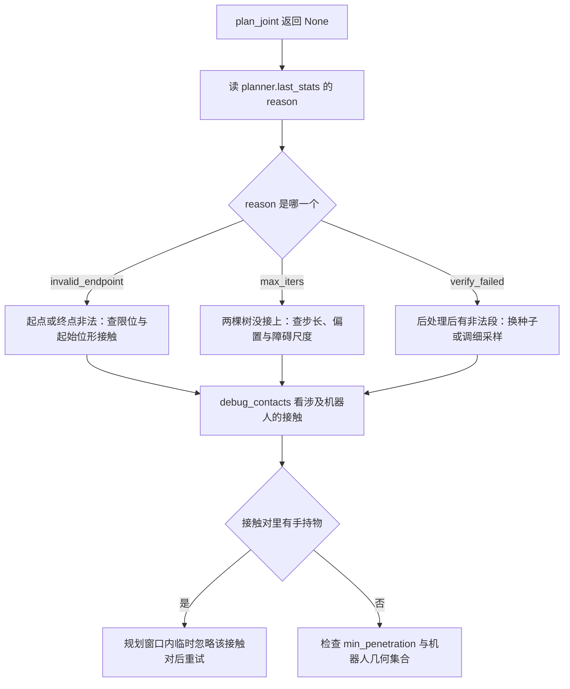
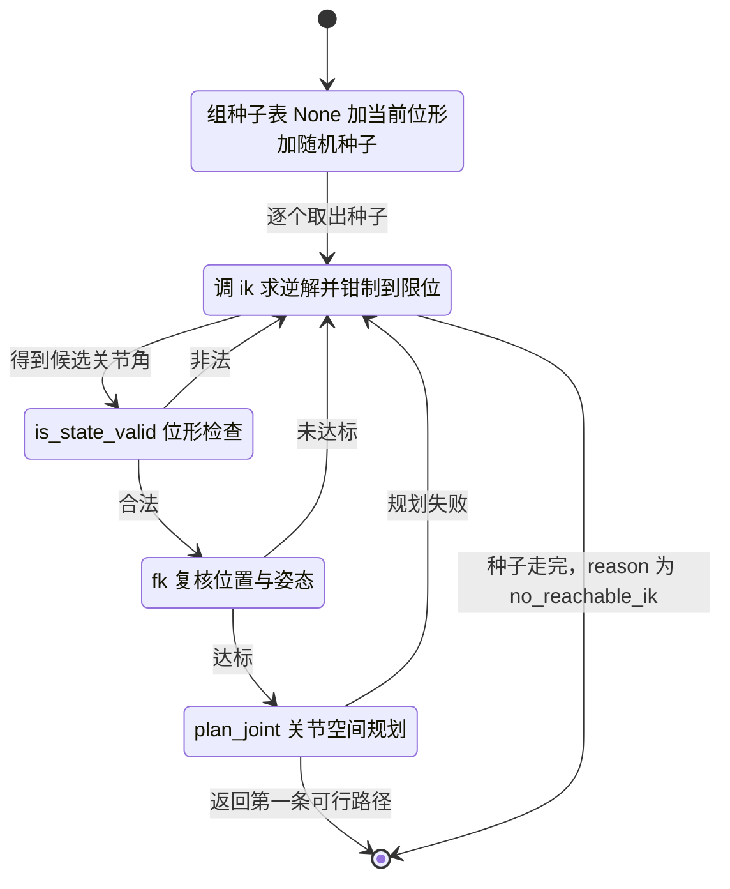

# 规划的易错点与调试

前几篇分别讲了碰撞检测、RRT-Connect 与后处理加位姿规划。这一篇把散落的判据与约定收拢成排查顺序：规划失败时先看哪个字段、位形被判非法时怎么确认原因、哪些现象是预期行为而不是缺陷。

所有现象都能从源码里核对到出处，涉及的数字来自 `planning/smoke.py` 的打印与 `README.md` 的结果表。

## 规划失败时先读统计字段

`plan_joint()` 与 `plan_pose()` 失败都返回 `None`，原因写在 `planner.last_stats` 里。第一步是分清失败发生在哪一层：

| 字段 | 取值 | 含义 |
| --- | --- | --- |
| `reason` | `invalid_endpoint` | 起点或终点本身不合法，RRT 没有开树 |
| `reason` | `max_iters` | 两棵树跑了 4000 轮仍没接上 |
| `reason` | `verify_failed` | RRT 出了路径，但后处理后有段非法 |
| `reason` | `no_reachable_ik` | `plan_pose` 走完全部种子仍没成功 |
| `attempt` | 整数 | `plan_joint()` 在第几次换种子尝试上停下 |
| `ik_tried` / `ik_planned` | 计数 | `plan_pose` 通过位形检查与进入规划的解各有多少 |

`plan_pose()` 成功时会把 `pose_target`、`ik_tried`、`ik_planned` 追加到 `plan_joint()` 留下的统计上，因此成功路径的统计同时含后处理的节点数与 IK 计数。

注意 `no_reachable_ik` 把两类原因合并了：一类是逆解本身没找到或全部非法，另一类是逆解合法但规划全部失败。`ik_tried` 有值而 `ik_planned` 为 0，说明卡在 `is_state_valid` 或 `_pose_reached`；两个计数都不小却仍然失败，问题在 `plan_joint()`。分开计数的意义就在这里。

## 接触判定的常见反例

反例一：直接看 `ncon`。 桌面上永远有物体与桌面的接触，堆叠物体之间也有。真实场景在物体沉到桌面之后实测 `ncon = 21`，对应的下沉量约 1.6e-4 m。把这些接触算成碰撞，连 HOME 位形都会非法。`planning/smoke.py` 专门用「reset 瞬间」与「沉底后」两个接触数做对照，并断言 HOME 在两者下都合法。

反例二：按 geom 名认连杆。 UR5e 的碰撞 geom 在 XML 里没有 `name`，只有 visual mesh 命名过；2F85 侧只有指垫有名字。`ignore_pairs` 因此同时支持 geom 名与 body 名，`_geoms_named()` 两种都匹配。只按 geom 名配置忽略对，会出现「配置了但不生效」。

反例三：把相邻连杆当成自碰撞来源。 MuJoCo 默认 `filterparent=true`，同一 body 内与父子 body 之间的 geom 不生成接触。`upper_arm_link` 与 `forearm_link` 这种相邻连杆本来就不会出现在接触列表里；会出现的、也应当判非法的是非相邻连杆自碰撞。

反例四：把微小穿透当成严重碰撞。 贴合面存在网格数值噪声时，`dist` 会是 $-10^{-6}$ 量级的负数。`min_penetration` 默认 0，只统计实际穿透；需要吸收噪声时把它调到 1e-4 一类的小值，不必修改几何集合。1e-4 是源码注释给出的示例值，验收未实测该调整。

## 采样参数之间的耦合

`edge_resolution = 0.02` rad 与 `step_size = 0.15` rad 的关系容易被误读。`_edge_steps()` 固定的是每段的关节空间长度，段数由距离反推并钳到 2 至 64：

| 边 | 按 0.02 rad 分辨率 | 按 `is_edge_valid` 默认 12 段 | 谁更细 |
| --- | --- | --- | --- |
| 0.15 rad（普通扩展边） | 8 段，每段约 0.019 rad | 12 段，每段约 0.0125 rad | 默认值更细 |
| 1.0 rad（shortcut 可能产生） | 50 段，每段 0.02 rad | 12 段，每段约 0.083 rad | 分辨率方案细得多 |

结论是两者各有适用的边长度区间。规划器把段数显式算好再传给 `is_edge_valid()`，目的是让长边的采样密度不随长度下降，并不追求在所有情况下都比默认值保守。这一点在 `planning/rrt_connect.py` 的模块注释里被简化成「比默认 12 段更保守」，按边长度理解更准确。

`step_size` 本身也参与成功率。步长太大时单条边容易横穿细障碍物，同时 CONNECT 的贪心连接跨度也大；步长太小则节点数增长快，4000 轮可能不够用。0.15 rad 与 24 mm 厚的障碍墙是当前场景下的取值。这一段的因果关系属推断，本工程没有做步长扫描复测。

## 随机性与可复现性

同一目标两次结果不同。 随机源在 `plan()` 内部按 `self.seed` 重新构造，因此同种子加同查询完全一致。如果改成只在构造器里播种一次，rng 状态会跨多次调用累积前进，第二次规划走另一条随机序列。`planning/smoke.py` 对这条有直接断言：同一个 seed 建两个规划器，输出逐点一致。

重试序列每次不同。 `plan_joint()` 第 $k$ 次尝试用 `seed + k`，`shortcut()` 也用同一个种子。这样重试序列本身是确定的，排查时可以稳定复现。

同一位形两次判定不同。 碰撞查询每次都会把 `env.data.qpos` 快照进私有数据、覆盖 6 个臂关节并清零 `qvel`。如果漏掉清零或漏掉覆盖，残留状态会让同一组关节角得到不同结果。`planning/smoke.py` 用连续 30 轮调用后比较 `env.data.qpos` 与 `env.data.qvel` 的方式固定这条约束。

## 端点约定与浮点回填

端点断言用的是精确相等或 `atol = 1e-9`，背后有三处回填：

| 位置 | 回填动作 |
| --- | --- |
| `RRTConnect.plan()` | `found[0]` 与 `found[-1]` 换成调用方传入数组的副本 |
| `densify()` | 输出首尾覆盖为输入首尾的副本 |
| `JointPlanner.plan_joint()` | 后处理后再设一次 `path[0]` 与 `path[-1]` |

第三处最容易被忽略。`plan_joint()` 先对目标做 `_clamp()`，若调用方给的目标超限，路径末节点是钳制后的关节角，与传入值不同。排查「终点差一点点」时，先确认目标是否被钳制过。

`_clamp()` 会优先调用 `kin.clamp()`（如果存在），再按 `ARM_JOINT_LIMITS` 裁剪，最后把长度截到 6。长度截断意味着传入 7 维目标不会报错，会静默取前 6 维。

## 位姿入口的接口边界

`plan_pose()` 的容差与计数决定了它和 `control.kinematics` 的分工：

| 参数 | 值 | 作用 |
| --- | --- | --- |
| `pos_tol` | 5e-3 m | 用 `fk` 复核位置误差的阈值 |
| `rot_tol` | 0.05 rad | 显式给 `quat` 时才生效的姿态阈值 |
| `ik_iters` | 300 | 传给 `ik()` 的迭代上限 |
| `ik_tol` | 1e-3 | 传给 `ik()` 的收敛容差 |
| `n_seeds` | 20 | 显式 IK 种子数，另加一次 `q0=None` |

不看 `ik()` 返回的 ok 标志是有原因的：`quat=None` 时逆解欠约束，ok 可能因为姿态误差置假而位置已经到达。复核走 `kin.fk()`，位置用 `pos_tol`、姿态用 `rot_tol` 各判一次。姿态误差取四元数点积的绝对值，$q$ 与 $-q$ 视为同一姿态。

**种子表**的顺序也影响耗时。第一枪 `q0=None` 交给 `control` 内部做多次随机重启，单次 2 到 60 ms；后续显式种子是热身精化，单次 0.3 到 2 ms。种子表首元素是当前位形，与 `q0=None` 的搜索起点重合，当前位形实际被试了两次。耗时区间引用 `planning/planner.py` 注释里 control 侧的实测建议，本轮验收未复测。

## 场景限制与带载规划

手持物不参与碰撞检测。 规划的几何集合只有机械臂与夹爪，被夹着的物体不在其中，这就是**不建模被夹物体**的含义。结果是手持物既不会撞到别人，也无法作为障碍被避开。`--with-barrier` 场景下抓放不可靠就来自这条限制，README 把它记为已知问题。

带载时起始位形可能非法。 夹爪握着物体时，手持物与指垫的持续接触会让 `is_state_valid(q_start)` 判假，`plan_joint()` 因此直接返回 `None`。`skills/library.py` 的 `_ignore_contacts_with()` 在规划窗口内对 `checker._ignore_mask` 求快照、把「手持物 geom 与夹爪 geom」成对置真，`finally` 里整块还原。这只改变一次规划调用内的判据，其它模块看到的碰撞语义不变。

这个上下文管理器还有一个名字解析分支：无真值模式下物体占位符是 `"unnamed"`，按名字匹配会命中 0 个 geom，于是改为「当前与夹爪接触的可动物体」反查真实 body 名。名字对不上就放弃忽略会让带载归位必然失败。

测试替身会改变结论。 `planning/smoke.py` 优先用真实的 `sim.MuJoCoArmEnv` 与 `control.Kinematics`；两者未就绪时退化为 `planning/stub_env.py` 并在输出里打印 WARNING。绕障用例依赖 `barrier_geom` 的几何参数，stub 里的参数按真实场景抄写，但结论仍以真环境为准。

一个未被调用的辅助函数。 `planning/smoke.py` 里的 `_has_barrier_contact()` 定义之后没有被调用，绕障用例用内联表达式重算了同一判据。这不是缺陷，但改判据时两处都要照顾到。

## 排查顺序

遇到规划问题，按下面的顺序走，每一步都有对应的可观察量：

1. 确认两端位形是否合法：单独调 `checker.is_state_valid(q_start)` 与目标位形，区分「端点问题」与「搜索问题」。
2. 读 `planner.last_stats` 的 `reason`，把失败定位到 RRT、后处理还是 IK 三层中的一层。
3. 用 `checker.debug_contacts(q)` 看某个位形涉及机器人且未被忽略的接触；它返回 `geom1`、`geom2`、`dist` 与 `ignored` 四项，不做过滤，判断留给调用方。
4. 沿关节直线做一次粗采样（类似 smoke 里的做法，取 25 个中间点），找出第一个非法点，确认是障碍物造成还是起始位形自带接触。
5. 检查带载状态：手持物与指垫的持续接触会让起始位形非法，需要在规划窗口内临时忽略。
6. 复核参数：`min_penetration` 是否为噪声留下了容差，`step_size` 与障碍尺度是否匹配。
7. 最后才动种子与重试次数。前六步都排除之后，调 `n_attempts` 或换 `seed` 才有意义。

| 现象 | 先怀疑 | 对应位置 |
| --- | --- | --- |
| 所有位形都非法 | 直接用了 `ncon` | `planning/collision.py` |
| 忽略连杆接触不生效 | 只按 geom 名匹配 | `planning/collision.py` |
| 细障碍被跨过 | 采样段数不足 | `planning/rrt_connect.py` |
| 同目标两次结果不同 | 随机源没有每次重播 | `planning/rrt_connect.py` |
| 终点比目标差一点 | 目标被 `_clamp()` 钳制 | `planning/planner.py` |
| 逆解位置对姿态错 | 只看 `ik()` 的 ok | `planning/planner.py` |
| 带载规划直接失败 | 起始位形含手持物接触 | `skills/library.py` |
| 绕障测试结论异常 | 用了 stub 测试替身 | `planning/smoke.py` |

## 附：本页引用的路径

| 路径 | 用途 |
| --- | --- |
| `planning/collision.py` | `debug_contacts()`、`min_penetration`、`_geoms_named()` |
| `planning/rrt_connect.py` | `_edge_steps()`、`plan()` 的播种与统计 |
| `planning/planner.py` | `last_stats`、`_clamp()`、`plan_pose()` 的容差 |
| `planning/smoke.py` | 接触数对照、可复现断言、测试替身回退与 WARNING |
| `planning/stub_env.py` | 障碍墙几何与最小测试替身 |
| `skills/library.py` | `_ignore_contacts_with()` 与名字解析分支 |
| `README.md` | 已知问题中的「不建模被夹物体」 |
| `tests/run_acceptance.py` | 规划验收项的汇总入口 |
