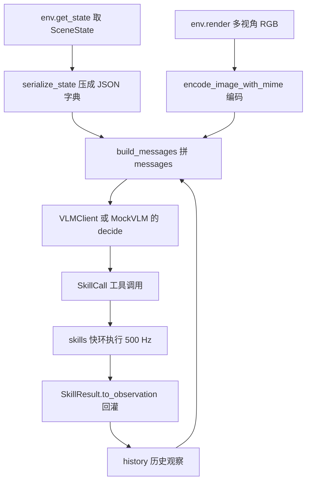
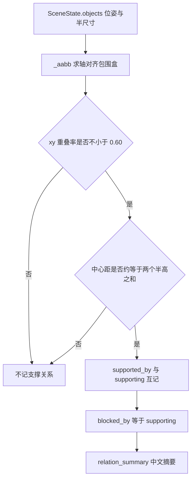
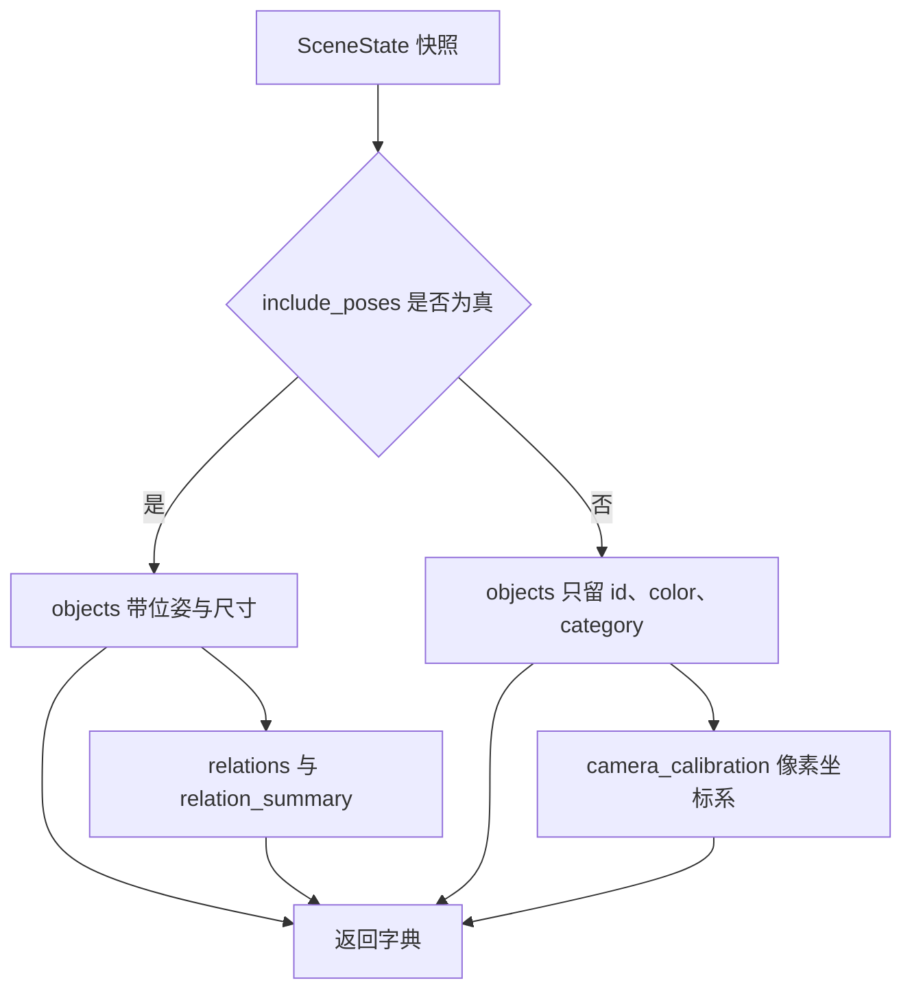

# 场景序列化与多模态消息

本文对应公开项目 `TC635807/vlm-admittance` 的 `agent/` 与 `core/`，仓库地址 https://github.com/TC635807/vlm-admittance 。这套代码不做 VLA 训练：上层用任意 OpenAI 兼容的多模态端点做任务级决策，底层是自研的 DLS IK、笛卡尔轨迹、六维导纳与 RRT-Connect，模型每一步只产出一个工具调用。

决策质量的上限由两件事决定：模型看到的场景描述是否够用，以及场景描述里有没有混进它不该知道的东西。前者对应 `agent/state.py` 的 `serialize_state()`，后者对应 `include_poses=False` 的无真值模式。

## 1. 决策层压在两条环上

整套系统按时间尺度拆成两条环。慢环在 `agent/`，只在需要决策时触发，设计口径约 0.5 至 2 Hz；快环在 `control/`、`planning/`、`skills/`，每个 `mj_step` 都跑，仿真步长 `SIM_DT = 0.002`，即 500 Hz。

| 环 | 位置 | 频率 | 输入 | 输出 |
| --- | --- | --- | --- | --- |
| 慢环 | `agent/` | 0.5 至 2 Hz，事件触发 | 多相机 RGB 加场景 JSON 加历史 | 一个 `SkillCall` |
| 快环 | `control/` `planning/` `skills/` | 500 Hz，每步 `mj_step` | `SkillCall` 的技能名与参数 | `SkillResult` 加关节目标 |

快环里没有任何神经网络推理，慢环里也没有关节目标。这条分界线让上层模型不需要知道 IK 与导纳的细节，下层执行器也不需要知道任务文本。



## 2. 不训练 VLA 的取舍

`agent/` 里的决策器是一个函数 `decide(messages) -> SkillCall`：`VLMClient` 走远程端点，`MockVLM` 走本地规则。两者同接口，由 `core/interfaces.py` 的 `VLMProtocol` 约束。

- 语言理解与图像判断交给现成端点，不需要数据集、不需要训练循环，换端点就换模型。
- 末端精度、接触力、避障交给经典控制，模型输出错参数也还有技能库兜底。
- 模型只在离散技能层决策。抓取姿态由几何解析给出，没有引入 GraspNet 或 SAM 这类重依赖。
- 代价是模型无法端到端优化动作细节，复杂抓取姿态超出它的表达范围。

没有 key 时 `make_vlm()` 返回 `MockVLM`，`AgentLoop` 走完全同一条代码路径。CI 依赖这一点：`agent.smoke` 的 239 个用例全部离线执行。

## 3. 场景快照的固定字段

`serialize_state(state, task, extra, include_poses)` 返回一个字典，字段在契约里冻结：

| 字段 | 内容 | 来源 |
| --- | --- | --- |
| `task` | 自然语言任务原文 | 调用方传入 |
| `time` | 仿真时间，秒 | `state.time`，保留 3 位小数 |
| `joint_names` | 6 个臂关节名 | `state.joint_names` 或 `ARM_JOINT_NAMES` |
| `robot` | `qpos`、`tcp_pos`、`tcp_quat`、`gripper`、`holding` | `RobotState.to_json()` |
| `objects` | `id`、`category`、`color`、`pose`、`size`、`graspable`、`is_container` 加四个支撑字段 | `SceneObject.to_json()` 加关系推导 |
| `contact` | `force`、`torque`、`force_norm`、`max_force`、`in_contact` | `ContactState.to_json()` |
| `summary` | `graspable` 与 `containers` 两个 id 列表 | 遍历 `objects` |
| `relations` | 每个 id 的 `supported_by`、`supporting`、`grasp_blocked`、`blocked_by` | `derive_relations()` |
| `relation_summary` | 中文人可读的一行摘要 | `_relation_summary()` |
| `extra` | 进度与失败信息，调用方自定义 | `run()` 调用处 |
| `camera_calibration` | 只在 `include_poses=False` 时出现 | 模块常量 `CAMERA_CALIBRATION` |

`robot` 只放 6 个臂关节，不塞完整的 14 维 `qpos`。夹爪内部自由度对高层决策没有意义，`core/types.py` 的 `RobotState` 从一开始就按这个约定设计。

## 4. 进 prompt 之前的两道清理

JSON 在 MuJoCo 与 numpy 环境里不能直接 `dumps`，`to_jsonable()` 负责递归转换，`_finite()` 与 `_r3()` 负责清理非有限值。

- `np.float32` 不是 `float` 的子类，`np.bool_` 同理，`json.dumps` 遇到它们直接抛 `TypeError`。
- `NaN` 与 `inf` 虽然被 Python 的 `json` 默认放行，但严格 JSON 不允许，也会让模型给出无意义的判断，统一归零。
- 带 `to_json()` 的对象先转成字典再递归；其余未知类型退化成 `str`。

```python
# agent/state.py 的 to_jsonable 节选
def to_jsonable(obj):
    if isinstance(obj, np.generic):
        v = obj.item()
        return _finite(v) if isinstance(v, float) else v
    if isinstance(obj, np.ndarray):
        return [to_jsonable(v) for v in obj.tolist()]
    if isinstance(obj, dict):
        return {str(k): to_jsonable(v) for k, v in obj.items()}
    if hasattr(obj, "to_json"):
        return to_jsonable(obj.to_json())
    return str(obj)
```

## 5. 谁压着谁是几何观测

`derive_relations()` 从物体的位姿与尺寸推支撑关系，不参与任何决策。叠放判据是两条几何条件的合取：

$$\text{overlap} = \frac{S_{xy}(a) \cap S_{xy}(b)}{\min\big(S_{xy}(a),\, S_{xy}(b)\big)} \ge 0.60$$

$$\big|\,z_b - z_a - (s_{z,a} + s_{z,b})\,\big| \le 0.015\ \text{m}$$

`SceneObject.size` 是半尺寸，所以第二个式子里两个半高相加才是中心距。满足条件的物体 `b` 记入 `a` 的 `supporting`，同时 `a` 记入 `b` 的 `supported_by`。

`blocked_by` 等于 `supporting`，含义是「从夹爪从上往下的进入方向看，谁会挡住我」。`grasp_blocked` 就是 `blocked_by` 非空。`_relation_summary()` 把它压成一行中文，例如「box_red 上方压着 box_blue（抓取受阻）；box_blue 叠在 box_red 上」，随每步消息一起送给模型，省掉它自己从位姿反推遮挡。



## 6. 图像编码与 data URI

`encode_image_with_mime(img, fmt, quality)` 返回 `(base64 字符串, MIME)`。两者必须一起用：PIL 缺失时即使请求 JPEG 也只能退化成 PNG，data URI 里声明的类型要跟真实字节一致。

| 环节 | 处理 |
| --- | --- |
| 输入形状 | `(H,W,3)`、`(H,W)` 灰度、`(H,W,4)` RGBA 都接受 |
| 浮点输入 | 最大值不超过 1.0001 时按 0 至 1 归一，乘 255 |
| alpha 通道 | JPEG 不支持，先丢第 4 通道 |
| 首选编码 | PIL 存 JPEG，默认 `quality=85`，走内存 `BytesIO` 不落盘 |
| 兜底编码 | PIL 不可用或保存失败时，用标准库 `zlib` 手写最小 PNG |

PNG 兜底只依赖 `struct` 与 `zlib`：8 字节签名、`IHDR`（位深 8、色彩类型 2 真彩 RGB）、`IDAT`（每行前置 1 字节 filter type 0）、`IEND`。这条路保证没有 PIL 的环境也能出图，同时不新增第三方依赖。

```python
# agent/state.py 的 _encode_png_py 节选
def _encode_png_py(rgb):
    h, w, _ = rgb.shape
    raw = bytearray()
    for y in range(h):
        raw.append(0)                     # 每行 filter type 0
        raw.extend(rgb[y].tobytes())
    ihdr = struct.pack(">IIBBBBB", w, h, 8, 2, 0, 0, 0)
    return (b"\x89PNG\r\n\x1a\n"
            + _chunk(b"IHDR", ihdr)
            + _chunk(b"IDAT", zlib.compress(bytes(raw), 6))
            + _chunk(b"IEND", b""))
```

`agent.smoke` 用 base64 前缀断言编码格式：JPEG 的字节流以 `0xFF 0xD8 0xFF` 开头，base64 一定以 `/9j/` 开头。

## 7. 无真值模式删掉什么

`include_poses=False` 是仿真给模型的开卷考试变闭卷：

| 字段 | `include_poses=True` | `include_poses=False` |
| --- | --- | --- |
| `objects` | 带 `pose`、`size` 与支撑关系 | 只留 `id`、`color`、`category` |
| `relations` 与 `relation_summary` | 有 | 无 |
| `camera_calibration` | 无 | 有 |
| 目标定位方式 | `target_id` 或 `target_xy` | 只能给像素，由 `pixel_resolver` 反投影 |

`CAMERA_CALIBRATION` 给出相机名 `top`、画面 `512×512`、`fovy = 45.0`、桌面高度 `table_z = 0.40`。它的用途只是告诉模型像素坐标系的约定，反投影计算仍由 `sim/vision.py` 在仿真侧完成，标定值不参与换算。

隔离要求由 `tests/test_isolation_no_truth.py` 把关：`object_pose` 与 `set_object_pose` 被换成抛异常的毒丸，闭环仍要跑通；消息扫描还要确认 `messages` 文本里不出现 `pose`、`size` 键，也不出现任何物体的真值坐标三元组。



## 8. 消息布局与可复现性

`build_messages(task, state, images, history, include_poses)` 的顺序固定为 system、history、user 一条。system 段来自 `system_prompt(include_poses)`，刻意不接收物体清单，这样同一套提示词跨场景不变，便于命中 prompt 缓存，也便于 `MockVLM` 复用。

user 段是多模态 part 列表：第一个 part 是文本，包含任务、场景关系摘要、图像张数与相机顺序、`SCENE_JSON_BEGIN` 与 `SCENE_JSON_END` 包住的场景 JSON，以及「只输出工具调用」的要求；其后每个相机一个 `image_url` part，内容是 `data:<mime>;base64,<b64>`。

图像顺序取 `sorted(images.keys())`，不依赖字典插入顺序。同一场景多次调用产生逐字节一致的消息，可复现、可缓存、便于 CI 做差分。文本标记 `SCENE_JSON_BEGIN`/`SCENE_JSON_END` 同时服务两件事：给真模型划出机器可读区块，给 `MockVLM` 做确定性反向解析。

历史元素兼容两种形态：完整的 `{role, content}` 消息原样透传，`SkillResult.to_observation()` 返回的字典被包成一条 `OBSERVATION_JSON` 观察消息。这样 `AgentLoop` 内部追加的历史与外部注入的历史能混用。

## 9. 易错点与调试

| 现象 | 原因 | 定位手段 |
| --- | --- | --- |
| `json.dumps` 抛 `TypeError` | 直接把 numpy 标量塞进字典 | 检查是否绕过 `to_jsonable()` |
| prompt 里出现 `NaN` | 位姿或接触力非有限值 | `_r3()` 与 `_finite()` 是否覆盖到该字段 |
| data URI 图片打不开 | 声明 MIME 与真实字节不符 | 用 `encode_image_with_mime()` 的返回值拼 URI |
| 同一场景两次消息不一致 | 图像顺序按插入顺序 | 确认走的是 `sorted(images.keys())` |
| 无真值模式仍泄漏位姿 | 用了 `include_poses=True` 建消息 | 跑 `tests/test_isolation_no_truth.py` |
| 模型不知道两物叠放 | 关系推导没算出来或尺寸按直径填 | 看 `relation_summary` 是否为空 |
| 灰度图编码失败 | 形状为 `(H,W)` 未扩成 3 通道 | `_as_uint8_rgb()` 的分支 |

## 10. 小结

- 慢环决策在 `agent/`，快环执行在 `control/` 与 `skills/`，模型每步只给一个工具调用。
- `serialize_state()` 输出契约字段，`to_jsonable()` 负责 JSON 兼容，非有限值一律归零。
- 支撑关系是纯几何推导，`relation_summary` 以中文摘要进每步 prompt。
- 图像走 data URI，PIL 加 JPEG 首选，标准库手写 PNG 兜底，编码函数同时返回 MIME。
- `include_poses=False` 删除位姿、尺寸与支撑关系，只留颜色与类别，逼模型看像素。
- 消息的 system 段跨场景固定，图像顺序排序后固定，整体可复现。

| 权衡点 | 本工程选择 | 收益与代价 |
| --- | --- | --- |
| 场景描述深度 | 只给 6 个臂关节与物体摘要 | 消息短、可缓存；代价是高物体定位依赖像素链路 |
| 图像编码 | JPEG 85 首选、PNG 兜底 | 体积小、无第三方依赖；代价是 PNG 兜底体积偏大 |
| 支撑关系 | 仿真侧算好再喂 | 模型不需要自己反推遮挡；代价是判据依赖半尺寸约定 |
| 真值隔离 | `include_poses` 开关 | 同一套闭环可跑开卷与闭卷；代价是两条路径的验证逻辑不同 |

## 练习

基础题

1. 写出 `serialize_state(include_poses=False)` 返回字典的全部键，并说明哪些键在开卷模式下会被替换。
2. 说明 `np.float32` 为什么不能被 `json.dumps` 直接序列化，`to_jsonable()` 在哪一步处理它。
3. 解释 `SceneObject.size` 是半尺寸这一点如何影响叠放判据的公式。

挑战题

4. 设计一个消息一致性测试，在给定 `SceneState` 与图像字典的情况下断言两次 `build_messages()` 输出逐字节相同，并列出需要控制的变量。
5. 若要把支撑关系推广到立方体以外的旋转物体，`_aabb()` 忽略旋转的假设会在什么场景下失效，如何在不引入真值泄漏的前提下补判据。

## 附：本页引用的路径

| 路径 | 用途 |
| --- | --- |
| `agent/state.py` | `serialize_state()`、关系推导、图像编码、`build_messages()` |
| `agent/schema.py` | `system_prompt()`，决定 system 段内容 |
| `agent/loop.py` | 调用 `build_messages()` 与历史注入 |
| `core/types.py` | `SceneState`、`SceneObject`、`RobotState`、`ContactState` |
| `core/config.py` | `RENDER_WIDTH`、`RENDER_HEIGHT`、`TABLE_HEIGHT`、`SIM_DT` |
| `tests/test_isolation_no_truth.py` | 真值隔离与消息扫描 |
| `sim/vision.py` | 像素与世界坐标互转，反投影的实际实现 |
| 仓库根 | `vlm-admittance`，上游 https://github.com/TC635807/vlm-admittance |
