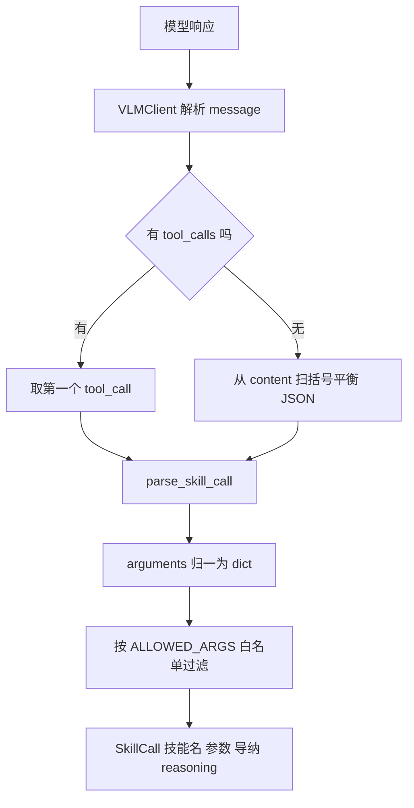
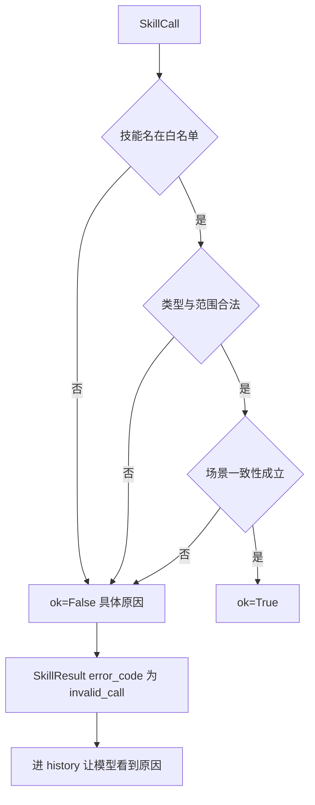
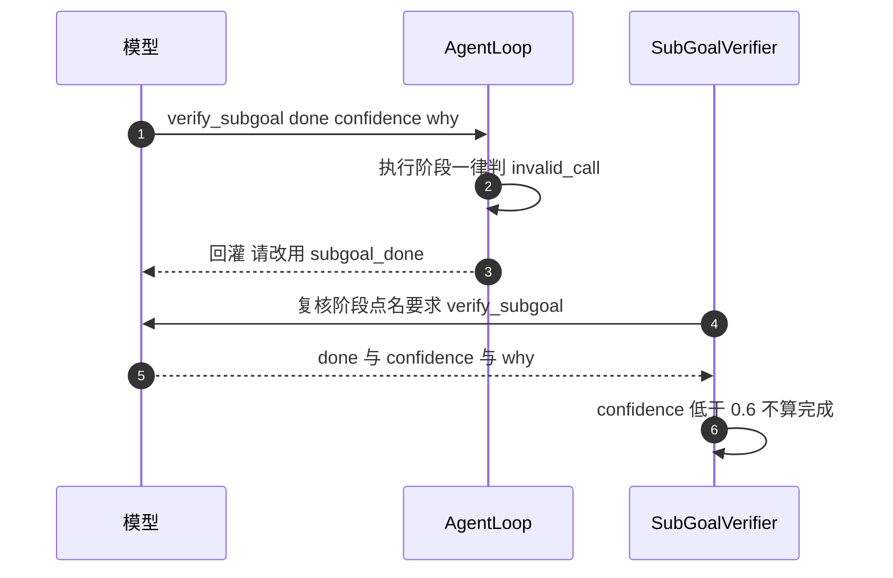

# function calling 与工具 schema 的校验链

`agent/schema.py` 只做决策层的语法与语义安检，不执行任何技能。它的三个出口各有分工：`TOOLS` 是给端点的工具表，`system_prompt()` 是给模型的行为约定，`parse_skill_call()` 与 `validate_skill_call()` 把五花八门的模型输出压成一个可执行或可回灌的结果。

## 1. 工具表的两个面

`SKILL_NAMES` 一共 14 个名字，分成两个面：

| 面 | 工具 | 处理者 |
| --- | --- | --- |
| 技能面 | `home`、`move_to`、`pick`、`place`、`push`、`open_gripper`、`close_gripper`、`set_compliance`、`stop`、`ask_user` | `skills/library.py` 的 `SkillExecutor.__call__` |
| 控制面 | `plan_subgoals`、`locate`、`subgoal_done`、`verify_subgoal` | `agent/taskplan.py` 与 `agent/loop.py` 的特判分支 |

控制面工具不经过 `SkillExecutor`。`plan_subgoals` 只在规划阶段由 `taskplan.plan_subgoals()` 直接解析；`locate` 与 `subgoal_done` 由 `AgentLoop` 特判；`verify_subgoal` 属于 `SubGoalVerifier`。这一分工让技能执行器保持「确定性动作序列」的纯度。

`TOOLS` 在模块导入时用 `_build_tools()` 构造一次，之后不再变化。工具条目的格式是标准 OpenAI function-calling：`{"type": "function", "function": {"name", "description", "parameters"}}`。



## 2. schema 里写死的静态约束

枚举与范围尽量写进 schema，让端点先挡一层。集中列出：

| 常量 | 取值 | 用在哪 |
| --- | --- | --- |
| `GRASP_PROFILES` | `auto`、`top`、`side` | `pick.grasp_profile` |
| `GOAL_TYPES` | `place_in_container`、`place_on_top`、`place_at`、`pick`、`free` | `plan_subgoals` 子目标 |
| `OBJECT_COLORS` | `red`、`blue`、`green`、`yellow`、`gray`、`black`、`white`、`cyan`、`orange` | `locate.color` 与颜色线索 |
| `PROFILE_NAMES` | `stiff`、`soft`、`z_only` | `set_compliance.profile` |
| `SURFACE_NAMES` | `table`、`tray` | `place.surface` |
| `RELATION_NAMES` | `right`、`left`、`front`、`back`、`beside` | `place.relation` |
| `PIXEL_CAMERAS` | `top`、`overview`、`wrist` | `pixel_camera`，默认 `top` |
| `LOCATE_CAMERAS` | `both`、`top`、`overview`、`wrist` | `locate.camera`，默认 `both` |

`place.relation` 的方向是世界系水平方向：`right` 是 +x、`left` 是 -x、`front` 是 +y、`back` 是 -y，`beside` 由技能自动挑净距最大的方向。

数值约束写在参数级 schema 里，校验函数再核对一遍：`pick.approach_height` 在 [0.01, 0.5] m，`pick.close_ratio` 在 [0, 1]，`pick.target_size` 分量在 (0, 0.5] m，`place.offset` 各分量绝对值不超过 0.5 m，`place.distance` 在 (0, 2] m，`move_to.pos` 各分量绝对值不超过 2 m，`push.distance` 在 [0.001, 0.5] m。

## 3. 参数白名单决定谁能进执行器

`ALLOWED_ARGS` 是每个技能允许的参数元组，`parse_skill_call()` 用它做过滤：

```python
ALLOWED_ARGS = {
    "home": (),
    "move_to": ("pos", "quat", "compliance"),
    "pick": ("target_id", "target_xy", "target_pixel", "target_pixel_overview",
             "pixel_camera", "target_z_hint", "target_size",
             "approach_height", "close_ratio", "grasp_profile", "compliance"),
    "place": ("container_id", "surface", "on_top_of", "anchor_id", "relation", "distance",
              "target_pixel", "target_pixel_overview", "pixel_camera", "xy", "offset",
              "descend_until_contact", "compliance"),
    "locate": ("target", "camera", "color", "pixel", "bbox"),
    "verify_subgoal": ("done", "confidence", "why"),
}
```

未知参数不报错，只被丢弃，并在 `reasoning` 里追加一条 `[parse] 忽略 <技能> 的未知参数: [...]`。模型经常多塞几个帮助性字段，直接拒绝会白白浪费一步；保留记录又让这种偏差可观测。

`home`、`open_gripper`、`stop` 不接受任何参数。校验阶段若发现 `args` 非空，会返回「不接受参数，实际收到 [...]」。

## 4. 解析层要兼容的输出形态

`parse_skill_call()` 接受五类外壳：标准 `tool_calls` 元素、完整 `tool_call` 的 `function` 壳、响应壳 `{"tool_calls": [...]}`、纯文本内嵌 JSON 或代码块、以及 `SkillCall` 自身的 `{"skill", "args"}` JSON。

纯文本路径按四步尝试：整段 `json.loads`、代码围栏内的 JSON、`name({...})` 形式的文本调用，最后用括号平衡扫描抽出所有 JSON 对象，优先带 `name`、`skill`、`function` 字段的那个。括号扫描会跟踪字符串状态与转义符，字符串内的花括号不会被误当边界。

```python
# agent/schema.py 的 _balanced_json_objects 节选
depth = 0
for i, ch in enumerate(text):
    if in_str:
        if esc: esc = False
        elif ch == "\\": esc = True
        elif ch == '"': in_str = False
        continue
    if ch == '"': in_str = True
    elif ch == "{":
        if depth == 0: start = i
        depth += 1
    elif ch == "}":
        depth -= 1
```

`arguments` 兼容三种形态：已经是 dict、是 JSON 字符串、或者是空串。空串按 `{}` 处理。非法 JSON 会抛出带原始内容的 `ValueError`，由 `VLMClient` 判为可重试的 `unparseable_content`。

技能名不在 `SKILL_NAMES` 里直接抛错。名字合法但参数有问题时，解析层只管类型转换，语义检查留给校验层。

## 5. compliance 的三种写法

导纳参数可以在一次调用里内联，也可以先切档位。`compliance` 字段接受三种形态：

| 形态 | 例子 | 处理 |
| --- | --- | --- |
| `null` | `"compliance": null` | 从参数里移除，沿用当前档位 |
| 档位名 | `"compliance": "soft"` | 走 `compliance_from_profile()` |
| 参数对象 | `{"k": [6], "d": [6], "m": [6], "axes": [6], "force_limit": f}` | 走 `_compliance_from_json()` |

参数对象要求 `k`、`d`、`m`、`axes` 四个 6 维数值数组，顺序是 `[x, y, z, rx, ry, rz]`。`axes` 只允许 0.0 与 1.0；`k`、`d`、`m` 不允许为负；`force_limit` 缺省 10.0 且必须大于 0。`set_compliance` 调用还会额外触发一次 `compliance_from_profile()`，`k_scale` 按 `ComplianceParams.scaled()` 缩放刚度，阻尼按 `sqrt` 缩放以保持阻尼比。

## 6. 校验的三道关

`validate_skill_call(call, state)` 返回 `(ok, msg)`，不抛异常。失败消息要具体到参数名，因为它会被当成观察回灌给模型，模型据此自我纠正。

三道关依次是：

1. 白名单：技能名是否在 `SKILL_NAMES` 里；`compliance` 字段是否是 `ComplianceParams`。
2. 类型与范围：三选一、四选一的组合是否正确，数值是否在区间内，四元数是否接近单位模。
3. 场景一致性：物体 id 是否存在、`graspable` 是否为真、`is_container` 是否为真、锚点是否可抓。

场景一致性有两条容易忽略的规则：`place` 的锚点（`on_top_of` 与 `anchor_id`）必须 `graspable=true` 且不是容器，所以托盘与桌面都不能当锚点；`pick` 的目标必须 `graspable=true`，托盘会被直接拒绝。



## 7. 冗余纠正与真矛盾

同一次调用里同时给两种目标表达很常见，处理口径是「冗余但一致就纠正，自相矛盾才拒绝」。`record_correction()` 把纠正项临时挂在 `SkillCall` 上，`AgentLoop` 用 `take_corrections()` 取走并写进 `SkillResult.metrics["corrected_args"]`。

| 情形 | 判据 | 处理 |
| --- | --- | --- |
| 无真值模式同时给像素与 `target_id` | 像素在场 | 丢弃 `target_id`，记一条 dropped 纠正 |
| 无真值模式同时给像素与 `target_xy` | 像素在场 | 丢弃 `target_xy`，以像素为准 |
| 开卷模式同时给 `target_id` 与 `target_xy` | 两者距离不超过 30 mm | 接受 `target_xy`，丢弃 `target_id` |
| 同上但距离超过 30 mm | 参数互相矛盾 | 拒绝，并报出实测距离 |
| `place` 同时给 `container_id` 与 `xy` | xy 落在容器水平范围内 | 接受 xy 为落点，容器只决定高度 |
| 同上但 xy 落在容器外 | 互相矛盾 | 拒绝，建议改用 `offset` 或 `surface="table"` |
| `surface` 与 `container_id` 同时给 | 四选一被破坏 | 拒绝 |
| `on_top_of` 与 `container_id` 同时给 | 四选一被破坏 | 拒绝 |
| `anchor_id` 与 `relation` 只给一个 | 必须成对 | 拒绝 |

容器水平范围用 `container_contains_xy()` 判断，比较物体的 `pose` 前两维与半尺寸 `size`，再加 `CONTAINER_XY_TOL_M = 0.010` m 容差。位姿或尺寸异常时返回 `False`，宁可拒绝也不把方块放到盘子外。

```python
# agent/schema.py 的 container_contains_xy
def container_contains_xy(state, obj, xy):
    try:
        x, y = float(xy[0]), float(xy[1])
        cx, cy = float(obj.pose[0]), float(obj.pose[1])
        sx, sy = float(obj.size[0]), float(obj.size[1])
    except Exception:
        return False
    return (abs(x - cx) <= sx + CONTAINER_XY_TOL_M) and (abs(y - cy) <= sy + CONTAINER_XY_TOL_M)
```

## 8. 控制面工具在执行循环里的特判

`plan_subgoals` 与 `verify_subgoal` 一旦出现在执行循环里，一律返回 `invalid_call`：

- `plan_subgoals` 在规划阶段之外出现，会让循环空转，也绕过子目标编排。
- `verify_subgoal` 在执行阶段出现，等于让模型自己给自己发完成判定。复核必须由 `SubGoalVerifier` 发起，模型只在被点名时回答。校验消息会把模型引导到 `subgoal_done(note=...)`。

`verify_subgoal` 自身仍要过类型检查：`done` 必须是布尔，`confidence` 在 [0, 1]，`why` 必须是字符串。



## 9. 易错点与调试

| 现象 | 原因 | 定位手段 |
| --- | --- | --- |
| 合法调用被判 `invalid_call` | 同时给了两种目标表达 | 看 `msg` 里的参数名与冲突项 |
| 参数被悄悄丢掉 | 写进了白名单外 | 看 `reasoning` 里的 `[parse] 忽略` 记录 |
| `compliance` 解析失败 | `axes` 不是 0 或 1 | `_compliance_from_json()` 的报错 |
| 模型返回 `plan_subgoals` 却不动 | 执行循环特判 | 执行阶段应直接给具体技能 |
| 纠正没进 UI 统计 | 没取走 `corrected_args` | 检查 `take_corrections()` 调用点 |
| 端点因缺少必填字段拒绝 | schema 的 `required` 比校验更严 | 见下条说明 |

`pick` 的 schema 把 `target_id` 列为必填，`place` 把 `container_id` 列为必填，而校验层接受三选一与四选一。无真值模式下的提示词又明确要求只给像素。严格按 `required` 检查工具参数的端点可能拒绝这种合法调用，属推断，尚未在真实端点上复现；遇到时以校验层为准并放宽 schema 的 `required`。

## 10. 小结

- 14 个工具分技能面与控制面，控制面不经过技能执行器。
- 枚举与范围写进 schema，`ALLOWED_ARGS` 做白名单过滤，未知参数丢弃并记录。
- `parse_skill_call()` 兼容五类外壳与三种 `arguments` 形态，`validate_skill_call()` 返回二元组不抛异常。
- 校验顺序是白名单、类型范围、场景一致性，错误消息必须具体到参数名。
- 冗余参数纠正后放行，自相矛盾直接拒绝，纠正项经 `corrected_args` 回灌。
- `plan_subgoals` 与 `verify_subgoal` 在执行循环里判非法，防止空转与自评撒谎。

| 权衡点 | 本工程选择 | 收益与代价 |
| --- | --- | --- |
| 未知参数 | 丢弃加记录 | 不浪费决策步；代价是模型看不到强反馈 |
| 目标表达 | 三选一与四选一互斥 | 目标明确；代价是模型容易多塞参数触发纠正 |
| 校验失败 | 返回消息不回抛 | 闭环可继续；代价是需要循环层配合结束条件 |
| 工具粒度 | 技能级工具 | 参数少、易校验；代价是复杂动作要靠子目标编排拆解 |

## 练习

基础题

1. 列出 `pick` 的三个目标参数与它们的互斥规则，说明像素与 `target_id` 同时出现时校验层怎么处理。
2. 说明 `_balanced_json_objects()` 为什么需要跟踪字符串状态，举一个会被误判的输入。
3. `place` 的四个目标分支分别是什么，锚点为什么不能是托盘。

挑战题

4. 为 `validate_skill_call()` 设计一组参数化用例，覆盖「冗余纠正」与「真矛盾」两类各三条，并写出期望的 `ok` 与消息关键字。
5. 若要新增一个 `place_on_edge` 工具，列出需要同步修改的位置（枚举、白名单、schema、校验、提示词、任务计划类型），并说明哪一处漏改会导致静默行为错。

## 附：本页引用的路径

| 路径 | 用途 |
| --- | --- |
| `agent/schema.py` | `TOOLS`、`system_prompt()`、解析与校验、纠正记录 |
| `agent/loop.py` | 取走纠正、特判 `locate` 与 `subgoal_done` |
| `agent/taskplan.py` | 解析 `plan_subgoals`、发起 `verify_subgoal` 复核 |
| `skills/library.py` | `SkillExecutor.__call__` 技能分派 |
| `core/types.py` | `SkillCall`、`SkillResult`、`ComplianceParams` |
| `core/config.py` | `STIFF_COMPLIANCE`、`SOFT_COMPLIANCE`、`DEFAULT_COMPLIANCE` |
| 仓库根 | `vlm-admittance`，上游 https://github.com/TC635807/vlm-admittance |
