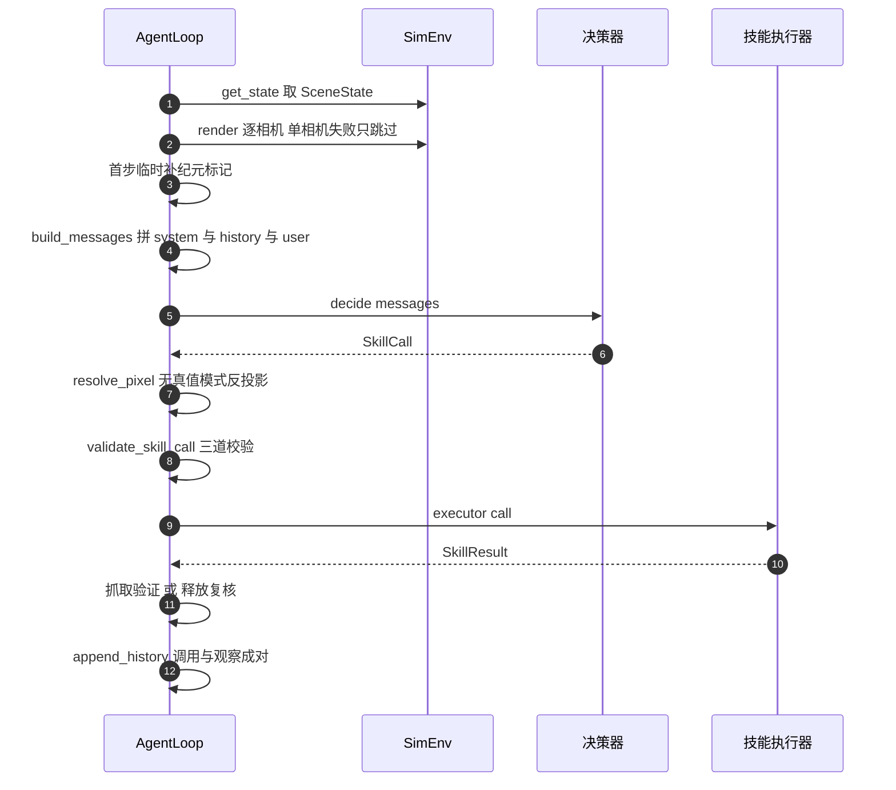
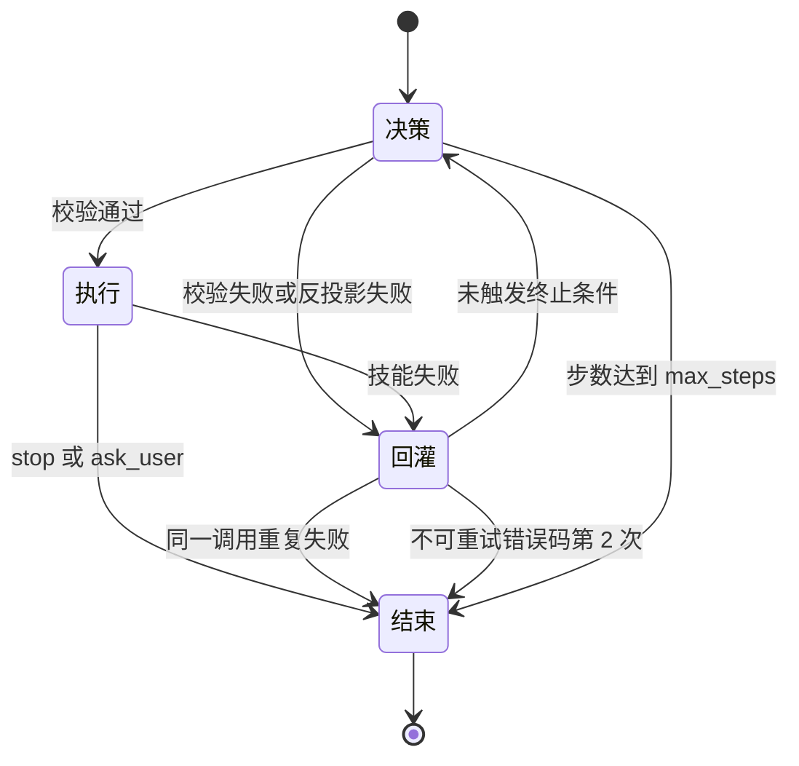
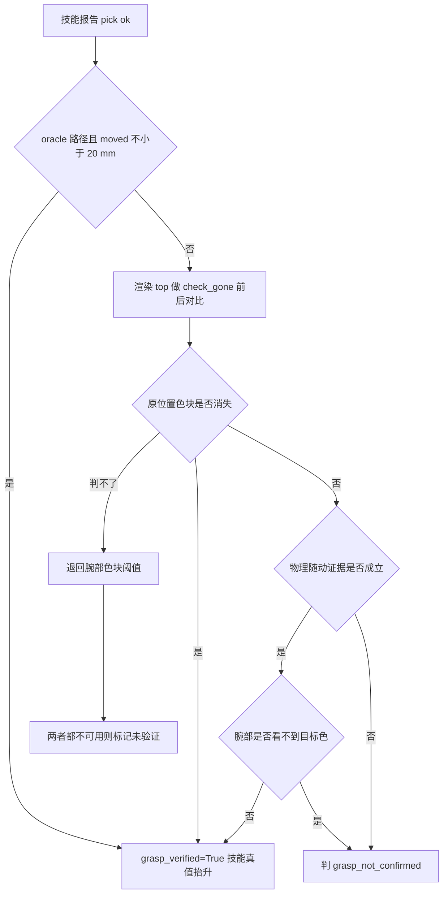

# AgentLoop 的闭环与失败回灌

`agent/loop.py` 的 `AgentLoop.run(task)` 是慢环的执行主体。它一步只做四件事：取状态、建消息、拿决策、执行并回灌。所有健壮性约定都围绕一条底线：任何一步都不允许把整个闭环崩掉。

## 1. 一步的完整数据流

`run()` 的主循环最多跑 `AGENT_MAX_STEPS` 步，默认 12。每一步的固定动作序列如下，`run()` 里对应的辅助函数都写在 `AgentLoop` 上。



顺序里有两个前置动作容易被忽略。其一，`_render_all()` 逐相机渲染，某个相机名不存在或渲染上下文异常只记一行日志并跳过，不中断闭环。其二，第一步在 prompt 里临时补一条任务纪元标记，这条消息不写进 `self.history`，只是为了 `MockVLM` 在本 run 还没产生持久标记时能正确切分任务。

## 2. 历史是成对的，纪元标记只写一次

`_append_history()` 一次追加两条：`assistant` 存 `call.to_json()` 的 JSON，`user` 存 `"OBSERVATION_JSON " + result.to_observation()` 的 JSON。两者严格成对，裁剪时也按整组处理。

本 run 的第一条 `assistant` 消息会内联一个前缀 `TASK_EPOCH_JSON {"task": "<任务原文>"}`。选择内联而不新增消息，是为了让历史长度与配对关系不受影响；`MockVLM` 在解析时只把最后一个标记之后的观测当成当前任务的状态，从而避免上一条命令的 `picked` 与 `placed` 泄漏进本次决策。

`max_history_messages` 默认 40。`_trim_history()` 的规则是按整组丢弃：保留最早 2 条作为锚点（上限写死为 2，通常恰好等于最早一组），保留最近若干整组，并且最后一个纪元标记所在整组及其后所有整组必须保留。当前任务的历史优先于条数上限，否则跨命令指代会断。

外部可以经构造参数或 `run(history=...)` 注入跨命令历史。`run()` 的优先级是显式参数高于构造参数，两者都没有就清空。运行结束后 `self.history` 是注入历史加本次新增，交互式命令台读回后保存给下一条命令。

## 3. 故障处理与错误码

每一步的失败都被翻译成一个结构化结果，而不是异常。`SkillResult.error_code` 是循环层与模型共用的词汇表。

| 故障 | 处理 | `error_code` |
| --- | --- | --- |
| 某个相机渲染失败 | 跳过该相机继续 | 不产生 |
| 决策器抛异常 | 记一条失败结果；连续 2 次中止，第 1 次继续 | `vlm_error` |
| 像素反投影失败 | 把原始像素与原因回灌，重新截图继续 | `perception_error` |
| 校验不通过 | 回灌具体原因，继续下一步 | `invalid_call` |
| 执行器抛异常 | 转成结构化失败 | `executor_exception` |
| 技能自称抓取成功但未确认 | 改写为失败并说明依据 | `grasp_not_confirmed` |
| 不可重试错误再次出现 | 第 2 次立即中止 | 见下一节 |

`vlm_error` 允许连续两次是实机需要：端点把思维链塞进 `message.reasoning` 时会吃光完成预算，`content` 为空是瞬时的。中间那次 `continue` 会让下一步重新截图、重建消息，而不是重发旧 payload。

不可重试错误码由 `AgentLoop.NON_RETRYABLE_ERRORS` 定义，共四个：`home_blocked`、`stuck`、`object_disturbed`、`scene_reset`。第 1 次出现仍允许重试一次，同一个错误码第 2 次出现立即终止。

## 4. 结束条件有四个



1. `stop` 或 `ask_user`：前者正常收尾，后者表示需要人工确认。继续循环只会反复问同一个问题直到步数上限。
2. 同一失败连续重复：同一 `skill`、同一 `error_code`、同一参数指纹连续出现 2 次后，下一步若模型仍提议完全相同的调用，就在**执行前**终止；任何参数变化都放行。
3. 不可重试错误码第 2 次出现。
4. 步数达到 `max_steps`，默认 12。

`_args_signature()` 用 `json.dumps(args, sort_keys=True)` 生成参数指纹。这条设计有实机依据：先给 `target_id` 加 `target_pixel` 被校验纠正过一次，随后改成纯像素的正确调用，如果只按技能名判重复，这次改正会被误杀。

```python
# agent/loop.py 的重复失败守卫节选
if self._pending_repeat is not None:
    p_skill, p_code, p_sig = self._pending_repeat
    if call.skill == p_skill and self._args_signature(call) == p_sig:
        self.log("[AgentLoop] 同一调用连续返回相同错误，任务中止")
        break
    self.log("[AgentLoop] 调用已改变，放行执行")
self._pending_repeat = None
```

## 5. 无真值链路的像素解析

`_resolve_pixel()` 把 `target_pixel` 与 `target_pixel_overview` 换成世界坐标，规则集中在几处：

| 环节 | 规则 |
| --- | --- |
| 主像素选择 | `top` 优先，只给 `overview` 时用 `overview` 并在日志标注单目 |
| 双目探测 | 用 `inspect.signature` 检查 resolver 是否接受 `overview_uv`、是否收集关键字参数、或是否至少有 4 个必填位置参数 |
| 同一特征对齐 | 双目时 `overview` 像素优先改用该色块 bbox 的顶边中点，即顶面中心 |
| 精修守门 | 模型原点离色块框超过 40 px 时不替换，防止串色 |
| z 作为高度提示 | 只有反投影 z 与桌面高度相差不小于 5 mm 时才写入 `target_z_hint` |
| 尺寸估计 | 只在 bbox 可用且可信时写入 `target_size` |

`_estimate_target_size()` 的不可信判据有四项：bbox 面积超过画面 25%、bbox 宽或高不超过 1 px、颜色属于 `gray`、`white`、`black`（颜色规则暂不可靠），以及估出的半宽不在 2 mm 到 250 mm 之间。任何一项命中就放弃估计，闭合量交回技能按类别先验处理。

## 6. 抓取验证的三级证据

技能报告抓取成功不等于真的夹住了。`_verify_pick_grasp()` 按优先级取证据：



几条证据的语义各不相同：

- 开卷路径直接采信技能的抬升位移 `metrics.moved`，阈值 20 mm。实测蓝块真抓后 z 位移 119.5 mm，但 top 图里面积 818 到 805 会被 `check_gone` 判成仍在原位，所以真值路径不再做图像复核。
- 无真值路径的主判据是 `top` 前后对比 `check_gone`，问的是「物体还在不在原位」，这正是「抓走了」的语义。
- 例外是物理随动证据：抬升 ok 且夹爪接触的物体确实离地，同时接触物体里包含目标 id。这条例外的必要性来自遮挡：顶视图能否看见物体取决于夹爪有没有挡住它，而物理事实比像素更硬。
- 例外带一道反向闸：腕部可用但看不到目标颜色时不允许放行，因为物理证据只说明手里夹着某个可动物体。
- `top` 判据做不了时退回腕部色块，阈值 `WRIST_GRASP_MIN_AREA_PX = 1500` 像素。腕部单独用只是近似恒真的假阳性：真抓住 40 mm 方块时面积约 16384 像素，而空夹爪停在物体上方 6 cm 也能看到约 12527 像素。

目标颜色本身也有来源优先级：最近一次 `locate` 的颜色优先，但若本次 `pick` 的 `target_id` 在场景里有颜色且两者不一致，以场景颜色为准；都没有就记「未验证」，绝不假装通过。任务只点名一种颜色时，若像素或标定指向另一种颜色，会先判 `grasp_not_confirmed`，免得白抓一次还当成成功。

## 7. 失败回灌补的是观测

`pick` 与 `place` 失败时，`_attach_failure_observation()` 往 `metrics` 里补四类字段，随观察回灌给模型：

| 字段 | 内容 | 来源 |
| --- | --- | --- |
| `failure_reason` | 失败消息 | `SkillResult.message` |
| `obstruction_id` | 最可能的阻挡物 id | 技能已有则保留，否则用 `agent/state.py` 的 `obstruction_id()` |
| `contact_force_norm` | 接触力模长 | 状态里的 `contact.force` |
| `suggested_cameras` | 建议重新观察的相机 | `AgentLoop.cameras` |

`obstruction_id()` 只做几何推断：`pick` 失败时取目标正上方压着的第一个物体，`place` 失败时取目标容器里最后放进去的物体。循环层只补观测，不改调用参数、也不自行重试，重新规划必须由模型决定。

另外两处回灌也走 `metrics`：参数纠正项写入 `corrected_args`，像素解析指标写入 `source`、`residual_mm` 等键，交互界面据此显示「已纠正」与定位来源。

## 8. `locate` 与 `subgoal_done` 的特判

这两个控制面工具不交给技能执行器：

- `locate` 走 `_run_locator()`，调用注入的 `locator(target, color, camera)`，把结果整理成 `SkillResult(skill="locate")`，`metrics` 里给出冻结的四个键 `pixel_top`、`pixel_overview`、`bbox_top`、`bbox_overview`，并保留 `pixel` 与 `bbox` 作为兼容别名。后端未配置、抛异常或没拿到像素，都记可重试的 `perception_error`。标定成功的像素会写进共享缓存，供抓取验证与后续复核复用。
- `subgoal_done` 直接产生一条 `ok=True` 的结果并结束本次子目标 epoch，`metrics.self_reported=True`。模型的自评只是终止信号，是否通过由 `SubGoalVerifier` 独立复核。

无真值模式下 `place` 调用前还有一步状态注入：抓取未被证伪时，循环往 `args` 里加 `holding=True`，已知颜色时再加 `holding_color`。技能据此跳过入口清场撤退，避免撤退过程中把件弄掉。实测无真值抓取抬到 z=0.5397 后进入 place 撤退，方块掉回桌面，而 place 仍报成功。

`place` 成功后还会做一次腕部释放复核，只写 `release_verified` 等指标，不改 `ok` 与 `error_code`。放置是否成功仍由技能的几何校验与子目标复核决定。

## 9. 易错点与调试

| 现象 | 原因 | 定位手段 |
| --- | --- | --- |
| 闭环一步就结束 | 决策器异常且已连续两次 | 看日志里的 `VLM 连续异常` 计数 |
| 模型改正后仍被判重复失败 | 参数指纹比较的是调用整体 | 确认参数确实变化 |
| 抓空却报成功 | 走的旧腕部单一判据 | 看 `grasp_verify_camera` 与 `grasp_verified` |
| 真抓成功被判失败 | top 仍能看到未被遮挡的色块 | 看技能是否给了 `grasp_lift_ok` 与随动证据 |
| 抬升报成功但物体没动 | 未校验抬升返回值与离地证据 | 看 `metrics.moved` 与物理证据字段 |
| 复核前物体掉回桌面 | 持物时归位瞬移 | 见子目标编排一篇的观察位守卫 |
| 跨命令决策串味 | 纪元标记被裁掉 | 检查 `_trim_history()` 的纪元组保留规则 |

## 10. 小结

- 一步四件事：取状态、建消息、拿决策、执行回灌；渲染失败只跳过单个相机。
- 历史严格成对追加，首个 `assistant` 内联纪元标记，裁剪按整组且当前纪元必须保留。
- 所有故障都转成结构化结果，`vlm_error` 允许连续两次，不可重试错误码限一次重试。
- 四个结束条件是 `stop` 与 `ask_user`、重复失败、不可重试错误码再现、步数上限。
- 无真值抓取验证以 `top` 前后对比为主判据，物理随动证据为例外，腕部只作诊断与兜底。
- 失败回灌补的是观测，参数纠正与像素指标都经 `metrics` 回传。

| 权衡点 | 本工程选择 | 收益与代价 |
| --- | --- | --- |
| 重复失败判定 | 按参数指纹 | 改正后的调用不被误杀；代价是模型换种写法重复错误仍会消耗步数 |
| 抓取验证 | 多证据分级 | 兼顾遮挡与假阳性；代价是判据分支多，日志需要看清 `grasp_verify_camera` |
| 失败处理 | 回灌观测不代改参数 | 保留模型自主性；代价是模型不改正时只能靠结束条件兜底 |
| 历史长度 | 40 条整组裁剪 | 上下文可控；代价是长任务会丢早期细节 |

## 练习

基础题

1. 列出 `run()` 主循环里四类失败的 `error_code`，并说明哪一类的处理方式是「继续循环」。
2. 说明纪元标记为什么内联在第一条 `assistant` 消息里，而不是新增一条消息。
3. 写出 `_estimate_target_size()` 的四条不可信判据。

挑战题

4. 为一个只有 `overview` 像素的高物体设计一次抓取验证流程，列出每一步用到的相机与判据，并指出哪一步可能返回「未验证」。
5. 若把 `max_history_messages` 降到 6，构造一个会让跨命令指代失败的场景，说明需要改哪一处保留规则。

## 附：本页引用的路径

| 路径 | 用途 |
| --- | --- |
| `agent/loop.py` | `AgentLoop.run()`、像素解析、抓取验证、特判分支 |
| `agent/state.py` | `build_messages()`、`obstruction_id()` |
| `agent/schema.py` | 校验、纠正记录、`locate` 与复核工具定义 |
| `agent/taskplan.py` | 像素共享缓存、子目标复核 |
| `skills/library.py` | `SkillExecutor.__call__` 与各技能实现 |
| `sim/perception.py` | `color_blob()`、`check_gone()`、`bbox_to_world()` |
| `core/config.py` | `AGENT_MAX_STEPS`、`RENDER_WIDTH`、`RENDER_HEIGHT` |
| `tests/test_isolation_no_truth.py` | 无真值闭环的毒丸测试 |
| 仓库根 | `vlm-admittance`，上游 https://github.com/TC635807/vlm-admittance |
