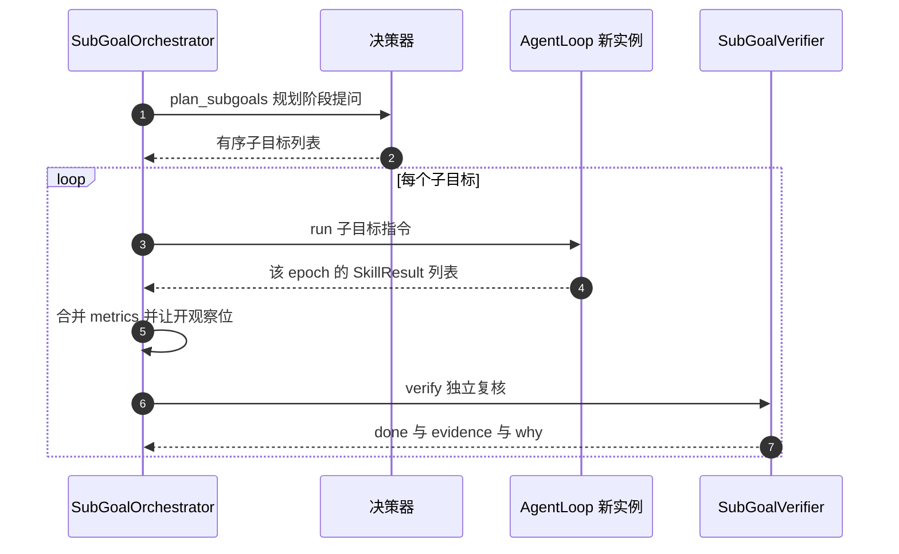
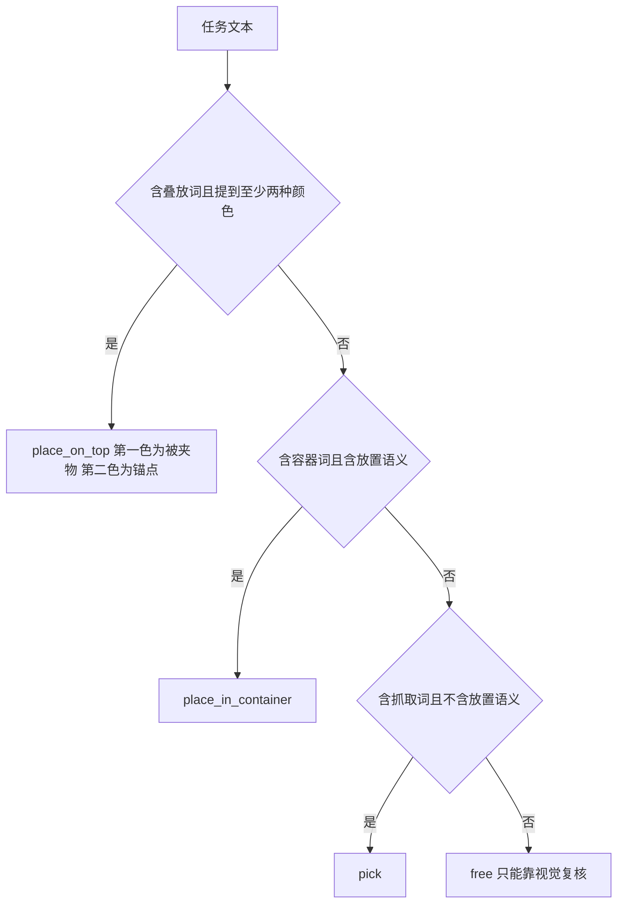
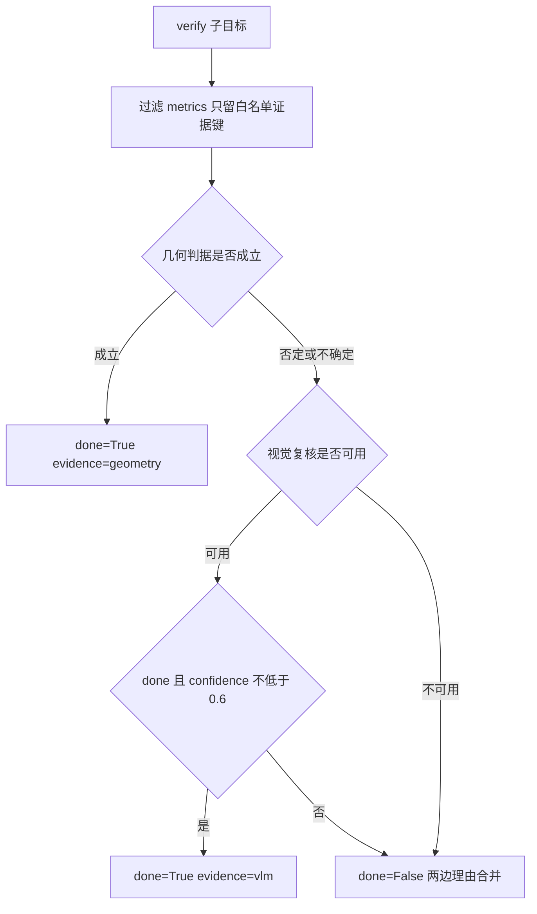

# 子目标规划与独立复核

`agent/taskplan.py` 解决一类具体问题：「把红色方块放进托盘，绿色方块叠到红方块上」这种任务丢给 `AgentLoop` 一次跑，中途容易丢目标，也无法回答「做到哪一步了」。这里的做法是拆成有序子目标，逐个跑、逐个复核，复核不通过就带着上次的原因重试。

## 1. 一个子目标一个 epoch

`SubGoalOrchestrator.run()` 对每个子目标调用 `_run_one()`，内部循环最多 `SUBGOAL_MAX_ATTEMPTS` 次，默认 3。每次尝试都通过 `loop_factory` 造一个新的 `AgentLoop` 实例，而不是复用同一个。

这条约束有实现上的原因：`MockVLM` 用任务纪元标记 `TASK_EPOCH_JSON` 切分当前任务，复用同一个实例会让上一个子目标的观测继续参与本子目标的 `picked` 与 `placed` 统计。`loop_factory` 的签名兼容三种形式，`_make_loop()` 用 `inspect.signature` 判断应传两个参数、一个参数还是零个参数。



## 2. 规划阶段：先问模型，再确定性兜底

`plan_subgoals()` 构造一条额外消息，文本前缀是「（规划阶段）」，明确要求只调用 `plan_subgoals` 工具，最多 4 条。`include_poses=False` 时这次规划提问同样不带物体真值位姿，保持隔离。

解析层 `_parse_subgoal_list()` 兼容三种形态：已经是列表、JSON 字符串、或者 `{"subgoals": [...]}` 外壳。每个子目标经 `_subgoal_from_dict()` 归一：

- 缺少 `instruction` 的子目标直接丢弃，并记一行日志。
- `goal_type` 不在 `GOAL_TYPES` 里时降级为 `free`，后续只能走视觉复核。
- `subject_color` 先用 `canonical_color()` 规范，认不出来再尝试从 `subject` 文本里解析。
- 条数超过上限直接截断。

任何一步失败都不影响主流程：模型没调 `plan_subgoals`、返回的列表为空、JSON 非法、规划调用抛异常，都会回退到 `fallback_subgoals(task)`。



`fallback_subgoals()` 只做确定性文本推断，不猜物体 id、不读真值。它返回**单条**子目标，`instruction` 就是原任务。这条兜底路径保证没有可用模型时闭环仍能跑，只是复杂任务会被当成一个整体。

## 3. SubGoal 的字段

| 字段 | 含义 |
| --- | --- |
| `id` | `g1`、`g2`…，按规划顺序生成 |
| `instruction` | 直接喂给 `AgentLoop` 的自然语言子任务 |
| `goal_type` | `place_in_container`、`place_on_top`、`place_at`、`pick`、`free` 之一，决定复核判据 |
| `subject` | 被操作物体的描述，人可读，不参与几何计算 |
| `subject_color` | 颜色线索，喂给感知做颜色分割 |
| `container` 与 `container_color` | 容器描述与颜色，`place_in_container` 用 |
| `anchor_color` | 叠放或横向锚点的颜色 |
| `verify_hint` | 人可读的验收说明，也进复核提问 |

`verify_hint` 由 `_verify_hint()` 按类型生成，例如 `place_in_container` 的说明是「色块质心应落在容器框内（check_inside）」，`pick` 的说明是「技能 metrics 的 holding 或 grasp_gap_mm 优先，缺失则看原位置色块是否消失」。它同时进人看的日志与复核模型的提问文本。

## 4. 复核的判定顺序

`SubGoalVerifier.verify(sg, metrics, rgb_before)` 的顺序在契约里冻结：

1. `place_in_container` 走 `check_inside(rgb, subject_color, container_bbox)`。
2. `place_on_top` 走 `check_stacked(rgb, subject_color, anchor_color)`，顶视图判不了再换 overview 斜视。
3. `pick` 走技能 `metrics` 里的 `holding`、`grasp_ok`、`picked`、`grabbed`，以及物理随动证据与指间间距判据。
4. `place_at` 与 `free` 没有固定几何判据，直接问视觉复核。

几何判据给出「完成」就直接返回，`evidence` 记 `geometry`；几何判据给出否定或不确定，则继续问视觉复核；两者都不通过时返回 `done=False`、`evidence="none"`，并把两边的理由拼进 `why`。任何异常一律 `done=False`，绝不上抛，也绝不在没有证据时返回成功。



### 4.1 叠放的三条正面证据

顶视图里叠放严丝合缝时下层会被完全盖住，`check_stacked` 找不到下层颜色，几何判据失明。`_geom_stacked()` 因此在 top 之后补一次 overview：

| 判据 | 条件 |
| --- | --- |
| 契约判据 | `check_stacked` 直接返回 ok |
| bbox 相邻 | 上层 bbox 底边与下层 bbox 顶边差不超过 `STACK_ADJACENT_TOL_PX = 8` 像素，且水平重叠不低于 `STACK_OVERLAP_MIN = 0.60` |
| 遮挡工况 | 下层完全找不到，且上层质心落在动作阶段标定的锚点 bbox 内 |

三条正面证据都不接受「只看到上层就算成功」。遮挡工况依赖动作阶段写进共享缓存的锚点框，拿不到框就只记说明，不放行。

### 4.2 抓取的证据分层

`_geom_pick()` 依次尝试：`metrics` 里的布尔字段、物理随动证据（`grasp_lift_ok` 与 `grasp_carry_evidence` 都为真）、指间间距大于全闭加 1 mm、以及前后对比 `check_gone`。物理随动证据单列有实测依据：无真值 `pick` 的 `metrics` 里既没有 `holding` 也没有 `grasp_closed_mm`，「技能实测优先」这条分支从来命不中，复核只能靠 `check_gone`，而它是否通过取决于夹爪有没有挡住物体。

## 5. metrics 白名单与信息隔离

复核器收到的证据先过 `_safe_metrics()`：只保留白名单里的键，键名里含 `pose`、`truth`、`oracle`、`position`、`xy`、`quat`、`qpos` 一律丢弃。白名单包含 `holding`、`grasp_ok`、`grasp_gap_mm`、`grasp_carry_evidence`、`grasp_lift_ok`、`touchdown_z`、`contact_force_norm`、`obstruction_id`、`failure_reason`、`target_id` 等。

整个模块不调用 `env.object_pose`、`env.set_object_pose`，也不读 `state.objects[*].pose`。复核只用渲染图、感知模块的颜色与几何判据、技能 `metrics` 的证据字段，以及视觉复核。连喂给复核模型的提问都写明证据已过滤、不含真值坐标。

`tests/test_isolation_no_truth.py` 把关这条约束，共三组断言：字面毒丸（`object_pose` 一类调用一律抛异常）下闭环仍要成功；栈感知毒丸下运行路径不得直接读真值；消息扫描下场景 JSON 不含 `pose`、`size` 键，也不含任何物体真值坐标三元组。

## 6. 共享像素缓存与观察位

复核需要像素才能跑 `check_inside` 与 `check_gone`，但复核自己重新标定容易失败。`taskplan.py` 里有一份模块级共享缓存：`remember_pixel()` 写入，`recall_pixel()` 读取，键是「颜色加相机」，另有一条按时间排序的日志，上限 64 条。

分工是单向的：动作阶段（`AgentLoop` 的 `locate` 与 `place` 解析成功时）写入，复核器只读。这样「本次动作阶段实际用过的容器框」才可靠，也避免复核自己的标定反过来污染下一次复核。

`recall_pixel()` 的查找顺序是：颜色精确命中、`target` 文本包含匹配、允许时退回最近一次带 bbox 的标定。退回兜底命中时，命中条目的 `target` 与 `source` 会记进证据，保证可审计。

清缓存的时机只有一个：`SubGoalOrchestrator.run()` 入口，即新任务开始时。绝不在每个子目标或每次 `AgentLoop.run()` 开头清，否则动作阶段标定好的容器框会在复核前丢掉，`place_in_container` 的几何判据只剩视觉复核。

复核前的观察位由 `_observe()` 负责。默认兜底是 `env.home()`，把机械臂移出工作区，让 top 与 overview 看得见结果。实测叠放完成后夹爪还停在叠放点上方，整个区域被挡住。但归位在持物时会把物体丢掉，所以有两条守卫：注入的 `observe` 钩子优先，钩子接受参数时会把子目标传进去；没有钩子时，`pick` 子目标或仍持物一律跳过归位。

这条守卫来自一次实测：原先每个子目标复核前都归位，带载时规划失败会走瞬移并顺手张开夹爪，方块落回原位，复核判目标仍在，`g1:pick` 三次尝试全废，技能层却报告已抓起。

## 7. 重试与结果记录

`_run_one()` 的第 1 次尝试用原指令；第 2 次起在原指令后追加「（上一次复核未通过：<原因>；请再试一次，必要时先 locate 重新标定目标像素）」。这让重试带上上下文，而不是简单重复。

视觉复核走 `_vlm_review()`，优先要求模型调用 `verify_subgoal(done, confidence, why)`；兼容旧的 `subgoal_done`（视为完成、置信度 1）；纯文本只在没有工具调用时兜底，且否定词优先，宁可不判完成也不谎报成功。`_finish_vlm()` 统一出口：`confidence` 低于 `vlm_confidence_min = 0.6` 时，即使 `done=True` 也判未完成。

回复为空或没有结构化结论时标 `inconclusive=True`，含义是「无结论」，没有说模型认为未完成。这类结果照样消耗一次尝试，但日志会标注可重试。

```python
# agent/taskplan.py 的 _finish_vlm 统一出口
if done and conf < self.vlm_confidence_min:
    return {"done": False, "evidence": "vlm", "confidence": conf, "source": source,
            "why": f"VLM 认为完成但置信度 {conf:.2f} 低于阈值，不算数"}
if done:
    return {"done": True, "evidence": "vlm", "confidence": conf, "source": source,
            "why": why or "VLM 视觉复核通过"}
return {"done": False, "evidence": "vlm", "confidence": conf, "source": source,
        "why": why or "VLM 复核未通过"}
```

每个子目标的记录字段在契约里冻结：`subgoal`、`attempts`、`done`、`evidence`、`why`。三次尝试全部未通过时返回 `done=False`，`why` 里写明 `subgoal_failed`。

## 8. 易错点与调试

| 现象 | 原因 | 定位手段 |
| --- | --- | --- |
| 第二个子目标状态被上一条污染 | 复用了同一个 `AgentLoop` 实例 | 检查 `loop_factory` 是否每次造新实例 |
| 容器几何判据从不触发 | 像素缓存被提前清空 | 确认只在 `run()` 入口清一次 |
| 复核说「只见机械臂」 | 观察位没让开或归位失败 | 看 `_observe()` 的日志与钩子是否注入 |
| pick 子目标复核总失败 | 归位把刚抓起的物体丢掉 | 看是否跳过了归位 |
| 复核把完成判成未完成 | 视觉复核置信度低于 0.6 | 看 `confidence` 与 `inconclusive` |
| 复核提问里出现坐标 | 白名单或禁用子串漏了 | 检查 `_safe_metrics()` |
| 子目标类型全是 `free` | 规划返回的 `goal_type` 非法 | 看 `_subgoal_from_dict()` 的降级日志 |

## 9. 小结

- 复合任务拆成有序 `SubGoal`，每个子目标开一个新的 `AgentLoop` epoch，最多尝试 3 次。
- 规划优先问模型调 `plan_subgoals`，失败或为空回退到确定性单条子目标。
- 复核判定顺序冻结：容器、叠放、抓取各走几何判据，其余交视觉复核。
- 几何不成立仍会问视觉复核，两者都否才返回失败；异常一律失败。
- 喂给复核的证据过白名单，键名带真值语义的一律丢弃。
- 像素缓存在动作阶段写、复核阶段只读，只在任务开始时清空。
- 复核前让开观察位，但 `pick` 子目标与持物状态跳过归位。

| 权衡点 | 本工程选择 | 收益与代价 |
| --- | --- | --- |
| 复核主体 | 几何优先，视觉兜底 | 成功判定硬；代价是几何判据依赖颜色分割的可靠性 |
| 模型自评 | 只当终止信号 | 防止谎报；代价是自评正确时也要多跑一次复核 |
| 证据范围 | 白名单加禁用子串 | 隔离彻底；代价是新增证据字段要同步改两处 |
| 重试上限 | 3 次 | 控制时间；代价是失败原因未被模型理解时仍会耗尽尝试 |

## 练习

基础题

1. 写出 `SubGoalVerifier.verify()` 的四类判定分支，说明几何判据给出否定后为什么还要问视觉复核。
2. 说明共享像素缓存为什么由动作阶段写、复核阶段只读。
3. 列出 `_estimate` 相关的三条叠放证据，并指出哪一条依赖动作阶段的标定。

挑战题

4. 为 `place_at` 设计一条可自动复核的几何判据，要求不引入真值坐标，并说明需要感知模块提供什么接口。
5. 构造一个「模型自评完成但几何与视觉都判否」的子目标场景，写出 `verify()` 会返回的字段，并说明日志里应关注哪几个键。

## 附：本页引用的路径

| 路径 | 用途 |
| --- | --- |
| `agent/taskplan.py` | `SubGoal`、`plan_subgoals()`、`SubGoalVerifier`、`SubGoalOrchestrator` |
| `agent/schema.py` | `plan_subgoals` 与 `verify_subgoal` 的工具 schema 与校验 |
| `agent/loop.py` | 每个 epoch 的 AgentLoop、`subgoal_done` 特判 |
| `sim/perception.py` | `check_inside()`、`check_stacked()`、`check_gone()`、`color_blob()` |
| `tests/test_isolation_no_truth.py` | 隔离要求的三组断言 |
| `tests/test_subgoal_loop.py` | 子目标闭环回归 |
| 仓库根 | `vlm-admittance`，上游 https://github.com/TC635807/vlm-admittance |
