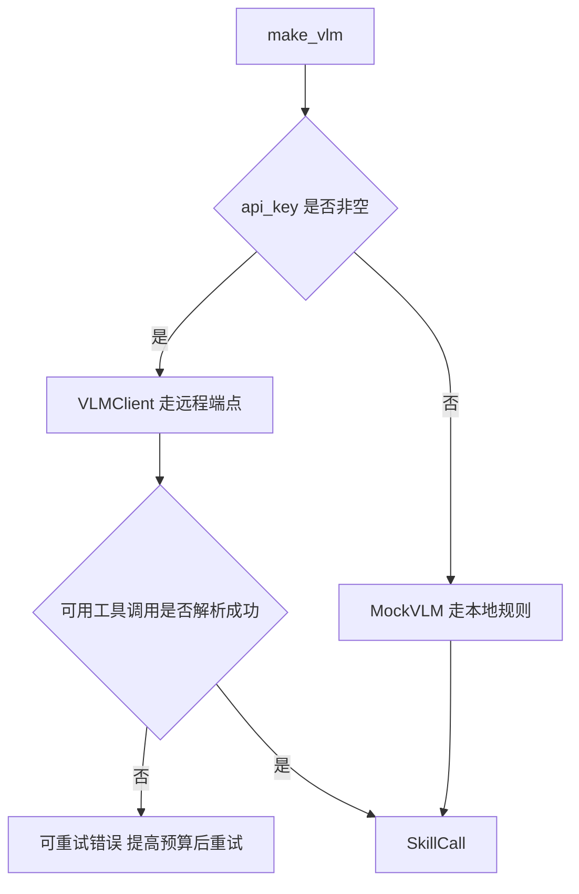
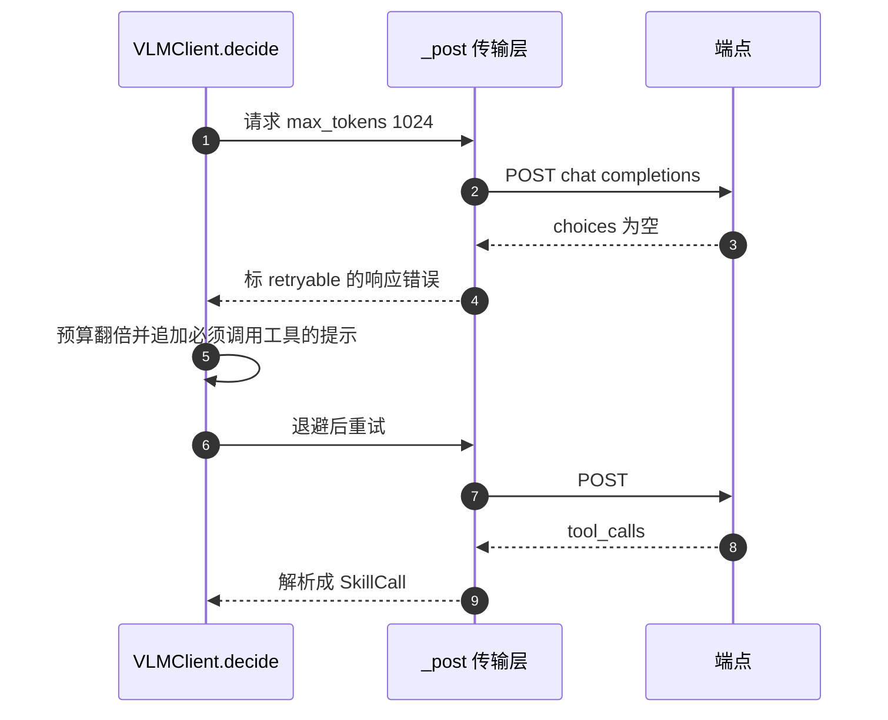
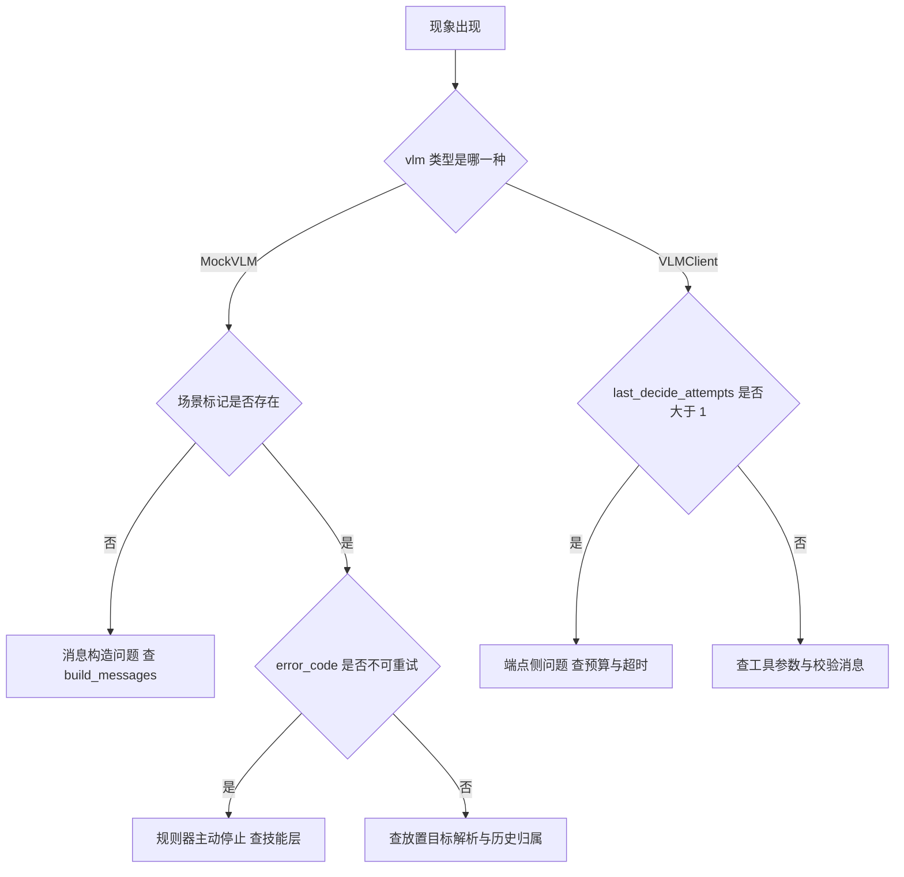

# 决策层的故障定位与调试

这一篇把决策层的排查入口集中起来。排查的第一步永远是确认走的是哪条决策路径，因为同一段现象在真端点与离线规则器下的原因完全不同。

## 1. 先确认决策路径

`make_vlm(prefer_api=True)` 的判据只有一条：`VLMClient.available` 为真，也就是 `api_key` 非空。为真返回 `VLMClient`，否则返回 `MockVLM`。`AgentLoop.run()` 开头会把决策器类型打进日志，形如 `vlm=VLMClient` 或 `vlm=MockVLM`。



凭据优先级是环境变量高于 `config.local.json` 高于内置默认，三套别名都认：`VLM_*`、`OPENAI_*`、`AI_*`。填充必须发生在 import 期，因为 `core/config.py` 里的常量是导入时求值的。`VLM_DISABLE_LOCAL_CONFIG` 可以关闭本地文件，`VLM_CONFIG_FILE` 可以指定别的路径。任何日志与界面都不打印 key。

`MockVLM` 的边界要记清楚，它决定离线现象能不能复现：

- 输入是 `messages` 里的全部文本，先找 `SCENE_JSON_BEGIN` 与 `SCENE_JSON_END` 之间的场景 JSON；找不到就直接 `stop`。
- 只依据场景 JSON 的 `color`、`category`、`is_container`、`graspable` 与任务文本做匹配，不硬编码任何物体 id。
- 接触力超过 `force_threshold`（默认 6.0 N）时先切 `soft` 导纳；抓取失败先降刚度，明确归属本目标的失败达到 `max_pick_retries`（默认 3）次才转 `ask_user`。
- 放置目标解析不出来时一律 `ask_user`，不静默退回托盘。

## 2. 端点侧的重试与错误码

`VLMClient` 只用标准库 `urllib.request`，POST 到 `{base_url}/chat/completions`，请求体带 `tools` 与 `tool_choice="auto"`。两层重试要分开看：

| 层 | 触发条件 | 次数 | 退避 |
| --- | --- | --- | --- |
| 传输层 `_post` | 网络错误、超时、以及 408、425、429、500、502、503、504 | `VLM_MAX_RETRIES = 4`，即最多 5 次尝试 | `(0.6, 1.5, 3.0, 5.0)` 秒，超出长度取最后一个 |
| 决策层 `decide` | 解析失败但异常标了可重试 | 同上 | 同上 |

决策层的重试会在第 2 次起把 `max_tokens` 翻倍（上限 `VLM_MAX_TOKENS_CAP = 8192`），并追加一条「必须调用工具」的提示。实测端点的 `message.reasoning` 会占满完成预算，`content` 为空，翻倍通常就够。重试只改本次 payload，不动调用方传入的 `messages`。



每个异常都显式带 `retryable` 与 `error_code`，常见错误码是 `network`、`http_429`、`bad_json`、`no_choices`、`empty_response`、`unparseable_content`。这里有一段实机教训：早期实现靠中文子串判断是否重试，而 `decide()` 抛出的两条消息都不含那个子串，空回复一次都不重试，任务直接死掉。现在判据只读异常属性，不读错误文本。

```python
# agent/vlm_client.py 的 _retryable_response
def _retryable_response(err):
    if isinstance(err, VLMError):
        return bool(getattr(err, "retryable", False))
    m = re.search(r"HTTP\\s+(\\d{3})", str(err))
    return bool(m) and int(m.group(1)) in RETRYABLE_HTTP_CODES
```

诊断字段：`last_attempts` 记传输层尝试次数，`last_decide_attempts` 记决策层尝试次数，`last_max_tokens` 记本次实际预算。两者分开记，互不覆盖。默认超时 `VLM_TIMEOUT = 120` 秒，实测 30 秒会被服务端提前掐断。

## 3. 隔离相关的检查点

无真值模式需要同时满足两件事：`include_poses=False`，以及注入 `pixel_resolver` 或 `locator` 之一。缺一个就会出现「模型只能给像素，但系统不会反投影」的组合。

| 检查项 | 期望 | 手段 |
| --- | --- | --- |
| 消息里没有真值 | 场景 JSON 不含 `pose`、`size`，不含真值坐标三元组 | `tests/test_isolation_no_truth.py` 的消息扫描 |
| 运行路径不读真值 | `object_pose` 与 `set_object_pose` 只在 `sim/env.py` 内部被调用 | 栈感知毒丸用例 |
| 复核证据已过滤 | 键名不含坐标与真值语义 | `SubGoalVerifier` 的 `_safe_metrics()` |
| 冗余参数不报错 | 像素在场时 `target_id` 被丢弃并记日志 | `corrected_args` 与 `[validate]` 日志 |

隔离测试里有一个 `SceneLeak` 检测器：只要场景 JSON 里出现 `pose` 或 `size` 键就抛异常。这个检测器自身也有一个用例，故意喂一份带真值的假消息确认它有效。

## 4. 症状与原因对照

| 症状 | 可能原因 | 定位手段 |
| --- | --- | --- |
| 决策一步都不发出 | 消息里没有场景标记 | 看 `MockVLM` 是否直接 `stop`；确认 `SCENE_JSON_BEGIN` 存在 |
| 决策立刻 `stop` | 历史里出现过不可重试错误码 | 看最近观察的 `error_code` |
| 反复同一调用直到上限 | 参数完全没变，触发重复守卫 | 看日志里的参数指纹提示 |
| 连续 `invalid_call` | 三选一或四选一冲突 | 看校验返回的 `msg` 点名了哪个参数 |
| `perception_error` | 反投影失败或定位后端未配置 | 看 `metrics` 里的原始像素与相机 |
| `grasp_not_confirmed` | 抓取未通过独立确认 | 看 `grasp_verify_camera`、`grasp_verified`、面积前后值 |
| `vlm_error` 两次后中止 | 端点空回复或被截断 | 看 `last_decide_attempts` 与 `last_max_tokens` |
| 复核标 `inconclusive` | 复核回复为空或无结构化结论 | 看 `why` 是否写明无结论 |
| 复核说只见机械臂 | 观察位没让开 | 看 `_observe()` 的日志 |
| 真模型给出像素却不动 | 没有注入反投影能力 | 看 `pixel_resolver` 与 `locator` 是否为 None |



## 5. 复现与验证入口

| 入口 | 覆盖 |
| --- | --- |
| `tests/run_acceptance.py` | 全链路验收，2026-10-12 实跑 9/10 通过 |
| `tests/test_isolation_no_truth.py` | 5 个用例，真值隔离与无真值闭环 |
| `agent.smoke` | 239 个用例，`MockVLM` 决策确定性与非法调用拒绝 |
| `tests/test_subgoal_loop.py` | 6 个用例，子目标闭环 |
| `interactive_flows` | 17 个用例，意图路由、持物不变量、pick 子目标复核 |
| `tools/vlm_probe.py` | 端点能力探针，文本、图片、function calling 三项 |
| `demo.interactive --headless --self-test` | 真实技能库加子目标编排加独立复核 |

端点探针的用法是设置 `AI_API_URL`、`AI_API_KEY`、`AI_MODEL` 后运行，三项全通过才说明端点具备本工程需要的能力。真实端点实测过一次完整链路：`把红色方块放进托盘` 走 `pick(box_red)`、`place(tray)`、`stop`，耗时 11.9 秒；绿色 9.1 秒；`轻放进托盘` 先 `set_compliance(soft)`，10.6 秒。

## 6. 已知缺陷与未确认项

| 项 | 现状 | 影响 |
| --- | --- | --- |
| 导纳让位方向用例 | `test_target_overlay` 失败，验收里唯一的红 | 属控制单元，与决策层无直接关系 |
| `can_yellow` 细高圆柱 | 抓取不稳，指垫接触窗口窄 | 决策层会收到更多 `grasp_not_confirmed` |
| `gray` 与 `white` 颜色规则 | 暂不可靠，实机 `gray` 曾误检到 494 mm | 复核的几何判据可能失明，退化为视觉复核 |
| `residual < 15 mm` 判据 | 已被判定不是有效可信度依据 | 反投影结果的接受需要更严格的判据 |
| `--with-barrier` 场景 | 规划不建模被夹持物体 | 该场景下抓放不可靠 |
| 工具 schema 的 `required` | 比校验层更严，属推断未在真实端点复现 | 严格端点可能拒绝合法的像素调用 |

## 7. 小结

- 先看决策器类型，`MockVLM` 与 `VLMClient` 的故障原因不同源。
- 端点侧两层重试分开计数，空回复重试会提高预算并追加提示。
- 重试判据读异常属性，不读错误文本。
- 无真值模式需要开关与反投影能力同时到位，隔离由三组毒丸断言把关。
- 大部分症状都能从 `error_code` 与 `metrics` 里的证据字段直接读出来。
- 已知缺陷集中在颜色规则、细高圆柱与规划对持物的建模。

| 排查起点 | 先看什么 | 再看什么 |
| --- | --- | --- |
| 决策太慢或不发出 | 决策器类型 | 端点的 `last_decide_attempts` 与 `last_max_tokens` |
| 决策反复无效 | `error_code` | 参数指纹与校验消息 |
| 抓取结果不可信 | `grasp_verify_camera` | 面积前后值与物理证据字段 |
| 复核结论矛盾 | `evidence` | `confidence` 与 `inconclusive` |

## 练习

基础题

1. 列出 `make_vlm()` 判定 `VLMClient` 与 `MockVLM` 的唯一条件，并说明凭据的三级优先级。
2. 说明空回复重试与传输层重试的两点差别。
3. 写出至少三个能从 `SkillResult.metrics` 直接读出的抓取验证字段及其含义。

挑战题

4. 设计一个不依赖真实端点的回归用例，覆盖「空回复一次后成功」与「两次都空后抛出不可重试错误」两条路径，说明如何替换传输层。
5. 给定一次「模型给出像素但抓取反复失败」的现象，列出按顺序要检查的五个环节，并指出每一步的判定依据。

## 附：本页引用的路径

| 路径 | 用途 |
| --- | --- |
| `agent/vlm_client.py` | `VLMClient` 重试与错误码、`MockVLM`、`make_vlm()` |
| `agent/loop.py` | 错误码处理、抓取验证字段、`AgentLoop.NON_RETRYABLE_ERRORS` |
| `agent/taskplan.py` | 复核证据白名单、`inconclusive` 语义 |
| `agent/schema.py` | 校验消息与参数纠正记录 |
| `core/config.py` | `VLM_TIMEOUT`、`VLM_MAX_TOKENS`、凭据填充 |
| `tests/test_isolation_no_truth.py` | 隔离断言与 `SceneLeak` 检测器 |
| `tools/vlm_probe.py` | 端点能力探针 |
| `README.md` | 验收结果、真实端点实测、已知问题 |
| 仓库根 | `vlm-admittance`，上游 https://github.com/TC635807/vlm-admittance |
