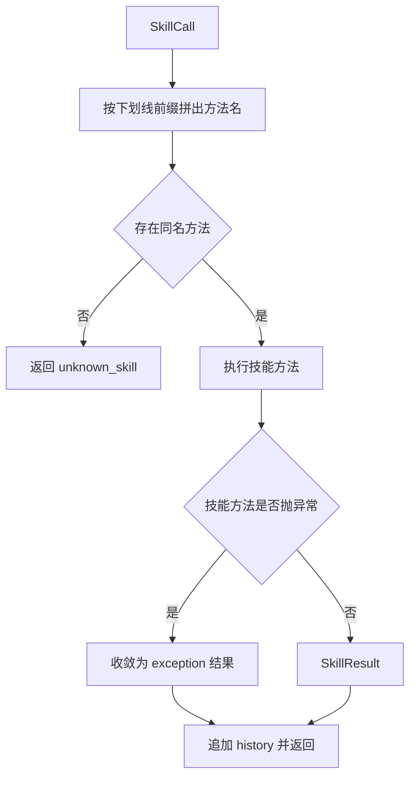
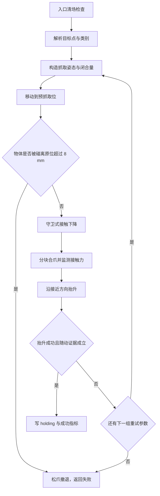
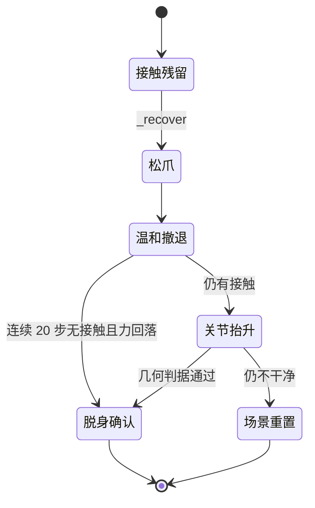

# 技能库的确定性动作序列

本文对应公开项目 `TC635807/vlm-admittance` 的 `skills/`（https://github.com/TC635807/vlm-admittance）。技能库是决策层与控制层之间的执行层：模型只输出一个 `SkillCall`（技能名、参数字典、可选柔顺意图），`skills/library.py` 把它展开成一段顺序固定的物理动作，并在失败时回一个带 `error_code` 的结构化结果。

这段流程必须是确定性的，因为一次抓取要穿过规划、IK、位置伺服、接触力与视觉校验五道环节。顺序与参数固定下来之后，失败才能被归因到具体环节，模型也才能基于观测改参数重试。

## 1. 执行层夹在慢环与快环之间

系统里有两层时间尺度。慢环 0.5~2 Hz、事件触发，位于 `agent/`：渲染相机图、组装 messages、调用模型、校验返回的 `SkillCall`。快环 500 Hz、每个物理步 `mj_step` 一次，位于 `control/`、`planning/` 与 `skills/`。技能库是两层之间的接口，慢环调用一次，内部可能跑掉几千个物理步。

`SkillExecutor.__init__` 接收四个协作对象：`env`（场景与环境）、`kin`（DLS IK）、`runner`（轨迹执行与力看门狗）、`planner`（RRT-Connect）。自身只维护少量状态：当前柔顺档 `compliance`、手持物体 id `holding`、最近一次成功抓取前的位姿 `last_pick_pose`，以及逐次追加的 `history`。

技能名与方法名一一对应。`__call__` 用下划线前缀拼出方法名，找不到就返回 `unknown_skill`；技能方法内部抛出的异常统一收敛成 `exception` 结果，不让异常穿过执行层。调用耗时与观察结果都写进 `history`，供上层把上下文交回模型。



```python
def __call__(self, call: SkillCall) -> SkillResult:
    t0 = time.time()
    name = call.skill
    fn = getattr(self, "_skill_" + str(name), None)
    if fn is None:
        res = SkillResult(False, name, f"unknown skill: {name}", "unknown_skill")
    else:
        try:
            res = fn(call)
        except Exception as exc:
            res = SkillResult(False, name, f"exception: {type(exc).__name__}: {exc}", "exception")
    res.duration = time.time() - t0
    self.history.append({"call": call.to_json(), "result": res.to_observation()})
    return res
```

## 2. 抓取位姿由接近轴与偏航角解析得到

Robotiq 2F85 挂到 UR5e 法兰之后，TCP site `g_pinch` 的局部 +z 轴就是接近轴（pinch 相对 base_mount 沿 +z 偏移 0.145）。于是「从上往下抓」等价于让 TCP 局部 +z 指向世界系 -z，而不是去凑一组欧拉角。

$$q_{\text{top}} = \mathrm{Z2Vec}([0,0,-1]), \qquad q = q_{\text{top}} \otimes q_{\text{axis}}([0,0,1], \psi)$$

`approach_quat(yaw)` 先用 `mujoco.mju_quatZ2Vec` 求出对齐用的 `q_down`，再绕局部 z 转 yaw。乘序是 `q_down ⊗ q_yaw`，也就是把偏航加在已经对齐的局部坐标系里。yaw 的作用是选择两指的开合方向：方块可以绕竖直轴任意转，圆柱与窄物体对指垫与表面的贴合很敏感，需要换一个 yaw 重试。

侧面夹持走另一个入口 `approach_quat_dir(direction, roll)`：把接近轴指向给定的世界系方向，roll 同样是绕局部 z 的转动。`top-down` 就是 `direction=[0,0,-1]`，与 `approach_quat` 等价。

```python
def approach_quat(yaw: float = 0.0) -> np.ndarray:
    q_down = np.zeros(4)
    mujoco.mju_quatZ2Vec(q_down, np.array([0.0, 0.0, -1.0]))
    if abs(float(yaw)) < 1e-9:
        return q_down
    q_yaw = np.zeros(4)
    mujoco.mju_axisAngle2Quat(q_yaw, np.array([0.0, 0.0, 1.0]), float(yaw))
    out = np.zeros(4)
    mujoco.mju_mulQuat(out, q_down, q_yaw)
    return out
```

## 3. 闭合量按物体宽度反算

`close_ratio_for(obj)` 把物体水平半尺寸换算成夹爪开合比例。标定来自仿真实测：开合比例 1 时指间距 93 mm，比例 0 时 8.4 mm，中间线性。目标指间距取物件宽度减去一个余量（默认 6 mm），保证夹紧而不是虚合。

$$\text{ratio} = \mathrm{clip}\!\left(\frac{2000\max(s_x,s_y) - m - g_{\text{closed}}}{g_{\text{open}} - g_{\text{closed}}},\, 0,\, 1\right)$$

其中 $s_x,s_y$ 是半尺寸（米），$m$ 是 6 mm 余量，$g_{\text{open}}=93$、$g_{\text{closed}}=8.4$。固定用 0.35 对 40 mm 方块勉强可行，但对 30 mm 圆柱会算出 38 mm 的指间距，大于物件本身，根本夹不住，因此必须按物体现算。

```python
@staticmethod
def close_ratio_for(obj: SceneObject, margin_mm: float = 6.0) -> float:
    width_mm = 2000.0 * float(max(obj.size[0], obj.size[1]))
    gap_mm = width_mm - float(margin_mm)
    span = GRIPPER_GAP_OPEN_MM - GRIPPER_GAP_CLOSED_MM
    return float(np.clip((gap_mm - GRIPPER_GAP_CLOSED_MM) / span, 0.0, 1.0))
```

无真值模式下拿不到 `SceneObject`，改用同一条标定的 `_close_ratio_for_size(half_size)`；连尺寸都没有时按类别先验取 0.35（方块）/ 0.55（圆柱）/ 0.75（水瓶）。模型给的闭合量只作为更紧的上限，两者取较小值，因为更松会夹空、更紧不会。

## 4. pick 的动作序列

`_skill_pick` 的主干可以拆成七步：入口清场、解析目标、构造姿态与闭合量、移动到预抓取位、守卫式接触下降、分块合爪、抬升并核对证据。任何一步失败都先松爪再撤退，然后把失败原因写进 `reasons`，最多按 `PICK_ATTEMPT_PLAN` 的 3 组参数重试。

三组重试参数是有取舍的：标准深度、略浅（0.3 倍深度，避免指垫顶桌面）、更紧加 90 度偏航（贴合方向救场）。深压被证明收益低而且会把指垫顶到桌面，所以从早期的 10 组压缩到 3 组。三组用完仍然失败时，技能层不再自己换参数，而是把结构化观测交回模型重新规划。



预抓取位由目标点沿接近方向反向偏移 `APPROACH_HEIGHT`（0.10 m）得到。下降之前会复检物体是否被碰跑：预抓取位的移动本身可能把物体推走，实测圆柱被推移 33 mm，继续下降与合爪后又被推到 127 mm 与 152 mm，所以超过 `PICK_APPROACH_DRIFT_TOL`（8 mm）就立刻撤退。

## 5. 自由段用刚性档，接触段切柔顺档

同一段动作在自由空间与接触期的需求相反。自由段要求末端严格跟随参考轨迹，用 `STIFF_COMPLIANCE`：`k=5000, d=200, m=5`，六个轴全部关闭导纳，等于纯位置控制。接触段要求末端让位，用 `PLACE_TOUCH_COMPLIANCE`：只在 z 向开启，`k=120, d=20`，力阈值 6 N。

模型的柔顺意图只允许改变刚度与阻尼，不允许降低技能自身的安全力阈值。`_motion_compliance` 对 `force_limit` 取技能基准值作为下界，否则模型一句「轻一点」会把阈值压到 8 N，导致正常的贴面放置都被判超限。

```python
def _motion_compliance(self, call: SkillCall, base: ComplianceParams) -> ComplianceParams:
    comp = self._compliance_from_call(call, base)
    return ComplianceParams(k=comp.k, d=comp.d, m=comp.m, axes=comp.axes,
                            force_limit=max(float(comp.force_limit), float(base.force_limit)))
```

抓取下降只用 z 向柔顺。六维全开会把接触反力传成横向位移，末端被推横之后指垫夹偏，30 mm 圆柱在这个模式下实测必失败。抬升段则相反，可以接受模型给的软档，因为此时没有接触面需要保持。

## 6. 守卫式下降与力看门狗

放置下降是 guarded move：几何算出的目标高度只当上限，是否到位由接触力判定。容器与托盘有壁厚和边缘，几何高度差几毫米就会过度下压，实测用 20 N 档下降时先以 21.6 N 中止，随后机械臂卡死、接触力冲到 400~500 N。现在的做法是接触力一到就算到位，厚度误差由导纳吸收。

`_descend_until_contact` 走两段限速：先用 `PLACE_APPROACH_VMAX`（0.006 m/s）从目标上方 60 mm 走到目标上方 10 mm 处，再用 `PLACE_VMAX`（0.003 m/s）走完最后 10 mm 与 10 mm 的几何地板余量，接触判据取当前力与该步 `max_force` 的较大者，阈值 2.5 N。两段都打开 `stop_on_force`，力到阈值就冻结参考并正常返回，而不是报错。

| 阶段 | 限速 | 终点 | 触发条件 |
| --- | --- | --- | --- |
| 阶段 1 接近 | 0.006 m/s | 目标上方 10 mm | 力 >= 2.5 N 或 contact-stop |
| 阶段 2 触底 | 0.003 m/s | 目标下方 10 mm 几何地板 | 力 >= 2.5 N 或 contact-stop |
| 容器撞壁 | 同上 | 同容器分支 | 触点在目标上方 > 20 mm 即接触 |

抓取下降的入口 `_descend_grasp_until_contact` 对矮物体保持单段轨迹，对细高物体才拆成巡航段加最后 10 mm 限速段。细高物体的模型高度常常给的是瓶身中部，实际先碰到的是瓶盖或瓶肩，所以巡航段也带同一个 3 N 看门狗。看门狗中止返回 `force_limit`，调用方把它当成接触信号，冻结在当前高度合爪，等于抓住了上半身。

```python
if r.error_code == "force_limit":
    self._freeze_arm(int(PLACE_CONTACT_HOLD_STEPS))
    f_hold = max(float(f_now), self._force_norm(), float(peak))
    return "contact", {"grasp_z_effective": round(tcp_z, 4),
                       "touchdown_force": round(f_hold, 3)}, \
        MoveResult(True, "接触即停（守卫式接触下降）", None, max_force=float(f_hold))
```

## 7. place 的四种落点

`_skill_place` 支持四种目标，四者互斥，同时给两个以上直接返回 `bad_args`。容器落点的支撑面取容器顶面，桌面落点取 `TABLE_HEIGHT`，叠放取锚点顶面，横向并排取锚点 xy 加上方向单位向量乘以中心距。

| 参数 | 目标 | 支撑面 | 关键校验 |
| --- | --- | --- | --- |
| `container_id` | 容器中心或显式 xy | 容器顶面 | 目标必须是容器 |
| `surface=table` | 显式 xy 或自选空位 | 桌面上表面 0.40 | 空位与其它物体净距 >= 80 mm |
| `on_top_of` | 锚点 xy 加偏移 | 锚点顶面 | 锚点底面离桌面在 [-10, +20] mm |
| `anchor_id + relation` | 锚点 xy 加方向 | 桌面上表面 | relation 必须在白名单内 |

放置成功要四条同时成立：物体 xy 距目标小于 6 cm、底面离支撑面落在 [-1, +2] cm、接触力不超过 5 N、夹爪已张开，否则返回 `place_mismatch`。释放之后强制再抬升 0.15 m，把指垫彻底带离被放物体；抬升失败或仍有残余压力时立刻走多方向脱身。

## 8. 撤退、恢复与三级脱困

任何中止或恢复路径在移动之前都要先做 `_freeze_arm`：把当前 6 个关节角写成位置目标并空步若干步。这一步不能省。`move_to_pose` 因力超限中止时，`data.ctrl` 仍停在最后一条压入指令上，此时若直接发起下一次运动，而它恰好是出发前 IK 预检失败一步都不走，位置伺服会继续按旧 ctrl 下压，实测 0.196 s 内末力冲到 7471 N。

```python
def _freeze_arm(self, steps: int = 20) -> None:
    q = self._arm_qpos_now()
    try:
        self.env.set_arm_joint_targets(q)
    except Exception as exc:
        self.log(f"[skills] 停住失败（set_arm_joint_targets）: {exc}")
        return
    try:
        self.env.step(max(1, int(steps)))
    except Exception as exc:
        self.log(f"[skills] 停住步进失败: {exc}")
```

`_retreat` 只做一次温和撤退：力已经松（不超过阈值）时方向取纯 +z，有力时才沿接触反力的反方向走。方向这里不能照噪声反力取，实测 |F|=0.6 N 时噪声朝下，沿着它撤退等于主动下压 8 cm，接触力从 0.6 N 涨到 32.3 N。力上限取「进入力的 1.5 倍」再夹到 [40, 45] N，运动时长 2.5 s。旧实现把上限抬到 1e9 并做多轮升级，实测撤退期间末端反而下沉，|F| 从 20 N 涨到 8437 N。

`_recover` 先松爪再做一次温和撤退。判据同时要求两条：几何上连续 20 步不再与被挡物体接触，且末端力回落到安全阈值。只看几何会误判压桌面这类接触，因为接触反查只映射场景物体。`_escape_contact` 在此基础上追加一次关节空间抬升，`_finish_failure` 在两种手段都清不掉时才重置场景，并把 `obstruction_id` 与受阻力一起上报。

`hard_recover` 是交互式使用中的应急入口，分三级：常规撤退、规划器直接回 `HOME_QPOS` 的关节位形、重置整个场景。每一级在动作前后都调用 `_freeze_arm`，避免留下继续压入的指令。



## 9. 带载禁瞬移

`_skill_home` 优先走关节路径。带载时，夹爪与被夹物体的持续接触会让碰撞检查把起始位形判非法，于是规划返回 `None`，此时在规划窗口临时忽略「手持物与夹爪」这一对接触后重试。仍然失败才考虑 `env.home()` 的瞬移兜底。

瞬移有严格前置条件：接触力接近 0、夹爪已张开，且手里没有载荷。带载时一律禁止瞬移，因为瞬移会让机械臂瞬间跑到 0.6 m 之外，手里的物体被拖着走或直接丢下。走不了关节路径就诚实返回 `home_blocked`，保留持物状态交给上层处理。`env.home()` 自身也不再默认张开夹爪，需要张开的调用方显式传参。

```python
loaded = self.holding is not None and gripper < GRIPPER_OPEN_MIN
grip_gate_ok = (gripper >= GRIPPER_OPEN_MIN) or loaded
if loaded:
    why = (f"带载（holding={self.holding}）禁止瞬移归位：瞬移会把手里夹着的物体"
           f"拖走/丢下，必须走关节路径或先放下物体")
elif f_norm > HOME_SAFE_FORCE_N or not grip_gate_ok:
    why = (f"接触力 {f_norm:.1f} N（阈值 {HOME_SAFE_FORCE_N:.1f} N）/ "
           f"夹爪开合 {gripper:.2f}（需 >= {GRIPPER_OPEN_MIN:.2f}）")
else:
    why = ""
```

## 10. 易错点与调试

| 现象 | 原因 | 处理位置 |
| --- | --- | --- |
| 技能报成功但物体没动 | 抬升返回值被忽略，只看了夹爪开合判据 | `_skill_pick` 要求 `grasp_lift_ok` 与随动证据同时成立 |
| 中止后力继续飙升 | `data.ctrl` 停在压入指令上 | 任何恢复路径先 `_freeze_arm` |
| 撤退越退越紧 | 沿噪声反力方向走，或把力上限抬得过高 | 力小取纯 +z，上限封顶 45 N，只退一次 |
| 圆柱抓不住 | 固定闭合量算出的指间距大于物件宽度 | `close_ratio_for` 按宽度反算 |
| 模型说「轻一点」导致正常放置中止 | 柔顺意图把 `force_limit` 也压低了 | `_motion_compliance` 对力阈值取下界 |
| 带载归位被拒 | 判据要求夹爪开合 >= 0.80，夹着 45.5 mm 方块时恒为 0.44 | 带载时改走关节路径，禁止瞬移 |
| 放置下降压死 | 几何高度差几毫米，用大阈值硬顶 | 守卫式下降，接触即停 |

`place` 下降的源码注释写的是「1.5 mm 小步 + 每步 2.5 N 看门狗」，现行实现已经改成两段限速轨迹，`PLACE_CONTACT_STEP_M` 这个常量在技能层没有被引用，只在 smoke 里被导入。两处口径不一致，读参数时以代码路径为准。

## 11. 小结

### 核心概念

- 技能名与方法名通过下划线前缀绑定，异常一律收敛成结构化 `SkillResult`。
- 抓取姿态由 TCP 局部 +z 接近轴加绕局部 z 的偏航角解析得到。
- 闭合量按物体宽度线性反算，余量 6 mm，标定是 93 mm 与 8.4 mm。
- 自由段用刚性档，接触与抓取段切柔顺档；模型不能下调安全力阈值。
- 放置下降是守卫式接触停止，接触力到阈值即认为到位。
- 恢复的固定顺序是停住、松爪、一次温和撤退、几何判据确认，最后才重置场景。

### 设计权衡

| 取舍点 | 本项目选择 | 收益与代价 |
| --- | --- | --- |
| 抓取重试 | 3 组固定组合 | 行为可归因；代价是遇到未覆盖的摆放仍会失败，需要模型重新规划 |
| 接触判据 | 力阈值即到位 | 免去精确几何；代价是力阈值取值需要标定 |
| 恢复强度 | 只退一次的温和策略 | 不会越挣越紧；代价是清不掉时直接重置场景，丢失任务进度 |
| 带载归位 | 禁止瞬移、只走关节路径 | 不会掉件；代价是规划失败时归位被拒 |

