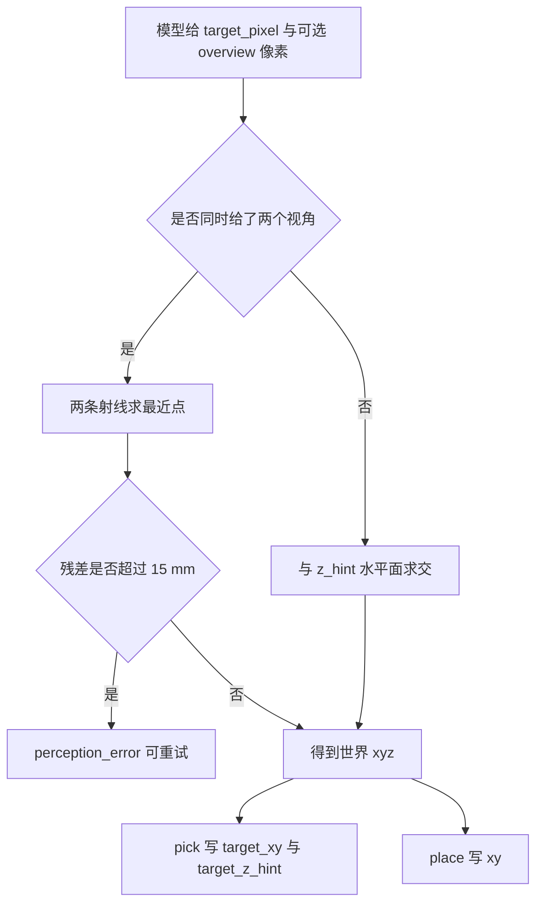
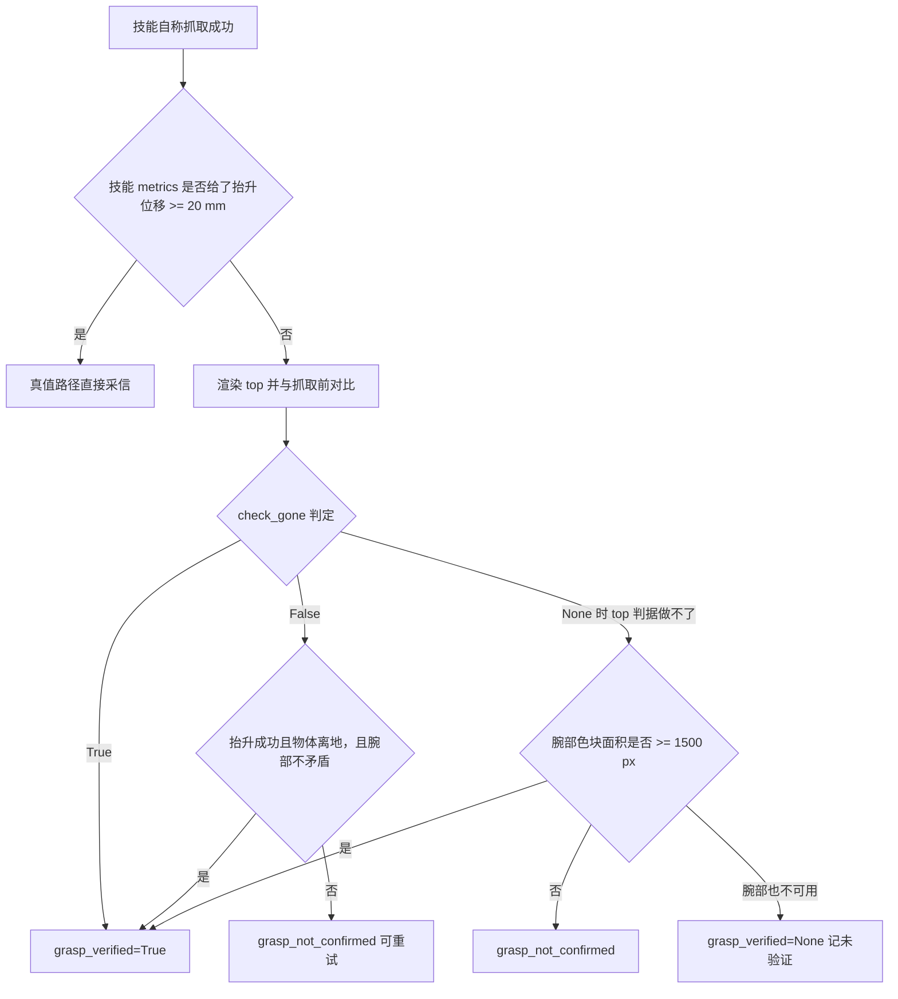

# 纯视觉闭环与抓取验证

本文讨论 `agent/loop.py` 的复核层与 `sim/vision.py`、`sim/perception.py` 组成的感知侧。技能层自称抓取成功只是一个候选结果，是否真的把目标拿走由独立证据确认。整套判据只用相机图像与物理接触信息，不读物体真值位姿。

## 1. 无真值的前提与信息边界

慢环送给模型的场景描述只有物体 id、颜色、类别、是否可抓、是否容器与尺寸，不含任何位姿。`include_poses=False` 就是这种 no-oracle 模式。文本块用 `SCENE_JSON_BEGIN` 与 `SCENE_JSON_END` 包住，`MockVLM` 靠这对标记做确定性解析，真实端点只把它当普通文本。

目标位置由模型自己看图像决定，输出的是像素而不是坐标。技能层只接收世界系 xy，不接收 `state.objects[...].pose`。隔离在代码里有硬约束：复核链不调用 `env.object_pose` 与 `env.set_object_pose`，也不读 `state.objects[*].pose`；喂给复核模型的 metrics 只保留白名单证据键，键名含 `pose`、`truth`、`oracle`、`position`、`xy`、`quat`、`qpos` 的一律丢弃。

验收里有一条专门的毒丸用例 `tests/test_isolation_no_truth.py`：它把 `object_pose` 一类真值接口替换成直接抛异常，纯视觉闭环仍要跑完全流程。这条用例的意义是把隔离从约定变成可检查的约束。

## 2. 目标像素到世界坐标

`CameraModel` 从 `model.cam_fovy` 与 `mj_forward` 得到的相机位姿构建针孔模型，不硬编码任何相机位置。焦距按竖直视场角换算：$f = (H/2)/\tan(\text{fovy}/2)$。世界点到相机系的变换与投影是：

$$p_c = R^{T}(P - c), \quad \text{depth} = -p_c[2], \quad u = \tfrac{W}{2} + f\tfrac{p_c[0]}{\text{depth}}, \quad v = \tfrac{H}{2} - f\tfrac{p_c[1]}{\text{depth}}$$

矩阵 $R$ 的列分别是相机局部的 x 右、y 上、z 后轴在世界系的分量，MuJoCo 相机沿自身 -z 轴观察，所以深度取负号。反投影走 `ray(u,v)` 得到世界系射线，再与水平面 z 求交。腕部相机随机械臂运动，`CameraModel` 在每次投影前比较私有 `MjData` 的 qpos 与 `env.data`，不同就重新 `mj_forward` 刷新标定。

```python
def project(self, xyz) -> Optional[tuple]:
    point = _as_vec3(xyz, "xyz")
    if point is None:
        return None
    self._sync()
    p_c = self.cam_mat.T @ (point - self.cam_pos)
    depth = -float(p_c[2])
    if depth <= DEPTH_EPS:
        return None
    u = self.width / 2.0 + self._focal * float(p_c[0]) / depth
    v = self.height / 2.0 - self._focal * float(p_c[1]) / depth
    if not (0.0 <= u < self.width and 0.0 <= v < self.height):
        return None
    return (float(u), float(v))
```

`AgentLoop._resolve_pixel` 把模型给的像素换成世界 xy。主像素优先用 top 视角，只有 overview 像素时按单目处理。两个视角都给时走双目三角：取两条空间射线的最近点，两点距离就是残差；残差超过 15 mm 直接返回失败，不回退单目，由上层记成可重试的 `perception_error`。单目路径用 `z_hint` 指定的水平面求交，缺省是桌面高度；对高物体，俯视视差最大可达 7 cm，所以定位给出 z 时会写进 `target_z_hint`。



像素在场时，模型冗余给出的 `target_id` 与 `target_xy` 会被丢弃并记一条参数纠正，避免两套目标互相矛盾。`target_id` 不参与定位，但会留给抓取验证做交叉校验，确认夹爪接触的是模型点名的那个物体。

## 3. 颜色分割与连通域

`color_blob` 是感知判据的公共入口：把 RGB 转成 HSV，按颜色取掩码，再做连通域标注，最后给连通域打分。给 `hint_uv` 时只在半径 60 px 内找候选，排名同时看面积、离 hint 的距离、面积是否合理与致密程度；面积超过画面 25% 的连通块直接忽略。

| 输入 | 行为 | 原因 |
| --- | --- | --- |
| 有 hint 的红色方块 | 在 hint 附近取最优连通域 | 局部先验压掉桌面反光与阴影 |
| 无 hint 的 gray / white / black | 直接返回未找到 | 与桌面、背景同色，全图搜索必然给错点 |
| 有 hint 的 gray 等低饱和色 | 额外要求致密度 >= 0.55 且 hint 落在框内 | 碎片化掩码宁可不给结果 |
| 找不到候选 | 返回 `found=False`，不抛异常 | 由上层决定降级或重试 |

`refine_pixel` 把模型的粗像素精修到颜色质心，并返回位移量 `delta_px`。精修失败时原样返回模型给的像素，`refined=False`，调用方可以安全回退。实测无 hint 地对托盘做全图搜索会给出偏离真值 99 到 145 px 的点，所以低饱和色拒绝无 hint 搜索是刻意的取舍。

## 4. 抓取验证的证据分层

`_verify_pick_grasp` 的主判据是 top 视角的前后对比。抓取前在目标像素附近记下色块面积，抓取后再渲染 top 图，问的是「原位置的色块是否已经不在」：色块消失，或者面积掉到原来的三分之一以下，判 `grasp_verified=True`；色块仍在原位，默认判 `grasp_not_confirmed`，调用方绝不改写成成功。

```python
if not before.found:
    return {"ok": False, "why": "subject_not_found_before", "metrics": metrics}
if before.area_px < int(min_area_px):
    return {"ok": False, "why": "subject_too_small_before", "metrics": metrics}
if not after.found:
    return {"ok": True, "why": "subject_gone", "metrics": metrics}
if after.area_px * 3 < before.area_px:
    return {"ok": True, "why": "subject_area_shrank", "metrics": metrics}
return {"ok": False, "why": "subject_still_present", "metrics": metrics}
```

单靠 top 会漏判一类真实成功：物体被夹起来但没被夹爪挡住，top 图里面积几乎不变。实测蓝块被抓起后面积从 818 变到 827，纯前后对比会把成功判成失败。为此加了一条物理随动例外：技能报告的抬升成功且夹爪接触的物体已经离地时，允许判成功。物理证据说的是「手里夹着某个可动物体」，不说明夹的是目标，所以例外还配了一道反向闸：腕部相机可用且看不到目标颜色时不允许放行。

腕部相机本身单独使用时可靠性不足。它挂在夹爪根部朝下看，只要夹爪停在物体上方就能看到大片颜色：抓住 40 mm 方块时面积约 16384 px，空夹爪 0 px，但距顶 6 cm 时仍有 12527 px、19 cm 时还有 1299 px。这是接近恒真的假阳性来源，所以它只做诊断指标、top 判据不可用时的兜底，以及上面那道反闸。面积阈值是 `WRIST_GRASP_MIN_AREA_PX = 1500`。



两条图像判据都不可用时，结果记成 `grasp_verified=None` 加 `grasp_unverified=True`，既不判成功也不判失败。腕部面积一律作为诊断指标保留，不再单独决定成败。

## 5. 技能侧的无真值抓取判据

`pick` 在无真值模式下拿不到物体位姿，只能用夹爪的实测开合与接触力做判断。`_jaw_gap_mm` 把夹爪开合比例按同一套标定换算成指间距：全闭 8.4 mm、全开 93 mm、中间线性。

判断指间是否有物，基线取全闭间距与本次指令间距的较大者。原因是一个容易误判的现象：指向空处时夹爪照样能走到指令开合度，只有被物体挡住、合不到位才算夹住。方块与低矮物体的容差取 1 mm，细高物体取 4 mm，细高物体另有「合爪被力看门狗挡住」这条正面证据作为门。

```python
baseline = max(GRIPPER_GAP_CLOSED_MM, float(command_gap_mm))
tolerance = 1.0 if not slender else 4.0
held_by_gap = (self._jaw_gap_mm() > baseline + tolerance)
```

抓取成功的完整条件是：抬升阶段的 `MoveResult.ok` 成立，抬升后夹爪接触的物体已经不被支撑面托着，并且指间距相对指令值确实偏大。抬升的返回值必须检查，旧实现只要开合判据过就报成功，实测抬升以 46 N 中止、方块只动 0.8 mm 仍被判成「已抓起」。无真值时不知道物件的 id，`holding` 用占位常量表示，后续放置只当作「手里有东西」。

## 6. 放置与子目标的图像判据

放置与叠放的复核用纯图像几何，三条判据都在 `sim/perception.py` 里。

| 判据 | 输入 | 判定 |
| --- | --- | --- |
| `check_inside` | 被放物颜色、容器外接框 | 被放物色块质心在容器框内缩后仍在内 |
| `check_stacked` | 上层色、下层色 | 上层质心在下层框内且重叠率不低于 0.55 |
| `check_gone` | 前后两帧、颜色、hint | 原位置色块消失或面积掉到三分之一以下 |

`check_inside` 的内缩量缺省取容器短边的 6%，近似容器壁的像素宽度。`check_stacked` 为抵抗遮挡，下层框取「与上层框相邻的所有下层连通域的并框」：先取面积最大的块，再把外接框与上层框间隙不超过上层短边 25% 的块并入。三条判据都只用图像信息。

`place` 之后还有一条独立信号 `_check_place_release`：腕部仍看到目标颜色且面积不低于 1500 px 时记 `release_verified=False`，提示可能没放下或粘在夹爪上。它只写 metrics，不改技能的 ok 与 error_code，放置是否成功仍由技能层的几何校验与子目标复核决定。

`locate` 工具产出的外接框还能反过来估尺寸：`bbox_to_world` 把框四角经射线投到桌面平面，得到世界系包围盒与尺寸，`estimate_size` 取长边短边。这个估计值作为 `target_size` 传给技能，让闭合量按真实尺寸算。

## 7. 易错点与调试

| 现象 | 原因 | 处理位置 |
| --- | --- | --- |
| 真抓成功被判失败 | top 视角里物体没被夹爪挡住，面积变化很小 | 物理随动例外加腕部反闸 |
| 空抓被判成功 | 腕部只看面积，夹爪停在物体上方也能看到大片颜色 | 腕部降级为诊断与反闸，主判据换 top |
| 精修后目标点更偏 | 无 hint 地全图搜索低饱和色 | 低饱和色无 hint 直接返回未找到 |
| 高物体落点偏远 | 单目按桌面反投影，俯视视差随高度增大 | 给 `target_z_hint` 或补第二视角做三角 |
| 双目三角给出错点 | 两视角没对准同一个特征 | 三角残差超过 15 mm 直接判失败 |
| 复核读到真值 | 证据键混进了位姿字段 | 白名单过滤后交回模型 |

`object_point` 在双目残差过大时不会静默回退单目，这一点与部分调用方的直觉相反：宁可返回可重试的失败，也不给一个看起来可用但来源不明的点。

## 8. 口径与权衡

### 判据来源

- 主判据是 top 的前后对比，问的是物体是否还在原位。
- 物理随动证据只做例外，且必须配合腕部反闸。
- 腕部面积是诊断指标与兜底，不单独决定成败。
- 图像判据做不了时明示未验证，不猜测。
- 信息隔离通过白名单与毒丸测试固定下来。

### 权衡表

| 取舍点 | 选择 | 收益与代价 |
| --- | --- | --- |
| 单目还是双目 | 优先双目，残差超限不回退 | 高物体定位稳；代价是拿不到第二视角时只能靠 z_hint |
| 主判据选谁 | top 前后对比 | 语义就是「被拿走」；代价是遮挡场景要补物理证据 |
| 低饱和色处理 | 无 hint 拒绝搜索 | 不给错点；代价是托盘这类目标必须由模型给像素 |
| 未验证的处理 | 记 None 并标注 | 不谎报；代价是上层需要把未验证当作可重试状态 |

