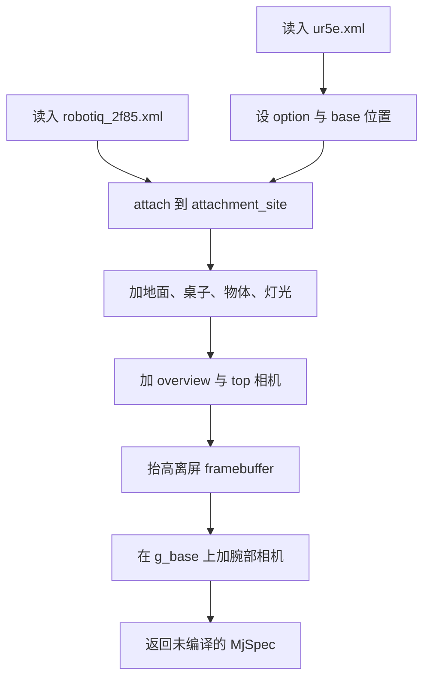
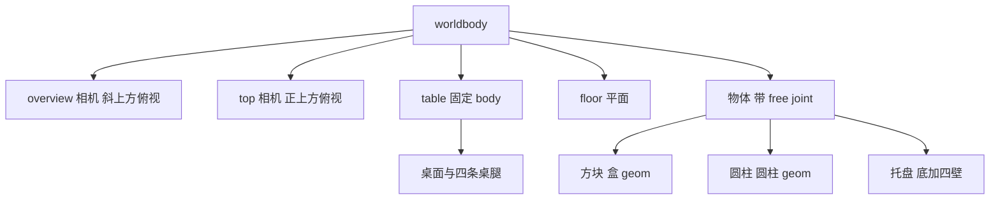
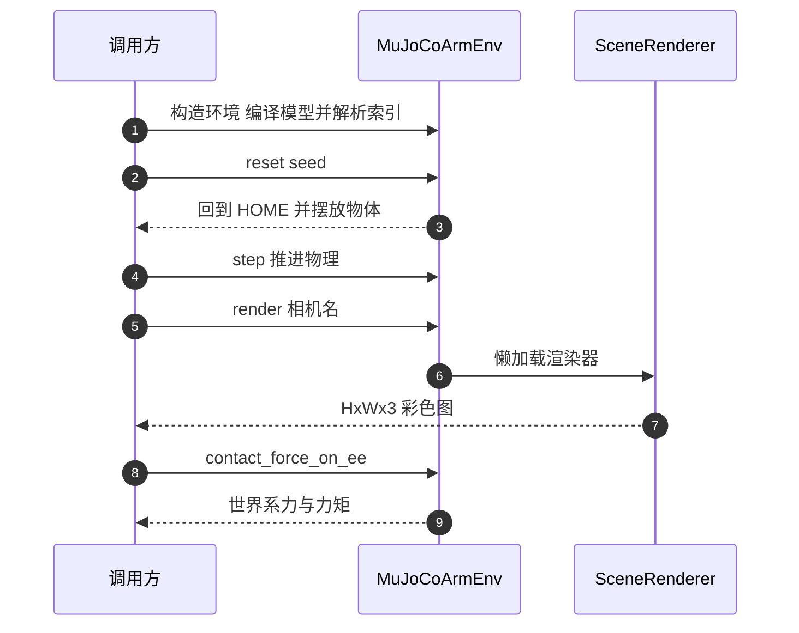
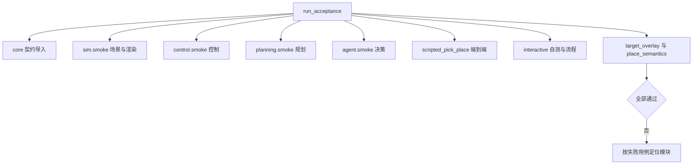

# 仿真场景、渲染与验收

本文覆盖 `sim/` 与 `tests/` 两个目录。仿真侧负责三件事：把机器人、桌面与物体组装成可编译的模型，把相机图算出来交给决策层，以及提供接触力这类物理量给控制层。验收侧负责证明这几条链路合起来能跑通。

## 1. 场景由两份 Menagerie 模型拼成

`build_spec` 是场景组装的入口。它先用 `MjSpec.from_file` 读入 UR5e 与 Robotiq 2F85 两份 Menagerie 模型，把夹爪挂到机械臂的 `attachment_site` 上，再补齐桌面、地面、物体、灯光与相机。返回的是尚未编译的 `MjSpec`，编译发生在 `MuJoCoArmEnv` 的构造函数里。

几个取值来自实测：父子 spec 的 `option` 必须一致，否则编译期会连续报 Attach conflict 警告，所以两边都设 `impratio=10.0` 与椭圆接触锥；`ur5e.xml` 的 base body 位于世界原点，不抬高会让 HOME 位形的 TCP 穿桌，因此把 `base` 的 pos 改到 `ROBOT_BASE_POS`；时间步在 spec 上写 `SIM_DT`，编译后还会再覆盖一次。

挂夹爪用 `arm.attach(grip, prefix="g_", site=arm.site("attachment_site"))`。前缀让夹爪的所有名字带 `g_`，环境侧就靠这个前缀识别末端 body 集合。组装完成后统一调 `_add_props` 加属性，走 MjSpec API 而不是先导出字符串再解析，原因是 `MjSpec.from_string` 之后再 attach 会让子 spec 的元素名带上斜杠前缀，`mj_name2id` 查这些名字会返回 -1。



离屏 framebuffer 必须显式放大。本机 MuJoCo 默认的离屏高度只有 480，渲染 512×512 会直接报「Image height 512 > framebuffer height 480」，所以 spec 上把 `visual.global_.offwidth` 与 `offheight` 都设成 1024。

## 2. 工作台、物体与三台相机

桌面是固定 body `table`，上表面 z = 0.40，对应 `TABLE_HEIGHT`。桌面 box 的半尺寸是 (0.60, 0.60, 0.02)，中心放在 (0.10, 0, 0.38)，四条桌腿是四个小 box。地面是一张平面 geom，配棋盘纹理；`with_barrier=True` 时在 (0.25, 0, 0.52) 加一块竖直挡板，挡板没有关节，供规划绕障测试用。

默认场景有五个物体：红、蓝、绿三个方块，一个黄色圆柱，一个灰色托盘。每个物体是一个带 free joint 的 body。尺寸字段是半尺寸，`(0.02, 0.02, 0.02)` 对应 40 mm 方块；圆柱的 size 按 MuJoCo 约定写 (半径, 半高) 两项，因此 `can_yellow` 的 (0.015, 0.015, 0.035) 是半径 15 mm、半高 35 mm。物体中心 z 取 `TABLE_HEIGHT + 半高`，静止时正好落在桌面上。

| 物体 | 类别 | 半尺寸 | 可抓 | 容器 |
| --- | --- | --- | --- | --- |
| `box_red` | box | 0.02, 0.02, 0.02 | 是 | 否 |
| `box_blue` | box | 0.02, 0.02, 0.02 | 是 | 否 |
| `box_green` | box | 0.02, 0.02, 0.02 | 是 | 否 |
| `can_yellow` | cylinder | 半径 0.015，半高 0.035 | 是 | 否 |
| `tray` | tray | 0.09, 0.07, 0.012 | 否 | 是 |

托盘由五块 geom 拼成：一块底加四面壁，壁厚半值 4 mm。这个形状让它能真的接住物体，也让容器内落放需要判断撞壁。日常场景是另一份独立布局 `DAILY_OBJECTS`（水瓶与眼镜盒），不改默认布局，通过 `build_spec(DAILY_OBJECTS)` 或 `MuJoCoArmEnv(objects=DAILY_OBJECTS)` 选用。

相机共三台，名字固定为 `overview`、`wrist`、`top`。overview 与 top 是固定在 worldbody 上的相机，位置与朝向由 `_look_at_quat` 从位置和目标点算出；腕部相机在 attach 之后加到 `g_base` 上，参数是 pos `[0, 0, 0.070]`、quat `[0, 1, 0, 0]`、fovy 110 度。这几个数是实测调出来的：`pos.z` 不超过 0.06 时相机会埋在夹爪 base 网格内部，深度中位数只有 2.6 cm；0.070 时刚好落在两指之间；fovy 不放大到 110 度，横向 ±3 cm 的指垫会落在 45 度视锥外，画面里看不到夹爪。



## 3. 名称到索引与环境对象

`MuJoCoArmEnv.__init__` 编译模型、建 `MjData`、调 `_resolve_ids` 把名字换成索引，最后做一次 `reset`。`_resolve_ids` 里最常用的几组是：6 个臂关节的 qpos 与 dof 地址、7 个执行器索引、TCP site 索引、夹爪两个 driver 关节的地址，以及物体 body、qpos 地址与元数据的映射。

末端 body 集合按名字前缀识别：所有以 `g_` 开头的 body 都算夹爪子树。这个集合被接触力查询与碰撞检测复用。物体列表按 `_objects_spec` 的顺序返回，顺序固定，`list_objects()` 每次都按同一顺序生成，便于上层做前后对比。

编译后的维度可以用一条公式核对：机器人本体贡献 14 个 qpos 与 14 个 dof，每个带 free joint 的物体再加 7 个 qpos 与 6 个 dof。因此 $nq = 14 + 7N$、$nv = 14 + 6N$，$nu = 7$、$neq = 3$，$N$ 是物体个数。默认五个物体时 $nq=49$、$nv=44$。`sim/test_env.py` 的 `test_model_layout_matches_contract` 直接断言这四个维度，改物体布局就会在这条断言上暴露。

## 4. 确定性重置与接触力查询

`reset(seed)` 先把机械臂写回 `HOME_QPOS`、夹爪全开、清零速度，再摆放物体。`seed=0` 时物体精确位于配置位置，与 `model.qpos0` 完全一致，方便规划与执行对齐；`seed` 非零时用 `numpy.random.default_rng(seed)` 在 xy 上做 ±15 mm 的微扰。两种情况都可复现。

重置瞬间物体底面与桌面上表面只是相切，MuJoCo 不生成接触，`ncon` 为 0；步进若干步之后物体沉底约 0.1 mm，才出现稳定的静置接触，实测 20 步时 ncon 稳定在 21。这一点会误导按 `ncon > 0` 判碰撞的代码，所以碰撞检测单独统计与机器人相关的接触对。

接触力由 `contact_force_on_ee` 汇总：遍历所有接触，只保留至少一个 geom 属于夹爪子树的接触对，把 `mj_contactForce` 给出的 6 维 wrench 从接触系旋回世界系。符号按 `mj_contactForce` 的语义确定：它给出的是施加在 geom2 上的力，所以末端是 geom2 时取正、是 geom1 时取负，最后把力矩从接触点平移到 `g_pinch`。

```python
for i in range(d.ncon):
    c = d.contact[i]
    b1 = int(self.model.geom_bodyid[c.geom1])
    b2 = int(self.model.geom_bodyid[c.geom2])
    ee1 = b1 in self._ee_body_ids
    ee2 = b2 in self._ee_body_ids
    if not ee1 and not ee2:
        continue
    mujoco.mj_contactForce(self.model, d, i, buf)
    rot = c.frame.reshape(3, 3)
    f_w = rot.T @ buf[:3]
    sign = 1.0 if ee2 else -1.0
    force += sign * f_w
```

`get_state()` 把 TCP 位姿、关节状态、物体列表与接触状态打包成 `SceneState`，同时维护本次运行的峰值力 `_max_force` 与夹持判定 `_holding`。夹持判定是尽力而为的：夹爪闭合到阈值以内且与某物体有接触，就把该物体 id 记为 holding。



## 5. 离屏渲染的懒加载与深度

`SceneRenderer` 把 `mujoco.Renderer` 的创建推迟到第一次取图。创建渲染器要建 GL 上下文与 framebuffer，本机 glfw 后端首次约几百毫秒，之后复用。渲染器按 `(宽, 高)` 缓存，切换尺寸不会反复重建；请求尺寸超过模型离屏缓冲时，渲染器会按需抬高 `offwidth` 与 `offheight`，只影响离屏渲染，不动物理。

深度图的开关是配对的：先 `enable_depth_rendering`，取完立刻 `disable_depth_rendering`，否则后续彩色渲染会拿到单通道的深度数据。`Renderer.render` 返回内部缓冲的引用，再次渲染会覆盖，所以模块统一 `.copy()` 后返回，调用方可以直接持有。深度单位是米，天空与超出远平面处是远平面值。

WSL 上加 `MUJOCO_GL=glfw` 是前提，本机 EGL 不可用。这个变量必须在 import mujoco 之前生效，`sim/_glinit.py` 就负责这件事，并被渲染模块在导入 `mujoco` 之前先导入。自动化与自测一律走 headless，不加参数会真的在桌面上弹出 MuJoCo 窗口。

## 6. 像素闭环如何接进仿真

相机标定不读硬编码位置，而是用一份私有 `MjData` 跑 `mj_forward`，从 `cam_xpos` 与 `cam_xmat` 拿位姿。私有 `MjData` 与规划、控制的约定一致：只复制 `env.data.qpos`，不改动环境本身。腕部相机随机械臂运动，每次投影前比较 qpos 是否变化，变了就重新标定。

分辨率取 `env.render_size`，默认 512×512，与 `sim/render.py` 实际渲染的图严格对应，所以投影像素可以直接在渲染图上采样。实测桌面点做 project 再 pixel_to_plane 的往返误差约 $10^{-15}$ m。把五个物体中心投影到像素再采样颜色，红方块取到 [255,108,98]、黄圆柱取到 [255,255,131]，与该像素的深度值也对得上，说明相机的朝向与 v 向下都取对了。

## 7. 两条验收路径

脚本化验收 `demo/scripted_pick_place` 不依赖模型：构造 env、IK、导纳控制器、运动执行器、碰撞检测、规划器与技能库，然后依次执行 `home`、`pick`、`place`，每一步打印 ok、消息与 metrics，并在开始、抓后、放后各存一轮三视角图。三个技能都成功才返回 0。它验证的是 sim、control、planning、skills 四层能不能接起来。

全链路验收 `tests/run_acceptance` 跑十个用例：core 契约导入、`sim.smoke`、`control.smoke`、`planning.smoke`、`agent.smoke`、脚本化抓放、交互式自测、`interactive_flows`、`target_overlay`、`place_semantics`。每个用例独立起子进程、独立超时，最后打印通过数。2026-10-12 的实跑结果是 9/10 通过，唯一失败的是 `test_target_overlay` 里导纳让位方向的用例，属已知未修项。

| 验收项 | 关键结果 |
| --- | --- |
| `sim.smoke` | 维度与契约一致，三相机都产出 512×512 彩色图与深度图，静止力约 0 |
| `control.smoke` | 44 用例；IK 往返 0.38 mm / $4.9\times10^{-4}$ rad；`move_to_pose` 终态 0.98 mm |
| `planning.smoke` | 5 用例；`plan_pose` 误差 0.0000 m；绕障 0.12 s、挡板接触 0 |
| `agent.smoke` | 239 用例；`MockVLM` 决策确定；非法调用被拒 |
| `e2e_scripted` | `box_red` 抬升 119.3 mm、峰值力 1.46 N，放入托盘落点偏差 0.5 mm |
| `interactive_flows` | 17 用例；意图路由、持物不变量、强制恢复、pick 子目标复核 |
| `target_overlay` | 失败：外力 +z 时参考位移应为负，实测 +0.32 |

其余单测覆盖 `sim.test_env` 14 项、抓取高度 9 项、面板 12 项、子目标循环 6 项，以及前面提到的无真值隔离 5 项。



## 8. 交互式并发与锁

交互式运行时主线程只做一件事：`viewer.sync()`。MuJoCo 要求渲染与物理在同一个线程，所以 `env.step` 与 `env.render` 都在工作线程里执行，主线程每帧把工作线程的结果合入渲染。

两个线程会同时读写 `env.data`：主线程的 `viewer.sync()` 内部会复制可视化数据，工作线程在跑轨迹。保护方式是环境对象内部的一把 `RLock`，`env` 的所有公开 data 访问都走它。锁必须可重入，因为 `MotionRunner` 内部会嵌套调用 `env.step` 与 `env.render`。不使用这把锁时，取图与 `viewer.sync()` 并发是数据竞争，实测会直接 SIGABRT。

`--headless` 模式下没有窗口，面板仍然照常输出文件，所以自动化与自测不需要 X 显示。

## 9. 易错点与调试

| 现象 | 原因 | 处理位置 |
| --- | --- | --- |
| 编译期一串 Attach conflict | 父子 spec 的接触选项不一致 | 两边都设 `impratio` 与椭圆锥 |
| 名字查不到返回 -1 | 从字符串解析后再 attach，名字被加斜杠前缀 | 统一走 MjSpec API 直接加元素 |
| 渲染报 framebuffer 太小 | 默认离屏高度不足 512 | 抬高 `offwidth` 与 `offheight` |
| 彩色图变成单通道 | 深度渲染没有关掉 | 取图放在 try/finally 里配对开关 |
| 保存的图内容错位 | 持有了 `Renderer.render` 的引用，被下一次渲染覆盖 | 统一 `.copy()` 后返回 |
| 重置后物体不算碰撞 | 相切时不生成接触，`ncon` 为 0 | 步进若干步或按接触对判定 |
| 腕部画面看不到夹爪 | fovy 太小，指垫落在视锥外 | fovy 放大到 110 度 |
| 取图时崩溃 | 与 `viewer.sync()` 并发读写 `data` | 共用一把可重入锁 |

`sim/scene.py` 的 `build_spec` 注释把编译维度写成「14+7×物体数」，只涵盖了 qpos 的增量，没有写出 `nv` 的增量是 6 而不是 7。核对维度时按 `sim/test_env.py` 的断言为准，那里把 $nq$ 与 $nv$ 分开写了。

## 10. 集成口径与余量

### 场景与环境的固定约定

- 场景组装走 `MjSpec`，夹爪用 `g_` 前缀挂载，末端 body 集合靠前缀识别。
- 物体尺寸是半尺寸，圆柱按 MuJoCo 约定取半径与半高。
- 三台相机的名字固定，腕部相机挂在夹爪 body 上。
- 编译维度服从 $nq = 14 + 7N$、$nv = 14 + 6N$、$nu = 7$、$neq = 3$。
- `seed=0` 精确摆放，非零种子做 ±15 mm 微扰，两者都可复现。
- 渲染懒加载、按尺寸缓存，深度开关成对，返回前复制缓冲。

### 权衡表

| 取舍点 | 选择 | 收益与代价 |
| --- | --- | --- |
| 场景组装方式 | MjSpec API 直接构建 | 名字干净、可编程加元素；代价是需要了解 MjSpec 接口 |
| 渲染器管理 | 懒加载加尺寸缓存 | 首帧之外不再付创建开销；代价是每个尺寸各占一份 GL 资源 |
| 物体布局 | 默认与日常两套独立布局 | 不动默认场景；代价是两套都要各自核对间距 |
| 并发保护 | 一把可重入锁 | 两线程共享 `data` 安全；代价是所有公开访问都串行 |

