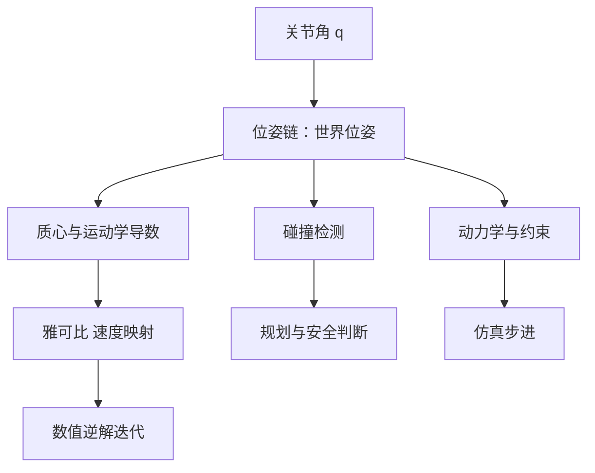

# 正运动学与雅可比

让末端到达空间里的某个位姿，第一件事是能回答「现在末端在哪、朝哪」。关节角是驱动量，末端位姿是任务量，把前者映射成后者的规则就是正运动学。第二件事是敏感性：某个关节角动一点，末端位姿动多少。这个关系由雅可比给出，它是数值逆解、力映射与奇异判断共用的基础工具。第三件事是代价：位姿、雅可比、碰撞与动力学各自需要不同的中间量，算得越多越慢，在会被反复调用的求解器里，这一层取舍直接决定方案是否可行。

下面先看位姿怎么沿刚体链传递、姿态为什么选四元数，再讲雅可比的定义与它在速度层面的地位，最后给出一条按需求分层的计算路径，以及这一块容易出现的判断偏差。

## 位姿沿刚体链传递

机械臂是一串刚体，每个关节提供相邻刚体之间的一到三个相对自由度，工具固定在末端。从基座出发，把每个关节的相对变换按顺序连乘，就得到末端相对世界的位姿：

$$T_{world} = T_{base}\;T_1(q_1)\;T_2(q_2)\cdots T_n(q_n)\;T_{tool}$$

这条连乘把「关节角」翻译成「位姿」，其中位置是三维平移，姿态是三维转动。平移没有表示歧义，姿态的表示方式却有多种选择，选哪一种直接影响后续所有计算的写法。

| 姿态表示 | 分量数 | 自由度 | 优点 | 代价 |
| --- | --- | --- | --- | --- |
| 欧拉角 | 3 | 3 | 直观、便于人读 | 存在万向节死锁，插值不沿最短路径 |
| 旋转矩阵 | 9 | 3 | 无奇异，可直接与向量相乘 | 分量冗余，需要维护正交性 |
| 四元数 | 4 | 3 | 复合只是一次乘法，归一化简单 | 双重覆盖：$q$ 与 $-q$ 表示同一旋转 |
| 旋转向量 | 3 | 3 | 与角速度同维，物理含义清楚 | 模长接近 $\pi$ 时表示发生跳变 |

四元数被普遍选作内部表示，原因在于运算量而不是表达能力。两个旋转的复合对应一次四元数乘法，不需要三角函数，也不需要九元素矩阵的乘法；姿态差可以直接写成两个四元数之比，再转成旋转向量交给迭代算法。代价是双重覆盖带来的符号问题：$q$ 与 $-q$ 描述同一姿态，计算姿态差时必须先翻到同一分支，否则误差会突然跳变到补角。

工具中心点通常取末端的一个坐标帧，位置放在夹持中心或指尖中点，不必等于最后一个刚体的原点。正运动学输出的正是该帧在世界系的位姿，后续的误差、雅可比与力都相对它定义。


## 雅可比表达什么

对位姿映射 $x = f(q)$ 求时间导数，得到速度层面的关系：

$$\dot x = J(q)\,\dot q$$

$J$ 是一个 $6 \times n$ 矩阵：前三行把关节速度映射成末端线速度，后三行映射成角速度。它的列对应广义速度的维数，而不是可执行器的个数——夹爪内部自由度与场景中浮动刚体都会占列，但它们对末端位姿的贡献为零。

把它称作速度层面的核心，是因为上层几乎每个环节都要用到它：

| 用途 | 用到的形式 | 为什么够用 |
| --- | --- | --- |
| 数值逆解的迭代 | $J^{T}$ 或伪逆 | 每步把笛卡尔误差换算成关节增量 |
| 力与力矩的映射 | $\tau = J^{T}F$ | 虚功原理给出速度映射的对偶关系 |
| 奇异位形判断 | 秩与条件数 | 秩亏时某些方向无法产生运动 |
| 速度前馈 | 伪逆 | 把参考笛卡尔速度映射成参考关节速度 |

雅可比也是判断工作空间性质的工具：在奇异位形附近，$J$ 的最小奇异值趋于零，同样的末端速度需要越来越大的关节速度。这是逆解必须带阻尼与步长限制的原因，相关内容在逆解一节展开。

要注意 $\dot x = J\dot q$ 只在一阶邻域成立。关节角变化较大时，线性化误差随之变大，所以基于雅可比的方法都要迭代，并且每次只迈出一小步。

另一个容易混淆的点是表达坐标系。雅可比可以写在世界系，也可以写在末端体坐标系，两者相差一个旋转。误差在世界系定义时，用世界系雅可比；误差在体坐标系定义时用体坐标系雅可比。混用会让迭代方向整体偏斜，残差长时间不下降。

## 前向计算该算到哪一层

正运动学是一条可以停在任意一层的前向流水线。每一层产出不同的派生量，代价也不同：

| 计算层 | 主要产出 | 谁需要 | 相对代价 |
| --- | --- | --- | --- |
| 位姿链 | 各刚体与坐标帧的世界位姿 | 正解、雅可比、可视化 | 低 |
| 质心与运动学导数 | 与关节轴相关的微分量 | 雅可比、动力学前向 | 低 |
| 碰撞检测 | 接触对与几何距离 | 规划、安全判断 | 随几何数量增长 |
| 动力学与约束 | 加速度、约束力 | 仿真步进本身 | 高 |

这里有一条不显然的依赖：雅可比并不只依赖位姿链，它还依赖第二层的微分量。只跑位姿链而不跑质心层，得到的雅可比会是全零矩阵——位姿正确，速度映射却没有被填充。理解这一点，才能解释为什么轻量前向要连跑两步而不是一步。

```python
mujoco.mj_kinematics(model, data)     # 位姿链
mujoco.mj_comPos(model, data)         # 质心与运动学导数，雅可比依赖它
mujoco.mj_jacSite(model, data, jp, jr, site_id)
```

分层取舍的判据很简单：只算当前需要的量。数值逆解的内循环每个迭代步都要算一次位姿与雅可比，碰撞检测对它毫无贡献却开销可观，因此逆解停在前两层。碰撞查询放在调用逆解之前或规划阶段，用同一套位姿但单独的代价预算。



## 坐标系与存储约定

位姿相关的约定一旦在工程里定下，就应当在所有模块保持一致，因为它们会在不同模块之间来回传递：

| 约定 | 一种常见选择 | 混用的后果 |
| --- | --- | --- |
| 四元数分量顺序 | 标量在前，记作 wxyz | 与 xyzw 的外部库对接时姿态整体错位 |
| 雅可比表达坐标系 | 世界系 | 与体坐标系误差混用时迭代方向偏斜 |
| 工具点定义 | 末端的一个坐标帧 | 用末端刚体原点代替时抓取点偏移 |
| 关节角范围 | 与模型限位一致 | 采样点落到不可行区间 |

工程里常用的处理是把转换集中到少数几个位置：外部输入在进入计算前一次性转成内部顺序，内部一律按统一约定传递。这样即使外部库与内部约定不同，改动范围也只有一个函数。

模型接口的差异也属于这一层。某些版本的仿真库不直接提供坐标帧的四元数，只能从旋转矩阵转换得到；转换接口存在与否决定正解的最后一步怎么写，但与位姿链本身无关。

## 常见判断偏差

| # | 判断偏差 | 表现 | 依据 |
| --- | --- | --- | --- |
| 1 | 把雅可比当作位姿映射 | 用它检验末端是否到位 | 它只描述速度与一阶邻域 |
| 2 | 认为列数等于关节数 | 对方阵直接求逆 | 列对应广义速度维数，含不影响末端的自由度 |
| 3 | 误差在一个坐标系、修正在另一个 | 迭代残差长时间不下降 | 两者必须配套 |
| 4 | 把四个分量当作四个自由度 | 约束或优化里多引入一维 | 单位四元数只有三个自由度 |
| 5 | 为逆解内循环做完整动力学前向 | 单步开销过高 | 位姿与雅可比只需前两层 |
| 6 | 用欧拉角做姿态插值 | 末端绕远路或端点不重合 | 欧拉角有奇异且不沿最短弧 |

## 小结

### 核心概念

- 正运动学是关节角到末端位姿的连乘映射，工具点是一个随末端运动的坐标帧。
- 姿态表示各有取舍；四元数以运算量取胜，代价是双重覆盖的符号问题。
- 雅可比是速度层面的一阶映射，同时承担误差到关节增量、力到力矩、奇异判断三类用途。
- 它只在一阶邻域成立，因此基于它的方法必须迭代并限制步长。
- 前向计算应当按需求分层；雅可比依赖两层，不包括碰撞与动力学。

### 设计权衡

| 权衡点 | 常见选择 | 收益与代价 |
| --- | --- | --- |
| 姿态表示 | 四元数内部表示、边界处转换 | 运算快、插值稳；代价是符号分支与外部转换 |
| 雅可比坐标系 | 世界系 | 与任务误差直接对齐；代价是体坐标系相关的量要额外旋转 |
| 前向计算层数 | 只算当前需要的层 | 内循环开销低；代价是要清楚各层依赖关系 |
| 工具点定义 | 独立的末端坐标帧 | 抓取点可独立配置；代价是多一次名称与下标解析 |

## 练习

### 基础题

1. 写出把关节角映射到末端位姿的连乘表达式，并说明每一项代表什么。
2. 四元数有四个分量却只表示三个自由度，多出来的一个分量约束是什么？
3. 雅可比的前三行与后三行分别对应什么物理量？
4. 为什么只跑位姿链会得到全零的雅可比？

### 挑战题

5. 设计一套姿态表示约定，要求能同时支持外部数据导入、内部运算与日志输出，说明每处转换放在哪里。
6. 给定一个需要频繁求解逆解的场景，画出前向计算的分层方案，标出每层被调用的频率与理由。
7. 设计一个检查清单，用来在一次改动后验证雅可比仍然正确，列出可对照的量。
8. 如果工具点从末端刚体原点改到夹持中心，哪些量需要重新定义？按影响范围排序。

## 附：本页引用的路径

| 路径 | 用途 |
| --- | --- |
| `vlm-admittance/control/kinematics.py` | 正解与雅可比的封装，含私有计算数据 |
| `vlm-admittance/control/trajectory.py` | 四元数与旋转向量的基础运算 |
| `vlm-admittance/core/types.py` | 关节名、工具点名称与自由度常量 |
| `vlm-admittance/core/config.py` | 关节限位与采样周期 |
| `vlm-admittance/INTERFACES.md` | 模型装配方式与运动学接口约定 |
| `vlm-admittance/control/smoke.py` | 正解与雅可比的交叉校验用例 |
