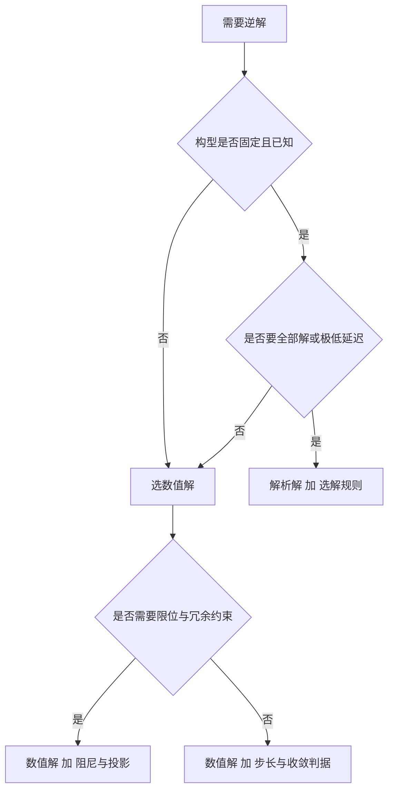
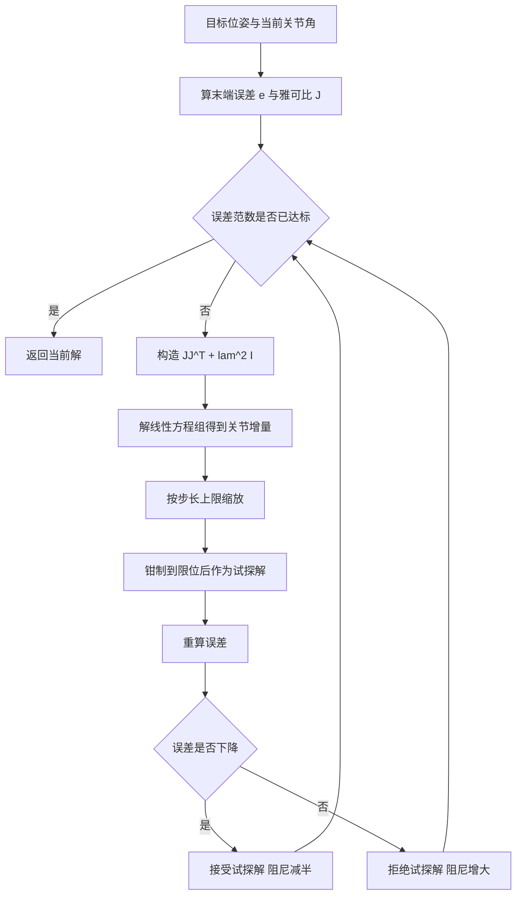

# 逆解为什么用数值法

正运动学是一路连乘，从关节角到末端位姿没有歧义。反过来问「要让末端到某个位姿，关节角该取多少」，问题立刻变复杂：三角函数把关节角耦合在一起，方程无法逐项拆开；同一个末端位姿往往对应多组关节角；有些目标根本不可达；在伸展或对齐的构型上，关节速度与末端速度的关系还会退化。逆解要解决的就是这些情况下的可解性、稳定性与确定性。

下面先看这些困难具体来自哪里，再比较解析解与数值解的适用边界，然后把数值法拆成三个必须一起定的东西：阻尼、步长与收敛判据。

## 逆解难在哪

把目标位姿写成关节角的函数，得到的是一个非线性方程组。它的困难有四类，来源各不相同：

| 困难 | 来源 | 表现 |
| --- | --- | --- |
| 非线性 | 关节角以三角函数形式参与连乘 | 无法逐项解出，只能整体迭代 |
| 多解 | 三角函数的周期性与构型对称性 | 同一末端位姿对应多组关节角 |
| 可达边界 | 工作空间的几何限制 | 目标超界时无解，而方程本身看不出来 |
| 奇异 | 雅可比在特定构型下降秩 | 逆映射不存在或不唯一，解对误差敏感 |

奇异需要单独说明。它指雅可比矩阵的秩下降，某些笛卡尔方向无法由关节运动产生。在奇异位形附近，同样的末端位移需要越来越大的关节速度，逆映射的数值解会剧烈放大输入误差。工作空间边界通常也与奇异相关：手臂完全伸直的位形同时是可达边界与奇异点。

多解意味着逆解的输出是一组候选，需要从中挑选。选哪一组取决于任务：有的解落在关节限位之外，有的解会让手臂穿过自身或障碍，有的解离当前位形很近、适合连续运动。因此逆解算法除了求出一个可行解，还要提供挑选解的手段，这部分在冗余与多解一节展开。

## 解析解与数值解的边界

解析解通过几何或代数推导得到闭式表达式，把关节角写成目标位姿的显函数。数值解把逆解转化为误差最小化的迭代过程。两者不是替代关系，适用场景有明显分界：

| 维度 | 解析解 | 数值解 |
| --- | --- | --- |
| 求解速度 | 单次计算，常数级 | 数十到数百次前向，随构型变化 |
| 解的数量 | 可枚举全部解 | 一次只给一个解，取决于初值 |
| 构型依赖 | 与连杆参数、关节排布绑定 | 与构型无关，只需位姿与雅可比 |
| 限位与冗余 | 需要额外处理，改动代价高 | 可自然加入，作为约束或投影 |
| 无解判定 | 几何推导中给出 | 需要靠误差是否收敛判断 |
| 开发成本 | 每种构型单独推导与验证 | 一次实现，通用 |

选择判据可以按问题特征套用：构型固定、需要全部解、单次求解要求极快时，解析解更合适；构型可能变化、需要叠加限位与冗余约束、或开发成本比单次耗时更重要时，数值解更合适。工业机械臂常用解析解加选解规则，通用平台与研究代码更多用数值解。

数值解的代价不止是慢，还有不确定性。它只能给出一个解，且这个解依赖初值；同一个目标从不同初值出发可能落到不同构型。要让结果可复现，必须把初值策略也固定下来。

## 从最小二乘到阻尼最小二乘

数值逆解的出发点是把误差线性化。给定当前关节角，末端误差 $e$ 与关节增量之间的关系是一阶的：

$$e \approx J\,\Delta q$$

若雅可比可逆，直接解出 $\Delta q$。实际中两个问题会同时出现：任务维数与关节数不一定相等，矩阵可能不是方阵；即使在方阵情形，奇异位形附近它也接近不可逆。最小二乘先解决第一个问题，取伪逆：

$$J^{+} = J^{T}\left(JJ^{T}\right)^{-1}$$

这一支给出的是最小范数解，也就是在所有能减小误差的关节增量里挑范数最小的那个。但它只对满秩的 $J$ 成立，$JJ^{T}$ 接近奇异时求逆会放大数值误差。阻尼项的作用就是在这个位置上加一个正定项：

$$\Delta q = J^{T}\left(JJ^{T} + \lambda^{2}I\right)^{-1} e$$

这就是阻尼最小二乘，也是 Levenberg-Marquardt 在逆解上的形式。$\lambda$ 是两个极限之间的旋钮：趋近零时退化为最小范数解，精度最高但稳定性最差；$\lambda$ 增大时关节增量整体收缩，数值稳定但收敛变慢。它承担的是把不可解方向平滑掉的作用，代价由收敛精度支付。

形式的选择与矩阵形状有关。任务维数不超过关节数时，$J^{T}(JJ^{T}+\lambda^{2}I)^{-1}$ 给出最小范数解；任务维数大于关节数时，对应形式是 $(J^{T}J+\lambda^{2}I)^{-1}J^{T}$，给出最小二乘解。工程中常把未约束的方向以零误差补齐，保持矩阵方形，避免在两种形式之间切换。

## 阻尼、步长与迭代上限怎么定

这三个量共同决定迭代能不能走到解，单独调其中任何一个都会顾此失彼。

阻尼按试探结果做乘性自适应。误差下降就把阻尼减半，误差没有下降就把它乘若干倍，并在一个上限处判定卡死。用乘性调整的原因是可用的阻尼要跨越多个数量级，加减法在这个尺度上不适用；初值选在最小范数解附近（$10^{-3}$ 量级），既能保证前几步精度，又留有升阻尼的余量。上限取到 $10^{3}$ 量级时，阻尼项已经压倒雅可比项，关节增量趋于零，再迭代没有意义，直接判为卡死并结束本次尝试。

步长限制约束的是单次关节增量，而不是迭代次数。做法是按整段增量的范数等比缩放，超过上限就整体缩小，而不是逐关节截断：逐关节截断会改变搜索方向，让不同关节的增量比例失真。上限取多少与关节行程有关。该平台除肘关节外各关节行程约 $2\pi$，肘关节约 $\pi$；单步上限取 0.25 rad 时约为行程的百分之几，保证线性化误差可控，又能让常规目标在几十步内收敛。上限过大会跳过硬解区域、迭代反复越界；过小则步数增加，在限位附近容易停住不动。

迭代上限是安全边界，不是收敛目标。它应当与阻尼上限配合使用：阻尼达到上限说明搜索方向已无效，此时无论还剩多少预算都不必继续。单次求解的迭代上限取数百次，而外层还会做多次初值尝试，两个上限的乘积才是一次完整逆解的时间开销。

| 参数 | 典型量级 | 约束什么 | 过大或过小的后果 |
| --- | --- | --- | --- |
| 初始阻尼 | $10^{-3}$ | 起点精度与稳定余量 | 过小则初期抖动，过大则收敛慢 |
| 阻尼上限 | $10^{3}$ | 卡死判据 | 过小会误判卡死，过大则空转 |
| 单步上限 | 关节行程的百分之几 | 线性化有效范围 | 过大跳过硬解区域，过小步数暴增 |
| 单次迭代上限 | 数百步 | 单次尝试的时间预算 | 过小解不出来，过大浪费预算 |

## 收敛判据怎么定

判据要同时约束位置与姿态，做法是把两个误差拼成一个向量再取范数：

$$\left\|\left[e_{pos}\,;\,e_{rot}\right]\right\| \le \varepsilon$$

用一个判据而不是两个阈值，好处是收敛的定义唯一：位置差一点而姿态很好，整体仍然算未收敛。范数不超过阈值意味着每个分量都不超过阈值，所以位置与姿态同时受约束，不需要额外判断两者哪个先满足。

阈值的量级由任务与可实现精度共同决定。姿态误差要小到抓取时夹爪朝向不偏，位置误差要小到指垫不夹偏物体，两者的实用量级分别在毫米与毫弧度的下沿。阈值取在这个量级附近才有意义：取得比数值噪声还小，迭代永远达不到，只会白耗迭代次数；取得太大，解虽然收敛却不可用。在六自由度机械臂上，逆解往返的位置误差可以到亚毫米、姿态到 $5\times10^{-4}$ rad 量级，阈值取 $10^{-3}$ 与之同量级，既能拦住退化解，又不会被数值噪声拖住。

判据还决定未约束方向的表达。只关心位置时，把姿态误差整体置零，判据退化为位置条件，迭代在姿态方向不再有下降压力。这种降维用法很常见，但要注意它让解变得不唯一：位置相同而姿态不同的一大类关节角都算合格，此时解的选择权重新回到初值与阻尼上。

## 常见判断偏差

| # | 判断偏差 | 表现 | 依据 |
| --- | --- | --- | --- |
| 1 | 认为逆解是一个确定的函数 | 同一目标两次调用结果不同 | 数值解依赖初值，需要固定初值策略 |
| 2 | 把阻尼当作越多越稳的保护 | 收敛步数成倍增加 | 阻尼用精度换稳定，是取舍而非保险 |
| 3 | 用逐关节截断限制步长 | 搜索方向变化、迭代绕路 | 限幅应按整段增量的范数等比缩放 |
| 4 | 收敛阈值越紧越好 | 迭代永远达不到，超出预算 | 阈值要与可实现精度同量级 |
| 5 | 只约束位置或只约束姿态 | 解收敛但不可用 | 两个量的量纲与用途都不同 |
| 6 | 用迭代次数判断是否收敛 | 卡死时仍在消耗预算 | 收敛由误差判据给出，次数只是上限 |

## 小结

### 核心概念

- 逆解难在非线性、多解、可达边界与奇异四个方面，四者来源不同、处理手段也不同。
- 解析解快且能枚举全部解，但绑定构型；数值解通用、易加约束，但依赖初值且一次只给一个解。
- 阻尼最小二乘用 $\lambda^{2}I$ 平滑不可解方向，$\lambda$ 在精度与稳定之间连续可调。
- 阻尼、步长与迭代上限必须一起定，它们共同决定迭代能否走到解。
- 收敛判据把位置与姿态拼成一个向量，阈值量级要贴近可实现精度。

### 设计权衡

| 权衡点 | 常见选择 | 收益与代价 |
| --- | --- | --- |
| 求解方式 | 通用构型用数值解 | 一套代码适应多种构型；代价是迭代开销与初值不确定性 |
| 阻尼调整 | 乘性自适应 | 跨数量级可用；代价是每次试探多算一次前向 |
| 步长限制 | 按增量范数等比缩放 | 方向保持不变；代价是关节利用率不如逐关节限制 |
| 收敛判据 | 位置与姿态联合范数 | 定义唯一；代价是无法单独放松其中一个 |

## 练习

### 基础题

1. 写出逆解误差线性化的近似关系，并说明它成立的邻域条件。
2. 阻尼最小二乘中 $\lambda$ 趋近零与趋于无穷时，解分别退化成什么？
3. 为什么步长限制要按整段增量的范数缩放，而不是逐关节截断？
4. 收敛判据把位置与姿态拼成一个向量，这样做的好处是什么？

### 挑战题

5. 为一个已知构型的机械臂设计选解方案：解析解与数值解混用，写出切换判据与失败回退路径。
6. 设计一套阻尼自适应的规则，说明初值、倍率、上限的取值理由，以及卡死如何判定。
7. 给出一份逆解质量检查清单：列出能区分「收敛到可用解」与「收敛到边界解」的可观测判据。
8. 若任务从六维位姿降为三维位置，收敛判据与解的唯一性会发生什么变化？给出处理方案。

## 附：本页引用的路径

| 路径 | 用途 |
| --- | --- |
| `vlm-admittance/control/kinematics.py` | 阻尼最小二乘迭代、步长限制与收敛判据 |
| `vlm-admittance/control/trajectory.py` | 姿态误差转旋转向量与最短分支处理 |
| `vlm-admittance/core/config.py` | 关节限位，作为钳制与采样边界 |
| `vlm-admittance/core/interfaces.py` | 逆解接口的签名与默认参数 |
| `vlm-admittance/INTERFACES.md` | 运动学契约与收敛口径 |
| `vlm-admittance/planning/planner.py` | 多初值求解与结果复核的调用方式 |
