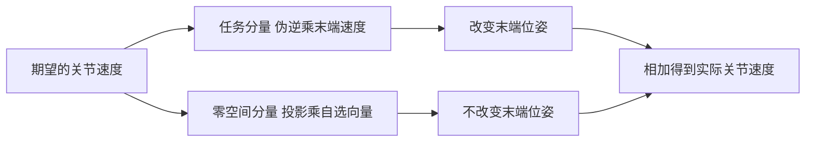
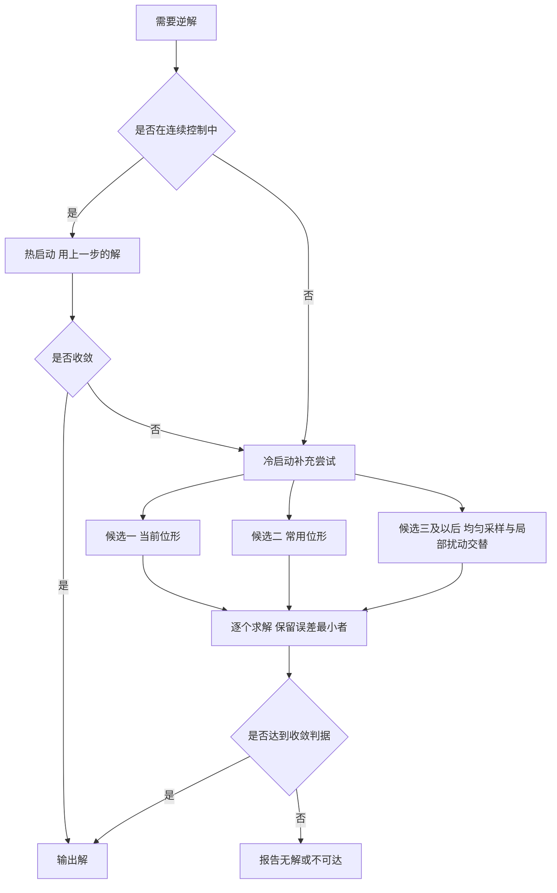

# 冗余、限位与多解

逆解写成一个返回关节角的函数时，隐藏了两个问题。第一，返回值只是众多可行解中的一个：同一个末端位姿往往对应好几组关节角，任务维数少于关节数时解甚至连续无穷多。第二，从哪一组解开始迭代决定了落到哪一组，而这个选择会影响关节是否贴限位、手臂会不会穿过障碍、相邻两个控制周期的关节角是否连续。限位则把原本连续的可行域切成一个有界盒子，让一部分解直接出局。

下面先看多解的几何来源，再讲冗余与零空间如何被用来挑选解，然后讨论限位进入求解的三种方式，最后落在初值策略与可复现性上。

## 多解从哪来

多解来自机械臂的几何对称性与旋转关节的周期性。对一条常见的六自由度串联臂，同一末端位姿通常对应若干组解，可以按几何分支归类：

| 分支类型 | 几何来源 | 对任务的影响 |
| --- | --- | --- |
| 肩部左右 | 基座回转的两个方向 | 决定手臂从哪一侧接近目标 |
| 肘部上下 | 肘关节的两种弯折方向 | 影响可达范围与是否撞到自身 |
| 腕部翻转 | 末端姿态相同、腕部关节符号相反 | 影响姿态连续性与线缆走向 |
| 关节周期性 | 旋转关节加整圈仍是同一位形 | 数值上等价，但会影响限位与连续性 |

这些分支组合起来，一般位姿下解的数目是有限的，典型量级在个位数到十来组。它们并非全部可用：有的超出限位，有的会让中间连杆与工作台或障碍相交，有的离当前位形太远、关节需要走很长的路。

关节周期性是另一类多解，与几何分支不同。它不改变机械臂的构型，只改变关节角的数值表示。处理方式通常是维护一个连续区间，让关节角在跨越整圈时不被误判为跳变，同时让限位判断仍然按实际角度进行。

## 冗余与零空间

冗余指的是关节数多于任务维数，于是存在不改变末端位姿、只改变内部构型的关节运动。这类运动构成雅可比的零空间：

$$J\,N = 0,\qquad N = I - J^{+}J$$

把任务分量与零空间分量相加，就得到逆解的通解形式：

$$\dot q = J^{+}\dot x + N\,z$$

其中 $J^{+}\dot x$ 负责完成末端任务，$N z$ 是在零空间里自由选择的运动。$z$ 怎么取决定机械臂在完成任务的同时做什么：向关节行程中心回拉可以避免长期漂移，向远离限位的一侧推可以留出余量，向远离障碍的方向推可以避障。这些目标都可以写成 $z$ 的形式，互不干扰末端。

冗余是相对任务定义的属性，随任务维数变化。同一条六自由度机械臂，面对六维位姿任务时关节数与任务维数相等，零空间退化为零；面对三维位置任务时只有三个约束，留下三维的零空间，解连续无穷多。任务降到三维位置后，解的唯一性随之消失，挑选解的责任重新落到初值与零空间项上。

零空间项的增益需要保守。它对末端误差的一阶贡献为零，因此不会破坏收敛，但它的量级若与任务分量相当，会让每次迭代的关节角变化很大，在限位附近的试探更容易被拒绝。取一个小增益，让回拉在几十步内缓慢完成，是更稳的做法。

## 限位怎么进入求解

关节限位是模型给定的硬边界，机械臂无法越过。数值求解中处理限位有三种常见方式，代价各不相同：

| 处理方式 | 做法 | 优点 | 代价 |
| --- | --- | --- | --- |
| 钳制 | 每次更新把关节角裁到区间内 | 实现最简单 | 裁掉位移后误差可能不再下降 |
| 惩罚 | 在误差里加上越界量的代价 | 解自然远离边界 | 需要调权重，且不保证严格不越界 |
| 零空间投影 | 用零空间把关节推离限位 | 不干扰末端任务 | 只在冗余时可用，非冗余时无效 |

钳制之所以能用，是因为它只在边界处生效：绝大多数迭代步关节角都在内部，钳制不改变结果。麻烦出现在目标本身只在边界外可达的场合。此时迭代会顶到限位，误差不再下降，阻尼随之增大，最后以未收敛结束。正确的处理是把这种情况判为无解并向调用方报告，不能把边界上的那一组角当作答案返回，因为后者在数值上收敛于钳制后的解，实际上末端并没有到达目标。

限位的来源必须与模型一致。把限位写成代码常量时，一旦连杆参数或关节零位调整，常量就会与实际模型脱节，采样点与钳制边界一起错位。更稳的做法是从模型读取，让限位只有一处定义。

另一个与限位相关的细节是初始采样。均匀采样必须在限位盒内进行，否则一部分随机初值从第一步起就落在不可行区间，重启的有效次数被浪费。在限位较紧的关节上，这个损耗尤其明显。

## 种子策略决定落到哪个分支

数值逆解的输出依赖初值，因此初值策略本身就是解选择策略。常用做法分两类：

| 形态 | 初值来源 | 适用场景 | 代价 |
| --- | --- | --- | --- |
| 热启动 | 上一个控制周期的解 | 连续运动、实时控制 | 可能停留在次优分支 |
| 冷启动 | 当前位形、常用位形、随机采样 | 单次求解、规划中的多解搜索 | 需要多次完整求解 |

热启动把连续性放在第一位：相邻周期从几乎相同的初值出发，迭代只需要走很短的距离，关节角不会突然跳到另一个分支。这在连续轨迹执行中很重要，一次分支跳变会让机械臂在两步之间扫过大角度。代价是它不会主动寻找更好的解，即使存在一个离限位更远的构型。

冷启动用一组初值换取覆盖面。典型的组合是：先试当前位形与一个常用位形，这两者命中率高、迭代短；再补若干随机初值，其中一部分在限位盒内均匀采样以覆盖不同几何分支，另一部分在常用位形附近做小幅扰动以提高近处命中率。两类交替排列，使前几次尝试就有机会命中可用解，不必等全部均匀采样试完。

初值数量是一次直接的取舍。候选越多，覆盖分支越全，单次求解耗时也越长。实践中把它定在个位数：前两个确定性候选覆盖常见情形，其余用于跳出局部构型。如果全部尝试都未收敛，说明目标在工作空间之外或落在奇异区域附近，应当把结论如实向上传递，不能返回误差最小的那组角。

## 可复现性为什么是设计需求

随机初值让逆解带上了随机性，而工程上通常需要同输入同输出：回归测试要能判断一次改动是否改变了结果，重放一段轨迹要能复现同样的关节角序列，调试时也要能排除随机因素。做法是给随机采样器一个固定种子，并且让种子在每次求解开始时重新生效。

| 播种位置 | 行为 | 后果 |
| --- | --- | --- |
| 每次求解重新播种 | 同目标、同初值给出同一串候选 | 结果可复现，适合回归与重放 |
| 只在初始化时播种一次 | 候选序列随调用次数推进 | 结果随调用历史漂移，测试不稳定 |

两种做法的差别不在随机性本身，而在随机序列是否与调用历史耦合。重新播种切断了这种耦合：一次求解的结果只由输入决定，与之前解过多少次无关。代价是连续两次遇到同一目标时会重复同样的失败尝试，但在逆解这种单次开销较小的环节上可以接受。

可复现性还要求收敛判据与迭代顺序稳定。只要阈值、候选顺序、阻尼规则都不随调用变化，同一个目标就会稳定地落到同一个分支。把随机种子、候选构造与阈值看作解定义的一部分，而不是实现细节，才能解释为什么同一目标会给出同一组关节角。

## 常见判断偏差

| # | 判断偏差 | 表现 | 依据 |
| --- | --- | --- | --- |
| 1 | 把冗余当作机械臂的固定属性 | 认为六轴臂一定冗余 | 冗余由任务维数与关节数之差决定 |
| 2 | 认为逆解只有一组解 | 换一个初值结果不同就开始怀疑实现 | 多解由几何对称性与周期性产生 |
| 3 | 把限位外的解当作可行解返回 | 末端实际没有到位 | 钳制后的解误差不收敛，应判无解 |
| 4 | 零空间增益调得过大 | 迭代反复被拒、收敛变慢 | 零空间项对末端误差没有贡献，只需缓慢生效 |
| 5 | 随机采样不限制在限位盒内 | 部分候选从第一步就不可行 | 采样范围必须与限位一致 |
| 6 | 只在初始化时播种一次 | 同一目标两次调用结果不同 | 可复现要求每次求解重新播种 |

## 小结

### 核心概念

- 多解来自肩部左右、肘部上下、腕部翻转等几何分支，以及旋转关节的周期性。
- 冗余由任务维数与关节数之差定义；零空间分量改变内部构型而不影响末端。
- 逆解通解是任务分量与零空间分量之和，自选向量决定回中、避限位或避障。
- 限位的三种处理方式各有代价，钳制最简但与无解判定必须分开处理。
- 初值策略就是解选择策略；热启动保连续，冷启动覆盖分支。
- 固定种子并在每次求解时重新播种，使结果只由输入决定。

### 设计权衡

| 权衡点 | 常见选择 | 收益与代价 |
| --- | --- | --- |
| 解的选择 | 热启动优先，必要时冷启动 | 连续性好；代价是可能停留在次优分支 |
| 冗余利用 | 小增益零空间回中 | 不干扰末端任务；代价是回拉速度慢 |
| 限位处理 | 迭代内钳制，边界外判无解 | 实现简单且语义清楚；代价是需要在调用方处理失败 |
| 初值数量 | 个位数候选，确定性优先 | 命中率与耗时可预期；代价是覆盖面有限 |
| 随机性 | 固定种子、按次播种 | 可复现；代价是失败尝试会重复出现 |

## 练习

### 基础题

1. 写出零空间投影矩阵，并说明它把什么映射成什么。
2. 同一条六自由度机械臂，面对六维位姿与三维位置任务时冗余度各是多少？
3. 为什么在迭代中钳制关节角通常不影响结果，却在目标越界时产生误导？
4. 只在初始化时播种随机数，会给回归测试带来什么问题？

### 挑战题

5. 设计一套选解规则，在多个几何分支之间按限位余量、行程长度与避障需求排序，写出判据。
6. 为一个冗余机械臂设计零空间目标向量，同时兼顾回中与避限位，说明如何避免两者冲突。
7. 写出逆解可复现性检查清单：列出必须固定的输入、参数与顺序，以及验证方式。
8. 如果目标只在限位外可达，设计一条从失败判定到上层处理的完整语义路径。

## 附：本页引用的路径

| 路径 | 用途 |
| --- | --- |
| `vlm-admittance/control/kinematics.py` | 零空间回中、关节限位钳制与多初值求解 |
| `vlm-admittance/core/config.py` | 关节限位与常用位形 |
| `vlm-admittance/core/types.py` | 关节名称与自由度常量 |
| `vlm-admittance/planning/planner.py` | 多初值调用与解复核 |
| `vlm-admittance/INTERFACES.md` | 模型装配与限位口径 |
| `vlm-admittance/control/smoke.py` | 限位、往返精度与多解相关用例 |
