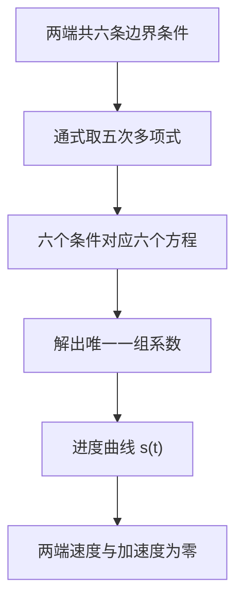
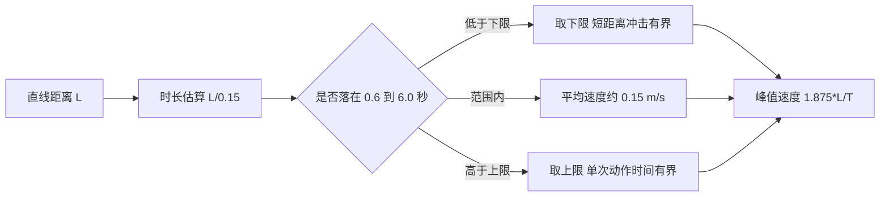
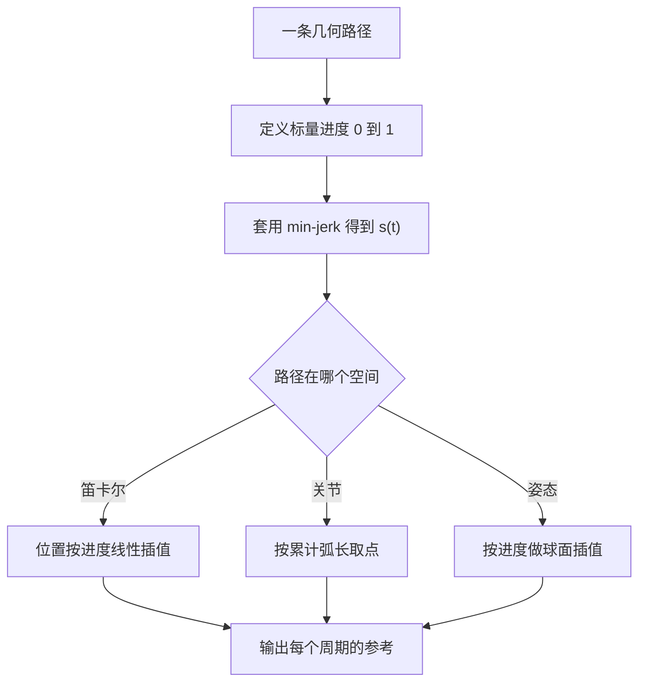

# 为什么要给运动定时

机械臂从一个位姿去另一个位姿，在两个端点各做一次逆解，再把目标的关节角写进伺服，位置层面就算完了。可伺服收到的是一个阶跃指令：关节角瞬间从当前值跳到目标值，隐含的速度与加速度在那一瞬间是无穷大。电机与减速器承受一次冲击，柔性环节被激励出振动，末端到位后还会抖一会儿；终点附近如果有接触，冲击直接变成力。点位运动不能只回答"去哪里"，还要回答"用多长时间、按什么形状过去"，这条随时间变化的参考就是时间律。

下面先看不给运动定时会发生什么，再讲端点条件的数量怎样决定多项式阶数、加速度连续换来的是什么，然后比较多项式与梯形速度两类做法，最后看时长与峰值速度这一对约束，以及同一条时间律如何用到别的空间。

## 不给时间维度的运动是什么样

把目标直接交给位置伺服，指令在数学上是一个阶跃。伺服内部有自己的带宽，实际响应是指数逼近而非瞬移，但这不等于安全：阶跃指令的导数没有定义，控制器输出的力矩会瞬间饱和，实际加速度由驱动器电流限幅与机械刚度决定，不再受运动规划控制。

位置的正确性与运动的可行性是两件事。逆解保证终点位置对，时间律决定两点之间是否走得动、走得稳；前者由运动学回答，后者由轨迹层回答。两者都成立，末端才会按预期到达。

在自由空间里，阶跃的后果通常表现为到位后的残余振动与关节噪声；在有接触的任务里，后果变成力：速度不为零地撞上目标，接触力由速度与接触刚度共同决定，可能比静态压力大一到两个数量级。时间律的第一个作用，就是让接近段的速度在接触前降下来。

| 关注点 | 只给终点 | 给一条时间律 |
| --- | --- | --- |
| 终点位置 | 正确 | 正确 |
| 速度 | 隐含无穷大 | 两端为零，中间受控 |
| 加速度 | 隐含无穷大 | 两端为零且连续 |
| 接触冲击 | 由伺服与接触刚度决定 | 由参考速度上限决定 |
| 可复现性 | 依赖伺服动态与负载 | 参考确定，与负载无关 |

## 端点条件的数量决定多项式阶数

把沿路径的进度归一化为 $s(\tau)$，其中 $\tau=t/T\in[0,1]$ 是归一化时间。点位运动的两端都是静止状态，于是有六条边界条件：位置、速度、加速度各在两端取定值。

| 条件 | 数学形式 | 保证的量 |
| --- | --- | --- |
| 起点位置 | $s(0)=0$ | 从起点出发 |
| 终点位置 | $s(1)=1$ | 到达终点 |
| 两端速度 | $\dot s(0)=\dot s(1)=0$ | 起停无速度跳变，即 C1 |
| 两端加速度 | $\ddot s(0)=\ddot s(1)=0$ | 起停无加速度跳变，即 C2 |

只固定位置与速度是四条约束，三次多项式就够；要让加速度在两端也为零，需要第五次。约束个数与待定系数个数相等，解唯一：

$$s(\tau)=10\tau^3-15\tau^4+6\tau^5$$

这个式子由六条条件代入通式后解一个六元线性方程组得到，不经曲线拟合。写成连乘形式可以少几次幂运算：

```python
def min_jerk(s: float) -> float:
    s = float(np.clip(s, 0.0, 1.0))
    return s * s * s * (10.0 + s * (-15.0 + 6.0 * s))
```

其中的输入钳制让调用方传入超界的归一化时间不会外推：小于 0 得 0，大于 1 得 1。



## 加速度连续为什么重要

对进度曲线求导，可以得到速度与加速度的形状：

$$\dot s(\tau)=30\tau^2(1-\tau)^2,\qquad \ddot s(\tau)=60\tau(1-\tau)(1-2\tau)$$

一阶导在 $[0,1]$ 内非负且两端为零，所以进度单调、速度两端为零；二阶导是三次式，零点在 $0$、$1/2$、$1$，前半段加速、后半段减速。加速度连续意味着加加速度在两端有限。加加速度是加速度的导数，若加速度存在跳变，加加速度在跳变点上就是冲激，而冲激正是激励机械共振的成分。

C2 连续是参考层面的保证，不是执行层面的保证。伺服带宽、减速器柔性与连杆弹性会各自引入动态，实际末端轨迹与参考之间存在滞后与振荡。时间律要做的，是把可控的那部分做平滑，把不可控的部分交给外环补偿与安全判据。

| 连续性 | 含义 | 缺它会怎样 |
| --- | --- | --- |
| C0 | 位置连续 | 末端跳变，物理上不可能 |
| C1 | 速度连续 | 起停有速度跳变，伴随冲击与噪声 |
| C2 | 加速度连续 | 加加速度出现冲激，激励结构振动 |
| C3 | 加加速度连续 | 参考更平滑，实现复杂度上升 |

## 梯形速度与多项式速度的取舍

另一类常见做法是梯形速度：加速段用恒定加速度，中间匀速，末段恒定减速。它的参数有明确物理含义（最大速度、最大加速度），位移与时间的关系可以闭式求出，控制器实现简单，工业控制器里很常见。代价是加速度在两个折角处跳变，加加速度在折角上无穷大，折角的冲击会通过减速器传到末端。

三次多项式保证速度连续，但加速度在端点不为零，它与梯形同族：都只固定了位置与速度。S 型速度曲线在梯形上再接一段加加速度限制，把加加速度也变成有界量，代价是参数变多、位移时间关系需要分段求解。五次最小加加速度多项式属于"只固定两端状态、不做中间约束"这一类里的平滑解。

| 时间律 | 连续性 | 参数 | 位移时间关系 | 末端冲击 |
| --- | --- | --- | --- | --- |
| 线性进度 | C0 | 时长 | 平凡 | 起停都有速度跳变 |
| 三次多项式 | C1 | 时长 | 闭式 | 两端加速度跳变 |
| 梯形速度 | C1 | 时长、速度上限、加速度上限 | 分段闭式 | 折角处加加速度冲激 |
| S 型速度 | C2 | 再加加加速度上限 | 分段闭式 | 平滑，参数较多 |
| 五次 min-jerk | C2 | 时长 | 单式闭式 | 两端加加速度有限 |

选择依据是路径上有没有可以牺牲的量。梯形速度用加速度跳变换位移效率与实现简单，五次多项式用更高的峰值速度换两端平滑。两者没有普遍优劣，只有任务是否在乎起停冲击。

## 时长与峰值速度是一对约束

给定时长与距离，进度曲线的形状直接决定峰值速度。对五次多项式，峰值出现在 $\tau=1/2$：

$$\dot s(1/2)=30\cdot\frac{1}{4}\cdot\frac{1}{4}=1.875$$

峰值速度是平均速度的 1.875 倍。若按平均速度 0.15 m/s 估算时长，长距离移动的峰值线速度约 0.28 m/s；距离很短时时长由下限兜住，峰值退化为 $1.875L/T_{\min}$，反而随距离变小而下降。这就是时长估算需要上下限的原因：下限保证短距离不会因为时长趋零而峰值速度发散，上限保证单次移动不会吃掉整个时间预算。

| 距离 (m) | 时长估算 (s) | 峰值速度 (m/s) |
| --- | --- | --- |
| 0.03 | 0.6（下限） | 0.09 |
| 0.06 | 0.6（下限） | 0.19 |
| 0.09 | 0.6 | 0.28 |
| 0.30 | 2.0 | 0.28 |
| 1.20 | 6.0（上限） | 0.375 |

表内数值按 $T=\mathrm{clip}(\max(0.6,\ L/0.15),\ 0.6,\ 6.0)$ 与 $v_{\mathrm{peak}}=1.875L/T$ 推算。距离小于 0.09 m 时下限决定时长，峰值随距离线性下降；中等距离的平均速度是 0.15 m/s；距离超过 0.9 m 后上限决定时长，峰值继续上升而总时间不再增加。下界的意义是限制短距离动作的冲击，上界的意义是限制单片动作占用的时间。



## 同一条时间律可以用在别的空间

时间律描述的是"进度如何随时间变化"，与几何路径无关。只要能把一条运动化成一个从 0 到 1 的标量进度，这条曲线就能直接用。笛卡尔直线段用距离比例作进度；关节空间的折线路径可以用累计弧长作进度，先按弧长在折线上取点，再让弧长按时间律前进。

| 空间 | 进度变量 | 几何路径 | 插值方式 |
| --- | --- | --- | --- |
| 笛卡尔位置 | 直线距离比例 | 两点连线 | 按进度线性插值 |
| 关节空间 | 折线累计弧长 | 路点折线 | 按弧长取点 |
| 姿态 | 角度比例 | 球面测地线 | 球面线性插值 |



关节空间复用同一条时间律时，各关节速度按自己在弧长里的占比分配，整体仍然两端为零。规划层因此只需要给出几何路点，不必关心时间形状；时间参数由执行层统一决定，改一处就能改变所有路径的起停特性。

## 时间律管不到的地方

时间律给出的是参考。参考到实际之间存在伺服滞后、重力静差与接触力，这些由执行层的外环与安全判据处理。反过来，执行层无法修正一条本身不合理的参考：如果参考在接触前仍保持高速，力检查只能在下一次采样时发现超限，而单步内已经压进去了。参考速度上限与执行层力上限是两道独立约束，见同单元《轨迹怎么被执行》。

## 常见判断偏差

| # | 判断偏差 | 表现 | 依据 |
| --- | --- | --- | --- |
| 1 | 逆解成功就等于能走 | 到点后仍有振动或冲击 | 逆解只保证端点位置 |
| 2 | 认为线性插值最省时间 | 起停速度跳变、接触冲击大 | 线性进度的端点速度不为零 |
| 3 | 把加速度连续当成可选 | 折角处加加速度冲激、结构振动 | 梯形速度的加速度跳变 |
| 4 | 用平均速度反推峰值约束 | 峰值被低估约一倍 | 峰值是平均速度的 1.875 倍 |
| 5 | 忽略短距离的时长下限 | 峰值速度随距离缩小而发散 | 下限约束了峰值 |
| 6 | 认为时间律与路径空间绑定 | 关节路径另写一套时间参数 | 时间律只依赖标量进度 |

## 小结

### 核心概念

- 点位运动需要一条随时间变化的参考，只有终点位置不足以让机械臂安全到达。
- 端点条件的个数决定多项式阶数：四条约束给三次，六条约束给五次。
- 五次 min-jerk 的峰值速度是平均速度的 1.875 倍，两端的速度与加速度为零。
- C2 连续换来的好处是加加速度有界；梯形速度用加速度跳变换位移效率与实现简单。
- 时长估算需要上下限：下限约束短距离冲击，上限约束单次动作时间。
- 时间律只依赖 0 到 1 的标量进度，因此可以复用到关节弧长与姿态插值。

### 设计权衡

| 权衡点 | 常见选择 | 收益与代价 |
| --- | --- | --- |
| 时间律形状 | 五次多项式或梯形速度 | 多项式平滑；代价是峰值速度更高 |
| 连续性等级 | 点位运动取 C2 | 结构冲击小；代价是峰值速度约束更强 |
| 时长来源 | 按平均速度估算再钳制 | 参数少、行为可预期；代价是需要上下限 |
| 进度空间 | 笛卡尔距离或关节弧长 | 同一时间律可复用；代价是速度分配随路径变化 |

## 练习

### 基础题

1. 写出五次 min-jerk 满足的六条边界条件，并说明每条分别保证什么。
2. 计算 $10\tau^3-15\tau^4+6\tau^5$ 的峰值进度速度，说明它相对平均速度的倍数。
3. 距离 0.06 m、时长下限 0.6 s 时峰值速度是多少？距离翻倍后峰值怎样变化？
4. 说明梯形速度与五次多项式在连续性、实现复杂度与参数个数上的差别。

### 挑战题

5. 设计一套时长估算规则：给定距离范围与两类任务（自由移动、接触前接近），分别给出时长下限与上限，并说明判据。
6. 若机械结构的共振频率已知，说明怎样检查时间律的加加速度频谱不会激励该频率，需要哪些额外参数。
7. 把同一条时间律复用到一条由多段直线组成的路径，设计弧长参数化步骤，并说明如何保证各段衔接处速度不跳变。
8. 给定"峰值速度上限"与"总时长上限"两个约束，设计求解时长的流程，说明可行性判定与冲突处理。

## 附：本页引用的路径

| 路径 | 用途 |
| --- | --- |
| `control/trajectory.py` | 时间律 `min_jerk()` 与笛卡尔轨迹 `CartesianTrajectory` |
| `control/motion.py` | 时长估算与关节弧长时间律的实现 |
| `core/config.py` | 控制周期 `SIM_DT` 等时间相关常量 |
| 仓库根 | https://github.com/TC635807/vlm-admittance |
