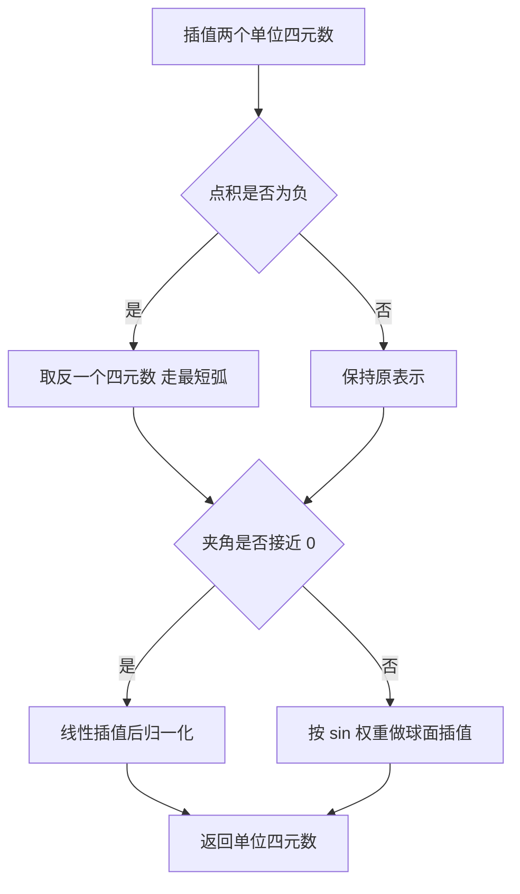
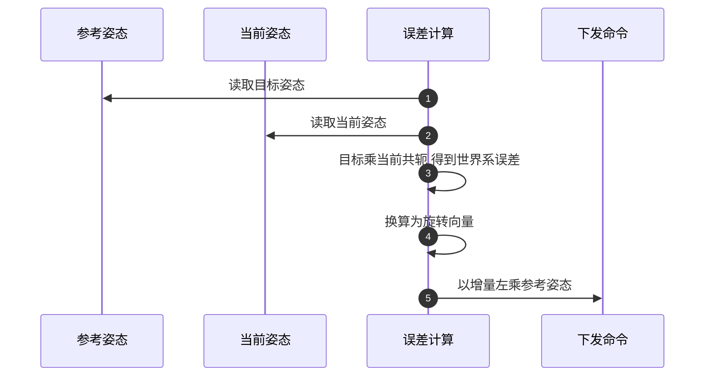

# 姿态插值与四元数

位置插值是在一条直线上对一个标量做插值，姿态不能照搬。把三个欧拉角各自线性插值，得到的姿态路径取决于角序约定，角速度在过程中不均匀，靠近奇异位形时还会失控；把旋转矩阵的九个元素逐元素插值，得到的矩阵不再正交，需要重新正交化才能使用。姿态插值面对的是一个球面上的测地线问题，表示选得对，插值就退化成一次球面线性插值。

下面先比较几种姿态表示在插值场景下的性质，再讲单位四元数的旋转复合语义，然后推导球面线性插值的等角速度性质、最短弧分支与近平行退化，最后说明旋转向量在两端的奇异，以及误差姿态与修正方向为什么必须统一在世界系。

## 姿态表示的几种选择

| 表示 | 参数个数 | 自由度开销 | 插值性质 | 主要风险 |
| --- | --- | --- | --- | --- |
| 旋转矩阵 | 9 | 6 个正交约束 | 逐元素插值后需重新正交化 | 正交性漂移 |
| 欧拉角 | 3 | 无约束 | 路径依赖角序约定，角速度不均 | 万向锁与角度回绕 |
| 旋转向量 | 3 | 无约束 | 直线插值近似测地线，大角度偏差明显 | 转角为零时轴不定、转角接近 π 时轴不稳定 |
| 单位四元数 | 4 | 1 个单位范数约束 | 可直接做球面测地线插值 | 双覆盖导致符号冗余 |

欧拉角的问题来自它是一张局部坐标卡：三个角的取值与姿态在大多数区域一一对应，但在奇异位形附近映射退化，微小的姿态变化对应很大的角变化。插值路径还依赖角序约定，同一对起止姿态在 zyx 与 xyz 两种约定下会给出不同路径。

旋转矩阵没有奇异，但插值发生在矩阵元素上，两个正交矩阵的线性组合一般不正交，必须补一步正交化，而正交化的方式又会影响路径形状。

单位四元数的四个分量中只有三个自由度，多出的那个分量把旋转空间表达成一个没有奇异的球面。代价是它的覆盖是双重的：$q$ 与 $-q$ 表示同一个姿态，插值时需要先决定朝哪个表示走。

## 单位四元数与旋转复合

单位四元数写成标量部分与向量部分：

$$q=w+x\mathbf{i}+y\mathbf{j}+z\mathbf{k},\qquad \|q\|=1$$

两个旋转的复合由四元数乘法给出，乘法顺序与矩阵乘积一致：先施加右侧旋转，再施加左侧旋转。语义上等于 $R(a)R(b)$，因此把它用在误差计算里时，目标姿态乘当前姿态的共轭得到的是"把当前姿态转到目标姿态所需的旋转"，且这个旋转表达在世界系。

共轭把向量部分取反，对单位四元数来说就是逆旋转。四元数乘法里没有三角函数，只有乘加，这也是它在控制回路里比矩阵便宜的原因。

## 球面插值的等角速度性质

两个单位四元数之间的测地线插值由下式给出：

$$\mathrm{slerp}(q_0,q_1,s)=\frac{\sin\big((1-s)\theta_0\big)}{\sin\theta_0}\,q_0+\frac{\sin\big(s\theta_0\big)}{\sin\theta_0}\,q_1,\qquad \cos\theta_0=q_0\cdot q_1$$

权重是两条正弦曲线，插值结果的转角随进度线性增长，也就是说角速度恒定。对伺服参考而言这是关键性质：角速度恒定意味着加速度只在两端变化，中间没有额外的角加速度突变。

另一种省算力的做法是先线性插值再归一化。它与球面插值的路径相同，但角速度在两端偏慢、中间偏快，角度越大偏差越明显。小角度下两者几乎重合，大角度下速度偏差会直接体现在关节跟踪误差上。

| 做法 | 计算量 | 角速度 | 适用场景 |
| --- | --- | --- | --- |
| 球面线性插值 | 需要反三角与两次正弦 | 恒定 | 伺服参考、大角度姿态变化 |
| 线性插值后归一化 | 只有乘加与一次开方 | 两端慢中间快 | 小角度、对速度不敏感的显示 |
| 欧拉角分别插值 | 最省 | 依赖约定且不均匀 | 仅用于人可读的显示 |

这里的取舍与位置不同：位置插值可以容忍速度形状略有偏差，姿态的角速度偏差会通过雅可比直接映射到关节速度，因此更倾向于用球面插值。

## 最短弧与近平行退化

四元数的双覆盖带来一个必须显式处理的分支。若两个姿态对应四元数的点积为负，说明它们落在球面的两侧，直接插值会走长弧：机械臂绕远路转过超过 180 度的角度，既浪费时间，也可能撞上关节限位。做法是在插值前把其中一个四元数取反，点积随之取反，插值就走短弧。取反不改变姿态，只改变表示的符号。

另一个分支处理近平行情形。$	heta_0\to0$ 时 $\sin\theta_0\to0$，上式做分母会除零或放大数值误差；当点积超过一个接近 1 的阈值时，改用线性插值后归一化。阈值取 0.9995 对应夹角约 1.81 度，这个范围里两种做法的角速度差可以忽略，而数值上完全避开了除零。

| 分支 | 触发条件 | 为什么需要 |
| --- | --- | --- |
| 最短弧 | 点积小于 0 | 避免绕远路超过 180 度 |
| 近平行 | 点积大于 0.9995 | 避免 $\sin\theta_0$ 除零 |
| 常规 | 其余 | 等角速度的球面插值 |

## 旋转向量的换算与两端奇异

旋转向量是单位轴乘转角，长度为转角弧度。它适合表达小角度修正，因为方向直观、没有冗余；代价是两端各有一处奇异。

转角接近零时，轴的方向由噪声决定，除以转角模长会把噪声放大。做法是改用一阶近似：转角很小时，四元数的向量部分约等于半个旋转向量，直接乘 2 即可，不需求轴。转角接近 π 时，轴的方向在数值上不稳定，同一个姿态两次换算可能给出相反的轴。反馈回路里如果直接使用绝对值接近 π 的旋转向量，控制量会跳号。

工程上的处理是改变表达方式：不在回路里传绝对旋转向量，而是传增量，再把它复合到参考姿态上。参考姿态负责大范围变化，增量只负责每一步的小修正，两端奇异就落在增量之外。

| 输入区域 | 数值风险 | 处理 |
| --- | --- | --- |
| 转角接近 0 | 轴不定、除零 | 用一阶近似，直接由向量部分乘 2 |
| 转角中等 | 无 | 常规换算 |
| 转角接近 π | 轴方向不稳定 | 避免在回路中传绝对值，改用增量复合 |

## 误差姿态与修正方向

姿态误差写成目标姿态乘当前姿态的共轭，得到的是世界系旋转。这个约定决定修正量应当怎样复合：误差在世界系描述，修正就必须左乘到参考姿态上；若把修正右乘，等于在体坐标系里做修正，当参考姿态本身转过较大角度时会收敛到错误的固定点。

| 误差定义 | 修正方式 | 语义 | 后果 |
| --- | --- | --- | --- |
| 目标乘当前共轭 | 左乘到参考姿态 | 世界系修正 | 与误差定义一致，收敛正确 |
| 当前共轭乘目标 | 右乘到参考姿态 | 体坐标系修正 | 需与体坐标系误差配套，否则收敛到错点 |

这里的规则可以概括成一句：误差在哪里描述，修正就在哪里施加。混淆两处不会立刻发散，而是留下一个稳定的残余姿态误差，排查时容易误判为伺服精度问题。

## 姿态与位置共用进度

位置与姿态用同一个归一化进度插值，带来的直接好处是两者同时启停。如果姿态另取一条时间律，就可能出现位置已经停住而姿态还在转的状态，末端在到位点附近画出一小段弧，抓取时表现为夹爪在最后几毫秒里偏转。

| 组合方式 | 起停同步 | 末端表现 |
| --- | --- | --- |
| 位置与姿态共用进度 | 同步 | 到位即停 |
| 姿态独立时间律 | 不同步 | 到位后有残余旋转 |
| 位置插值、姿态恒定 | 只有位置在动 | 用于保持朝向的移动 |

## 常见判断偏差

| # | 判断偏差 | 表现 | 依据 |
| --- | --- | --- | --- |
| 1 | 对欧拉角分别线性插值 | 路径依赖约定、角速度不均 | 欧拉角是局部坐标卡 |
| 2 | 认为四元数第四个分量冗余 | 丢掉它就无法做测地线插值 | 单位四元数把旋转表达为球面 |
| 3 | 忽略双覆盖 | 姿态绕远路超过 180 度 | 点积为负表示落在球面两侧 |
| 4 | 去掉近平行分支 | 小角度插值出现除零或跳变 | $\sin\theta_0$ 趋于零 |
| 5 | 在回路里传绝对旋转向量 | 转角接近 π 时控制量跳号 | 轴方向数值不稳定 |
| 6 | 误差用世界系、修正用体坐标系 | 留下稳定的残余姿态误差 | 误差与修正的方向必须一致 |

## 小结

### 核心概念

- 姿态插值是球面上的测地线问题，欧拉角与旋转矩阵都不是合适的插值坐标。
- 单位四元数用一个单位范数约束换取无奇异的插值，代价是 $q$ 与 $-q$ 表示同一姿态。
- 球面线性插值的权重由正弦给出，转角随进度线性增长，角速度恒定。
- 最短弧分支在点积为负时取反，近平行分支在夹角极小时退化为线性插值。
- 旋转向量在小角与 π 两端各有奇异，小角用一阶近似，π 附近改用增量表达。
- 误差姿态定义在世界系时，修正必须左乘，误差与修正的方向要一致。

### 设计权衡

| 权衡点 | 常见选择 | 收益与代价 |
| --- | --- | --- |
| 姿态表示 | 单位四元数 | 无奇异、插值简单；代价是符号冗余需要分支处理 |
| 插值方式 | 球面线性插值 | 角速度恒定；代价是反三角与正弦的算力 |
| 近平行处理 | 阈值退化到线性插值 | 数值稳定；代价是极小区间内角速度略偏 |
| 误差与修正 | 统一在世界系并左乘 | 收敛正确；代价是每次都要构造共轭与乘积 |
| 进度来源 | 与位置共用同一个进度 | 起停同步；代价是姿态变化大时必须提前约束角速度 |

## 练习

### 基础题

1. 说明欧拉角为什么在奇异位形附近不适合做插值，奇异点对应什么物理位形。
2. 写出单位四元数点积为负时插值会怎样，并给出处理办法。
3. 说明球面线性插值与线性插值后归一化在角速度上的差别，各自适合什么场景。
4. 解释为什么转角接近 π 时旋转向量的轴方向不稳定。

### 挑战题

5. 设计一套姿态插值接口：要求同时支持最短弧、近平行退化与进度参数钳制，写出参数与返回值。
6. 给定一段既要求位置准确又要求姿态受限的抓取轨迹，设计角速度上限的检查方法，说明需要哪些量。
7. 若在回路中必须使用绝对旋转向量，设计一种把 π 附近的跳号抑制到可接受范围的方案，并说明代价。
8. 设计一组自检用例覆盖四元数插值的边界：最短弧、近平行、单位四元数端点、双覆盖等价性。

## 附：本页引用的路径

| 路径 | 用途 |
| --- | --- |
| `control/trajectory.py` | 乘法、共轭、旋转向量换算与球面线性插值的实现 |
| `control/kinematics.py` | 逆解中误差姿态的构造 |
| `control/motion.py` | 姿态修正的左乘、增量表达与导纳入口 |
| `core/config.py` | 姿态相关的收敛阈值常量 |
| 仓库根 | https://github.com/TC635807/vlm-admittance |
