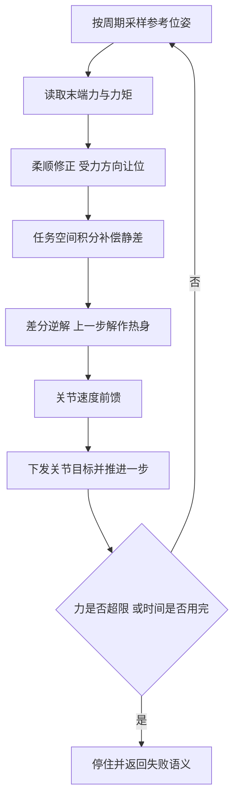
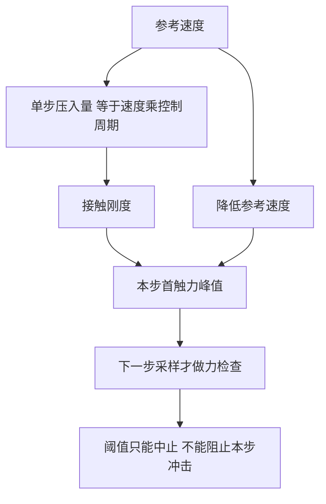
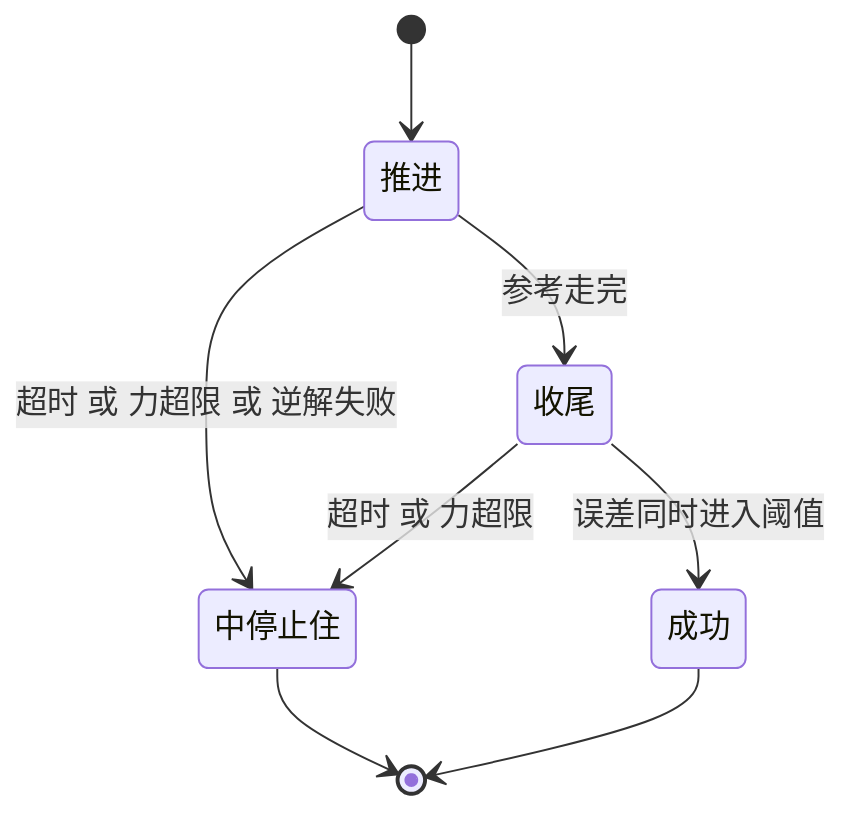

# 轨迹怎么被执行

时间律与姿态插值给出的是"每个时刻应该在哪里"的参考。把这串参考变成关节命令，是执行层的工作：按控制周期采样参考、叠加柔顺与误差补偿、解出关节角、下发并推进一步物理。执行层同时承担三件与安全相关的判断：跟踪误差是否可接受、接触力是否超限、时间预算是否用完。参考本身再平滑，执行层缺了这些判断，机械臂仍然可能撞上去。

下面先看一个控制周期里发生什么，再讲离散推进的时间分辨率与跟踪滞后的来源、收尾伺服解决什么，然后说明接触段为什么要限制参考速度而不能只靠力阈值，最后看时间预算与失败语义的设计。

## 一个控制周期里做什么

执行层的主循环是一个固定顺序，每一步都读当前状态、算命令、推进一步物理：

| 顺序 | 动作 | 目的 |
| --- | --- | --- |
| 1 | 采样参考位姿 | 得到本周期应该跟踪的目标 |
| 2 | 读取末端力与力矩 | 得到接触状态 |
| 3 | 柔顺修正 | 让末端在受力方向上让位 |
| 4 | 任务空间积分补偿 | 抵消位置伺服的静差 |
| 5 | 差分逆解 | 把笛卡尔命令换成关节角，上一步的解作热身 |
| 6 | 关节速度前馈 | 抵消伺服跟踪斜坡时的速度滞后 |
| 7 | 下发目标并推进一步 | 让命令实际作用到物理上 |
| 8 | 记录跟踪误差并检查力 | 判断是否继续、是否中止 |

参考推进与物理步同频，控制频率因此决定了两件事：最小可表达的运动时间，以及力检查能够分辨的时间粒度。周期越短，参考的时间分辨率越高，接触冲击在被发现前能压进去的距离越短。

## 离散推进与时间分辨率

一条时长为 $T$ 的轨迹被量化成 $n=\mathrm{round}(T/\mathrm{dt})$ 个控制步，第 $k$ 步采样 $t=\min(k\cdot\mathrm{dt},\ T)$。最后一步的时间被钳制到 $T$，参考正好落在终点，不会因为取整而越过目标。

这个量化带来两个设计后果。第一，时长短于一个控制周期的动作退化成一步，参考直接跳到终点，等价于一次阶跃，所以轨迹时长需要一个下限。第二，时长不是连续可调的，调整时间参数时实际生效的是最接近的控制步数，差值不超过半个周期。

| 控制周期 | 时间分辨率 | 每步位移（按 0.15 m/s） | 力检查粒度 |
| --- | --- | --- | --- |
| 1 ms | 1 ms | 0.15 mm | 细 |
| 2 ms | 2 ms | 0.3 mm | 中 |
| 10 ms | 10 ms | 1.5 mm | 粗 |

控制周期不是越小越好：它受限于逆解与外环的计算开销，也受限于执行器与物理步的稳定边界。周期与每步压入量成正比，这一点在接触段会直接决定力峰值。

## 跟踪为什么会滞后

位置伺服通常是一个比例微分环节，输出力矩正比于位置误差、再减去速度阻尼项：

$$\tau=k_p\,(q_{\mathrm{cmd}}-q)-k_v\,\dot q$$

这种结构在重力方向上没有前馈补偿，误差靠位置项自身撑住。结果是静态下就存在一个与负载力矩成正比的残余误差：末端在同一个位姿停住时，实际位置比命令位置低若干毫米；换一个关节位形，误差量级相近但不相同。

跟踪一条斜坡参考时，误差还有速度分量。稳态下位置误差约等于 $(k_v/k_p)\cdot\dot q$，其中 $k_v/k_p$ 的量纲是时间，可以理解为伺服的速度滞后时间常数。参考速度越大，滞后越大；参考在两端速度为零，滞后也在两端收敛。

| 误差来源 | 机理 | 补偿手段 |
| --- | --- | --- |
| 重力与负载静差 | 位置项承担全部负载力矩 | 慢速积分外环 |
| 斜坡跟踪滞后 | 速度阻尼项与参考速度成正比 | 关节速度前馈 |
| 模型与摩擦 | 未建模的阻力矩 | 积分外环兜底 |

积分外环把位置误差累加成一个命令偏移，慢慢把静差顶掉；速度前馈则用参考速度乘上速度滞后时间常数，直接加到关节命令上。两者一起用，才有"命令下去、末端跟上"的效果。这里能看出一条边界：运动学只负责算得对，是否停得准由伺服与外环共同决定，见同领域《伺服与执行》。

## 收尾伺服解决什么

轨迹走完之后参考停在终点，但末端还没到。若此时直接判定成功，实际位置与目标的差就是前面说的跟踪滞后；抓取任务里这个差值可能直接决定夹爪能不能夹住。

收尾段继续跑同一个闭环：仍然采样最终参考位姿，仍然走柔顺、积分、逆解、下发的完整流程，直到平动误差与姿态误差同时进入阈值，或者累计时间达到上限。这样收尾期也会继续补偿静差，而不是把最后一帧的滞后冻住。

| 收尾参数 | 典型取值 | 设计含义 |
| --- | --- | --- |
| 平动到位阈值 | 毫米量级 | 必须严于任务精度要求 |
| 姿态到位阈值 | 百分之一弧度量级 | 由抓取方向的容许偏差反推 |
| 收尾时间上限 | 秒量级 | 防止阈值过严导致永不结束 |

阈值与上限是一对约束：阈值取得过严，闭环永远进不去，只能靠时间上限退出，白白浪费时间；阈值取得过松，任务精度不够。合理做法是从下游任务反推阈值，再用时间上限兜住异常情况。收尾段与轨迹段共用同一份时间预算，因此阈值过严还会挤占后续动作的预算。

## 接触段为什么限制参考速度

接触力来自压入量。位置伺服按参考推进，每一步参考前进多少，末端就会往接触面里压多少。单个控制步内的压入量等于参考速度乘控制周期：

$$\Delta x=v_{\mathrm{ref}}\cdot\mathrm{dt}$$

力检查发生在推进一步之后，也就是说，一个控制步内已经压进去的距离无法在本步内被撤销。首触力的大小主要由这一步的压入量与接触刚度决定，而不由力阈值决定：阈值只能在下一步发现超限并中止，无法阻止本步的峰值。

把量级摆在一起看，差别很直接。巡航速度约 0.15 m/s，控制周期 2 ms，单步前进约 0.3 mm，刚性面上的首触力是百牛量级；把参考速度降到 0.002 m/s，单步前进约 4 µm，首触力降到几牛量级，相差约两个数量级。这就是限制参考速度的意义：力峰值与参考速度近似成正比，压速度等于直接压低冲击。

速度压低之后，正比关系会失效。接触恰好落在哪一个控制步会改变采样时刻的压入量，于是同样的参考速度下，首触力会出现几牛的离散。继续压低速度不再稳定地降低观测到的峰值，实际可用下限由这段离散决定。设计上因此存在一个速度区间：既要低于正比区的上界，又不能把时间成本无限放大。

| 参考速度量级 | 单步压入量 | 首触力量级 | 适用判断 |
| --- | --- | --- | --- |
| 0.1 m/s | 0.2 mm | 百牛 | 自由空间转移 |
| 0.01 m/s | 20 µm | 十几牛 | 接近段 |
| 0.003 m/s | 6 µm | 几牛 | 接触前最后一段 |
| 0.002 m/s 以下 | 4 µm 以下 | 几牛，离散主导 | 稳定低压入的边界 |

一个容易忽略的推论是：只降低力阈值不会让接触变软。阈值调小只会让中止发生得更早，本步的冲击仍然由参考速度决定；要控制冲击，控制的量是参考速度。

## 限速怎么接入而不改执行器

限速的实现方式有设计含义。主循环需要的是"给我 $t$ 时刻的参考位姿"，这是一个很小接口：总时长加一个采样函数。任何满足这个接口的对象都能替换原来的参考轨迹，于是限速不需要在柔顺、积分、逆解、力检查里加分支，只需要换掉参考对象。

替代参考的推进规则很直接：先按目标距离与速度上限算出所需步数 $n=\lceil L/(v_{\mathrm{max}}\mathrm{dt})\rceil$，总时长取 $n\cdot\mathrm{dt}$，第 $k$ 步的进度是 $k/n$。位置沿直线恒速前进，姿态按同一进度做球面插值，角速度恒定。构造时传入的原时长被忽略，总时长完全由速度上限决定。

限速模式下速度前馈要关闭。前馈项是按巡航速度量级算出的超前量，在接触段会把参考进一步推向接触面；而此时单步位移只有几微米，前馈带来的跟踪收益可以忽略，引入的冲击风险却是实在的。收尾段也相应改变：只把误差收到到位阈值，不再重新加速。

限速的范围需要选择，只限最后一段接触接近，还是限制所有运动：

| 限速范围 | 接触安全性 | 时间代价 | 结论 |
| --- | --- | --- | --- |
| 只限接触前最后一段 | 满足 | 可接受 | 采用 |
| 限制全部运动 | 满足 | 巡航速度与接触速度相差约 50 倍，总时长同比例增长 | 不采用 |
| 完全不限速 | 不满足 | 最短 | 不采用 |

总时长与速度上限成反比，因此限速必然带来时间成本。把限速套到没有接触的自由移动上，安全性没有增加，时间却按速度比值放大约 50 倍，所以限速只用于接触前的最后一段。

时间预算也要相应放大。限速模式下的轨迹时长是 $L/v_{\mathrm{max}}$，比原来的时间律长得多，调用方必须按这个量级重新给预算，并额外留出收尾段的余量；沿用旧的固定超时会在收尾阶段报出超时。

## 时间预算与失败语义

时间预算用仿真时间计，也就是控制步数乘控制周期。用仿真时间而不是墙钟时间，是因为同一条轨迹在空闲机器与负载机器上应当给出相同结果：墙钟超时会让同一段运动在一台机器上通过、在另一台上失败，而仿真时间只与物理步数有关，可复现。

失败语义的设计目标是让上层能据此决定下一步。错误码应当各自对应一种决策：

| 错误码 | 含义 | 上层可做的决策 |
| --- | --- | --- |
| 超时 | 预算用完，可能还有残余误差 | 放大预算重试，或拆短路径 |
| 力超限 | 接触力超过阈值 | 视为到位接触，或降低参考速度重试 |
| 逆解失败 | 中间位姿不可达 | 重新规划路径 |
| 目标不可达 | 出发前预检就失败 | 换目标位姿 |
| 路径非法 | 输入不合法 | 修正调用方参数 |

中止动作本身也是设计的一部分：任何失败返回之前，必须把关节目标设成当前关节角并继续推进一步物理。只改命令而不推进一步，旧的压入指令仍在生效，接触会沿着旧的穿透继续演化。把目标拉回当前角度再步进，等效于撤销残留的运动指令。

力上限还需要一道独立保护：调用方传入的力阈值可能远大于机械能承受的量级，因此执行层自带一个硬上限，超过就钳制并给出警告。安全保护不依赖调用方的自律，这一点比阈值调参更重要。柔顺参数与力的符号约定属于导纳层，参考速度上限与力上限是两道独立约束，两者都设好才会安全。

## 常见判断偏差

| # | 判断偏差 | 表现 | 依据 |
| --- | --- | --- | --- |
| 1 | 认为参考到位就是末端到位 | 抓取时夹爪偏了一点 | 伺服存在静差与斜坡滞后 |
| 2 | 用墙钟计超时 | 同一轨迹在不同机器上结果不同 | 应使用仿真时间 |
| 3 | 只靠力阈值控制冲击 | 本步峰值仍然很大 | 力检查发生在推进一步之后 |
| 4 | 认为阈值越小接触越软 | 中止更早但峰值不变 | 冲击由参考速度决定 |
| 5 | 限速后仍开速度前馈 | 参考被顶进接触面 | 前馈按巡航速度设计 |
| 6 | 把限速套到全部运动 | 时间成倍增长而无额外安全收益 | 时长与速度上限成反比 |

## 小结

### 核心概念

- 执行层按固定顺序推进：采样参考、读力、柔顺修正、积分补偿、逆解、前馈、下发、检查。
- 轨迹时长被量化到控制周期，时长短于一个周期就退化为阶跃，因此需要时长下限。
- 位置伺服没有重力补偿，静差与斜坡滞后由积分外环和速度前馈分别处理。
- 收尾伺服继续运行同一个闭环，直到误差进入阈值或时间用完。
- 单步压入量等于参考速度乘控制周期，接触冲击由参考速度决定，力阈值只能中止不能阻止。
- 速度压得很低后，接触落在哪一步带来离散，限制下限的存在。
- 时间预算用仿真时间，失败码要能直接支撑上层的下一步决策。

### 设计权衡

| 权衡点 | 常见选择 | 收益与代价 |
| --- | --- | --- |
| 控制周期 | 与物理步同频 | 力检查粒度细；代价是计算开销 |
| 静差补偿 | 积分外环加速度前馈 | 末端到位；代价是外环需要抗饱和 |
| 收尾阈值 | 从任务精度反推加时间上限 | 精度与时间可控；代价是参数需要标定 |
| 接触段控制量 | 限制参考速度 | 冲击与速度近似成正比；代价是时间变长 |
| 限速范围 | 只限接触前最后一段 | 安全且时间可控；代价是需要判断接触段边界 |
| 超时口径 | 仿真时间 | 结果可复现；代价是与真实耗时脱钩 |

## 练习

### 基础题

1. 写出一个控制周期里参考到位姿下发的主要步骤，并说明逆解为什么要用上一步的解作热身。
2. 解释位置伺服的静差与斜坡滞后分别由什么引起，各自对应哪种补偿。
3. 说明单步压入量的计算公式，以及控制周期减半会带来什么变化。
4. 为什么超时要用仿真时间而不是墙钟时间？举一个墙钟计时的反例。

### 挑战题

5. 设计一套收尾判定：给出平动与姿态阈值、时间上限的取值依据，并说明阈值过严与过松的后果。
6. 给定接触刚度未知，设计一个从参考速度到力峰值的标定流程，说明需要记录哪些量、如何判断进入离散主导区。
7. 设计一个限速段自动选取的规则：由哪些观测量决定从哪一点开始限速，避免把限速套到自由移动上。
8. 为执行层设计一组失败码，要求每个码能对应一种上层决策；说明如何避免两个码在不同层重复判断。

## 附：本页引用的路径

| 路径 | 用途 |
| --- | --- |
| `control/motion.py` | 主循环、积分外环、速度前馈、收尾与限速参考 |
| `control/trajectory.py` | 被执行的参考轨迹与采样接口 |
| `control/kinematics.py` | 差分逆解与热身种子 |
| `control/admittance.py` | 柔顺修正与力的符号约定 |
| `core/config.py` | 控制周期与限速相关常量 |
| 仓库根 | https://github.com/TC635807/vlm-admittance |
