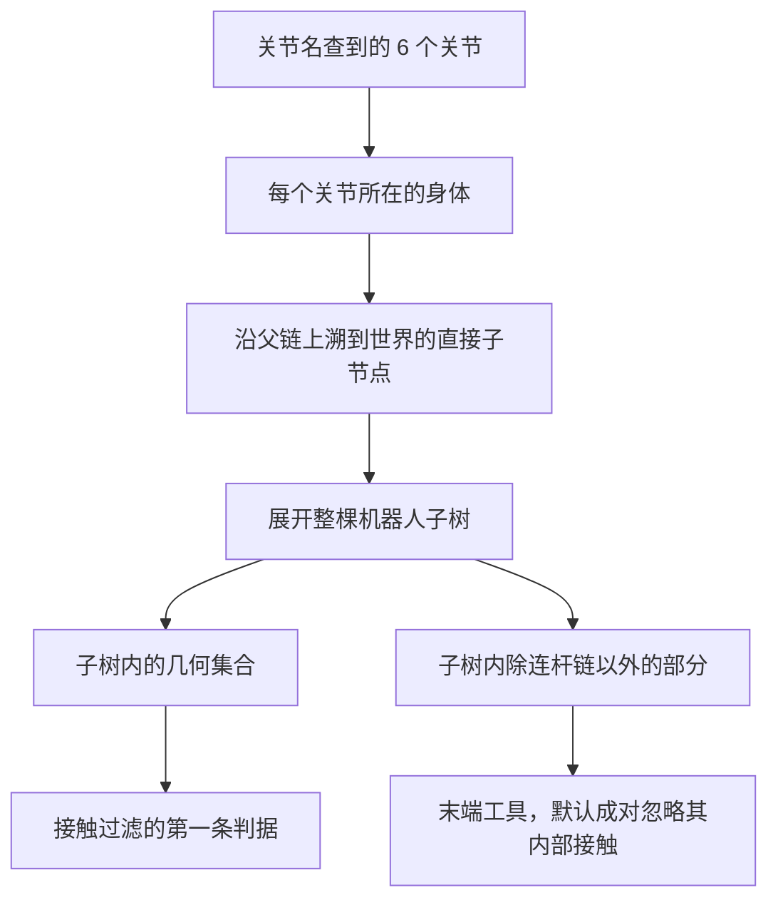
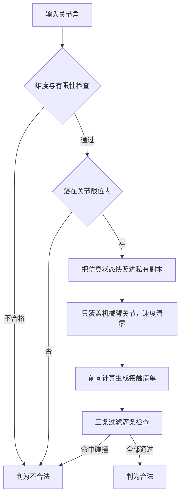
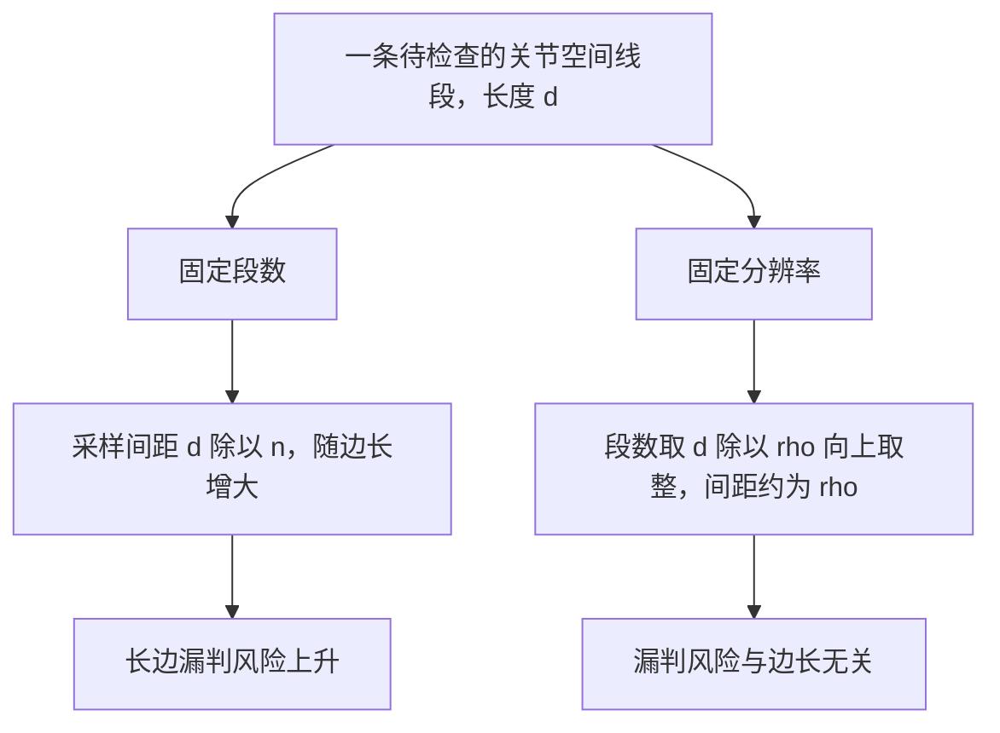

# 碰撞检测判什么

给机械臂规划一条绕过障碍的关节路径，第一道坎不在搜索算法，而在“什么算碰到”。物理引擎输出的是一张接触清单，清单里既有物体压在桌面上这类与机械臂无关的接触，也有机构自己零件之间的接触。直接拿接触数量当碰撞数量，会让几乎所有位形都判成非法，规划器连起点都出不去。

下面先把规划需要的判据说清楚，再拆开一次查询里“哪些接触算碰撞”的三条过滤，然后讨论查询为什么必须无副作用，最后给出离散采样漏判的来源与量化方式。

## 规划需要的是布尔判据

采样式规划把运动规划化简成一串二值查询：一个位形在不在自由空间里，一条线段是不是整条都在自由空间里。算法不要求知道离障碍有多远，也不要求障碍边界有解析表达式。这个选择换来两件事：查询接口可以很窄，只有合法与不合法两种返回；规划器对场景几何不需要任何假设，换机器人、换障碍都不用改搜索逻辑。

代价是丢失了距离信息。有符号距离能让采样朝远离障碍的方向偏置，也能给路径留出安全裕度；只有布尔判据时，贴着障碍通过的路径与离障碍很远的路径没有区别。这个代价在“找到一条可行路径就够”的场景里可以接受，在“必须留出安全间隙”的场景里就要在判据之外另加距离评估。

| 判据形态 | 规划器能得到什么 | 主要代价 |
| --- | --- | --- |
| 布尔合法性 | 位形与线段是否可用 | 无法表达安全裕度 |
| 有符号距离 | 离障碍多远与梯度方向 | 查询更贵，需要额外实现 |
| 接触对清单 | 谁与谁相互接触 | 归因与过滤交给调用方 |

物理引擎给出的天然产物是第三种，所以规划层要自己把它折算成第一种。折算规则就是这一篇的主体。

## 三条过滤把接触清单变成碰撞判据

接触清单的长度不等于碰撞次数，因为清单里混着两类与机械臂无关的条目：环境物体之间的接触（物体压桌面、物体互相堆叠），以及机构内部的自接触。前者在场景里长期存在，后者在多数位形下也存在。判定一次位形是否合法，需要三条过滤同时成立：

$$
\mathrm{collide}(g_1, g_2) \iff
\big(\mathrm{robot}(g_1) \lor \mathrm{robot}(g_2)\big)
\;\land\; \big(\mathrm{dist} < -\varepsilon\big)
\;\land\; \lnot\,\mathrm{ignore}[g_1, g_2]
$$

第一条要求接触双方至少有一方属于机器人。这条过滤是必须的：桌面上的物体在重力下沉稳落定之后，环境接触是常态，把所有接触都算碰撞等于把整个自由空间判空。第二条用穿透深度定义碰撞，容差 $\varepsilon$ 默认取零，也就是只要有实际穿透就判碰撞；把容差调大，贴合面上的数值噪声就不会被当成碰撞，代价是允许的穿透量随之变大。第三条留给机构自接触与调用方显式指定的忽略对，细节见下一节。

```python
for contact in contacts:
    g1, g2 = contact.geom1, contact.geom2
    if not (is_robot[g1] or is_robot[g2]):
        continue                      # 纯环境接触，与本位形无关
    if contact.dist >= -min_penetration:
        continue                      # 没有实际穿透
    if ignore_mask[g1, g2]:
        continue                      # 机构自接触或显式忽略
    return False                      # 三条都过，判为碰撞
return True
```

第一条过滤需要一份“哪些几何属于机器人”的集合。按名字筛是不可靠的：导入的机器人模型里，碰撞几何往往没有名字，只有用于显示的外观网格才命名过；不同来源的模型命名习惯也不一致。按结构筛更稳：从关节所在的身体沿父链上溯到根，再展开整棵子树，子树覆盖的几何就是机器人本体与挂在末端的工具。这个集合随模型结构变化，不随命名变化。



第二条过滤的容差是一个设计量，不是精度问题。取值太小会把贴合面的数值噪声算成碰撞，取值太大会让真实的浅穿透被放过。它的量级应当远小于机械臂与障碍的特征尺度，同时大于求解器在静止接触上留下的抖动幅度。

## 忽略表表达“哪些接触在规划里没有意义”

机构内部的自接触在物理上是真实的，在规划语义里却没有意义：夹爪手指互插、多连杆机构的杆件自接触，都会在正常位形下持续出现。如果把它们算作碰撞，机械臂的可用位形会大幅收缩，甚至收缩到空集。

忽略表的构造方式是几何对的布尔矩阵，默认把末端工具内部的几何两两置为忽略，再叠加调用方传入的忽略对。忽略对的名字同时接受几何名与身体名，这样即使碰撞几何没有名字，也可以按所属身体配置。矩阵在运行时可以增补，因为忽略需求随任务变化：抓取过程中手持物体与手指的持续接触在物理上一直存在，而规划仍需要从当前位形出发寻找路径。
这条需求引出一个接口设计上的取舍：忽略表是查询器的一部分，还是调用方每次传参？做成查询器内部状态，调用方只需要在需要时临时改写，用完还原；做成参数，每次查询都要重新构造矩阵，开销更大。临时改写的方式要求改动范围严格限定在一次查询窗口内，否则忽略会泄漏到其它模块的碰撞语义里。

| 忽略类别 | 典型来源 | 是否为默认 | 生效时机 |
| --- | --- | --- | --- |
| 工具内部自接触 | 夹爪手指与连杆机构 | 默认忽略 | 始终 |
| 调用方指定的几何对 | 调试或特殊任务 | 按需加入 | 配置后始终 |
| 手持物体与工具 | 抓取过程中的持续接触 | 不默认 | 仅规划窗口内临时生效 |

## 查询必须无副作用

规划是预测，不是执行。搜索过程会对成百上千个位形做查询，其中绝大多数不会被执行；这些查询不能改变仿真状态，否则规划本身就会把场景推着走，物体位置与关节状态在搜索过程中漂移，查询结果也不再彼此可比。

做法是准备一份私有的状态副本，每次查询把仿真状态整份快照过来，只覆盖机械臂的关节量，再调用一次前向计算。快照保证查询看到的是当前场景：物体已经落在哪里就按哪里算，而不是复位时的初始布局。只覆盖关节量保证夹爪开合、物体姿态这些与搜索无关的自由度保持真实值。速度量清零，让同一组关节角每次都得到同一份接触清单：接触几何与速度无关，残留速度只会带来不可复现的结果。

前向计算取到哪一层也是一个取舍。规划只需要运动学与接触信息，不需要积分，也不需要推进时间，因此调用只算派生量的前向层，而不跑步进物理。前者开销小且不产生任何状态变化，后者会把仿真往前推一步。这个选择把查询与执行在实现层面分开，规划器因此可以任意频繁地调用。



## 边合法性是连续问题，采样只能近似

单点查询可以做到精确：给定位形，前向计算给出的接触清单是确定答案。边的合法性则是一个连续问题：整条关节空间线段是否都落在自由空间里。物理引擎没有线段碰撞这样的接口，只能把它离散成一串点，逐点查询。

离散化必然带来漏判窗口。设线段长度 $d$、切 $n$ 段，相邻采样点的间距是

$$
\Delta s = \frac{d}{n}
$$

设某障碍在关节空间中的穿越宽度为 $w$。若 $w < \Delta s$，存在相位使两个相邻采样点都落在障碍之外，这条线段就被判为合法。漏判风险随 $w / \Delta s$ 减小而升高；要保证不漏，需要 $\Delta s \le w$。这条判据把采样多密才算够从经验问题变成了可计算问题：分辨率的上限由场景中最小障碍的穿越宽度决定。

```python
def is_edge_valid(q1, q2, steps):
    if not is_state_valid(q1) or not is_state_valid(q2):
        return False
    for k in range(1, steps):
        s = k / steps
        if not is_state_valid(q1 + s * (q2 - q1)):
            return False
    return True
```

段数的取法有两种常见形态，差别在采样间距如何随边长变化：

| 段数策略 | 采样间距 | 长边上的表现 |
| --- | --- | --- |
| 固定段数 | $\Delta s = d / n$，随边长线性增大 | 边长越长越容易漏判 |
| 固定分辨率 | $\Delta s \approx \rho$，与边长无关 | 段数随边长增长，漏判风险稳定 |

固定分辨率把段数算成 $\lceil d / \rho \rceil$，再钳到一个上下限：下限保证很短的边也有中间采样点，上限防止超长边把时间全花在采样上。规划器通常同时用到两种策略：单步扩展的边很短，两种取法差别不大；后处理阶段会出现跨度很大的候选边，这时固定分辨率的优势才显现出来。

```python
def edge_steps(a, b, resolution, max_steps=64):
    d = norm(b - a)
    return clip(ceil(d / max(resolution, 1e-9)), 2, max_steps)
```



## 限位判据为什么只需查端点

关节限位是每个关节一个独立区间，六个区间的笛卡尔积是一个凸集，也就是关节空间里的一个盒体。凸集的性质直接给出结论：线段两端都在盒内时，整条线段都在盒内。因此边的限位检查只需要查两个端点，中间的采样点不必重复判断限位，只需判断碰撞。

碰撞判断没有这个性质，自由空间一般不是凸的，所以中间点必须逐点查。把两类约束分开处理，既省掉重复的限位判断，也让限位是凸约束、碰撞是非凸约束这个区别在代码结构里显式可见。

端点是否算在限位内是另一处约定。把端点算进去，边界位形合法；不算进去，边界位形非法。两种约定都能工作，重要的是全仓统一：如果采样边界、限位判据、目标钳制三处用了不同约定，就会出现规划器给出的目标被判定超限这类自相矛盾的结果。
## 常见判断偏差

| # | 判断偏差 | 表现 | 依据 |
| --- | --- | --- | --- |
| 1 | 用接触总数当碰撞数 | 所有位形都判非法，起点也走不出去 | 环境里存在与机器人无关的长期接触 |
| 2 | 按几何名筛选机器人部件 | 忽略配置不生效，连杆碰撞漏判 | 导入模型的碰撞几何常常没有名字 |
| 3 | 认为忽略表只服务夹爪 | 手持物体时起点被判非法 | 忽略需求随任务变化，需要临时生效 |
| 4 | 对长边沿用固定段数 | 稀疏采样跨过薄障碍 | 采样间距随边长线性增大 |
| 5 | 认为采样够密就不会漏判 | 薄障碍仍然被跨过 | 漏判取决于间距与障碍宽度之比 |
| 6 | 让查询直接读写仿真状态 | 搜索过程改变物体位置 | 规划是预测，查询必须无副作用 |

## 小结

### 核心概念

- 采样规划需要的是一张布尔判据表，不是距离场；物理引擎给出的接触清单要经过折算才能用。
- 折算规则是三条过滤：至少一方属于机器人、存在实际穿透、不在忽略表内。
- 机器人几何集合按结构界定而不是按命名界定，这样对模型命名习惯不敏感。
- 查询基于私有状态快照，只覆盖机械臂关节并清空速度，保证无副作用且结果可复现。
- 边的合法性只能离散近似，采样间距必须不大于最小障碍在关节空间里的穿越宽度。
- 限位是凸约束，只需查端点；碰撞是非凸约束，必须逐点查。

### 设计权衡

| 权衡点 | 常见选择 | 收益与代价 |
| --- | --- | --- |
| 判据形态 | 布尔合法性 | 接口窄、算法简单；代价是没有安全裕度 |
| 机器人界定 | 按身体子树 | 对命名不敏感；代价是依赖模型结构 |
| 穿透容差 | 默认零，按需调大 | 语义严格；代价是需要为数值噪声留容差 |
| 忽略表位置 | 查询器内部状态加临时改写 | 调用简单；代价是改写要限定在查询窗口内 |
| 边采样 | 固定分辨率加段数上下限 | 长边不漏判；代价是长边查询更贵 |

## 练习

### 基础题

1. 写出接触折算成碰撞的三条过滤条件，并各给一个会被该条件拦掉的例子。
2. 为什么机器人几何集合按身体子树界定比按几何名界定更稳？给出两种界定方式各自失效的场景。
3. 一条长 1.0 rad 的关节空间线段，分别按固定 12 段与固定 0.02 rad 分辨率切分，计算两种采样间距，并指出哪一种在长边上更安全。
4. 说明关节限位为凸集时，为什么边检查可以只查端点，而碰撞检查不行。

### 挑战题

5. 场景中存在最小穿越宽度为 0.01 rad 的薄障碍。设计一套边采样策略，给出分辨率取值、段数上限与理由，并说明段数上限带来的残余漏判风险。
6. 为一次抓取任务设计忽略表的生命周期：哪些接触对在什么阶段加入、何时还原，写出接口与还原时机，并说明忽略泄漏到其它模块的后果。
7. 设计一份碰撞查询的自检清单，覆盖无副作用、可复现、几何集合正确性、忽略表生效与穿透容差五类检查。
8. 若把布尔判据升级为有符号距离，规划算法的哪些部分需要改动？给出改动清单与新增的取舍。

## 附：本页引用的路径

| 路径 | 用途 |
| --- | --- |
| `planning/collision.py` | 位形与边合法性查询、接触过滤、忽略表与调试接口 |
| `planning/rrt_connect.py` | 边的离散段数计算与调用方 |
| `core/config.py` | 关节限位区间，采样边界与限位判据的共同来源 |
| `core/interfaces.py` | 规划协议中的查询方法签名 |
| `planning/smoke.py` | 过滤规则与无副作用的核对用例 |
