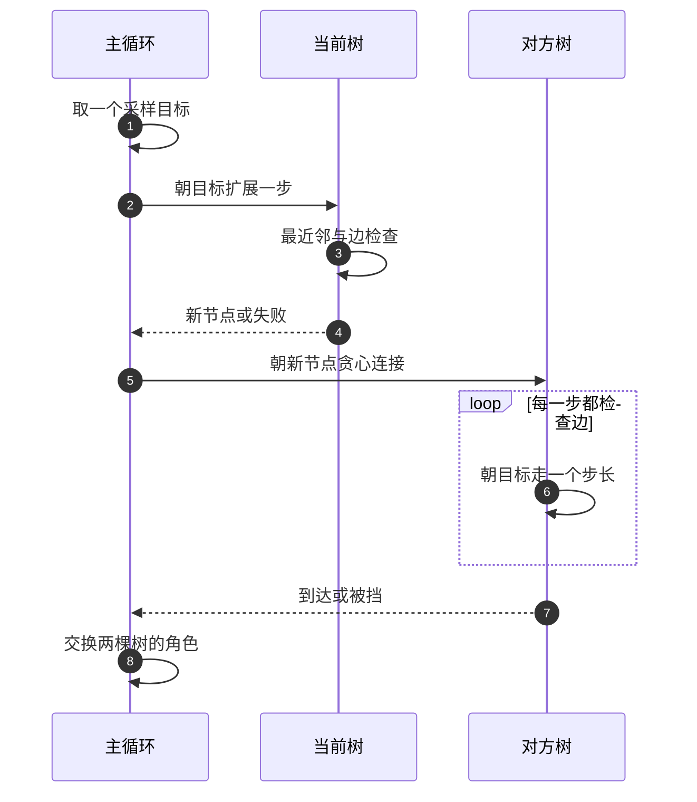
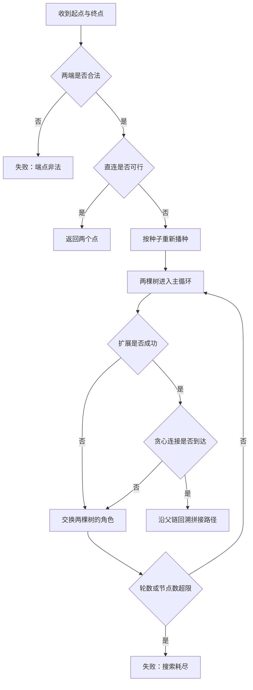

# RRT-Connect

在六维关节空间里给机械臂找一条绕开障碍的路径，第一反应通常是网格搜索，或者沿着障碍的几何边界走。网格搜索的单元数随维度指数增长，六维下很快就会超出任何可用的时间与存储预算；几何方法要求障碍在关节空间里有解析边界，而关节空间里的障碍是工作空间障碍经过运动学映射的像，通常没有解析表达。两类方法在高维上都很快失效。

采样式规划换了一个问题设定：不要求覆盖整个空间，只要求在自由空间里连出一条可行路径。下面先说明这个换法为什么成立，再讲单向树的扩展机制，然后展开双向树与贪心连接，最后讨论步长、采样偏置、迭代上限与边离散分辨率这几组需要一起选的参数。

## 高维空间里为什么改用采样

网格搜索把空间切成单元，逐个标记自由或占用，完备性建立在分辨率上：分辨率足够细时一定能找到存在的路径。代价是单元数按维度指数增长，而关节空间的维度等于自由度，六轴机械臂就是六维。几何方法走另一条路：显式构造障碍的边界与自由空间的连通性，完备性好，但对环境的假设最强。

采样式规划不做覆盖，只在自由空间里随机取点、把点连成树或图。它的完备性变成概率完备：只要路径存在且算法运行足够久，找到它的概率趋近于一。这个弱化的承诺换来了对维度不敏感的增长行为，以及对障碍表达几乎没有要求。代价是结果带随机性、不保证最短，并且必须配合后处理才能交给控制器执行。

| 方法 | 完备性 | 维度适应性 | 解的质量 | 主要代价 |
| --- | --- | --- | --- | --- |
| 网格搜索 | 分辨率完备 | 单元数随维度指数增长 | 依赖分辨率 | 时间与存储快速膨胀 |
| 几何与路线图 | 完备 | 依赖障碍的解析边界 | 通常较好 | 构造复杂，动态环境难维护 |
| 采样法 | 概率完备 | 与维度弱相关 | 不保证最优 | 结果随机，需要后处理 |

“概率完备”这句话有两处必须读准。第一，它只保证路径存在时最终能找到，不保证多长时间能找到，所以迭代上限是失败判据而不是完成判据。第二，它依赖采样在自由空间上的覆盖，若采样分布或连接方式有系统偏差，某些窄通道可能长期采不到。

## 单向树：随机采样与最近邻扩展

单向 RRT 的每一步只有四件事：在关节空间里取一个随机点，找到树上离它最近的节点，从这个节点朝随机点走一个固定步长，检查这段边是否可用；可用就把新节点接上去。重复这个过程，树会朝未被覆盖的区域生长。

扩展方向指向随机点，长度被步长截断：

$$
q_{\text{new}} = q_{\text{near}} + \frac{\min(\varepsilon, d)}{d}\,\bigl(q_{\text{rand}} - q_{\text{near}}\bigr)
$$

其中 $d$ 是最近节点到随机点的距离，$\varepsilon$ 是步长。最近邻取树上到随机点距离最小的节点：

$$
i = \arg\min_j \lVert q_j - q_{\text{rand}} \rVert
$$

为什么朝最近节点扩展就能覆盖空间，可以用最近邻区域的形状解释：树上每个节点对应空间中的一块区域，落在这块区域里的随机点都会朝该节点扩展。树的节点越稀疏的地方，单块区域越大，被采中的概率越高，树就朝那里生长。这个机制让扩展自然偏向未探索区域，不需要额外的启发式。

```python
def extend(tree, target, step_size):
    i = nearest(tree, target)
    delta = target - tree[i]
    d = norm(delta)
    if d <= 1e-9:
        return i, True
    new = tree[i] + delta * (min(step_size, d) / d)
    if not edge_valid(tree[i], new):
        return -1, False
    return add(tree, new, i), d <= step_size
```

步长同时承担两个角色：它限制单条边的长度，也决定节点增长的快慢。边只有一条，因此树的规模与边数是同一量级。这个稀疏结构是采样法的优点也是缺点：节点少意味着内存小、最近邻查询便宜；连接关系单一意味着路径只有一条候选，找不到就整棵树重来。

## 双向：两棵树交替生长与贪心连接

单向树从起点出发，要走到终点附近的概率取决于两者之间的距离与空间体积。双向版本让起点与终点各长一棵树，任意一棵扩展成功之后，让另一棵朝新节点做贪心连接，两棵树交替生长。距离目标越远，单向树需要的节点越多；两棵树相向生长时，各自的覆盖半径只需要走完一半路程。

贪心连接是双向版本的关键。它与普通扩展的差别在循环次数：扩展只走一步，走不动就放弃；连接反复朝同一个目标走，每一步都检查边，直到到达目标或被障碍挡住。这个循环利用了一个事实：两棵树的节点之间往往存在一条直线可达的自由段，一次连接可以把这段直线整段走完，等价于一次加了很多个节点。

| 操作 | 循环次数 | 目标 | 失败时的行为 |
| --- | --- | --- | --- |
| 扩展 | 一步 | 随机采样点或对方树的根 | 放弃这一步，交换角色 |
| 连接 | 反复直到到达或被挡 | 对方刚生成的新节点 | 保留已加上的节点，交换角色 |

相遇的判据是距离阈值而不是精确相等。两棵树的节点由不同的扩展路径生成，浮点上不会精确重合，用一个小阈值判定到达即可。这个阈值同时防止另一种退化：两棵树的根几乎重合时，最近节点不再变化，若没有到达判据，连接循环会反复添加同一个点。


## 采样目标的两个来源

采样目标决定树往哪里长，它有两个来源，按概率分配。主要来源是关节限位盒内的均匀采样，作用是把节点撒向尚未覆盖的区域。另一个来源是直接取对方树的根节点，作用是把两棵树往彼此身上拉。两者组合的意义是：均匀采样负责探索，取对方根节点负责相遇。

```text
目标 = 对方树的根节点        以 goal_bias 的概率
目标 = 限位盒内均匀采样        其余情况
```

偏置概率是一处需要一起看的参数。取值过高，树会长期沿着两个根之间的连线生长，遇到障碍就卡住，探索性消失；取值过低，两棵树靠随机采样相遇，需要的节点数随距离增长。取值在零点一到零点二之间是常见折中：绝大多数轮次保持探索，少量轮次直接朝对方推进。

| 偏置取值 | 树的行为 | 适合的场景 |
| --- | --- | --- |
| 接近零 | 纯随机探索，相遇慢 | 障碍复杂、通道曲折 |
| 零点一到零点二 | 探索为主，定期朝对方推进 | 通用 |
| 接近一 | 只沿两棵树的连线生长 | 几乎无障碍的远距离目标 |

## 步长、迭代上限与节点预算

步长 $\varepsilon$ 是扩展一次的最大关节空间位移，它同时影响三件事：单条边跨越障碍的风险、边检查的成本、达到目标所需的节点数。步长越大，单条边越长，越可能跨过薄障碍，边离散所需的采样点也越多；步长越小，节点增长越快，最近邻查询与树的存储会先成为瓶颈。合理取值与场景中最薄障碍的尺度挂钩，而不是与关节范围的绝对值挂钩。

迭代上限的作用容易被误解。它属于失败判据：到达上限只说明这段时间内没找到路径，不说明路径不存在。因此上限必须与时间预算和节点容量一起定。轮数上限与节点总量上限是两个量，因为一轮里的贪心连接可能添加很多节点，只限制轮数不足以限制规模。

| 参数 | 太小 | 太大 | 量级参考 |
| --- | --- | --- | --- |
| 步长 | 节点暴涨，最近邻变慢 | 单边跨越薄障碍，检查变贵 | 零点一弧度级 |
| 迭代上限 | 窄通道来不及展开就放弃 | 失败时等待过久 | 数千轮级 |
| 偏置概率 | 相遇依赖运气 | 探索性消失 | 零点一级 |
| 边分辨率 | 长边漏判 | 采样开销上升 | 零点零二弧度级 |

## 边离散分辨率与可复现性

树上的每条新边都要离散采样后逐点检查。分辨率与步长是两个独立的量：步长决定树长什么样，分辨率决定检查一条边有多细。若把两者混为一谈，用固定段数去检查所有边，长边的采样间距会随长度增大，薄障碍就有被跨过的窗口。按固定分辨率反推段数可以消除这个依赖：

$$
n = \mathrm{clip}\!\left(\left\lceil \frac{d}{\rho} \right\rceil,\ 2,\ 64\right)
$$

下限取二保证很短的边也有一个中间采样点，上限防止超长边把时间全花在采样上。分辨率 $\rho$ 由场景中最小的障碍穿越宽度决定，理由在碰撞检测那一篇里已经给出。

```text
每次调用规划入口：rng = default_rng(seed)
```

随机源的处理方式决定结果能不能复现。每次规划按种子重新播种，同种子加同查询得到完全一致的两棵树、完全一致的路径；如果只在构造器里播种一次，随机状态会跨多次规划累积前进，同一组查询在不同调用顺序下给出不同结果。可复现的价值在三处体现：失败能重放，重试序列确定，参数比较时只有被比较的变量在变。

## 快路径与失败语义

主循环之前先做一次直连检查：起点与终点之间的一条边若可用，直接返回两个点，整棵树都不必建。近距离目标在调用里占相当比例，这一步省掉的开销最大，而且返回结果与搜索得到的路径同样有效。

失败要区分原因，因为处置方式不同。一类是端点本身不合法，搜索根本不会开始，问题在输入端：目标可能超出限位，或者起始位形处于接触状态。另一类是搜索耗尽，问题在参数或场景：步长与障碍尺度不匹配、偏置不合适、上限太小，或者路径确实不存在。把两类失败返回同一个空值而不带原因，调用方只能靠猜。


## 常见判断偏差

| # | 判断偏差 | 表现 | 依据 |
| --- | --- | --- | --- |
| 1 | 认为采样法没有完备性保证 | 不敢在高维空间使用 | 概率完备：路径存在时找到的概率趋近于一 |
| 2 | 把迭代上限当完成判据 | 一到上限就断言路径不存在 | 上限只是失败判据，不是存在性判据 |
| 3 | 只限制轮数不限制节点数 | 一轮贪心连接加上大量节点 | 轮数与节点总量是两个独立预算 |
| 4 | 两棵树都只朝随机点扩展 | 相遇依赖运气，节点数暴涨 | 需要少量轮次直接取对方树的根 |
| 5 | 只在构造器里播种一次 | 同一组查询在多次调用间漂移 | 随机状态会跨调用累积前进 |
| 6 | 用固定段数检查所有边 | 长边采样稀疏，跨过薄障碍 | 采样间距随边长增大，应按分辨率反推 |

## 小结

### 核心概念

- 采样规划把完备性弱化为概率完备，换来对维度与障碍表达的低要求。
- 单向树靠最近邻区域偏置自然覆盖空间，扩展步长限制单条边的长度。
- 双向树两棵交替生长，贪心连接一次可以走完整段自由直线。
- 采样目标有两个来源：限位盒均匀采样负责探索，对方树的根负责相遇。
- 迭代上限是失败判据，轮数上限与节点总量上限需要分开设置。
- 每次规划按种子重新播种，保证同种子加同查询的结果可复现。

### 设计权衡

| 权衡点 | 常见选择 | 收益与代价 |
| --- | --- | --- |
| 完备性 | 概率完备 | 维度适应性好；代价是结果随机、耗时不定 |
| 树的方向 | 双向 | 相遇更快；代价是每轮多一次贪心连接 |
| 采样目标 | 均匀采样加少量偏置 | 探索与相遇兼顾；代价是偏置要按场景调整 |
| 上限设置 | 轮数与节点数分开 | 规模可控；代价是参数变多、需要一起调 |
| 随机源 | 每次规划重新播种 | 失败可重放；代价是调用方要显式管理种子 |

## 练习

### 基础题

1. 写出扩展公式与最近邻公式，说明步长对单条边长度与节点增长速度的影响。
2. 解释贪心连接为什么能在一次调用里添加多个节点，以及它在什么条件下会提前失败。
3. 说明概率完备与分辨率完备的区别，并各给一个适合的方法与场景。
4. 若同一个种子两次规划返回不同路径，最可能的原因是什么？给出两种排查方向。

### 挑战题

5. 为一个存在窄通道的场景设计参数组合（步长、偏置、迭代上限、边分辨率），给出推演过程与失败判据。
6. 设计一套失败归因流程：从返回空值出发，区分端点非法、探索不足与路径确实不存在三类原因。
7. 设计节点预算策略：轮数上限、节点总量上限与树的容量预分配三者如何配合，写出各自的作用。
8. 若要求路径尽量短，需要在双向树的基础上增加哪些机制？给出改动清单与新增的代价。

## 附：本页引用的路径

| 路径 | 用途 |
| --- | --- |
| `planning/rrt_connect.py` | 双向树、扩展与连接、后处理、统计字段 |
| `planning/planner.py` | 多轮换种子重试与位姿入口 |
| `planning/collision.py` | 位形与边的合法性查询 |
| `core/config.py` | 关节限位盒，采样与限位判据的共同边界 |
| `core/interfaces.py` | 规划协议的方法签名 |
