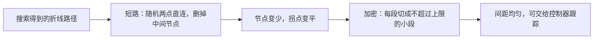
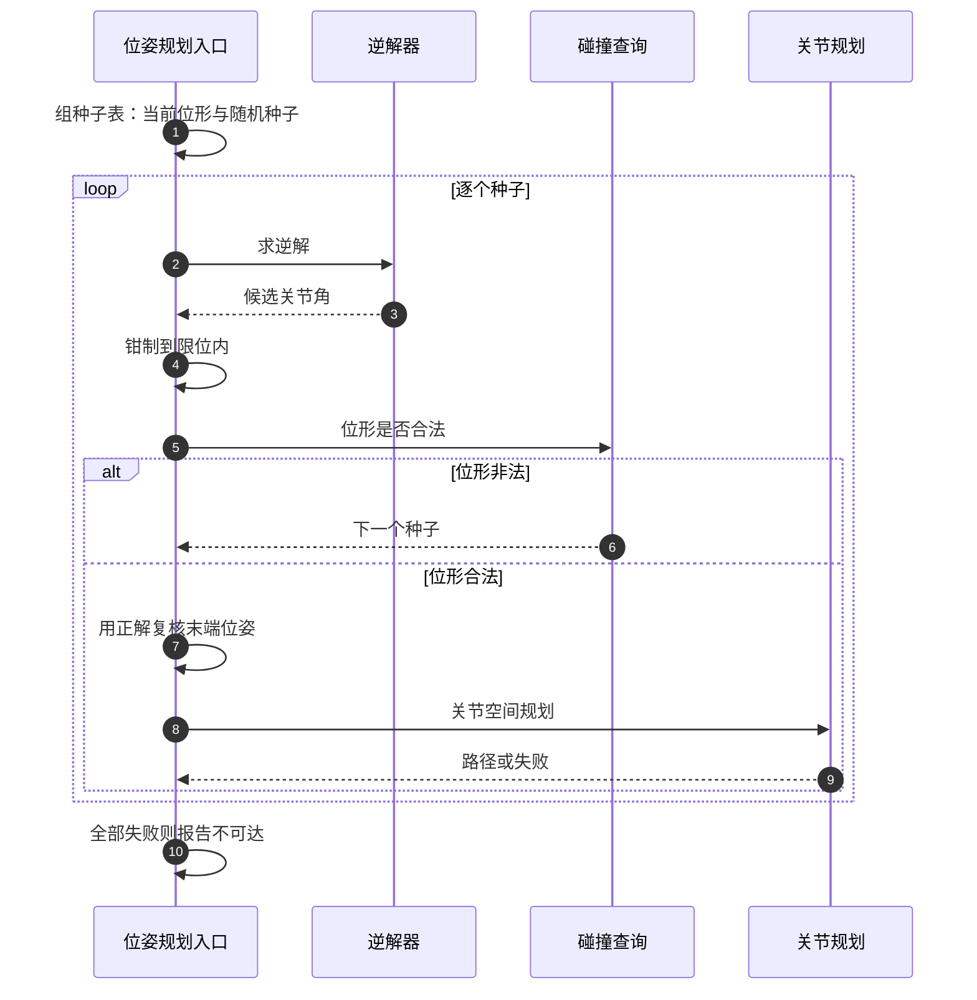
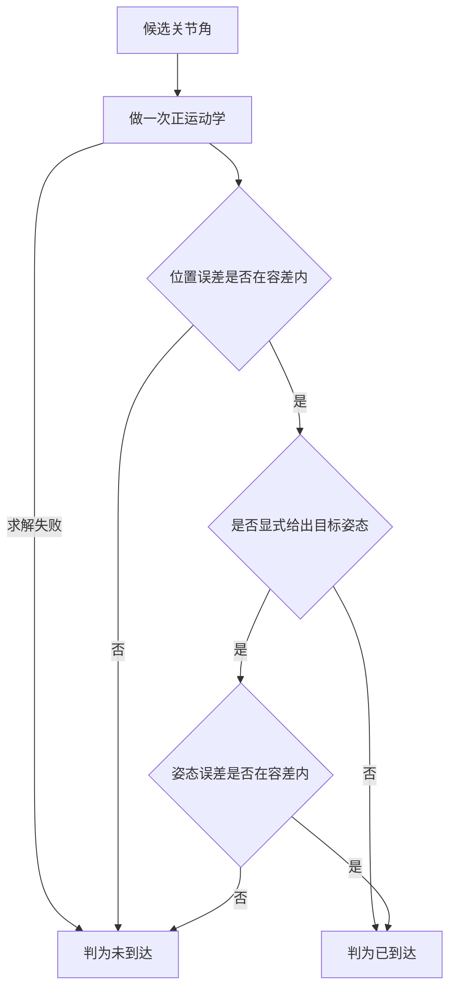

# 路径后处理与位姿规划

搜索返回的路径是一条折线：节点是扩展过程随手撒下的，方向在节点之间不断改变，间距也不均匀。把它直接交给位置控制，跟踪过程会反复减速加速，单周期参考跳变忽大忽小。规划与执行之间因此需要一层后处理，把路径整理成控制器能稳定跟踪的形状。另一头的问题是任务通常以末端位姿给出，需要先解出关节角才能规划，而逆解多解、对初值敏感。

下面先说明折线为什么不能直接执行，再讲短路与加密各自保持的不变量，然后转向位姿规划的多种子策略，最后给出复核与重试的分工。

## 折线与疏密：RRT 输出的两个问题

第一个问题是方向。折线的每个节点都对应一次方向变化，控制器沿折线走时，每过一段就要把速度方向转过来。若把路径按等速或按时间律展开，拐点附近的速度轮廓会出现反复的加减速，实际执行时间被明显拉长。

第二个问题是间距。扩展步长只限制单条边的上限，不保证下限：连接阶段可能一次加上很短的边，拼接处也可能出现很短的段；后处理阶段出现的候选长边又会远大于步长。控制器按关节空间插值执行时，段太短会浪费控制周期，段太长会让单周期的参考位移过大，速度前馈与插值的误差随之放大。

| 问题 | 来源 | 直接执行的后果 |
| --- | --- | --- |
| 折线拐点多 | 每次扩展都会改变方向 | 速度方向反复突变，执行时间拉长 |
| 节点间距不均 | 步长只设上限，连接阶段可加很多点 | 单周期参考跳变忽大忽小 |
| 采样带来的冗余节点 | 树只保证连通性，不保证最少节点 | 同样的几何路径带更多拐点 |

后处理的两个操作分别针对这两点，它们都不改变路径的可行性，只改变节点的数量与分布。



## 短路：随机两点直连并删掉中间节点

短路的思路很直接：在路径上随机取两个节点，试一次直连；如果这条边可用，就把它们之间的节点全部删掉。重复固定次数，路径只会变短、变平。

它的不变量有三条。第一，端点保持不变，无论怎么删，起点与终点都是原来的两个节点。第二，路径长度不增，每次删点都用一个线段替代一段折线，而线段是两点之间的最短连接：

$$
L(\text{path}') \le L(\text{path})
$$

第三，可行性不回退，只有通过边检查的直连才被接受。这三条让短路可以安全地反复执行，不需要额外的几何证明。

```python
for _ in range(iters):
    n = len(path)
    if n <= 2:
        break
    i = rand_int(0, n - 2)
    j = rand_int(i + 1, n - 1)
    if j == i + 1:
        continue
    if edge_valid(path[i], path[j], steps_for(path[i], path[j])):
        path = path[:i + 1] + path[j:]
```

为什么用随机尝试而不是求最短路径？后处理的目标是把折线整理成可执行的形状，不是求全局最优。求最短路径需要在自由空间里做搜索或做可见性图，代价远大于收益；随机尝试每次只需要一条边的检查，迭代固定次数后效果就基本饱和。

短路引入的候选边可能跨越很长距离，因此边检查的分辨率要按固定值反推段数，而不是沿用固定段数。若这一步偷懒，短路越成功、长边越多，漏判薄障碍的风险反而越高。

## 加密：把每段切成不超过上限的子段

加密把路径的每一段都切成等长的子段，段长不超过给定上限：

$$
k = \max\left(1,\ \left\lceil \frac{d}{s_{\max}} \right\rceil\right)
$$

每段被分成 $k$ 份，端点原样保留。切分后的路径总长不变，节点数增加，节点间距被压到上限以内。

这个上限服务的是下游跟踪器。关节空间跟踪按段插值时，单段的长度决定了插值跨度与速度前馈的量级；把上限固定下来，控制器收到的每一段都在同一个量级上，不必为个别长段做特殊处理。上限也不宜太小：节点越多，路径表越大，跟踪器的循环开销也越高。

```python
out = [path[0].copy()]
for a, b in zip(path[:-1], path[1:]):
    d = norm(b - a)
    k = max(1, ceil(d / max_step))
    for i in range(1, k + 1):
        out.append(a + (b - a) * (i / k))
out[0], out[-1] = path[0].copy(), path[-1].copy()
```

参数要做兜底：上限不是有限正数时回落到默认值。这个兜底让调用方即使传了非法值，也不会出现除零或无限循环。

端点在两处被重新覆盖，原因不同。浮点插值会让首尾节点与输入产生微小偏差，覆盖一次把偏差清零；上游的关节限位钳制会改动目标值，因此在整条流水线的出口再对齐一次调用方实际给出的起点与终点。端点可断言是后处理最重要的接口约定：调用方按精确相等检查两端，任何一处回填遗漏都会让断言失败。
## 后处理的顺序与代价

两个操作的顺序会影响成本。短路在前的理由是：加密的成本与路径段数成正比，先把节点删到接近最少，再做加密，总工作量最小；反过来先加密会把节点数抬高，之后短路删掉的大多是刚插入的点，等于白做一遍。

| 顺序 | 中间状态 | 代价 |
| --- | --- | --- |
| 先短路后加密 | 节点少、拐点平 | 短路的长边检查较贵，加密的段数少 |
| 先加密后短路 | 节点多、多数是刚插入的 | 加密白做，短路要在更长的列表上取随机点 |

后处理的边界也要说清：它只整理已经可行的路径，无法把不可行的路径变成可行。端点非法、搜索耗尽、路径必须穿过障碍，这三类问题都要在搜索阶段解决，后处理帮不上忙。它增加的边检查次数是防御性开销，用来保证整理后的路径仍然合法，而不是用来发现新路径。

## 位姿规划：为什么需要多组逆解种子

任务给出的通常是末端位姿，而规划在关节空间进行，因此中间要经过一次逆解。逆解是一个非线性方程组的求解过程，它的解可能有多组，收敛结果依赖初值：同一个目标位姿从不同的初始关节角出发，可能收敛到不同的解，也可能不收敛。

种子因此有两个来源，各有分工。当前位形是最有价值的种子：从它出发的解与当前状态连续，规划出的路径短，执行时不需要大幅跳变。限位盒内的随机种子负责覆盖面：某些目标位姿存在多组解，当前位形附近的解可能落在限位边界之外、处于奇异附近、或者被障碍挡住去路，此时换一组种子可以落到另一条解分支上。

为什么一个种子不够，可以分成三类原因。逆解本身可能不收敛；逆解收敛了但关节角不满足约束；关节角满足约束但没有可行路径到达它。三类原因的处置不同：前两类换种子，第三类换解分支之后还要重新规划。多组种子同时覆盖了这三类情况。

种子的使用顺序也有讲究。把当前位形放在最前，先试代价最低、路径最短的解。第一枪交给逆解器内部的多次重启，用一次调用覆盖较宽的初值范围；之后的显式种子都做热启动精化，单次成本低，适合逐个试探。这样安排让常见情况一次命中，少见情况才付出多次求解的代价。



## 为什么不直接信任逆解的成功标志

逆解器通常返回一个布尔标志，表示这次求解是否达到它自己的收敛条件。这个标志的语义是“求解器认为收敛”，与调用方需要的“末端到达目标”不是同一件事。当只约束位置时，逆解处于欠约束状态：求解器可能把姿态误差也算进收敛条件，于是位置已经到达而标志为假；反过来，标志为真也可能对应一个数值上收敛、几何上仍有偏差的解。

判据应当由调用方自己定义，做法是用正解复核：把候选关节角送回正运动学，比较末端位置与目标位置的误差；只有显式给出目标姿态时，才额外比较姿态误差。

姿态误差用四元数的最小夹角：

$$
e_{\text{rot}} = 2\arccos\!\left(\frac{\lvert q_a \cdot q_b \rvert}{\lVert q_a \rVert\,\lVert q_b \rVert}\right)
$$

取点积的绝对值，把 $q$ 与 $-q$ 视为同一姿态，这是四元数双覆盖的直接结果；两个四元数范数接近零时直接判为不达标，避免除零。

两个容差的量级要分开定。位置容差与执行精度同一量级，毫米级即可：再小会被数值误差淹没，再大会让路径终点偏离目标。姿态容差要明显小于任务对姿态的要求，弧度级的小量；只在显式给出姿态时才检查，因为只约束位置的调用本来就不关心末端朝向。

| 判据 | 量级 | 依据 |
| --- | --- | --- |
| 位置误差上限 | 毫米级 | 与执行精度同量级，再小无意义 |
| 姿态误差上限 | 零点零五弧度级 | 明显小于任务姿态容差 |
| 姿态检查触发 | 仅在显式给出姿态时 | 只约束位置的调用不关心朝向 |


## 换种子重试与交付前的复核

采样式搜索单次失败在窄通道里很常见，一次失败不代表路径不存在。规划入口因此做多轮重试，每轮换一个随机种子。由于随机源在每次搜索开始时重新播种，整条流水线（搜索加后处理）在给定种子下确定，重试序列本身也是确定的，失败可以重放，参数对比时只有被比较的变量在变。

重试次数的收益递减：每多一次尝试，边际成功率下降，而失败时的等待时间按次数线性增长。上限是成本与成功率的折中，通常取个位数。次数定得再多也解决不了另一类失败：目标位形本身不可达，或者路径确实不存在。

后处理完成之后还要逐段复核一遍。逻辑上这一步看起来多余，搜索建树时每条边都检查过，短路也只接受检查通过的直连；但后处理会引入新的边结构，实现一旦调整，就可能在两处检查的语义之间留下缝隙。复核的作用是防御性的：任何一段非法就换下一个种子重来，不把坏路径交给控制器。

| 阶段 | 保持的不变量 | 检查方式 |
| --- | --- | --- |
| 搜索 | 每条树边合法 | 扩展时逐边检查 |
| 短路 | 端点不变、长度不增、边合法 | 每个候选直连检查一次 |
| 加密 | 端点严格相等、段长不超上限 | 出口处回填并断言 |
| 交付前 | 整条路径逐段合法 | 按分辨率逐段复检 |

## 常见判断偏差

| # | 判断偏差 | 表现 | 依据 |
| --- | --- | --- | --- |
| 1 | 认为搜索路径可以直接执行 | 拐点多、间距不均，跟踪抖动 | 后处理负责整理形状 |
| 2 | 担心删点会移动端点 | 不敢在起终点附近短路 | 端点回填是短路的不变量 |
| 3 | 先加密再短路 | 加密工作大部分被删掉 | 顺序决定总工作量 |
| 4 | 长边沿用固定段数检查 | 短路越成功越容易漏判 | 候选边应固定分辨率离散 |
| 5 | 直接采用逆解的布尔标志 | 位置达标却被判为失败 | 标志的语义与调用方需求不同 |
| 6 | 只用随机种子求逆解 | 路径跳变大、成功率低 | 当前位形是最有价值的种子 |
| 7 | 认为重试次数越多越好 | 边际收益递减，失败等待变长 | 上限是成本与成功率的折中 |

## 小结

### 核心概念

- 搜索返回的折线有方向与间距两个问题，直接执行会让跟踪反复加减速。
- 短路用随机直连删点，保持端点不变、长度不增、可行性不回退三条不变量。
- 加密把每段切到不超过给定上限，端点严格相等，服务下游等步长跟踪。
- 后处理只整理已可行的路径，无法弥补端点非法或搜索耗尽。
- 位姿规划需要多组逆解种子：当前位形保证连续性，随机种子覆盖其它解分支。
- 逆解的成功标志语义与调用方需求不同，应由正解复核位置与姿态。

### 设计权衡

| 权衡点 | 常见选择 | 收益与代价 |
| --- | --- | --- |
| 后处理目标 | 整理形状而不是求最优 | 成本低；代价是路径长度不是最短 |
| 短路方式 | 随机尝试固定次数 | 实现简单、效果饱和；代价是无最优性保证 |
| 加密上限 | 固定段长上限 | 下游跟踪量级统一；代价是节点数增加 |
| 种子来源 | 当前位形优先、随机补充 | 常见情况一次命中；代价是少见情况多次求解 |
| 位姿判据 | 正解复核代替求解器标志 | 判据与需求一致；代价是每个候选多一次正解 |
| 重试次数 | 个位数，换种子 | 覆盖率提升；代价是失败等待按次数增长 |

## 练习

### 基础题

1. 写出短路的三条不变量，并说明每一条分别由哪一步保证。
2. 一段长 0.30 rad 的路径段，加密上限取 0.05 rad，计算切分后的子段数与子段长度。
3. 说明为什么后处理无法把不可行的路径变成可行，给出两类它无法处理的问题。
4. 为什么只约束位置时不应当直接用逆解的成功标志？给出两种会误判的情形。

### 挑战题

5. 为一个多解目标位姿设计种子表：给出种子来源、数量与顺序，并说明如何判断某一类失败该换种子还是换解分支。
6. 设计一份路径交付前的检查清单，覆盖端点相等、段长上限、逐段合法性、位置与姿态达标四类检查。
7. 短路迭代次数、加密上限与交付前复核三者存在成本耦合。给出一个把它们一起定的方法，并说明如何判断参数已经饱和。
8. 若下游控制器的单周期位移预算收紧，路径后处理的哪些参数需要改？给出改动顺序与对执行时间的影响。

## 附：本页引用的路径

| 路径 | 用途 |
| --- | --- |
| `planning/rrt_connect.py` | 短路、加密与路径长度统计 |
| `planning/planner.py` | 多轮换种子重试、位姿入口、正解复核与容差 |
| `planning/collision.py` | 边合法性查询与离散段数 |
| `control/motion.py` | 关节路径跟踪的段长上限消费方 |
| `core/interfaces.py` | 规划协议中位姿入口的方法签名 |
| `core/config.py` | 关节限位，目标钳制与种子采样的共同边界 |
