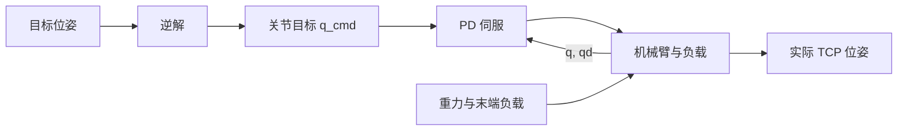
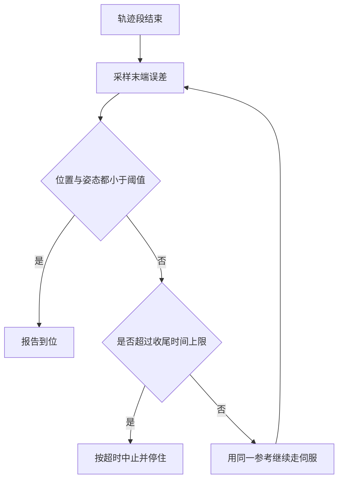

# 位置伺服为什么到不了点

逆解把目标位姿算成一组关节角，写进伺服，按说末端就该停在那里。实际停下来的位置常比目标低几毫米到十几毫米，换个位形又是另一个偏差。这类偏差不出在运动学上：解本身是收敛的，落点由伺服与负载共同决定。把算得对当成停得准，是位置控制在接触任务里最先暴露的一处误解。

下面先看位置执行器在算什么，再讲静差的两个来源（重力与速度滞后），然后对比抬高增益、重力补偿与积分外环三条路各自换到什么，最后给出一份末端误差的分解口径。

## 位置伺服只保证力矩平衡

关节位置模式下的执行器通常实现为一个带阻尼的比例控制器：

$$\tau = k_p (q_{cmd} - q) - k_v \dot q$$

控制量 `q_cmd` 是关节角目标，输出是关节力矩。它在静态下只要求力矩平衡，不要求 `q = q_cmd`。

稳态时角速度为零，输出力矩与重力矩抵消，代入 `\dot q = 0`：

$$k_p (q_{cmd} - q_{ss}) = g(q_{ss})$$

于是 `q_{ss} - q_{cmd} = g(q_{ss})/k_p`。静差与负载力矩成正比、与位置增益成反比；位形一变，重力矩就变，偏差跟着变。同一个位姿命令停在不同落点，来源就在这里。

在常见的 UR5e 描述里，前三个关节的位置增益量级为 2000，腕部约 500，且没有重力补偿项。关节上的重力矩在牛米量级，除以增益后落在毫弧度到十几毫弧度，乘以臂展就是毫米量级。把控制量固定在 HOME 位形时末端下沉约 11 mm，换一组关节角静差约 14 mm，两处偏差出自同一个机制。

| 量 | 量级 | 说明 |
| --- | --- | --- |
| 关节位置增益 k_p | 10^2 到 10^3 | 决定单位力矩误差需要多少角度补偿 |
| 关节重力矩 g(q) | 牛米量级，随位形变化 | 负载与连杆自身的重力投影 |
| 关节稳态偏差 | 毫弧度到十几毫弧度 | g/k_p |
| 末端稳态偏差 | 毫米到十几毫米 | 关节偏差经雅可比放大 |

## 静差的第二个来源是跟踪斜坡

静止时只有重力项，一旦参考在移动，阻尼项也开始参与平衡。给定角速度为 `\dot q` 的斜坡参考，稳态要求输出力矩同时抵消阻尼与重力，其中阻尼项只与速度有关：

$$k_p (q_{cmd} - q_{ss}) = k_v \dot q_{ss} + g(q_{ss})$$

只保留速度项时偏差退化为 `(k_v/k_p)\dot q_{ss}`。式中只出现比值 k_v/k_p：把两个增益同比例放大，速度滞后不变。该比值带时间量纲，可以读作伺服从指令变化到位置跟上所需的时间，UR5e 各关节取到约 0.2 s。

| 参考速度 | 0.2 s 时间常数对应的滞后 |
| --- | --- |
| 0.02 m/s | 约 4 mm |
| 0.05 m/s | 约 10 mm |
| 0.15 m/s | 约 30 mm |

笛卡尔直线运动的中段速度通常在 0.1 m/s 量级，对应的末端滞后在几十毫米，比静态下沉大一个量级。这条偏差随速度成比例，停下来的瞬间消失，因此只在运动过程中出现，用静态标定查不出来。

## 三条补偿路径的取舍

| 路径 | 做法 | 收益 | 代价 |
| --- | --- | --- | --- |
| 抬高位置增益 | 增大 k_p，与阻尼同比例 | 静态重力误差按比例下降 | 速度滞后不变；增益受离散步长与结构刚度限制 |
| 重力补偿 | 用模型把重力矩前馈到力矩 | 直接消掉静差里的重力项 | 依赖模型精度与负载辨识，负载改变需重算 |
| 任务空间积分 | 在外环积分末端误差，修正目标位姿 | 不依赖模型，负载与位形变化都能收敛 | 引入相位滞后，需要限幅与复位 |

抬高增益最省事，但它只压静态项：比值不变，速度滞后原样保留，而增益能加到哪里受控制周期与关节刚度约束。重力补偿针对性强，代价是把模型误差引进来，末端抓了新物体之后补偿量就偏了。任务空间积分不假设负载，代价是外环本身是积分环节，需要处理饱和与复位。三条路并不冲突，常见做法是后两条同时用：积分负责静态与慢变偏差，前馈负责把速度滞后压下去。

## 误差从哪里来，分别由谁负责

末端误差不是单一数字，把常见来源拆开之后，各自的量级与处理层才清楚：

| 误差来源 | 典型量级 | 随速度变化 | 处理层 |
| --- | --- | --- | --- |
| 逆解残差 | 10^-3 m / rad | 否 | 运动学，迭代收敛判据 |
| 关节重力静差 | 10 mm 量级 | 否 | 伺服、积分外环 |
| 速度跟踪滞后 | 10 mm 量级 | 线性 | 前馈、参考调速 |
| 轨迹离散与时间律 | 亚毫米 | 是 | 轨迹层 |

逆解判据本身取 10^-3 量级，位置以米计、姿态以弧度计，比伺服静差小一到两个数量级。如果末端误差目标是毫米级，把求解器再收紧没有意义，瓶颈在伺服与负载这一侧。

## 什么时候算到了

补偿能把偏差压小，但不会压到零，因此还需要一条到位判据，回答何时可以停止修正。判据取单次采样的瞬时误差最简单，但噪声会让它在阈值附近反复越界；取连续若干步都落在阈值内更稳，代价是每多判一步就多几个控制周期。

另一个必须定的量是超时。外环积分在误差很小时推进得越来越慢，遇到静摩擦或限位附近的死区，误差可能停在阈值之上不再下降。收尾伺服因此按仿真时间设上限，超过就按超时处置，把判断交回上层，而不是无限等下去。

| 判据形态 | 做法 | 收益 | 代价 |
| --- | --- | --- | --- |
| 瞬时阈值 | 单步误差小于阈值即结束 | 收尾最短 | 噪声下容易提前结束或反复越界 |
| 连续判据 | 连续若干步都在阈值内 | 抗噪声 | 多花若干个控制周期 |
| 带超时收尾 | 阈值判据加仿真时间上限 | 不会无限等待 | 需要给出与轨迹长度匹配的上限 |

阈值本身要与任务允许的偏差对齐。阈值取到亚毫米时，收尾在噪声与死区附近停留很久；取到厘米级，接触任务里的对位精度不够。判据的量级应当由任务决定，而不是由控制周期能分辨到多小决定。

## 常见判断偏差

| # | 判断偏差 | 表现 | 依据 |
| --- | --- | --- | --- |
| 1 | 认为逆解收敛就没问题 | 位姿命令精确但落点偏低 | 稳态由力矩平衡决定，不由解决定 |
| 2 | 用一套标定补所有位形 | 换位形后偏差换号 | 重力矩随位形变化 |
| 3 | 把静态偏差当成速度误差 | 静止正常，运动中偏差很大 | 速度项与比值 k_v/k_p 有关 |
| 4 | 只靠抬高增益压误差 | 速度滞后几乎不变 | 同比例放大不改变比值 |
| 5 | 忽略执行器类型 | 换成力矩模式后前馈失配 | 非位置执行器没有位置增益 |
| 6 | 用到位误差判断整段轨迹 | 中途误差被低估 | 到位误差与跟踪误差是两回事 |

## 小结

### 核心概念

- 位置伺服在稳态只保证力矩平衡，指令角与实际角之间存在与重力矩成正比的静差。
- 静态偏差由 g(q)/k_p 给出，随位形变化，无法用单一常数抵消。
- 跟踪斜坡时多出速度滞后，只取决于比值 k_v/k_p，与增益绝对值无关。
- 逆解残差在 10^-3 量级，比伺服静差小一到两个数量级，不是末端误差的瓶颈。
- 抬高增益、重力补偿、任务空间积分三条路解决不同分量，通常组合使用。

### 设计权衡

| 权衡点 | 常见选择 | 收益与代价 |
| --- | --- | --- |
| 位置增益 | 取到离散与刚度允许的上限 | 静态误差下降；代价是速度滞后不变、噪声与冲击上升 |
| 补偿方式 | 积分外环加前馈 | 不依赖负载模型；代价是引入相位滞后与饱和风险 |
| 误差预算 | 按来源分项，而不是只看总误差 | 能定位到该改的层；代价是各分量要分别测量 |
| 到位判据 | 与任务需要的最小量级对齐 | 判据太紧会拖长收尾，太松留下可见偏差 |

## 练习

### 基础题

1. 写出位置伺服稳态方程，说明静差与重力矩、位置增益的关系。
2. 为什么把位置增益与阻尼增益同比例放大，不能减小速度跟踪滞后？
3. 逆解判据取 10^-3，末端误差却在毫米级，两者的数量级差说明了什么？
4. 静止时末端偏差为零，是否说明伺服没有静差？给出判断方法。

### 挑战题

5. 设计一份末端误差分解方案，要求把重力静差、速度滞后、逆解残差分开，写出各项的测量条件。
6. 给定负载会变化的抓取任务，设计补偿策略并说明为什么不采用固定重力补偿。
7. 为一条含加减速的运动设计到位判据，说明阈值与轨迹峰值速度、任务允许偏差的关系。
8. 如果只能改一处来降低中段跟踪误差，选择抬高位置增益还是加入速度前馈？给出判据。

## 附：本页引用的路径

| 路径 | 用途 |
| --- | --- |
| `vlm_admittance/control/motion.py` | 任务空间积分外环、速度前馈与收尾伺服的实现位置 |
| `vlm_admittance/control/kinematics.py` | 逆解收敛判据与雅可比 |
| `vlm_admittance/core/config.py` | 控制周期与关节位形常量 |
| `vlm_admittance/assets/ur5e/ur5e.xml` | 位置执行器的增益与阻尼参数 |
| `vlm_admittance/control/smoke.py` | 轨迹误差与到位判据的自检入口 |
