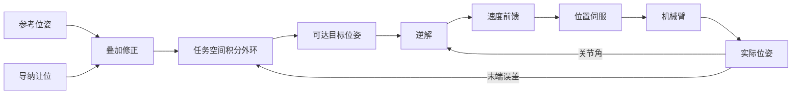
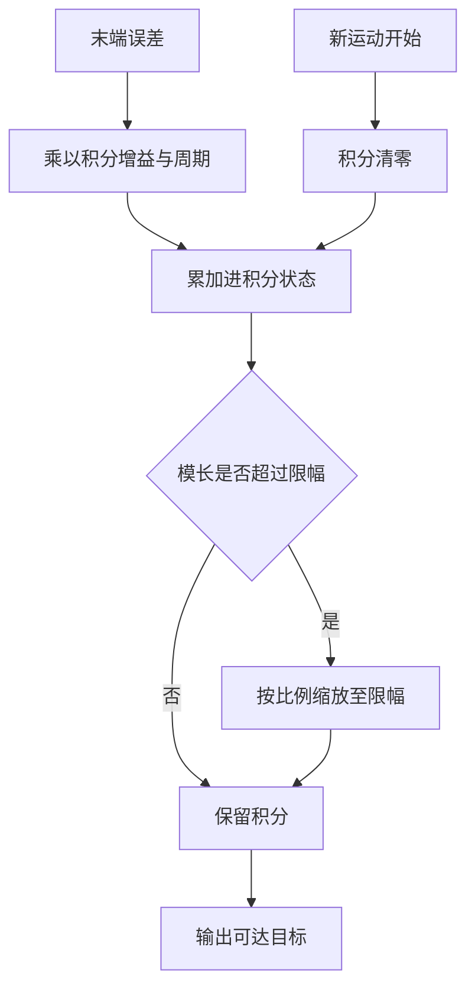
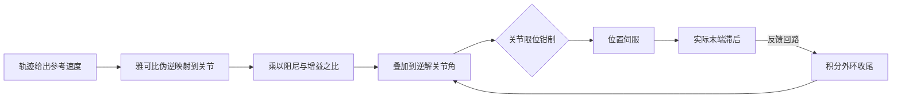

# 任务空间积分与速度前馈

伺服静差随位形和负载变化，写一个固定偏移量补上去，换个位形就不准；跟踪斜坡的速度滞后又与速度成比例，静态标定查不出来。这两类偏差都需要在运动过程中持续生成修正量，出发前算一次不够。修正量在哪里生成、由什么误差驱动、什么时候清零，决定了补偿是收敛还是自己来回摆。

下面先讲为什么把补偿放在任务空间，再给积分外环的方程与限幅，然后说明姿态修正必须与世界系误差同框，最后讲速度前馈的来源与它在接触段的取舍。

## 补偿量应当由误差在线生成

静差来自重力与阻尼，两者都与当前位形、当前负载有关，出发前无法知道确切值。在线生成修正有两条路：在关节空间对每个关节的位置误差积分，或在任务空间对末端位姿误差积分。

任务空间更合适，理由在误差的定义处。任务要求的是末端停在某个位姿，误差也应当在末端度量；关节空间积分虽然同样能消掉稳态偏差，但各关节误差的权重与末端偏差之间隔着雅可比，靠近奇异位形时关节上很小的修正会在末端放大，很难设定统一的限幅。

外环是慢反馈，内环是快伺服，两级的时间尺度要差一个量级以上才稳定。控制周期取 2 ms（500 Hz）时，外环的积分时间常数取到数百毫秒量级，内环仍按每个控制周期闭环。

## 积分外环的方程与限幅

任务空间误差由位置差与姿态差两部分组成：

$$e = \begin{bmatrix} p_{cmd} - p_{act} \\ \mathrm{rotvec}(q_{cmd} \otimes q_{act}^{-1}) \end{bmatrix}$$

积分更新写成

$$I \leftarrow \mathrm{clamp}\left(I + g_{i}\,\Delta t\, e\right)$$

其中 `g_i` 是积分增益，量纲为 1/s。修正后的目标是 `x_{goal} = x_{cmd} + I`，姿态部分再复合回参考姿态。

积分项必须限幅，原因与关节积分类似：误差大时积分持续累积，指令被顶到远处，等误差反号之后需要很长时间才能把积分拉回来，表现为过冲与来回摆动。几处细节要先定下来：

| 设计点 | 取值形态 | 理由 |
| --- | --- | --- |
| 分组限幅 | 平动与转动各自按模长钳制 | 两组量纲不同，不能共用阈值 |
| 限幅方式 | 超过时按比例缩放整组向量 | 保持修正方向，只压模长 |
| 每次运动复位 | 新的笛卡尔运动开始时清零 | 避免上一次动作的残留积分带进新目标 |
| 积分增益 | 明显低于伺服带宽 | 外环只负责慢变偏差，不与内环争响应 |

限幅阈值按任务允许的最大补偿量设定。平动取几厘米、转动取零点几弧度，对应执行器静差的量级；阈值过大等于允许外环把目标推出任务范围，过小则补偿不满。

## 姿态修正为什么要与世界系误差同框

姿态误差写成 `q_{cmd} \otimes q_{act}^{-1}`，这个量表达在参考姿态所对应的固定轴上，也就是世界系。积分出来的转动修正量 `I_{rot}` 是一个旋转向量，复合回目标时有两种写法：

$$q_{goal} = \exp(I_{rot}) \otimes q_{cmd} \qquad q_{goal} = q_{cmd} \otimes \exp(I_{rot})$$

左乘把修正叠加在世界系，右乘把它叠加在末端体坐标系。只有左乘与误差的来源同框。右乘的问题不在于收敛慢，而在于收敛到一个有偏差的固定点：参考姿态转动较大时，体坐标系下的修正轴被姿态旋转带走，积分会停在世界系误差不为零的位置。该模型上一段带姿态的轨迹因此残留约 0.22 rad，量级远大于姿态到位阈值。

这条规则可以推广：误差在哪个坐标系度量，修正就在同一个坐标系里施加。混合两个坐标系不会产生折中的结果，只会改变反馈的不动点。

| 写法 | 修正所在坐标系 | 与误差同框 | 结果 |
| --- | --- | --- | --- |
| 左乘 | 世界系，固定轴 | 是 | 误差可收敛到零 |
| 右乘 | 末端体坐标系 | 否 | 收敛到有偏差的固定点 |

## 速度前馈消掉的是可预见的部分

积分是反馈，只能等误差出现之后再修正，因此对持续移动的参考必然留有滞后。速度滞后可以预见：参考速度由轨迹给出，只要知道执行器的阻尼与位置增益之比，就能算出稳态偏差，并把等量的角度超前直接加到指令上：

$$q_{cmd} = q_{ik} + \frac{k_v}{k_p} J^{+} \begin{bmatrix} v_{ref} \\ \omega_{ref} \end{bmatrix}$$

这里 `J^{+}` 把参考笛卡尔速度映射成关节速度。前馈项不经过反馈回路，不改变闭环稳定性，只是在误差出现之前先补上。

| 做法 | 修正量来源 | 对速度滞后 | 对稳定性 |
| --- | --- | --- | --- |
| 只靠积分 | 已经发生的末端误差 | 能压小但总有残余 | 需要限幅与相位设计 |
| 只靠前馈 | 模型给出的参考速度 | 按模型精度抵消 | 不进入反馈，不改变闭环 |
| 前馈加积分 | 两者 | 残余由积分收尾 | 前馈量不准时积分兜底 |

系数从模型参数读出而不是写死，理由是执行器类型可能不同。位置执行器有阻尼与位置增益，换成力矩执行器之后这两个量不存在，前馈系数应当自动退化为零，而不是用一个历史常数继续偏移指令。前馈量叠加之后还要再钳一次关节限位，因为它已经离开运动学解的范围。

前馈在接触段要关掉。接触段的参考推进已经被限速到很慢，前馈项按自由空间的参考速度给出，会把参考继续推向接触面，收益不到一毫米，风险是接触力峰值上升。

## 常见判断偏差

| # | 判断偏差 | 表现 | 依据 |
| --- | --- | --- | --- |
| 1 | 用固定偏移补偿静差 | 换位形后偏差反向 | 静差随重力矩变化 |
| 2 | 积分不加限幅 | 目标过冲后来回摆 | 大误差期间积分持续累积 |
| 3 | 姿态修正用右乘 | 稳态存在固定姿态偏差 | 修正与误差不在同一坐标系 |
| 4 | 把前馈当成反馈调参 | 参数变化后偏差反弹 | 前馈依赖执行器模型参数 |
| 5 | 接触段保留速度前馈 | 首触力偏高 | 前馈把参考顶向接触面 |
| 6 | 跨动作复用积分状态 | 新动作起步就偏 | 上次动作的积分残留 |

## 小结

### 核心概念

- 静差与速度滞后都与当前状态有关，必须在线生成修正量，出发前标定不可靠。
- 任务空间积分以末端误差为驱动，限幅按平动与转动分组，每次运动开始复位。
- 姿态修正必须与世界系误差同框，右乘会收敛到有偏差的固定点。
- 速度前馈按阻尼与增益之比、参考速度给出超前量，抵消可预见的滞后。
- 前馈系数应当从模型参数读出，执行器类型不同时自动退化为零。

### 设计权衡

| 权衡点 | 常见选择 | 收益与代价 |
| --- | --- | --- |
| 补偿空间 | 任务空间，而不是关节空间 | 误差在任务处度量；代价是需要雅可比与姿态运算 |
| 积分增益 | 明显低于内环带宽 | 稳定；代价是收敛慢 |
| 限幅阈值 | 对齐任务允许的补偿量 | 能覆盖静差；代价是阈值需随任务调整 |
| 前馈的使用 | 自由段开启，接触段关闭 | 自由段快；代价是接触段靠限速而非超前 |

## 练习

### 基础题

1. 写出任务空间积分外环的更新式，说明两组限幅为什么不能共用一个阈值。
2. 姿态误差 `\mathrm{rotvec}(q_{cmd}\otimes q_{act}^{-1})` 表达在哪个坐标系，修正应当左乘还是右乘？
3. 速度前馈系数只依赖阻尼与位置增益之比，这一形式对执行器提了什么要求？
4. 为什么前馈叠加到关节指令后还要再钳一次关节限位？

### 挑战题

5. 设计一段带姿态变化的轨迹来验证修正与误差同框这条规则，写出判据与要观察的量。
6. 积分增益与限幅阈值应当如何配比？给出一个从任务允许偏差反推阈值的流程。
7. 设计一份外环复位的检查清单，覆盖动作切换、异常中止与参数变更三种情况。
8. 力矩执行器上读不到位置增益与阻尼时，前馈应当如何退化？给出替代方案与代价。

## 附：本页引用的路径

| 路径 | 用途 |
| --- | --- |
| `vlm_admittance/control/motion.py` | 积分外环、姿态左乘修正与前馈系数的实现 |
| `vlm_admittance/control/kinematics.py` | 雅可比与伪逆 |
| `vlm_admittance/core/types.py` | 柔顺参数与运动结果的数据契约 |
| `vlm_admittance/control/admittance.py` | 单步限幅与抗饱和的实现 |
| `vlm_admittance/core/config.py` | 默认柔顺档位与控制周期 |
