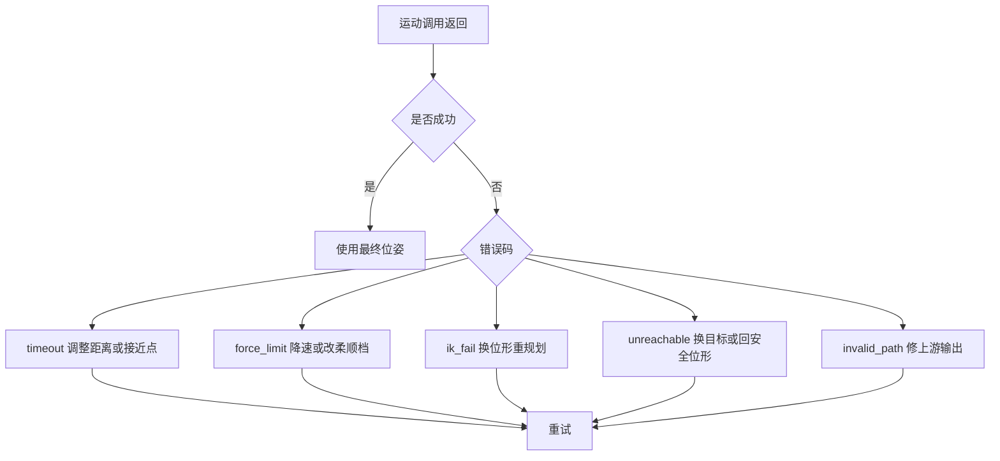
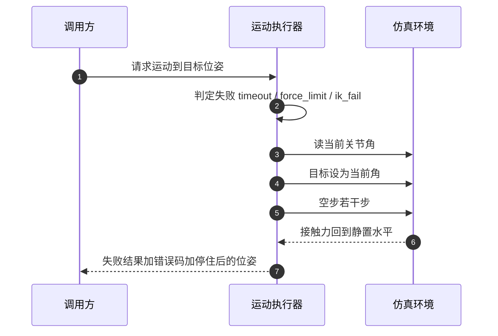
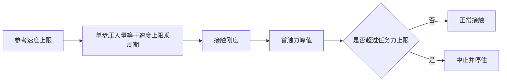

# 安全中止与错误语义

运动调用返回失败，调用方拿到一个错误码，然后决定下一步。这里有两件事容易被当成一件：返回失败与机械臂已经停下是两回事，一个错误码能否直接对应一个动作也是两回事。前者的反例是失败返回之后末端仍在往接触面里压，后者的反例是上层为了区分重试与放弃去解析错误信息的文本。

下面先看错误码的分类口径，再讲中止为什么必须包含一次真实的停住动作，然后说明力上限为什么要分任务层与硬保护层，最后给接触段单步压入量与首触力的关系。

## 错误码是一份决策表

错误码的价值在于把调用方的分支收敛成有限几种。按触发条件划分，一类常见分档如下：

| 错误码 | 触发条件 | 调用方应做 | 不应做 |
| --- | --- | --- | --- |
| timeout | 仿真时间超过预算 | 缩短距离或抬高接近点后重试 | 原样重发同一条指令 |
| force_limit | 接触力超过限值 | 降低接近速度或改柔顺档位 | 继续加压 |
| ik_fail | 执行中逆解失败 | 换位形后重新规划 | 在同一逆解上继续迭代 |
| unreachable | 出发前预检不可达 | 换目标或先回安全位形 | 进入运动流程 |
| invalid_path | 路径为空或格式非法 | 修上游规划输出 | 重试同一输入 |

分类的标准是调用方拿到它之后能否做出不同决定。两个错误码如果导出同一个动作，就该合并；一个错误码如果既可能是配置问题又可能是环境问题，调用方就只能靠猜。不可达与逆解失败分开，正因为前者能在动手之前判掉，后者只能发生在运动过程中。

错误码的集合本身是契约。新增一个码意味着调用方的分支要扩一支，已有的上层逻辑（连续失败计数、是否终止）都建立在同一组错误码语义稳定之上。接触这类到位但带接触的正常结束因此用结果字段表达，不占用错误码。

## 中止要包含一次真实的停住

把关节目标设回当前角度，再让仿真空走若干步，这才是一次有效的中止。只改控制量而不推进物理是不够的：旧的压入指令已经进入接触求解，接触的穿透深度会继续按旧值演化。让物理步继续推进，新的目标才会实际作用到接触上。

停住步数取一个短窗口，量级在几十毫秒。取零等于没有停住，取太长会挤占上层的时间预算。这几次空步不计入返回结果里的步数与时长，安全动作不参与任务预算的核算。

中止路径还有一条工程约束：它必须在任何情况下都能返回结果。清场过程本身可能遇到异常，例如读取状态失败，此时应当吞掉异常继续构造失败结果，而不是抛出去。抛出去会把可决策的失败变成不可分类的崩溃，上层的错误码逻辑全部失效。

失败返回同时给出停住后的实际位姿，而不是失败时的目标位姿。调用方需要知道机械臂此刻在哪里，才能决定下一步。

## 力上限要分两层

接触任务里的力上限有两个来源：任务层希望限制的力，和保护层不允许超过的力。二者目的不同，不该由同一个参数承担。

| 层次 | 作用 | 设定依据 | 超限行为 |
| --- | --- | --- | --- |
| 任务力上限 | 表达该动作允许的接触力 | 物体强度、任务需要 | 返回 force_limit，停止推进 |
| 硬保护上限 | 防止传入过大的值 | 关节力矩、结构强度、物体质量 | 钳制到上限并告警 |

硬保护的意义在于不依赖调用方自律。任务参数由上层给出，可能来自配置、来自模型决策，或者来自一次参数实验，任何一处写错都可能让接触力目标落到危险量级。执行器在收到显式力上限时先过一遍硬上限，超过就钳到边界并给出告警，同时保留一个显式关闭的口子给确知风险的场景。

硬上限的量级由物理约束决定。末端力经雅可比映射到关节力矩，几百牛的接触力对应的关节力矩已经接近或超过额定值；另一方面，刚性接触下几十牛的力就足以把轻物体弹开。两百牛量级作为保护边界，对应的是结构还能承受但任务已经失败的位置，而不是任务允许的力的量级。

| 参考量 | 量级 | 与上限的关系 |
| --- | --- | --- |
| 轻物体抓取允许的接触力 | 几牛到十几牛 | 由任务力上限与调速共同保证 |
| 刚性接触失控时的峰值 | 百牛以上 | 硬上限要拦住的对象 |
| 保护边界 | 两百牛量级 | 结构可承受与任务已失败之间的折中 |

## 接触段的单步压入量决定首触力

力上限是事后保护，触发时接触已经发生。要在接触前控制力峰值，可调的量是参考点每一步前进多远。把参考推进改成按速度限幅之后，单步位移等于速度上限乘以控制周期：

| 参考速度上限 | 单步压入量（2 ms 周期） | 首触力量级（刚性面） |
| --- | --- | --- |
| 不限速 | 由时间律决定，毫米级 | 百牛量级 |
| 0.016 m/s | 32 µm | 几十牛 |
| 0.008 m/s | 16 µm | 十几牛 |
| 0.004 m/s | 8 µm | 几牛 |
| 0.002 m/s | 4 µm | 几牛 |

数据形态说明两点。第一，首触力与单步压入量近似成正比，这就是把力峰值换算成速度上限的依据。第二，单步压入量小到一定程度后，首触力不再随速度单调下降：接触恰好落在哪一控制步开始变得重要，同一速度在不同初始高度下会给出相差几牛的结果。要在刚性面上稳定停在几牛，速度上限要取到 0.002 m/s 量级，再往下调，收益被离散相位淹没。

限速模式同时关闭速度前馈，因为前馈是按自由空间速度量级算出的超前项，在接触段会把参考继续顶向接触面。

## 中止之后的结果字段

失败结果除了错误码，还应带上停住位置、本次运动的最大接触力与已消耗的仿真时间。这些字段属于上层的决策输入，不当作日志使用：停住位置决定下一步往哪里走，最大接触力决定要不要降低速度上限，仿真时间决定剩余预算还能不能完成当前子目标。

成功路径同样需要区分两种结束：到位结束与接触即停结束。后者是接触任务里正常的一类结局，机械臂按预期接触物体后停下，错误码为空，只用一个结束原因字段与附加指标说明停止时的力与位置。把它塞进错误码会让上层把正常接触当成失败，进而触发不必要的重试。

| 字段 | 失败时 | 接触即停时 |
| --- | --- | --- |
| 结束标志 | 失败 | 成功 |
| 错误码 | 五个码之一 | 空 |
| 结束原因 | 无 | 接触 |
| 停住位置 | 停住后的实际位姿 | 触发接触时的位姿 |
| 力指标 | 峰值 | 触发时的力 |

## 常见判断偏差

| # | 判断偏差 | 表现 | 依据 |
| --- | --- | --- | --- |
| 1 | 认为返回失败就等于停住 | 失败后末端仍在压 | 只改目标不推进物理，接触按旧穿透演化 |
| 2 | 用力上限代替调速 | 触发时已经超限 | 上限是事后保护 |
| 3 | 靠错误文本区分处理方式 | 上层分支散落各处 | 错误码才是稳定契约 |
| 4 | 认为硬上限多余 | 一次参数写错就压到危险量级 | 任务参数由上层给出，不能全信 |
| 5 | 限速之后继续加前馈 | 首触力偏高 | 前馈把参考顶向接触面 |
| 6 | 把停住步数计入任务预算 | 上层超时提前触发 | 安全动作不参与任务核算 |

## 小结

### 核心概念

- 错误码按调用方能做出什么决定分类，导出同一动作的码应当合并。
- 中止等于把目标设回当前关节角并空走若干物理步，只改控制量不足以停住。
- 中止路径必须总能返回结果，清场异常不应升级为崩溃。
- 力上限分任务层与硬保护层，后者用于拦住传入的过大值。
- 接触段的力峰值主要由单步压入量决定，单步压入量等于速度上限乘控制周期。
- 单步压入量小到控制步相位量级后，首触力不再随速度单调下降。

### 设计权衡

| 权衡点 | 常见选择 | 收益与代价 |
| --- | --- | --- |
| 错误码粒度 | 按决策分支划分 | 上层逻辑简单；代价是码表需要维护契约 |
| 停住步数 | 几十毫秒的短窗口 | 真停住且不挤占预算；代价是失败返回多花一点时间 |
| 力上限 | 任务层加硬保护两层 | 灵活且不可越界；代价是两类参数的含义需要区分 |
| 接触段策略 | 限速，而不是加大前馈 | 力峰值可控；代价是接触段更慢 |
| 结束原因 | 成功结果里区分到位与接触 | 正常接触不被误判；代价是结果字段需要扩一档 |

## 练习

### 基础题

1. 列出五个错误码，并说明每个码对应的不同处置动作。
2. 为什么只把关节目标设回当前角而不推进仿真，不能算停住？
3. 任务力上限与硬保护上限解决的是哪两个不同问题？
4. 参考速度上限 0.004 m/s、控制周期 2 ms 时，单步压入量是多少？

### 挑战题

5. 为一条接触下降任务设计错误码分类表，要求每个码能导出唯一处置。
6. 设计一份中止路径检查清单，覆盖清场异常、状态读取失败与预算统计三种情况。
7. 给定物体强度与末端力允许值，推导速度上限的选取流程，说明每一步需要哪些量。
8. 说明为什么首触力在低速下不再单调，并设计一个实验方案确认这一现象对参数选择的影响。

## 附：本页引用的路径

| 路径 | 用途 |
| --- | --- |
| `vlm_admittance/control/motion.py` | 错误码、中止停住、力上限解析与参考限速的实现 |
| `vlm_admittance/core/types.py` | 运动结果的错误码与结束原因字段 |
| `vlm_admittance/core/config.py` | 柔顺档位与力上限默认值 |
| `vlm_admittance/skills/library.py` | 技能层对错误码的处置与降级路径 |
| `vlm_admittance/agent/schema.py` | 错误码对应的重试提示 |
| `vlm_admittance/control/smoke.py` | 中止与限速行为的自检入口 |
