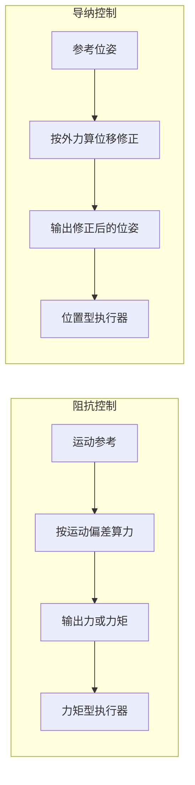
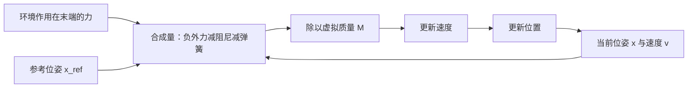

# 为什么接触任务要柔顺

机械臂在自由空间里跟踪一条轨迹，位置误差通常在毫米量级；同一个控制器把末端压向桌面，同样的毫米级偏差会变成几十牛的接触力。接触任务的第一个设计问题就在这里：末端与环境之间建立的是位置与力互相约束的关系，只命令位置就无法表达"允许多大接触力"。

下面先看纯位置控制在接触环境里放大了什么，再讲阻抗与导纳两条实现路线的分工，最后落到导纳方程本身：它由哪几项组成、六维语义如何定义、支撑这种写法的假设与边界在哪里。

## 位置控制在接触环境里放大了什么

位置控制器只做一件事：把实际位姿驱动到命令位姿。自由空间里这是一条单边关系；末端一旦抵住环境，命令位姿继续往环境内部推进时，环境会用自身刚度把末端顶回来。穿透深度 $\delta$ 与接触力 $f$ 的关系由环境刚度 $k_{env}$ 决定：

$$f = k_{env}\,\delta$$

环境刚度取决于接触对象。桌面、金属夹具一类刚性表面的 $k_{env}$ 通常在 $10^3$ 到 $10^4\ \mathrm{N/m}$ 量级。位置伺服自身又存在厘米量级的稳态残差：执行器是纯 PD，没有重力补偿，位形变化会让末端静沉若干毫米到一厘米。两件事叠在一起，量级关系立刻变得不利：

| 位置残差 | 环境刚度 | 接触力量级 |
| --- | --- | --- |
| 1 mm | $10^3$ N/m | 1 N |
| 10 mm | $10^3$ N/m | 10 N |
| 10 mm | $5\times10^3$ N/m | 50 N |
| 10 mm | $10^4$ N/m | 100 N |

自由空间里十毫米的残差只是精度问题，接触面上同一量级的残差会把力推到百牛量级。位置控制器没有可调的力矩输出，也没有"接触即止"的判据，它的唯一目标是继续压缩位置误差，于是穿透越深、力越大，直到执行器饱和或工件损坏。

接触任务因此需要一个额外的自由度：让位置随外力调整。这个自由度就是柔顺。

## 阻抗与导纳是对偶的两条路

柔顺控制有两条主流实现路线，它们的输入输出方向相反。

阻抗控制把末端当作一个虚拟阻抗。给定运动参考，控制器根据实际运动与参考的偏差算出应当输出的力或力矩，再由底层去实现这个力。它适合力矩可控的执行器，需要关节力矩接口或末端力闭环，控制量本身就是力。

导纳控制反过来：控制器读到的外力送入一个二阶模型，输出位置或速度的修正量，再交给位置伺服执行。它适合只能接受位置指令的执行器，控制量是位移。

| 维度 | 阻抗控制 | 导纳控制 |
| --- | --- | --- |
| 输入 | 运动参考与实际运动 | 实际力与力矩 |
| 输出 | 力或力矩指令 | 位置或速度修正 |
| 依赖的底层能力 | 力矩接口或力闭环 | 力感知、位置接口接受修正 |
| 适用执行器 | 力矩控制型 | 位置控制型 |
| 主要失效模式 | 环境刚度估计不准，出力偏差 | 力噪声直接进入位置环 |

选择哪一条，取决于执行器与传感的既有条件。位置接口加末端力传感的组合下，导纳控制的改动面最小：位置伺服、逆解、轨迹跟踪都可以原样保留，只是在参考与命令之间插入一个由力驱动的修正环节。



## 导纳方程的物理含义

导纳控制的被控对象是一个虚拟的二阶系统，方程写成：

$$M\ddot{x} + D\dot{x} + K\,(x - x_{ref}) = -f_{ext}$$

$x$ 是末端当前位姿，$x_{ref}$ 是轨迹给出的参考位姿，$f_{ext}$ 是环境作用在末端上的力旋量。三项分别是虚拟质量、虚拟阻尼与虚拟弹簧。外力为零时 $x$ 收敛到 $x_{ref}$；外力不为零时，弹簧被压缩或拉伸，末端偏离参考。

方程右侧的符号是一条设计约定：$f_{ext}$ 定义为外界施加在末端上的力，因此右侧取负号，代表末端会被力推离参考。读数语义换一种定义（例如取"末端作用在环境上的力"），符号就要跟着调整，否则让位方向会反向。

稳态时速度与加速度为零，位移与力的关系退化为弹簧公式：

$$x - x_{ref} = -\frac{f_{ext}}{K}$$

这条关系说明柔顺程度由 $K$ 单独决定：外力一定时，刚度越大、让位越小。它也说明柔顺无法用"是否让位"来描述，只能用"在外力下让位多少"来描述。

离散实现里这三项以同样顺序出现，下面的片段只截取加速度计算部分：

```python
# 使能轴上的加速度由外力、阻尼项与弹簧项合成
acc = (-f_ext - d * v - k * (x - x_ref)) / m
v_next = v + dt * acc
x_next = x + dt * v_next
```



## 六维语义与解耦假设

导纳状态量是六维向量，顺序为位置三维加旋转向量三维，外力旋量同样是六维，顺序为力三维加力矩三维。旋转部分用旋转向量而不是欧拉角，原因是旋转向量没有万向锁，方向即转轴、模长即转角，与"沿某轴让位多少"的直觉一致。

| 分量 | 含义 | 单位 | 典型任务需求 |
| --- | --- | --- | --- |
| 前三维 | 末端位置 | m | 接触方向上的让位 |
| 后三维 | 末端姿态 | rad | 表面贴合、侧向推进 |

六个轴各自持有独立的刚度、阻尼与质量，方程按轴解算。这等于假设各轴之间没有耦合惯量与科氏项，属于工程近似。接触任务中大量场景是单轴压缩或单轴推进，忽略耦合带来的误差远小于参数本身的量级；换成需要大范围姿态变化的场景，这个假设就不成立。

转动通道还面临一个表示问题。绝对旋转向量在转角接近 $\pi$ 时模长接近 $\pi$、方向对姿态极其敏感，直接把它当状态量会出现跳变。常见的做法是让转动通道只表达相对增量：参考的转动部分取零，输出的转动修正再叠回命令姿态。线性方程对绝对量与增量都成立，增量表达只是把数值敏感区间绕开。

## 柔顺的代价与边界

柔顺换来的是力可控，付出的是位置精度与响应速度。

| 特性 | 刚性位置控制 | 柔顺控制 |
| --- | --- | --- |
| 稳态位置精度 | 高，误差只来自伺服 | 外力下按 $f/K$ 偏移 |
| 接触力 | 不可控，由穿透深度决定 | 可由参数设计到目标量级 |
| 响应速度 | 快，直接跟踪参考 | 需要时间让虚拟弹簧被压缩 |
| 对外部干扰 | 一律抵抗，可能激发大力 | 让位吸收，可能偏离目标 |
| 适用阶段 | 自由空间、需要精确到点 | 接触、抓取、放置、脱身 |

这张表指向一个直接的设计结论：柔顺应当按任务阶段启用，而不是整个任务一套参数。自由段保持刚性以免无谓的跟踪误差，接触段切到柔顺以免接触力失控。档位机制就是把这件事固定下来，细节见同单元《柔顺参数怎么定》。

边界也要说清。导纳模型的参数化程度有限，它无法表达各轴耦合、无法描述摩擦与迟滞，力读数噪声会直接进入位置修正。柔顺是一种把力约束转成位移约束的近似手段，它降低了接触任务的峰值力，但既不测量接触力本身，也不保证接触稳定。

## 常见判断偏差

| # | 判断偏差 | 表现 | 依据 |
| --- | --- | --- | --- |
| 1 | 把柔顺等同于变软变慢 | 认为柔顺就是降低增益 | 柔顺改变的是力与位移的对应关系，可定量设计 |
| 2 | 把阻抗与导纳混用 | 按实现选型时接口对不上 | 两者输入输出相反，依赖的底层能力不同 |
| 3 | 认为让位方向由刚度决定 | 调试时反复改 K | 方向由方程右侧的力符号约定决定，K 只决定大小 |
| 4 | 自由空间也开柔顺 | 轨迹跟踪出现无谓偏移 | 无外力时柔顺档只是更慢的位置控制 |
| 5 | 认为六维模型真的解耦 | 大姿态变化下行为不符预期 | 按轴独立参数是线性近似 |
| 6 | 把力阈值当成柔顺度 | 想"轻一点"就调低阈值 | 阈值是安全线，柔顺度由 K 决定 |

## 小结

### 核心概念

- 位置控制在接触面上的力由穿透深度与环境刚度共同决定，厘米级残差足以产生百牛量级的力。
- 阻抗与导纳是对偶路线：前者由运动算力，后者由力算位移；位置接口加力传感的组合通常选导纳。
- 导纳方程是虚拟质量、阻尼、弹簧的组合，稳态让位量等于外力除以刚度。
- 六维状态按位置加旋转向量表达，各轴独立参数属于线性近似。
- 柔顺按任务阶段启用：自由段刚性保证精度，接触段柔顺限制力。
- 导纳不测量力、不保证接触稳定，它把力约束近似转成位移约束。

### 设计权衡

| 权衡点 | 常见选择 | 收益与代价 |
| --- | --- | --- |
| 实现路线 | 位置接口选导纳，力矩接口选阻抗 | 导纳改动面小；代价是力噪声进入位置环 |
| 刚度大小 | 按允许让位量反推 | 刚度高精度好；代价是同样外力下力更大 |
| 旋转通道表达 | 用相对增量而非绝对值 | 绕开 $\pi$ 附近的数值敏感；代价是调用处要负责叠加 |
| 参数粒度 | 每轴独立 | 表达灵活；代价是忽略轴间耦合 |
| 启用阶段 | 接触段柔顺、自由段刚性 | 兼顾精度与安全；代价是阶段切换要明确 |

## 练习

### 基础题

1. 环境刚度为 $2000\ \mathrm{N/m}$、位置残差为 5 mm 时，接触力大约是多大？
2. 写出导纳方程的稳态关系，并说明外力固定时让位量与刚度的关系。
3. 阻抗控制与导纳控制各自的输入与输出分别是什么？
4. 六维导纳状态量里，旋转部分为什么用旋转向量而不用欧拉角？

### 挑战题

5. 给定"允许在 5 N 外力下让位不超过 10 mm"，设计一个刚度取值，并说明依据。
6. 为一个"先自由移动、再接触放置"的任务设计阶段划分：每个阶段用刚性还是柔顺、依据是什么。
7. 力读数存在噪声且自由空间读数接近零，设计一条判据区分"真的接触"与"噪声"，写出阈值来源。
8. 如果执行器换成力矩控制型，导纳与阻抗两条路线的改动面分别在哪里？列出检查清单。

## 附：本页引用的路径

| 路径 | 用途 |
| --- | --- |
| `control/admittance.py` | 导纳方程、六维状态与离散更新 |
| `core/types.py` | 六维柔顺参数的数据结构 |
| `control/motion.py` | 导纳环节接入轨迹执行的位置 |
| `INTERFACES.md` | 六维语义与方程的冻结约定 |
