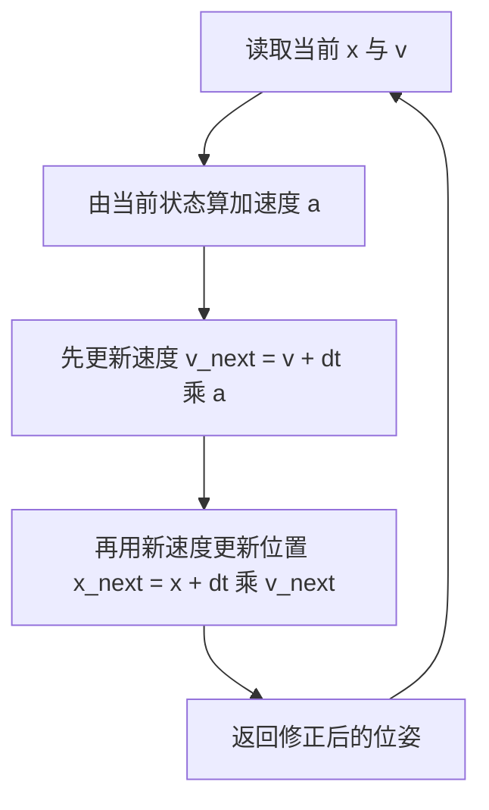
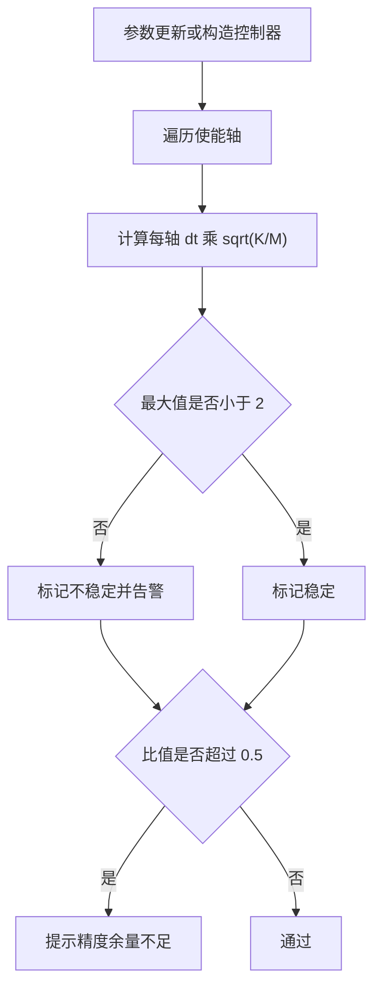

# 离散化与稳定性

导纳方程写在纸面上是连续的，控制器每个周期却只跑一次加减乘除。离散方式决定了同样的刚度与步长下系统是否收敛：步长相对固有频率偏大时，位置会逐步放大，而放大发生在接触段意味着力失控。这是数值实现本身的设计问题，与参数选得好不好无关。

下面先看连续方程为什么必须逐周期求解，再比较显式欧拉与半隐式欧拉在无阻尼弹簧上的差别，把稳定条件推出来，然后讲这个条件怎么用，最后是单步限幅与抗饱和。

## 连续方程为什么逐周期求解

连续方程的一般解由指数项与特解组成，形式上不难写；难在参数每个周期都在变：参考位姿由轨迹采样给出，外力读数每步更新，$x_{ref}$ 与 $f_{ext}$ 都不是常量。解析解要每周期重算系数与指数，代价高且形式复杂。

离散递推换掉了这件事：把导纳看成状态机，状态只有位置与速度，每周期做固定次数的乘加即可推进。这个选择带来三条设计约束，后续小节都在处理它们。

- 单步代价固定且可预测，适合放进实时控制环。
- 稳定性由步长与刚度共同决定，必须在参数校验里体现。
- 数值上要防止单步修正过大，否则接触瞬间会出现尖峰。

## 显式欧拉为什么会失稳

显式欧拉把新状态完全用旧状态表示：先把位置按旧速度推进，再用旧位置算加速度更新速度。

$$x_{k+1} = x_k + dt\,v_k, \qquad v_{k+1} = v_k - dt\,w^2 x_k, \qquad w = \sqrt{K/M}$$

把速度消掉可以得到位置的三项递推。由 $v_k = (x_{k+1} - x_k)/dt$ 与速度的更新式联立：

$$x_{k+1} - 2x_k + \big(1 + (dt\,w)^2\big)x_{k-1} = 0$$

特征方程为 $L^2 - 2L + (1 + (dt\,w)^2) = 0$，两根为 $L = 1 \pm i\,dt\,w$，模长等于：

$$|L| = \sqrt{1 + (dt\,w)^2}$$

模长恒大于 1。无阻尼弹簧在显式欧拉下每步都会放大，放大倍数只与 $dt\,w$ 有关，缩小步长只能减慢放大速度：

| $dt\,w$ | 每步放大 | 1000 步后的量级 |
| --- | --- | --- |
| 0.001 | 1.0000005 | 1.0005 倍 |
| 0.01 | 1.00005 | 1.05 倍 |
| 0.1 | 1.005 | 约 150 倍 |

阻尼项能压低放大倍数，但无阻尼或弱阻尼的接触过程正是需要注意的情形。这条结论说明显式欧拉不适合直接用于刚性弹簧的在线积分。

## 半隐式欧拉：先速度后位置

半隐式（symplectic）欧拉只改一处顺序：位置使用更新后的速度，其余不变。

$$a_k = \frac{-f_{ext} - D v_k - K(x_k - x_{ref})}{M}, \qquad v_{k+1} = v_k + dt\,a_k, \qquad x_{k+1} = x_k + dt\,v_{k+1}$$

这一处顺序改变让无阻尼情形重新变得有界。用同样的消元办法，由 $v_k = (x_k - x_{k-1})/dt$ 与 $v_{k+1} = v_k - dt\,w^2 x_k$ 得到：

$$x_{k+1} - \big(2 - (dt\,w)^2\big)x_k + x_{k-1} = 0$$

特征方程为 $L^2 - (2 - (dt\,w)^2)L + 1 = 0$，两根之积为 1。根落在单位圆内等价于 $|2 - (dt\,w)^2| \le 2$，也就是：

$$dt \cdot \sqrt{\frac{K}{M}} < 2$$

几何上可以把这件事看成位置用的是区间中点的速度近似：半步的相位修正把显式欧拉向外发散的能量转成在相空间里沿等能线绕行。代价是一阶精度没有提高，精度仍然是步长的一次方，好处是稳定性边界从"任意步长都发散"变成了一条明确的有限边界。



## 稳定条件怎么用

实现里通常不直接判断步长，而是算一个无量纲比值：$dt\sqrt{K/M}$，在六个使能轴里取最大值。原因是最硬的轴决定整体稳定性。

边界 2 是发散边界，实际取值要留余量。常见口径是把比值控制在 0.5 以内，相当于把离散频率保持为系统固有频率的十几倍，离散误差与参数漂移都不会把系统推过边界。按这个口径检查几组参数：

| $dt$ | $K$ | $M$ | $dt\sqrt{K/M}$ | 判断 |
| --- | --- | --- | --- | --- |
| 0.002 s | 5000 | 5 | 0.063 | 余量充足 |
| 0.002 s | 300 | 2 | 0.025 | 余量充足 |
| 0.002 s | 200 | 1.5 | 0.023 | 余量充足 |
| 0.002 s | $10^6$ | 0.1 | 6.3 | 超过边界，会发散 |

比值随刚度的平方根增长、随虚拟质量的平方根减小，所以"调高刚度"和"调小质量"都会同时吃掉稳定裕度。整定时把这两个量一起看，只调一个容易在其它工况下越过边界。

超限时的处置方式也是一个设计决定。控制环里抛异常会打断正在执行的动作；更稳妥的做法是记录并警告，让上层决定是否继续，同时保留单步限幅作为最后一道防线。这样参数写错不会让系统静默发散，也不会让一次参数错误直接终止任务。



## 单步限幅与抗饱和

限幅处理的是另一种失效：稳定性条件只能保证长期不发散，保证不了单步修正的幅度。接触瞬间外力可能在一步之内从零跳到很大，按这一帧的力算出的位移修正可能远超合理范围，直接把末端甩出去。

限幅按平动组与转动组分别取修正向量的模长，超过阈值就整组等比缩放。整组缩放而不是逐轴截断，是为了保持修正方向不变；逐轴截断会让修正方向偏转，接触中的方向错误比幅度错误更难排查。两组阈值量级不同是量纲决定的：平动是米、转动是弧度，允许的单步变化量不同。

限幅之后还有一步容易被忽略：把速度按实际位移回算。若速度继续按未限幅的加速度累积，位置被限制在原地，速度却越来越大，离开接触时这部分能量一次性释放，表现为弹开。回算相当于在位移受限时同步限制速度，是积分抗饱和在位移层的对应做法。

```python
# 按组取模长，超限则整组等比缩放，再按实际位移回算速度
norm = float(np.linalg.norm(delta[group]))
if norm > limit:
    delta[group] *= limit / norm
velocity[group] = delta[group] / dt
```

限幅的代价是大偏差下收敛变慢。自由空间里误差通常很小，这个代价不明显；接触附近希望末端走得慢，限幅方向与需求一致。这也是为什么限幅阈值按组给出、而不是按误差大小自适应。

## 数值防护的最小集合

除了积分方式与限幅，实现还需要几处输入防护。它们不影响控制效果，但决定异常输入下的行为是可预测还是崩溃。

| 防护 | 面向的问题 | 不做的后果 |
| --- | --- | --- |
| 校验步长为正 | 参数误填零或负数 | 除零或时间倒流 |
| 力旋量补齐到六维 | 上游只给三个力分量 | 维度不匹配报错 |
| 非有限值归零 | 传感异常产生 NaN 或 Inf | 一次污染永久扩散 |
| 非使能轴直接跟随参考 | 关闭的轴仍参与积分 | 关闭轴漂移 |
| 虚拟质量非正时退化为跟随 | 参数配置非法 | 除零 |

最后一处的处理方式需要单独说明：使能标志打开但虚拟质量为零时，正确做法是判为配置非法并退化为纯位置跟随，同时给出提示，而不是让除零产生非有限值。退化保证了控制环继续运行，提示保证了问题不会被掩盖。

## 常见判断偏差

| # | 判断偏差 | 表现 | 依据 |
| --- | --- | --- | --- |
| 1 | 认为缩小步长总能解决发散 | 缩小后仍在增长 | 显式欧拉在无阻尼弹簧上任意步长都放大 |
| 2 | 把稳定性边界记成 1 | 参数取在 1 到 2 之间时误判为不安全 | 半隐式欧拉边界是 2 |
| 3 | 只按一个轴检查稳定比值 | 其它更硬的轴越界 | 取所有使能轴的最大值 |
| 4 | 限幅后不回算速度 | 离开接触时弹开 | 速度按未限幅加速度累积 |
| 5 | 逐轴截断修正量 | 让位方向发生偏转 | 整组缩放才能保方向 |
| 6 | 参数非法时直接抛异常 | 正在执行的动作被打断 | 警告加退化更可控 |

## 小结

### 核心概念

- 连续方程因参考与外力逐步变化而采用逐周期递推，单步代价固定。
- 显式欧拉在无阻尼弹簧上的放大因子为 $\sqrt{1+(dt\,w)^2}$，任意步长都会放大。
- 半隐式欧拉先用旧状态算加速度、再用新速度更新位置，把稳定条件变成 $dt\sqrt{K/M}<2$。
- 稳定比值取所有使能轴的最大值，工程上常控制在 0.5 以内留精度余量。
- 单步限幅按组缩放以保持修正方向，限幅后必须按实际位移回算速度。
- 异常输入的处置目标是让行为可预测：补齐维度、归零非有限值、非法参数退化。

### 设计权衡

| 权衡点 | 常见选择 | 收益与代价 |
| --- | --- | --- |
| 积分方式 | 半隐式欧拉 | 稳定边界明确；代价是精度仍为一阶 |
| 稳定比值上限 | 0.5 而非边界 2 | 留参数漂移余量；代价是允许的刚度上限降低 |
| 超限处置 | 告警加退化，不中断 | 控制环稳定；代价是问题可能被忽略 |
| 单步限幅 | 按组取模长缩放 | 方向正确；代价是大偏差收敛变慢 |
| 抗饱和 | 限幅后回算速度 | 离开接触不弹开；代价是限幅时速度也被压缩 |

## 练习

### 基础题

1. 写出半隐式欧拉的三行更新式，并指出与显式欧拉的顺序差别。
2. 推导无阻尼情形下显式欧拉的放大因子，说明它与步长的关系。
3. 计算 $dt = 0.002$、$K = 1000$、$M = 4$ 时的稳定比值，并判断是否在常用上限内。
4. 限幅之后为什么要把速度改成位移除以步长？

### 挑战题

5. 设计一个参数校验流程：给定 $dt$ 与一组 $K/M$，判断是否可用，并给出超限时的处置选项。
6. 一个控制器需要在 1 kHz 与 500 Hz 两种步长下工作，设计稳定比值上限的取值规则与理由。
7. 为单步限幅设计一组按任务阶段变化的阈值，说明自由段与接触段的差别。
8. 如果力读数在一步内出现尖峰，设计一条从读数到修正量的完整过滤路径，并说明每级的作用。

## 附：本页引用的路径

| 路径 | 用途 |
| --- | --- |
| `control/admittance.py` | 半隐式欧拉、稳定比值与单步限幅 |
| `core/types.py` | 刚度、阻尼、质量三个六维向量 |
| `core/config.py` | 仿真步长这一离散基准 |
| `control/motion.py` | 控制器与控制环的步长一致性 |
