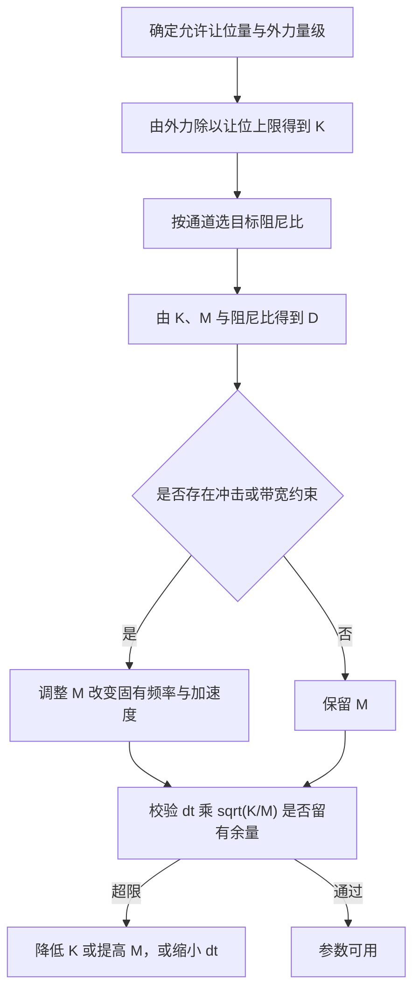
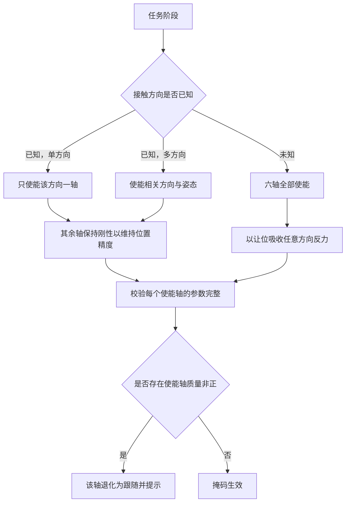

# 柔顺参数怎么定

导纳方程定下来之后，剩下的问题是六个轴上的刚度、阻尼与虚拟质量取多少，以及哪些轴参与。这些参数直接决定两件事：同样的外力下末端让位多少、让位过程有没有振荡。整定可以按"先满足稳态、再约束动态、最后校验数值边界"的顺序做，而不是在三个量之间反复试凑。

下面先从刚度与稳态让位的关系讲起，再引入阻尼比这个无量纲量，然后说明虚拟质量如何影响带宽与冲击，接着是轴掩码与档位的组织方式。

## 刚度决定稳态让位量

稳态时外力与让位量的关系只有刚度参与：

$$\Delta x = \frac{f}{K}$$

因此刚度的选择可以直接从需求反推：给定最大外力与允许的让位上限，$K$ 不小于外力除以让位上限。下表按 5 N 外力列出量级关系，用来说明选择依据。

| 刚度 $K$ | 5 N 外力下的让位 | 适用倾向 |
| --- | --- | --- |
| 100 N/m | 50 mm | 极软，仅用于大行程退让 |
| 200 N/m | 25 mm | 吸收毫米级几何误差，位置会明显偏移 |
| 500 N/m | 10 mm | 中等，兼顾精度与缓冲 |
| 1000 N/m | 5 mm | 偏硬，位置精度优先 |
| 5000 N/m | 1 mm | 近刚性，接触力几乎全靠位移控制 |

刚度同时决定接触力：外力相同时，刚度越大让位越小，系统对位置误差越不宽容。抓取与放置这类任务需要的刚度通常在几百 N/m 量级，既能把毫米级几何误差吸收掉，又不会让末端在自重下明显下沉。

## 阻尼比：把动态形状缩成一个无量纲量

刚度只回答"最终停在哪里"，回答不了"怎么到那里"。二阶系统的动态由两个量描述：固有频率与阻尼比。对导纳方程，两者分别是：

$$\omega_n = \sqrt{\frac{K}{M}}, \qquad \zeta = \frac{D}{2\sqrt{KM}}$$

阻尼比是无量纲量，它单独决定响应形状，与具体参数无关：

| 阻尼比 | 响应形状 | 适用倾向 |
| --- | --- | --- |
| 小于 1 | 欠阻尼，有超调与振荡 | 需要较快响应且能接受少量超调 |
| 等于 1 | 临界阻尼 | 无超调且最快收敛 |
| 大于 1 | 过阻尼，无超调但慢 | 不希望任何振荡的通道 |

给定 $K$、$M$ 与目标阻尼比，阻尼由 $D = 2\zeta\sqrt{KM}$ 反推。这比直接给 $D$ 更好控制：同样的 $D$ 在不同刚度下对应的响应形状完全不同，按阻尼比指定则形状可以预期。

项目里的参数在量级上体现了按通道分别取阻尼比的思路：平动通道的阻尼比大致落在 0.6 到 0.7，略欠阻尼，收敛快且超调有限；姿态通道取到 1 以上，过阻尼，避免姿态来回摆。接触中的姿态振荡比位置振荡更难处理，因为姿态误差会改变接触点的分布。

## 虚拟质量影响带宽与冲击

虚拟质量不出现在稳态关系里，它只影响动态。$M$ 越小、固有频率越高，系统对力的变化响应越快；$M$ 越大、固有频率越低，同样的力产生的加速度越小，接触瞬间的冲击越缓和。

$M$ 还直接进入稳定条件 $dt\sqrt{K/M}<2$。在固定步长下，$K/M$ 存在上限：想要高刚度又想要小质量，就要缩小步长；步长受物理仿真与计算预算约束时，只能降低刚度或提高质量。

三个量的分工因此可以这样概括：

| 参数 | 决定 | 整定顺序 |
| --- | --- | --- |
| $K$ | 稳态让位量、刚硬程度 | 由允许让位反推，最先定 |
| $\zeta$ 或 $D$ | 超调与收敛形状 | 按通道需求指定，其次 |
| $M$ | 带宽、加速度上限、稳定比值 | 兼顾冲击与步长，最后定 |



## 轴掩码表达任务需求

六个轴可以独立启用或关闭。关闭的轴不参与导纳，每步精确跟随参考，等价于刚性位置控制。因此轴掩码回答的是"哪些方向允许被推动"，与"多软"无关；它与刚度、阻尼、质量是正交的两件事。

| 任务阶段 | 需要柔顺的轴 | 依据 |
| --- | --- | --- |
| 自由空间移动 | 无，全部关闭 | 任何让位都表现为跟踪误差 |
| 抓取下降 | 接近方向一轴 | 水平位置决定夹持对准，不能漂 |
| 侧向推进 | 推进方向与姿态 | 接触方向不确定，硬顶会产生大力 |
| 放置下降 | 重力方向一轴 | 高度误差由接触吸收，水平位置要保持 |
| 卡滞脱身 | 六轴全开 | 卡滞反力方向未知 |

抓取下降只让接近方向柔顺，是一个典型的取舍。水平方向若也参与导纳，接触反力会把末端推横，指垫相对工件的位置随之偏移，夹持点落在工件边缘而不是中心。侧向推进则相反：只在重力方向柔顺时，推进方向上没有可让位通道，一旦提前接触就是硬顶，接触力直接由推进速度与位置误差决定。掩码要跟着接触方向走。

掩码还有一种退化情形要处理：标志打开但虚拟质量为非正时，该轴不能参与积分。正确做法是判为配置非法、退化为跟随并给出提示，避免除零，也避免一个错误的参数让整段动作失控。



## 档位：把参数集命名化

单轴参数定好之后，需要把它们组织成可以在任务里切换的单位。档位就是一组命名好的完整参数：六个轴的刚度、阻尼、质量、掩码与力阈值。

档位按任务阶段切换，不在动作中间连续调参。这样做的好处是行为可预测、结果可复现：同一个档位在同样的外力下表现一致，排查问题时只需要对比档位，不需要还原某一时刻的参数曲线。代价是阶段边界需要显式定义，阶段划分不合理时会出现"该软的时候还硬着"。

缩放是档位派生的一种常用手段：在同一组参数上整体调柔顺度，保持阻尼比不变。规则是刚度乘 $f$、阻尼乘 $\sqrt{f}$、虚拟质量不变。代入阻尼比公式可以验证这个规则：

$$\zeta' = \frac{\sqrt{f}\,D}{2\sqrt{(fK)M}} = \frac{D}{2\sqrt{KM}} = \zeta$$

```python
# 缩放松尺度而不改变响应形状：刚度乘 f、阻尼乘 sqrt(f)，虚拟质量保持不变
k = k * f
d = d * np.sqrt(f)
```

力阈值与柔顺参数是正交的两件事。刚度决定多软，力阈值决定多大接触力算异常，两者分别指定才能独立调整。把力阈值当成柔顺度的旋钮，会在需要更软时降低安全线，正常贴面接触反而被误判为异常。

## 常见判断偏差

| # | 判断偏差 | 表现 | 依据 |
| --- | --- | --- | --- |
| 1 | 直接给阻尼值而不看阻尼比 | 换刚度后响应形状完全变了 | 响应形状由 $D/(2\sqrt{KM})$ 决定 |
| 2 | 用刚度控制接触力 | 调软后位置精度同时下降 | 稳态让位与力都由 $f/K$ 给出，两者不可分开 |
| 3 | 忽略虚拟质量对稳定性的影响 | 高刚度配小质量越界 | $M$ 出现在 $dt\sqrt{K/M}$ 中 |
| 4 | 全六轴柔顺用于抓取 | 夹持点偏移导致夹偏 | 水平让位破坏对准 |
| 5 | 只在推进方向保持刚性 | 提前接触时硬顶 | 接触方向不确定时掩码要覆盖 |
| 6 | 把力阈值当柔顺度调节 | 正常接触被判超限 | 阈值是安全线，与参数正交 |

## 小结

### 核心概念

- 刚度由允许让位量反推，稳态关系是外力除以刚度。
- 阻尼比 $D/(2\sqrt{KM})$ 决定响应形状，按通道分别指定比直接给阻尼更可控。
- 虚拟质量只影响动态：固有频率、加速度上限与稳定比值。
- 轴掩码表达"哪些方向允许被推动"，与软硬程度正交，要跟着接触方向走。
- 档位是一组命名的完整参数，按任务阶段切换以获得可复现的行为。
- 缩放保持阻尼比不变，力阈值与柔顺参数独立指定。

### 设计权衡

| 权衡点 | 常见选择 | 收益与代价 |
| --- | --- | --- |
| 整定顺序 | 先刚度、再阻尼比、最后质量 | 每步只有一个自由度；代价是参数变更多时要重算 |
| 阻尼比取值 | 平动略欠阻尼、姿态过阻尼 | 收敛快且姿态稳；代价是两类通道不能共用一组参数 |
| 掩码粒度 | 按接触方向最小启用 | 保持位置精度；代价是接触方向判断错时保护不足 |
| 档位切换 | 按阶段整体切换 | 行为可预测；代价是阶段边界需要定义 |
| 缩放方式 | 刚度线性、阻尼开方 | 形状不变；代价是不能单独改刚度 |

## 练习

### 基础题

1. 允许在 8 N 外力下让位不超过 20 mm，刚度至少取多少？
2. 写出阻尼比的定义式，并说明刚度变化时它是怎么保持不变的。
3. 虚拟质量对稳态让位量有没有影响？说明理由。
4. 抓取下降阶段为什么只让接近方向柔顺？

### 挑战题

5. 为一个"先水平推进再向下压紧"的任务设计轴掩码，分两个阶段给出，并说明切换时机。
6. 给定 $K = 400$、目标阻尼比 0.7、$M = 2$，算出阻尼，并校验 $dt = 0.002$ 时的稳定比值。
7. 设计一组档位：自由段、抓取段、脱身段，每档给出掩码与参数倾向，说明理由。
8. 如果要把现有档位整体调软一半而保持响应形状，写出缩放规则并说明为什么阻尼不能同样线性缩放。

## 附：本页引用的路径

| 路径 | 用途 |
| --- | --- |
| `core/types.py` | 六维柔顺参数与缩放方法 |
| `control/admittance.py` | 掩码解析与使能轴判定 |
| `core/config.py` | 默认档与接触任务专用档 |
| `control/motion.py` | 执行前装载档位的环节 |
