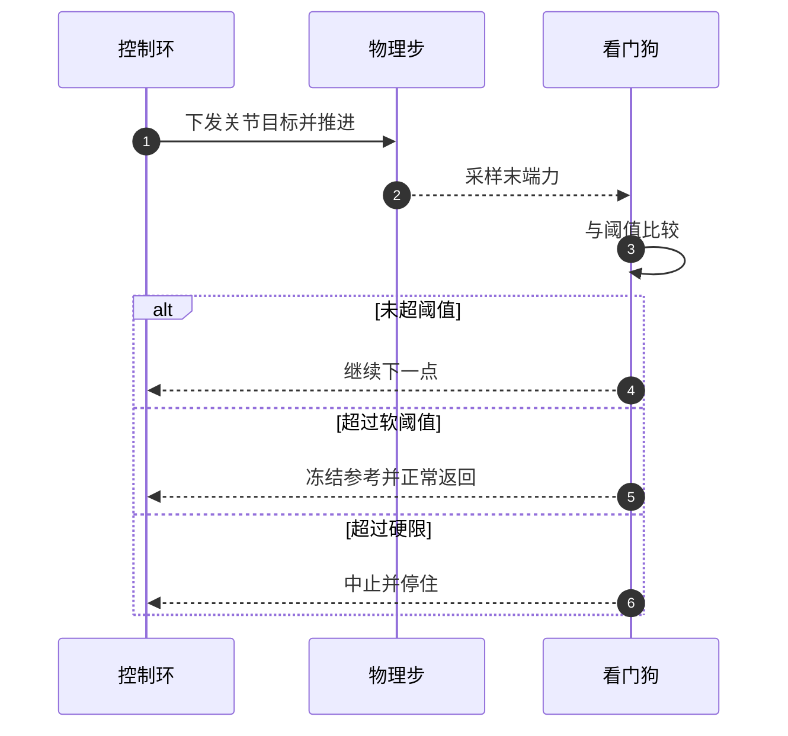
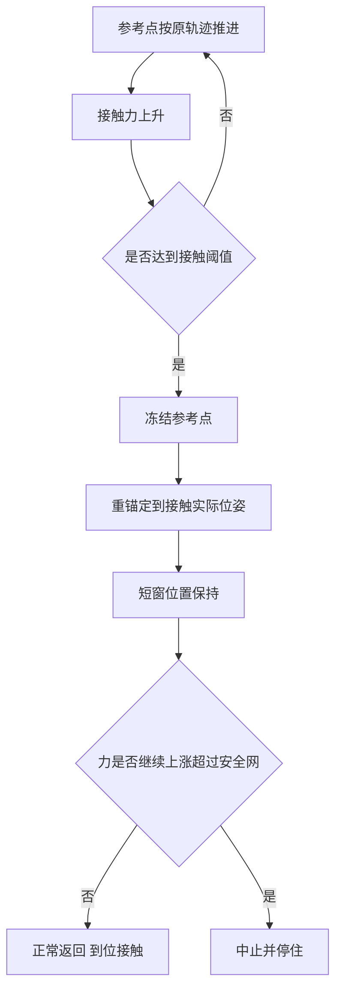
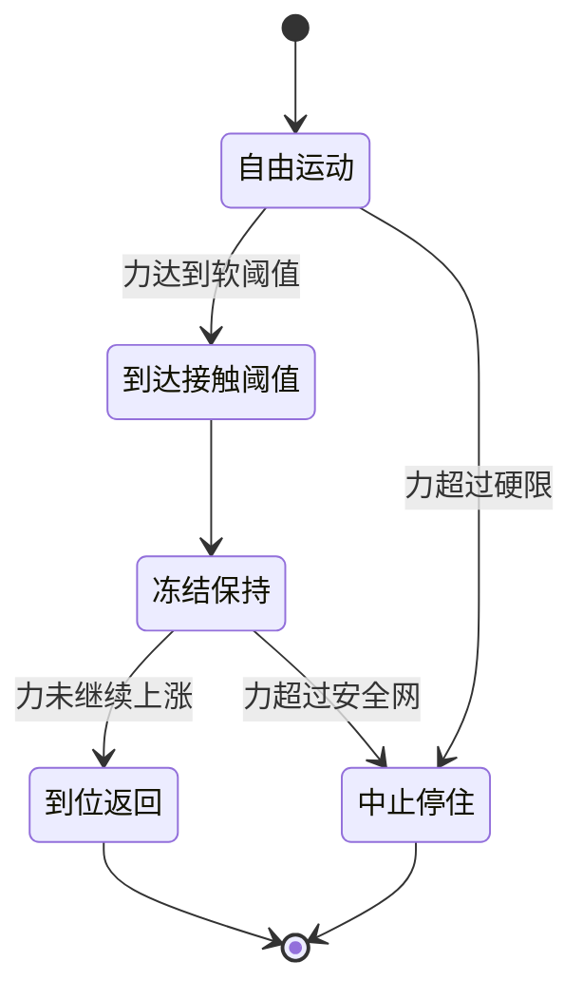

# 力看门狗与接触即停

接触任务的保护可以分成两类：一类是力太大就停下来，一类是力到了预期量级就认为到位。前者是看门狗，后者是接触即停。两者共用同一条力读数，但触发后的行为完全不同，混在一起会让安全逻辑变成「什么时候该继续、什么时候该退」的判断题。

下面先看看门狗挂在哪个周期上、分成哪些层级，再讲接触即停为什么不依赖让位，然后是冻结参考的设计与判定顺序，最后是阈值怎么定。

## 看门狗挂在哪个周期上

看门狗的作用是给接触力设一条不可越过的线。它挂在哪个周期上，直接决定能拦住多大的力峰值。

接触力不是连续渐变的量。末端与刚性表面之间的穿透深度一旦在某一步内跨过接触面，力就在这一步里从零跳到由穿透深度决定的值。同一个速度下，检查周期越短，越过接触面时多走的距离越小，力峰值越低。

| 检查时机 | 能拦住的量级 | 代价 |
| --- | --- | --- |
| 每个控制步，与物理步同频 | 单步压入量对应的力 | 每步一次比较，开销可忽略 |
| 每条轨迹结束 | 整段行程积累的力 | 中途撞击无法拦住 |
| 技能层外环，低频 | 数百毫秒内积累的力 | 冲击已经在物理里发生 |

外环检查的问题是量级不匹配：几百毫秒的外环周期里，位置伺服会持续推进很多步，等外环看到力时，穿透已经积累完成。看门狗放在控制步内，等于把接触瞬间多走的距离限制在一步的行程里。

## 看门狗的层级

同一套系统里通常有三层力约束，它们的职责与可修改权限不同：

| 层级 | 判据来源 | 典型量级 | 触发后的动作 | 谁可以改 |
| --- | --- | --- | --- | --- |
| 步内软阈值 | 任务期望的接触力量级 | 2.5 至 6 N | 认为到位，冻结并正常返回 | 技能层按任务选 |
| 技能硬限 | 该动作允许的接触力上限 | 10 至 20 N | 中止动作并停住 | 技能层 |
| 独立硬上限 | 系统允许的兜底值 | 数十至数百牛 | 钳制调用方传入的值 | 不随调用方改变 |

分层的意义是让每一层只回答一个问题。软阈值回答是否已经到位，硬限回答这个动作是否已经异常，独立硬上限回答调用方写的值是否越过了系统底线。

独立硬上限必须与调用方解耦。如果硬限只由调用方参数决定，一次误传的宽限值就会让保护失效；把上限放进执行器内部，调用方传任何值都要先经过它。保留的放开口子应当显式而少见：例如允许用无限大显式关闭，但这条路径要能被审计到。

## 接触即停为什么不依赖让位

导纳控制的直觉是力越大、让位越多，看起来天然能限制力。问题在于导纳的让位是相对参考点的位移，而参考点本身还在被轨迹推进。让位量与外力的关系是稳态关系，推进是持续的输入，两者叠加后不一定收敛。

| 依赖让位的问题 | 机制 | 后果 |
| --- | --- | --- |
| 参考仍在推进 | 轨迹没有因为接触而改变 | 力随参考推进继续增长 |
| 让位方向依赖符号 | 符号错时让位朝向接触面 | 正反馈，力迅速放大 |
| 让位有稳态滞后 | 力的变化要经过阻尼与质量项才变成位移 | 冲击峰值先于让位出现 |
| 刚度只影响让位量 | 压入量由参考速度决定 | 调低刚度不能降低首触峰值 |

因此接触即停需要一个不依赖让位的动作：停止推进参考。参考停住之后，外力不再有新的穿透来源，力被接触本身的弹性限制在一个静止量级；导纳是否让位只影响姿态的松弛方式，不影响不再往接触面里走这个事实。

## 冻结参考的设计

接触即停的核心动作是冻结参考，具体包含三件事：停止参考推进、把参考重锚定到接触发生时的实际位姿、保持一段短窗口让状态稳定。

重锚定这一步容易漏。接触发生时的参考点可能还在接触面之外或已经进入接触面，直接冻结这个参考，位置环可能继续向接触方向伺服。把参考改成接触时的实际位姿，等于把当前姿势作为新的目标，位置误差归零，压入指令被撤销。

保持窗口的长度是取舍。太短，压入指令还没有撤销，力会继续上涨；太长，机械臂夹着物体、物体已经顶住支撑面时，位置伺服的静差会持续产生新的压力。窗口的量级应当是几十毫秒，足够让物理响应完成，又不至于制造新的峰值。

冻结之后还有一个安全网问题：什么情况算没有收敛。接触后机械臂会因位置伺服的重力静差轻微下沉，力从触发值上升一小截属于物理静置，不是失控；失控是正反馈那种量级增长。判据可以取「力继续上涨超过硬限与触发值两倍中的较大者」，给静置留余量，同时兜住正反馈。

| 冻结后现象 | 判据结果 | 处理 |
| --- | --- | --- |
| 力基本不变或小幅上升 | 静置 | 正常返回，标记到位接触 |
| 力稳定在硬限以下 | 静置 | 正常返回 |
| 力持续上涨超过安全网 | 失控 | 中止并停住 |

## 判定顺序与状态语义

接触即停与硬限可能在同一控制步同时满足。单步冲击的力可以一次越过软阈值与硬限，如果先判硬限，动作会直接中止，冻结没有机会发生。要拿到到位接触这个结果，判定顺序必须是接触即停在前、硬限在后。

这个顺序不改变安全语义：硬限仍然存在，只是在同一时刻让接触即停先表达结果。冻结之后的安全网继续监控力是否上涨，异常仍会中止。

结果的语义要与动作分开表达：到位接触是一次成功返回，带停止原因是接触的标记与接触时刻的力、位置；中止是一次失败返回，带错误码。把两者都压成失败，会让上层无法区分碰到了预期支撑面与撞上了障碍。

## 阈值怎么定

阈值不是柔顺度。柔顺度由刚度决定，阈值是安全与判定线。把轻一点翻译成把阈值调低，会让正常贴面放置被判成超限。

阈值的选择有一条链：

| 环节 | 依据 | 量级示例 |
| --- | --- | --- |
| 噪声底 | 传感器自由空间读数波动 | 零点几牛 |
| 软阈值 | 期望接触力量级 | 数牛 |
| 技能硬限 | 允许的最大接触力 | 十余牛 |
| 独立硬上限 | 系统兜底 | 数十至数百牛 |

阈值还要按任务阶段分开。同一台臂在合爪时的允许力与轻触放置的到位力不是一回事，用一套阈值会把轻触判成异常，或者把合爪放宽到危险量级。阶段阈值的选择依据是这一阶段最多允许多少力、超过说明什么出了问题。

## 常见判断偏差

| # | 判断偏差 | 表现 | 依据 |
| --- | --- | --- | --- |
| 1 | 在每个技能结束时查力 | 中途撞击未被拦住 | 接触是单步跳变，检查要逐控制步 |
| 2 | 认为柔顺会自限接触力 | 力仍持续上涨 | 参考点推进是持续输入 |
| 3 | 冻结参考但不重锚定 | 位置环继续压入 | 参考要改成接触时的实际位姿 |
| 4 | 硬限先于接触即停判定 | 单步撞击直接中止，拿不到到位结果 | 同一时刻两者可能同时满足 |
| 5 | 用调用方参数当作唯一保护 | 误传大值后保护失效 | 需要独立于调用方的硬上限 |
| 6 | 把阈值调低当作调柔顺 | 正常贴面被判超限 | 柔顺度由刚度决定 |

## 小结

### 核心概念

- 接触力在单步内跳变，看门狗必须挂在每个控制步上才能限制峰值。
- 力约束分三层：任务软阈值、技能硬限、独立于调用方的系统硬上限。
- 接触即停的关键是冻结参考，让位只是可选的松弛方式。
- 冻结时要重锚定到接触实际位姿，并保持一个几十毫秒的窗口。
- 判定顺序是接触即停先于硬限，否则单步撞击拿不到到位结果。
- 阈值由噪声底与允许接触力共同夹出，与刚度代表的柔顺度是两件事。

### 设计权衡

| 权衡点 | 常见选择 | 收益与代价 |
| --- | --- | --- |
| 检查周期 | 每控制步 | 限制单步峰值；代价是每步一次比较 |
| 触发行为 | 预期接触冻结返回，异常才中止 | 上层能区分到位与故障；代价是结果语义变复杂 |
| 重锚定 | 参考改为接触时实际位姿 | 撤销压入指令；代价是丢弃原轨迹的剩余行程 |
| 保持窗口 | 几十毫秒 | 让物理收敛；代价是占用一点任务时间 |
| 安全网系数 | 硬限与触发值两倍取大 | 不误杀静置；代价是阈值以上留一段容忍区 |

## 练习

### 基础题

1. 说明为什么把力检查放在技能结束时不能拦住途中撞击。
2. 接触即停触发后，为什么要把参考重锚定到接触时的实际位姿？
3. 三层力约束各自的职责是什么？
4. 接触即停与硬限为什么要把接触即停排在前面判定？

### 挑战题

5. 为一个先合爪再抬升的动作设计阈值表，写出每层的取值依据。
6. 设计冻结保持窗口的确定方法，说明窗口过短与过长各自的表现。
7. 给冻结安全网设计一条判据，区分物理静置的力上升与正反馈失控。
8. 如果传感器噪声底升高十倍，阈值链的哪些环节需要调整？写出调整顺序。

## 附：本页引用的路径

| 路径 | 用途 |
| --- | --- |
| `control/motion.py` | 步内看门狗、冻结参考与冻结安全网 |
| `skills/library.py` | 各任务阶段的软阈值与硬限取值 |
| `core/types.py` | 运动结果里的停止原因与观测字段 |
| `tests/test_admittance_safety.py` | 判定顺序与冻结安全网的检查 |
| `INTERFACES.md` | 接触即停的接口约定 |
