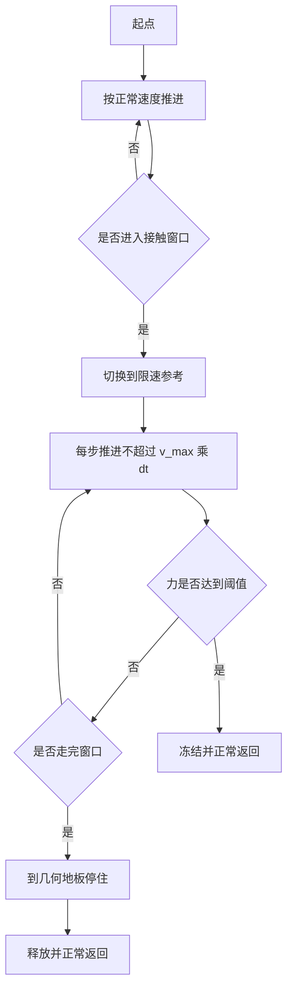
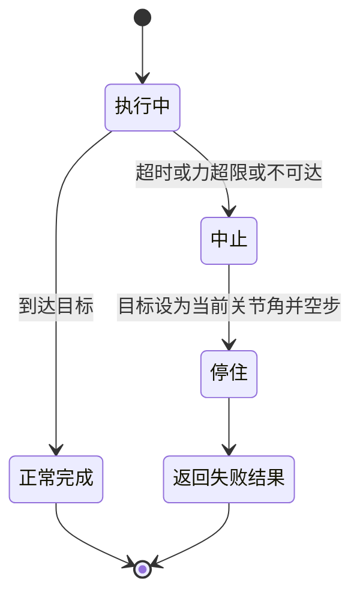

# 参考限速与安全停

接触段的安全裕度不体现在位置目标上，而体现在速度上。位置目标说停在哪里，速度上限说每步允许走多远；末端与刚性表面之间的穿透深度正好由后者的单步行程决定。把速度降下来，等于把接触瞬间可能冲进去的距离压到可控量级。

下面先看接触段为什么把控制量换成速度，再讲限速参考怎么推进、单步压入量与力峰值的量级关系，然后是限速该用在哪一段，最后是中止即停与独立力上限的设计。

## 接触段为什么把控制量换成速度

位置控制在接触段的困难是没有到达的判据。目标点定在支撑面上方几毫米，几何误差会让末端悬空；定在支撑面下方，末端会一路压进去。接触面本身的位置误差、物体变形与装配误差都可能超过这几毫米，位置目标无法同时表达贴住与不压坏。

速度上限换了一个角度：它限制的是每一步允许推进的距离。记控制周期 $dt$、参考速度上限 $v_{max}$，单步压入量为：

$$\Delta \delta = v_{max}\,dt$$

刚性接触下接触力近似由穿透深度与环境刚度决定，$f \approx k_{env}\,\Delta\delta$，于是首触力的量级可以由速度上限直接设计，不需要精确知道接触面落在哪里。

| 表达方式 | 描述的量 | 与接触力的关系 | 失效场景 |
| --- | --- | --- | --- |
| 位置目标 | 最终停在哪里 | 间接，取决于几何误差 | 接触面位置估计不准 |
| 速度上限 | 每步走多远 | 直接，单步行程决定穿透 | 需要在接触前切换到限速 |
| 力阈值 | 允许多大接触力 | 直接，但是事后判据 | 单步冲击可能一次越过阈值 |

另一处动机来自时间律。按最小急动度规划的速度曲线在中点达到峰值，而接触往往发生在行程末端附近，此时速度正在下降但仍有相当量级。用速度上限替代时间律，等于把末端速度从由总距离与时长决定改成由接触安全要求决定。

## 限速参考怎么推进

限速参考是一个只做匀速推进的参考生成器：每个控制步沿起点到终点的直线推进不超过 $v_{max}\,dt$，走完为止。它忽略传入的时长参数，总时长由距离与速度上限决定。

```text
每步推进量 = min(v_max * dt, 剩余距离)
新参考 = 旧参考 + 单位方向 * 每步推进量
```

这个设计带来三个必须一起处理的细节：

| 细节 | 原因 | 处理 |
| --- | --- | --- |
| 速度前馈要关闭 | 前馈是按正常速度算的超前项 | 接触段会把命令顶进接触面 |
| 收尾不重新加速 | 收尾伺服的目标是消除误差 | 重新加速会再压一次 |
| 超时要按距离放大 | 限速后总时长变长 | 沿用原超时会中途失败 |

速度前馈在自由空间里消除伺服滞后，收益在毫米级；接触段它的收益被限速本身覆盖，风险却成倍增加。同一条策略也适用于接触即停。



## 单步压入量与力峰值的量级关系

同一控制周期下，单步压入量与速度上限成正比，首触力也随之呈近似正比。控制周期为 2 ms、刚性桌面下降时的量级关系：

| 速度上限 | 单步压入量 | 首触力量级 |
| --- | --- | --- |
| 0.016 m/s | 32 µm | 约 28 N |
| 0.008 m/s | 16 µm | 约 13 N |
| 0.004 m/s | 8 µm | 约 7 N |
| 0.002 m/s | 4 µm | 约 3 N |

这组量级来自刚性桌面下降的标定，用来定方向：要把首触力压到数牛以内，速度上限要落在毫米每秒量级。它不能用来精确预测单个场景的力，原因有两层。

第一层是接触刚度不是常数。同样的单步行程，撞在薄壁、软垫或已经变形的物体上，力会明显不同。第二层是相位效应：当单步行程很小时，接触面落在哪一个控制步内决定了这一步实际压进去多少。速度上限小于某个量级之后，力不再随它单调下降，而是在一个区间内波动。这意味着限速有一个有效的下限，继续调小只能换来更长的时间，换不来更低的峰值。

| 现象 | 机制 | 设计含义 |
| --- | --- | --- |
| 首触力近似正比于速度上限 | 单步行程决定穿透 | 用速度上限做量级设计 |
| 小步长段出现波动 | 接触落在哪一控制步不确定 | 限速存在有效下限 |
| 软接触力逐步爬升 | 接触刚度低、变形大 | 软阈值能在早期抓住 |
| 刚性接触单步跳变 | 约束力在一步内建立 | 看门狗要在步内检查 |

## 限速该用在哪一段

限速的代价是时间。把速度上限套在所有运动上，行程时间按比例放大，长距离移动会慢到不可接受。限速应当只覆盖接触可能发生的区间。

问题在于接触可能发生在哪一段需要按对象判断。细高物体的真实接触面往往高于几何模型给出的高度，接触发生在接近段而不是最后一段；低矮物体的接触如果发生得太早，收尾行为会改变，抓取位置会偏到上沿。两种情形对应两种策略：

| 对象与阶段 | 限速策略 | 依据 |
| --- | --- | --- |
| 长距离转移 | 不限速 | 接触不在这里发生 |
| 接近接触面之前 | 正常速度或中等速度 | 缩短任务时间 |
| 刚性面上方的小窗口 | 低速 | 单步行程直接决定首触力 |
| 可能存在凸起的接近段 | 中等速度加看门狗 | 接触位置不确定 |

选择依据是这一段是否可能出现接触，以及出现接触时允许多大的力。把限速窗口定得比可能接触的区间更短，等于把冲击留给正常速度。

## 中止即停

任何非成功返回都必须在返回之前把机械臂停住。这一步不能只改命令：位置伺服的目标改了，但物理步不再推进时，上一次下发的压入指令仍然作用在接触上，穿透会按旧指令继续演化。正确做法是把关节目标设成当前关节角，并继续推进若干个物理步，让新的命令作用到系统上。

| 做法 | 效果 |
| --- | --- |
| 只改关节目标不推进物理 | 旧穿透继续演化，力不受控 |
| 目标设成当前关节角并空步 | 压入指令被撤销，接触力回落 |
| 中止路径抛异常 | 上层拿不到结果，状态不明 |

中止路径还要满足一条工程约束：清场动作本身不能抛异常。安全动作失败时，调用方至少应当拿到一个说明失败原因的结果，而不是一个二次异常。



停住的步数是一个小常数，几十毫秒量级。步数太少，物理响应还没完成；步数太多，占用任务时间，也可能在已经卡住的状态里产生新的接触。

## 独立力上限与放开口子

力限值的最终保护不能依赖调用方。调用方传入的阈值可能因为任务需要被写大，也可能因为笔误被写成一个很大的数。执行器内部需要一个独立上限：外部传入的值超过它就钳制并给出警告，不因为调用方要求而放宽。

| 入口 | 语义 | 结果 |
| --- | --- | --- |
| 不传力限 | 使用柔顺参数自带的值 | 不经过独立上限 |
| 传入正常值 | 按传入值执行 | 与独立上限比较后取小 |
| 传入超过上限的值 | 钳制到上限并警告 | 保护仍然有效 |
| 显式关闭 | 传入无限大 | 关闭独立上限，需要承担风险 |

三种语义的分工是：默认路径使用任务参数，显式值经过系统底线，关闭开关只在明确知道风险时使用。关闭开关的存在是必要的，实验室里需要验证大压力下的行为；但它应当是一条少见的路径，而不是默认路径。

错误码是给上层的决策输入。同一个错误码可以在不同技能里表达不同含义：在守卫式接触下降里，力达到阈值返回，上层把它解释为已经接触支撑面、可以释放；在自由移动里同样的返回值说明撞到了障碍。安全层不因此放宽，解释放在技能层。

## 常见判断偏差

| # | 判断偏差 | 表现 | 依据 |
| --- | --- | --- | --- |
| 1 | 用位置目标表达接触安全 | 目标差几毫米就压出大力 | 单步行程才决定穿透 |
| 2 | 把限速套在所有运动上 | 任务时间成倍增加 | 接触只可能发生在局部区间 |
| 3 | 认为限速越小越安全 | 小步长段力出现波动 | 相位效应给出有效下限 |
| 4 | 接触段保留速度前馈 | 命令被顶进接触面 | 前馈是正常速度下的超前项 |
| 5 | 中止只改关节目标 | 接触力继续演化 | 必须继续推进物理步 |
| 6 | 依赖调用方传入的力限 | 误传大值后保护失效 | 需要执行器内部的独立上限 |

## 小结

### 核心概念

- 接触段用速度上限表达安全裕度：单步压入量等于速度上限乘以控制周期。
- 刚性接触下首触力量级与单步压入量近似成正比，速度上限要落在毫米每秒量级。
- 单步行程很小时出现相位效应，限速存在有效下限。
- 限速只覆盖接触可能发生的区间，全程限速会把任务时间放大。
- 中止必须在返回前停住：关节目标改为当前角并继续推进物理步。
- 力限值需要执行器内部的独立上限，调用方传入的值先经过它。

### 设计权衡

| 权衡点 | 常见选择 | 收益与代价 |
| --- | --- | --- |
| 接触段控制量 | 速度上限替代位置目标 | 力的量级可设计；代价是任务时间变长 |
| 限速范围 | 只覆盖接触窗口 | 时间可控；代价是要判断接触可能发生的段 |
| 速度前馈 | 接触段关闭 | 减少顶入；代价是跟踪精度略降 |
| 停住步数 | 几十毫秒量级 | 撤销压入指令；代价是占用一点任务时间 |
| 独立力上限 | 与调用方解耦，显式可关闭 | 保护不易失效；代价是多一层参数语义 |

## 练习

### 基础题

1. 控制周期为 2 ms、速度上限为 0.004 m/s 时，单步压入量是多少？
2. 同一直线距离下，限速参考的总时长由什么决定？
3. 接触段关闭速度前馈的理由是什么？
4. 中止时为什么只改关节目标不够，还要继续推进物理步？

### 挑战题

5. 给定刚性接触首触力不超过 5 N 的要求，设计速度上限与检查窗口，写出依据。
6. 为细高物体与低矮物体分别设计限速窗口，说明两者为什么不同。
7. 设计一条中止路径的检查清单，覆盖停住、结果返回与异常安全三部分。
8. 如果必须在实验室里验证大压力行为，设计一条既能放开上限又能审计的流程。

## 附：本页引用的路径

| 路径 | 用途 |
| --- | --- |
| `control/motion.py` | 限速参考、速度前馈开关、中止停住与独立力上限 |
| `skills/library.py` | 接触段的限速取值与窗口划分 |
| `core/types.py` | 运动结果的错误码与停止原因字段 |
| `INTERFACES.md` | 参考限速与接触即停的接口约定 |
