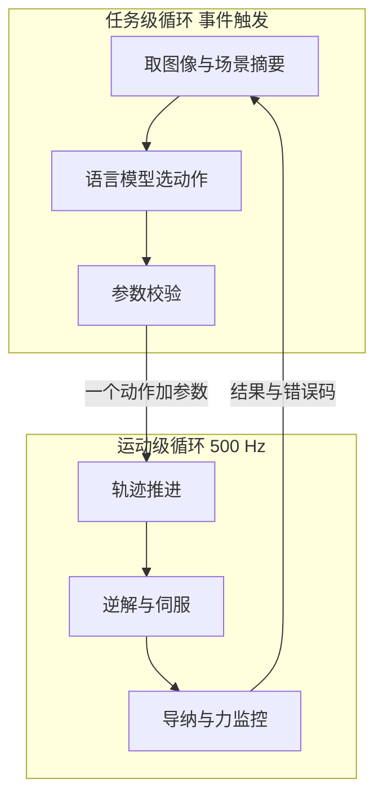
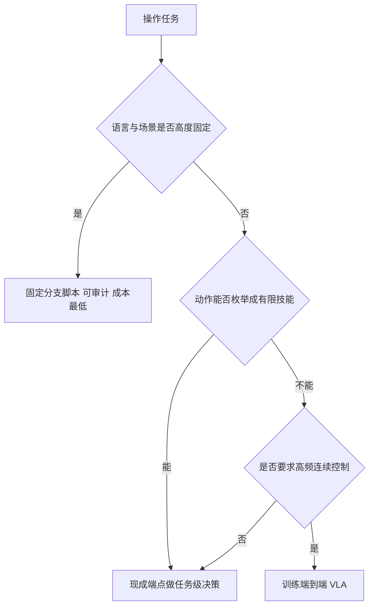

# 机器人为什么要用 VLM

一个抓取任务在演示里往往很顺：指定物体、规划路径、合爪、抬升。换一句说法，或者场景里多压了一个方块，同样的流程就卡住。真正难的部分通常不在轨迹计算，而在「现在该做什么」：先抓哪个、放到哪里、上一步为什么失败、要不要换一种拿法。这类判断用固定分支能覆盖见过的情形，遇到没见过的表达就退化。

把这类判断交给一个能看图的语言模型，是目前常见的一种做法。它只解决了一部分问题，同时引入一批新的约束。下面先划出任务级与运动级的分界线，再比较训练 VLA 与调用现成端点的取舍，最后讨论适用边界与配套要求。

## 两类决策的分界线

机械臂执行一次操作时，同时存在两种性质不同的决策。

| 维度 | 任务级决策 | 运动级决策 |
| --- | --- | --- |
| 典型问题 | 抓哪个、放到哪里、失败后下一步做什么 | 关节怎么动、何时算到位、接触力多大 |
| 输入 | 图像、任务语言、场景摘要、历史 | 关节角、末端位姿、接触力、碰撞状态 |
| 输出 | 离散动作名加少量参数 | 连续量：位置、姿态、力矩 |
| 时间尺度 | 每步数百毫秒到数秒 | 每个控制周期，毫秒量级 |
| 失败语义 | 目标没达成、参数矛盾、语义不清 | 超时、超力、不可达、路径非法 |
| 可验证性 | 语义判断，需要独立证据 | 物理量直接测量 |

两类决策的时间尺度差出三个数量级。任务级按事件触发，频率在 0.5 到 2 Hz 之间；运动级按每个仿真步执行，500 Hz。这个数量级差距是分层的直接原因。



## 为什么不能让一个循环同时做两件事

若让同一个循环既管语言判断又管关节输出，会撞上两个约束。其一，语言模型的决策延迟是数百毫秒到数秒，伺服环必须每个控制周期都更新目标，两者无法共享同一个节拍。其二，伺服环需要确定性：同样的状态必须给出同样的控制量，否则力监控与中止条件的时序无法复现；而语言模型的输出天然带随机性。

分层把这两个约束分别安放。上层允许慢、允许随机，只输出离散动作；下层必须快且确定，输出连续量；中间用一份经过校验的动作描述交接。

分层还让失败可以分别处理。运动级失败有物理量作依据，触发后立即中止；任务级失败只是「目标没达成」，需要重新观察再判断。把两者混在一起，中止逻辑会同时承担安全与语义两种职责，任何一处改动都会牵动另一处。

## 上层模型做的是映射

把上层的职责写成映射关系：

$$(\text{图像},\ \text{场景摘要},\ \text{任务},\ \text{历史}) \rightarrow (\text{动作名},\ \text{参数})$$

动作名取自一个封闭集合，参数有类型与范围约束。这个映射的表达能力受两点限制：集合里没有的动作无法表达，参数写错的调用会被校验拦下。它不输出力矩，也不输出关节角。

接口本身很小，核心只有一个方法：

```python
def decide(messages: list[dict]) -> SkillCall:
    """消息进，动作出。"""
    ...
```

接口小是有意的。上层只依赖「消息进、动作出」，因此远程端点、本地规则器、录像回放可以互相替换，循环的其余部分不需要改动。

## 训练 VLA 与调用现成端点的取舍

三条路线解决的是同一个问题的不同侧面，代价也各不相同。

| 维度 | 训练端到端 VLA | 现成多模态端点加经典控制 | 固定分支脚本 |
| --- | --- | --- | --- |
| 前置投入 | 遥操作数据采集与训练算力 | 一个可用的多模态端点 | 无 |
| 换机器人或相机 | 通常需要重新采集与训练 | 改配置即可 | 一般需要改代码 |
| 决策频率 | 可达数十赫兹 | 每步数百毫秒到数秒 | 与脚本相同 |
| 连续控制能力 | 有，端到端输出动作 | 无，只给离散动作与参数 | 无 |
| 依赖 | 自持模型与算力 | 网络服务或本地推理 | 无 |
| 可解释性 | 低，策略是黑盒 | 中，动作与依据可记录 | 高，分支即逻辑 |

选择依据可以压成三个问题：任务的语言多样性有多高；失败时能否接受一次数秒的重新决策；有没有采集与训练数据的条件。

- 语言表达固定、物体种类少，脚本更省事，也更容易审计。
- 表达多样、场景常变，但动作能拆成有限技能，现成端点加经典控制更划算。
- 要求高频反应与连续控制，训练 VLA 才有意义。



## 适用边界

这套组合能工作的前提有四条：动作空间可以枚举成有限技能；场景能压缩成紧凑的符号描述加图像；抓取几何可以用解析方法给出，不需要学习式抓取网络；每步数百毫秒到数秒的决策延迟可以被接受，并且总步数有上限。

反过来，以下情形会让它以不同方式失效。需要亚秒级反应的动态任务，例如抛接或拦截滚动中的物体，决策延迟超过任务的时间常数，闭环来不及反应。遮挡严重时符号描述与图像不一致，模型会基于错误前提决策。物体动力学复杂到解析抓取失效，例如软体或可形变物体，任务级决策没有可用的动作。端点不可用且没有本地回退，循环直接停摆。

边界处的设计原则是把不确定性显式化。模型可以回答「不确定」并请求澄清，也可以主动终止；这比在证据不足时强行给出一个动作安全。

## 经典控制为什么仍然是底座

上层越自由，下层越要收紧。经典控制在这里承担三件事：

1. 安全：非法或不可达的命令在校验与执行层被拦下，返回结构化错误，不会直接作用到电机。
2. 精度：位置与力的指标由控制层保证，上层不必关心毫米级误差从哪里来。
3. 可复现：同样的动作序列给出同样的结果，为独立复核提供稳定基线。

配合方式是一条硬约定：上层只能从被验证过的动作词表里选，参数要过类型、范围与场景一致性检查。这条约定让「模型输出错」最多变成一次可回灌的失败。

## 两条配套要求

第一，决策要可解释。每次调用附带一段判断依据，失败原因写进结构化字段，事后能归因到参数、场景还是模型本身。

第二，要有一条不依赖网络的确定性路径。同一个消息输入产生同一个动作，用于回归测试与持续集成：有凭据时走远程端点，没有凭据时走本地规则器，两者走同一条循环代码。若回归测试依赖远程服务，失败来源就分不清是代码问题还是服务抖动。

## 常见判断偏差

| # | 判断偏差 | 表现 | 依据 |
| --- | --- | --- | --- |
| 1 | 认为模型能替代控制器 | 期望它输出关节量或力矩 | 输出是离散动作加参数，表达能力受词表限制 |
| 2 | 以为换更强的模型就能提高精度 | 末端仍然差几毫米 | 精度由运动级闭环决定，与上层模型无关 |
| 3 | 把决策频率当成越高越好 | 每个控制步都调用模型 | 上层按事件触发即可，频繁调用只增加延迟与成本 |
| 4 | 把离线规则器当成占位实现 | 忽略它的确定性价值 | 无网络时的同路径回退是回归测试的基础 |
| 5 | 只看单步是否成功 | 忽略失败后能否恢复 | 闭环的价值在于失败能被重新观察并纠正 |
| 6 | 把语言理解等同于任务理解 | 忽略物理可行性 | 动作还要过可达性、碰撞与力限制 |

## 小结

### 核心概念

- 任务级与运动级决策在时间尺度、输入输出与失败语义上分属两类，时间尺度差三个数量级，因此需要分层。
- 上层模型做的是固定动作空间内的映射，不输出连续控制量。
- 训练 VLA 换来高频端到端控制，代价是数据、算力与迁移成本；现成端点换来开发速度，代价是延迟与不确定性。
- 经典控制是安全、精度与可复现性的底座，上层动作必须经校验后才允许执行。
- 适用边界取决于动作可否枚举、场景能否紧凑表示、决策延迟能否被接受。
- 确定性离线路径与可解释输出是两条必要配套。

### 设计权衡

| 权衡点 | 常见选择 | 收益与代价 |
| --- | --- | --- |
| 决策实现 | 现成端点加经典控制 / 训练 VLA / 脚本 | 端点省数据、脚本可审计、VLA 高频；代价分别是延迟、表达能力、泛化与迁移 |
| 分层粒度 | 两层：任务与运动 | 职责清晰；代价是需要一份跨层的动作描述与校验 |
| 决策频率 | 事件触发，0.5 到 2 Hz | 省算力、容忍网络抖动；代价是反应慢于动态任务 |
| 不确定性处理 | 允许提问与主动终止 | 避免在证据不足时执行危险动作；代价是需要人工介入路径 |
| 离线能力 | 确定性规则器同接口回退 | 可测试、可诊断；代价是多维护一套实现 |

## 练习

### 基础题

1. 列出任务级与运动级决策在时间尺度、输出类型、失败语义上的三处差异。
2. 说明伺服环为什么不能容忍语言模型那样的决策延迟与随机性。
3. 写出上层模型的输入与输出各有哪些，并解释输出为什么必须限制在封闭集合内。
4. 各举一个适合脚本、适合现成端点、适合训练 VLA 的任务特征。

### 挑战题

5. 设计一份判据表，判断一个操作任务是否适合放在任务级模型决策，至少包含语言多样性、动作可枚举性、实时性三项。
6. 若把决策频率从 2 Hz 提高到 10 Hz，分析收益与新增问题，至少覆盖成本、输出抖动与时序配合。
7. 设计「模型不确定就提问」的触发条件，并说明如何避免提问过多导致任务无法推进。
8. 为一个只有相机与力矩传感的抓取任务设计分层接口，写出上下层各自需要的输入输出与失败码分类。

## 附：本页引用的路径

| 路径 | 用途 |
| --- | --- |
| `agent/loop.py` | 任务级循环：取状态、建消息、拿决策、执行、回灌 |
| `agent/vlm_client.py` | 远程端点客户端与离线规则器，同一接口 |
| `agent/schema.py` | 动作词表、工具描述与参数校验 |
| `core/interfaces.py` | 决策器与执行器的协议定义 |
| `control/`、`planning/`、`skills/` | 运动级执行：轨迹、规划、导纳与技能序列 |
| 仓库根 | `vlm-admittance`，公开仓库 https://github.com/TC635807/vlm-admittance |
