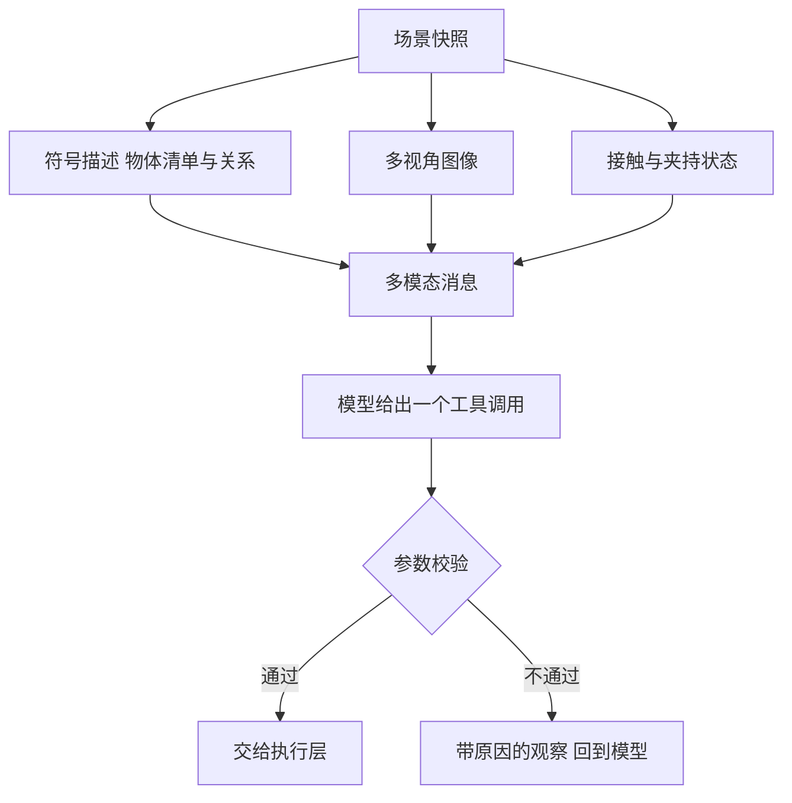
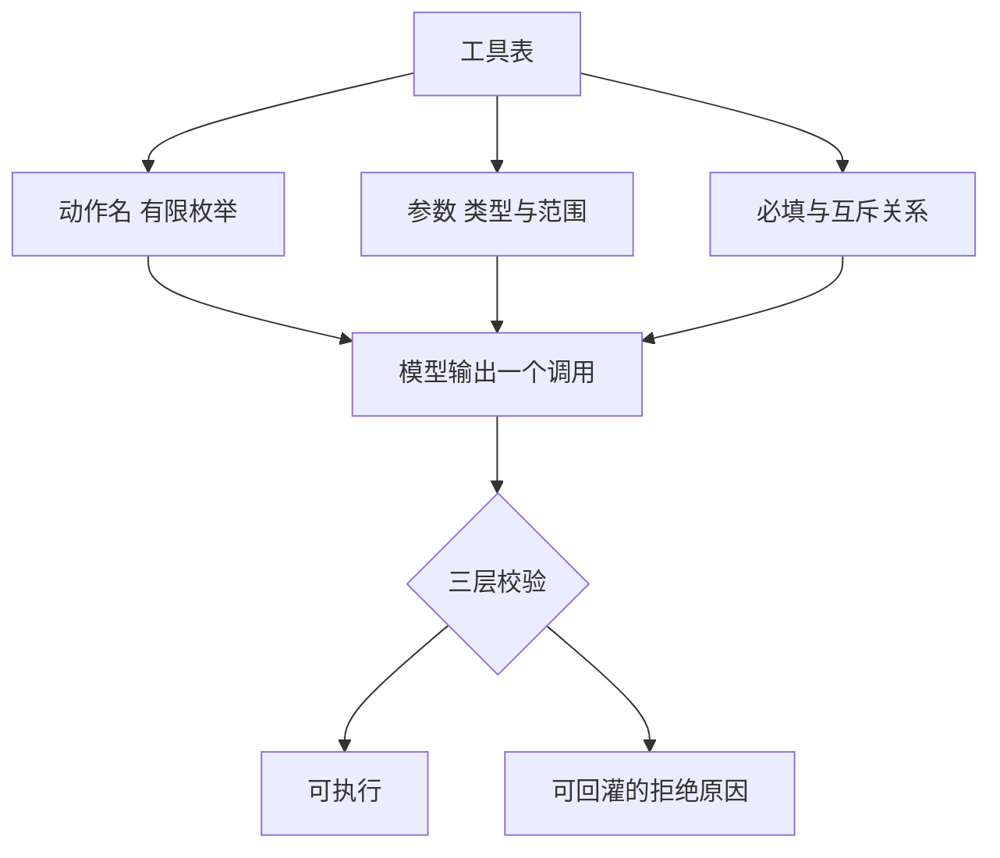

# 场景表示与工具调用

把一个场景交给决策模型时，最先要回答的是「给哪一类信息」，其次才是「给多少」。给少了模型判断不了，给多了它会绕开感知直接读答案；两种错误的表现不同：前者答错，后者在仿真里答对、换到真机就失效。

下面先说清图像与符号各自承担什么，再讲场景描述的四条设计原则与空间关系的取舍，然后讨论真值隔离、图像通道、工具 schema 与参数校验。

## 模型需要两种输入

图像与符号描述携带的信息类型不同，任何一类单独使用都有明显缺口。

| 信息类型 | 图像提供 | 符号描述提供 | 主要判据 |
| --- | --- | --- | --- |
| 外观 | 颜色、纹理、形状 | 类别与颜色标签 | 颜色分割与类别匹配 |
| 空间 | 相对位置、遮挡关系、视角 | 坐标、尺寸、支撑关系 | 反投影与几何关系 |
| 可操作性 | 需要结合类别推断 | 是否可抓、是否容器 | 标签直接给出 |
| 精度 | 像素级，含视角误差 | 米级，依赖标定 | 三角定位或平面假设 |
| 稳定性 | 受光照与遮挡影响 | 受标签与推导规则影响 | 两者互为校验 |

图像回答「看起来是什么样」，符号回答「在系统里被登记为什么」。模型用前者处理没见过的表达，用后者做精确指代。



## 场景描述的四条设计原则

结构化描述的目标是让模型不必做格式猜测，也让消息本身可复现。

| 原则 | 做法 | 收益 | 代价 |
| --- | --- | --- | --- |
| 固定键 | 每次快照给同样的字段集合 | system 段可缓存，消息可比对 | 字段调整需要同步所有读取方 |
| 显式类型 | 数值一律转成标准数字，非有限值归零 | 序列化不会抛错，模型不会被异常值带偏 | 极端值被抹平时需要另记日志 |
| 语义不变量 | 明确尺寸是半边长、位置是几何中心、四元数顺序 | 判据不必依赖隐含约定 | 约定变了要同时改读写两侧 |
| 稳定顺序 | 物体按固定规则排列，图像按相机名排序 | 同一场景产生逐字节一致的消息 | 需要额外一次排序 |

第三条容易被低估。尺寸用半边长还是全长、位置是几何中心还是底面中心，会让同一个几何判据的结果差出一个物体尺度。把这些约定写进表示层，下游所有判据才能共享同一套解释。

```json
{
  "task": "把红色方块放进托盘",
  "objects": [
    {"id": "box_red", "category": "box", "color": "red",
     "graspable": true, "is_container": false,
     "supported_by": [], "blocked_by": []},
    {"id": "tray", "category": "tray", "color": "gray",
     "graspable": false, "is_container": true}
  ],
  "summary": {"graspable": ["box_red"], "containers": ["tray"]},
  "relation_summary": "当前没有物体互相压着"
}
```

上面是结构示意，字段集合来自表示层的约定，取值仅用于说明形状。

## 空间关系：算好还是让模型自己推

位姿给全之后，遮挡与支撑关系理论上可以推导，但把推导交给模型有三处不划算：它要花 token 做几何运算；它容易把「在图像里重叠」与「在三维里叠放」混淆；不同模型的推导稳定性不一致。

更稳的做法是在系统侧算好关系，作为观察的一部分给出。

| 关系 | 判据 | 输出 | 失效条件 |
| --- | --- | --- | --- |
| 水平重叠 | 两个轴对齐框的交集面积与较小者面积之比超过阈值 | 重叠率 | 物体旋转后轴对齐框偏大 |
| 叠放 | 中心高度差约等于两者半高之和，且水平重叠达标 | 谁压着谁 | 物体倾斜或嵌入 |
| 抓取受阻 | 目标正上方存在支撑者 | 受阻标记与阻挡物 | 遮挡物不接触目标 |
| 支撑方向 | 由叠放关系反向读取 | 支撑与被支撑列表 | 多层叠放时只给直接关系 |

推导结果必须以「观测」的身份出现，而不是当作事实。判据本身是近似的：忽略旋转、只比较轴对齐框，遇到倾斜物体就会给出错误结论。表示层保留原始几何量，模型可以据此质疑推导结果。

## 为什么不能给真值位姿

真值位姿指仿真内部准确知道的物体坐标与尺寸。把它放进提示词会同时破坏三件事。

第一，它会制造捷径。模型只要抄一个坐标就能给出正确动作，视觉能力是否可用完全不参与，感知链路的缺陷在评测里不会暴露。

第二，它在真机上不存在。真实系统只有相机与标定，没有可信的物体坐标。在真值上验证过的提示词与流程，换到真机后第一步就缺输入。

第三，它让复核失效。验证依赖图像与几何判据；如果提示词里本来就有真值，验证失败只可能来自判据实现，感知误差永远测不出来。

正确的替代是给出模型能自己测的东西：相机画面加上一份标定摘要，说明画面尺寸、视场角与桌面高度，再说明像素坐标系的约定。系统侧负责把像素反投影成世界坐标。

| 方案 | 提示词内容 | 感知是否被检验 | 迁移到真机 |
| --- | --- | --- | --- |
| 开卷 | 物体坐标、尺寸、支撑关系 | 否 | 缺少输入，无法直接迁移 |
| 闭卷 | 类别、颜色、可抓性加图像 | 是 | 与真机输入形态一致 |

闭卷的代价是新增误差来源：平面假设在俯视相机下会让高物体产生视差，两个视角的像素对应到同一物理特征需要配准。这些误差是可观测的，因此也是可修的；被真值掩盖的误差则不可修。

隔离本身可以做成可检验的性质：把真值读取接口替换成抛异常的桩，闭环仍要能跑通；再扫描发出的消息，确认其中不出现坐标字段。这样「不给真值」就从约定变成了回归测试的一部分。

## 图像通道的工程约束

图像进入消息的方式影响可复现性与部署复杂度。

| 约束 | 选择 | 理由 |
| --- | --- | --- |
| 传输形式 | 消息内嵌数据地址，不落盘 | 无额外文件服务，消息自包含，字节可复现 |
| 编码 | 有图像库时用有损压缩，无图像库时用标准库写无损 | 压缩换体积；兜底保证无第三方依赖时仍可用 |
| 顺序 | 按相机名排序 | 同一场景的消息逐字节一致，便于缓存与比对 |
| 通道数 | 统一成三通道 | 灰度与含透明度图像先转换，避免格式分支 |
| 数量 | 按决策需要选，不默认全开 | 每张图都占上下文与带宽 |

多视角的分工同样需要设计。俯视相机适合判断水平位置与遮挡，斜视相机适合判断叠放与高度，腕部相机贴近目标但视野被夹爪占据。腕部视角单独使用时容易退化：夹爪停在物体上方时画面里同样有大片目标颜色，因此它更适合作为诊断与兜底，而不是主判据。

单视角定位在平面假设下工作，物体的高度会转化为像素偏移。高度越大偏移越大，量级可以到几厘米甚至接近物体自身尺度，因此高物体需要两个视角做三角定位；矮物体用一个俯视像素即可。

## 工具 schema：把动作空间变成有限集合

自然语言动作描述灵活但不可校验。可枚举的动作词表加结构化参数，换来三件事：输出可解析、参数可校验、失败可归类。



用函数调用而不是自由文本，主要收益是约束解码：端点在生成阶段就把输出限制在工具表内。代价是模型不能表达词表之外的动作，遇到新需求要改工具表。实际实现通常还会保留一条从纯文本里抽取调用的兜底路径，用于兼容把调用塞进正文的端点。

一次决策只允许一个动作。分步推进让每一步都有对应的观察，失败能定位到具体一步；若允许一次返回多个动作，中间步骤失败时无法确定从哪一步重来。

## 参数校验：三段顺序与两类冲突

校验顺序是白名单、类型与范围、场景一致性。顺序不能颠倒：先确认参数名合法，再判断取值，最后才去场景里核对指代对象。

| 段 | 检查内容 | 失败后果 |
| --- | --- | --- |
| 白名单 | 参数名是否属于该动作 | 未知字段被丢弃并记录，不报错 |
| 类型与范围 | 数组维数、数值区间、单位四元数 | 拒绝并指明参数名 |
| 场景一致性 | 物体是否存在、是否可抓、是否容器 | 拒绝并列出可选项 |

第一段特意选宽容。模型倾向多塞几个「有帮助」的字段，直接拒绝会浪费一步；丢弃并把它记进判断依据，既不污染执行层，也保留了可观测性。

第二类冲突需要区分冗余与矛盾。同一个目标用两种方式表达属于冗余，处理是把不含可执行信息的那一份丢掉，以信息更完整的一份为准；两种表达互相冲突则是矛盾，必须拒绝。

| 情形 | 判据 | 处置 |
| --- | --- | --- |
| 像素与物体标识同时给出 | 像素在场，标识不含额外信息 | 丢弃标识，以像素为准 |
| 坐标与物体标识同时给出 | 坐标与该物体位置一致 | 接受坐标，丢弃标识 |
| 坐标与物体标识明显不符 | 两者距离超过容差 | 拒绝，报出实测距离 |
| 容器与落点同时给出 | 落点在容器范围内 | 接受落点，容器只决定高度 |
| 容器与落点同时给出 | 落点在容器范围外 | 拒绝，提示改用偏移或桌面 |

校验失败的消息是给模型看的输入，所以它必须具体：点名参数、给出实测值与允许范围、尽量附上可选项。一句「参数非法」不能帮助模型纠正，只会让它换一个同样非法的猜测。

```python
def validate(call, state):
    if call.skill not in TOOL_NAMES:          # 第一段 动作名
        return False, f"未知动作 {call.skill!r}"
    args = drop_unknown(call.args)            # 第二段 白名单与范围
    ok, why = check_ranges(call.skill, args)
    if not ok:
        return False, why
    return check_scene(call.skill, args, state)   # 第三段 场景一致性
```

## 常见判断偏差

| # | 判断偏差 | 表现 | 依据 |
| --- | --- | --- | --- |
| 1 | 把场景 JSON 当成完整真值 | 直接相信支撑关系 | 关系由近似判据推导，倾斜物体上会错 |
| 2 | 认为图像与坐标可以二选一 | 只给图像或只给坐标 | 图像管外观与新奇表达，符号管精确指代 |
| 3 | 把未知参数当作错误 | 拒绝多塞字段的调用 | 宽容丢弃并记录，能少浪费一步 |
| 4 | 用同一套判据处理冗余与矛盾 | 把两种表达都判为冲突 | 冗余可纠正，矛盾必须拒绝 |
| 5 | 相信必填标注等于校验规则 | 以为 schema 已覆盖全部约束 | schema 管生成，校验管语义，两者要对齐 |
| 6 | 单视角给高物体定位 | 认为像素即位置 | 平面假设下高度会变成像素偏移 |

## 小结

### 核心概念

- 图像与符号描述互补：前者覆盖新奇表达与外观，后者覆盖精确指代与可操作性标签。
- 稳定的键、显式类型、明确的不变量与固定顺序，是消息可复现的前提。
- 空间关系宜在系统侧按判据算好，但必须标注为近似观测，并保留原始几何量。
- 真值位姿会制造捷径、阻断真机迁移、让复核失去意义，应替换为图像加标定摘要。
- 工具表把动作空间变成有限集合；一次一个动作，参数经白名单、范围、场景三段落校验。
- 冗余参数可纠正后放行，互相矛盾必须拒绝，拒绝原因要具体到参数名。

### 设计权衡

| 权衡点 | 常见选择 | 收益与代价 |
| --- | --- | --- |
| 场景表示 | 紧凑符号加图像 | 上下文可控、可复现；代价是压缩有损 |
| 关系推导 | 系统侧预算并标注为观测 | 省 token、稳定性好；代价是判据近似带来误判 |
| 真值 | 完全不进提示词 | 感知被真实检验；代价是定位精度下降且需要标定 |
| 未知参数 | 丢弃并记录 | 不浪费决策步；代价是模型看不到强反馈 |
| 冲突处理 | 冗余纠正、矛盾拒绝 | 兼顾容错与安全；代价是判据需要逐条设计 |

## 练习

### 基础题

1. 列出图像与符号描述各自擅长承担的两类判断，并说明理由。
2. 解释尺寸用半边长还是全长会影响哪些几何判据，举一个具体例子。
3. 说明真值位姿进入提示词的三个后果。
4. 写出参数校验的三段顺序，以及每段失败时的处置方式。

### 挑战题

5. 为一个含倾斜物体的场景设计支撑关系判据，要求给出近似的适用范围与失效时的退路。
6. 设计一套「冗余纠正、矛盾拒绝」的判据表，覆盖目标位置、放置容器与导纳参数三类参数。
7. 给定俯视与斜视两个相机，设计高物体定位的配准方案，说明如何确认两个像素指向同一物理特征。
8. 为工具表设计一次扩展：新增一个复合动作，列出需要同步修改的 schema、校验、提示词与执行层，并说明哪一处遗漏会导致静默错误。

## 附：本页引用的路径

| 路径 | 用途 |
| --- | --- |
| `agent/state.py` | 场景序列化、关系推导、图像编码与消息构造 |
| `agent/schema.py` | 工具表、参数白名单与三段校验 |
| `sim/vision.py` | 像素与世界坐标互转 |
| `sim/perception.py` | 颜色分割与几何判据 |
| `tests/` | 真值隔离与消息内容检查 |
| 仓库根 | `vlm-admittance`，公开仓库 https://github.com/TC635807/vlm-admittance |
