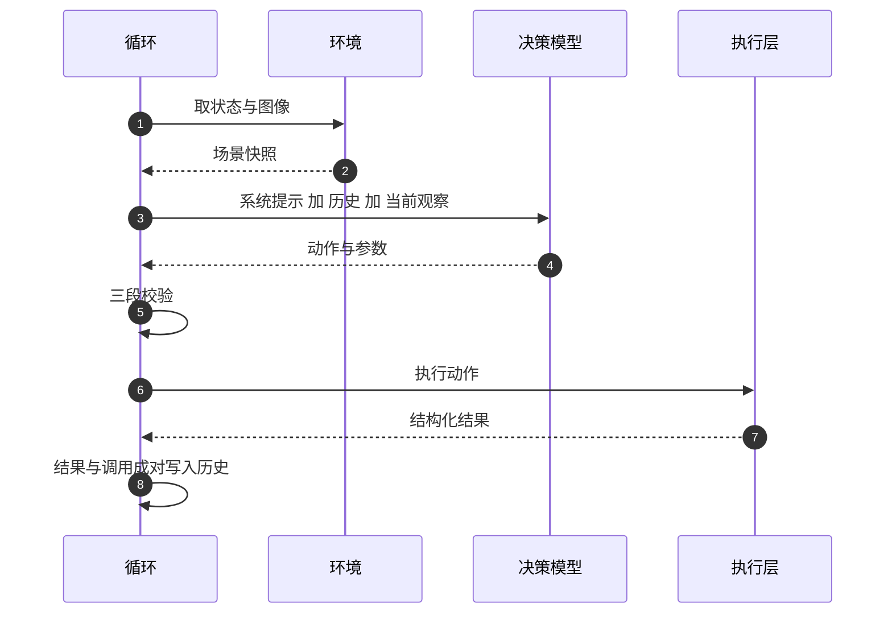
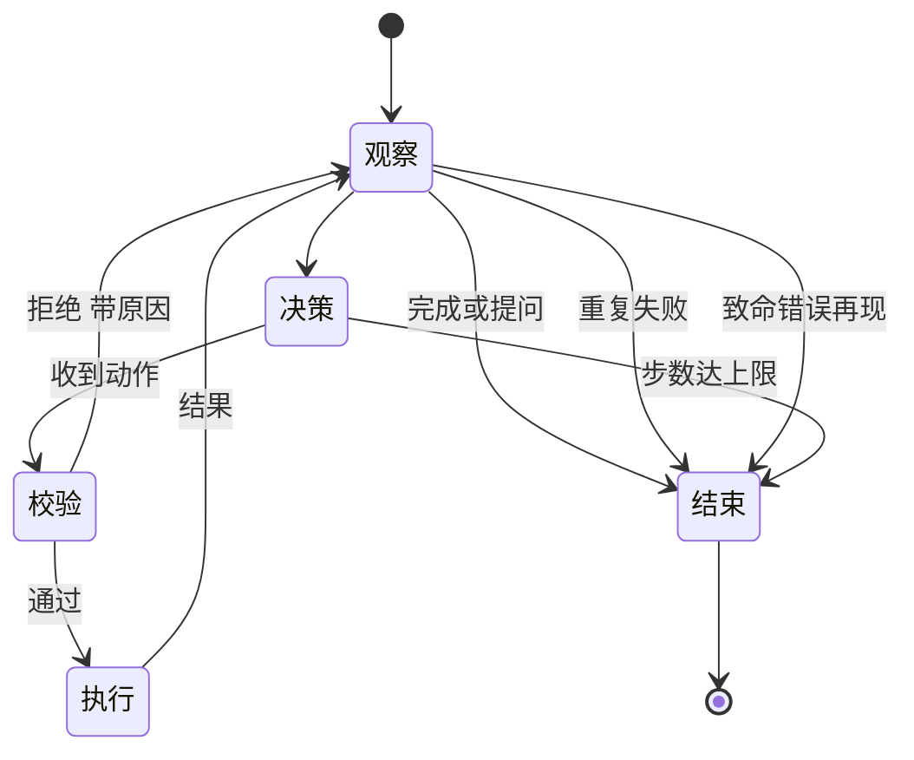

# Agent 循环与失败回灌

把模型接进循环之后，第一个要回答的问题是选错之后会怎样，而不是它选得对不对。一次失败就让任务终止，模型再强也只能做一步；失败被静默吞掉，任务看起来在推进而实际没有进展。失败信息的形态决定了循环能不能自己恢复。

下面先把一步拆成五个阶段，再讲观察怎么构造、历史如何划界、结束条件怎么定，最后讨论错误分层与重试退避。

## 一步的五个阶段

一次完整迭代由感知、决策、校验、执行、观察构成，每个阶段都可能失败，处理方式各不相同。

| 阶段 | 输入 | 输出 | 失败处理 |
| --- | --- | --- | --- |
| 感知 | 环境状态与多视角图像 | 场景快照与图像字典 | 单个视角失败只跳过该视角 |
| 决策 | 系统提示、历史、当前观察 | 一个动作加参数 | 异常记一条失败结果，允许有限次重试 |
| 校验 | 动作与场景快照 | 通过或拒绝原因 | 拒绝原因作为观察回灌，继续循环 |
| 执行 | 通过校验的动作 | 结构化结果 | 异常转成结果，不让循环崩掉 |
| 观察 | 执行结果 | 追加进历史的消息对 | 记录判断依据，供下一步使用 |



五个阶段里有三处刻意的设计。感知阶段对单视角失败采取跳过而不是中止，因为多视角本身就是冗余。执行阶段把异常转成结构化结果，让「执行器崩溃」与「动作失败」在循环眼里是同一种输入。观察阶段无论成功失败都写入，保证每一步都有对应的上下文。

## 观察必须是结构化的

回灌给模型的内容应当是一组字段，而不是一段自然语言。

| 字段 | 作用 |
| --- | --- |
| 成功标志 | 决定下一步是否进入完成判定 |
| 动作名 | 与发起调用对应，防止上下文错位 |
| 说明 | 给人看的自然语言，可包含具体原因 |
| 错误码 | 给循环与模型看的分类，决定重试还是终止 |
| 指标 | 物理量、几何证据、耗时等可核对的数据 |

错误码与说明分离是关键。说明可以写得很具体，但它不适合做程序判据：文本一改，依赖它的逻辑就失效。分类应由一个稳定的枚举承担，重试决策、终止决策、统计聚合都读枚举。

失败回灌的目标是让模型能重新规划，因此观察里要补上「为什么会失败」的可执行线索：可能的阻挡物、接触力大小、建议重新观察的视角。补全动作只发生在观察上。

```python
# 失败观察的补全：只加信息，不改动作
metrics.setdefault("failure_reason", result.message)
metrics.setdefault("obstruction_id", guess_obstruction(state, call))
metrics.setdefault("contact_force_norm", force_norm(state))
metrics.setdefault("suggested_views", list(cameras))
```

有一条边界必须守住：循环不代替模型改参数，也不自行重试同一个动作。它只补观测，重新规划由模型决定。否则「模型负责决策」这条设计前提会在实现里被悄悄推翻。

## 历史：成对追加与任务边界

历史由成对的消息构成：一条记录发起的动作，一条记录该动作的观察。成对存放有三个好处：可以原样发给兼容端点；文本扫描式的规则决策器能把调用与结果配对；裁剪时以「组」为单位，不会拆散因果关系。

跨任务调用同一个循环时，需要一条任务边界标记。没有它，上一条命令的抓取与放置记录会被当成当前任务的进度，导致状态判断错误。做法是在本轮第一条动作消息里内联一段任务标识，解析方只把最后一个标记之后的记录当作当前任务。

裁剪同样按组进行，并遵守一条优先级：当前任务的整段记录必须保留，其余历史按条数上限从旧到新丢弃。保留最早一组作为锚点，可以让上下文里仍有「最初的任务」这类背景，而不必保留全部中间过程。

## 结束条件

循环必须能在四种情况下停下来，缺任何一种都会出现空转或误停。

| 条件 | 判据 | 目的 |
| --- | --- | --- |
| 正常完成 | 模型给出完成或提问动作 | 收尾或转人工 |
| 重复失败 | 同一动作、同一错误码、同一参数组合连续出现 | 防止对着必然失败的动作空转 |
| 不可重试错误再现 | 环境类致命错误第二次出现 | 及时止损，不再浪费步数 |
| 步数上限 | 迭代次数达到预算 | 兜底，保证任务在有限时间内结束 |



「重复失败」的判据要包含参数组合。同一动作换个参数是一次新尝试，按动作名判重会把模型改正后的调用误杀；把参数序列化成一个指纹再比较，参数一变就放行。这条细节决定了守卫是保护还是阻碍。

「不可重试错误」指那些再试也不会改变的错误，例如归位路径被持有物挡住、场景被外部改动。它们第一次出现允许重试一次，第二次出现立即终止。把「世界的问题」与「模型的问题」分开，循环才能在两种情况下做出不同处置。

步数上限是最后一道兜底。即使模型每一步都合理，累计步数过多也说明任务本身超出能力范围，继续跑只消耗预算。

## 错误语义分层与重试

重试发生在三个层次，混在一起会出问题。

| 层次 | 触发 | 措施 | 上限 |
| --- | --- | --- | --- |
| 传输层 | 网络错误、超时、限流与网关类状态码 | 退避后重发同一请求 | 少量固定次数 |
| 决策层 | 响应无法解析出动作 | 提高输出预算并追加约束提示后重发 | 与传输层共用次数 |
| 任务层 | 动作执行失败 | 不自动重试，交模型重新规划 | 由结束条件约束 |

传输层与决策层的共同点是没有产生副作用，重发安全。任务层已经动过机械臂，自动重发可能重复执行，因此必须交回决策层。

分类依据应当是异常自带的稳定属性，而不是错误文本。文本是给人看的，措辞会变；属性是给程序用的。把分类挂在异常上，调用方读属性即可。

退避采用递增间隔，从数百毫秒到数秒，长度随尝试次数增加。递增的作用是让瞬时故障有时间恢复，同时避免高频重试放大服务端压力。次数上限保证失败最终会暴露给上层。

空回复需要单独处理。在带思维链的端点上，完成预算常被推理内容占满，正文为空。此时重试的有效措施是提高输出预算并追加一条「必须给出工具调用」的提示，而不是原样重发；只修改本次请求，不动调用方传入的消息。这类失败能否重试，同样取决于异常的稳定属性。

## 常见判断偏差

| # | 判断偏差 | 表现 | 依据 |
| --- | --- | --- | --- |
| 1 | 把失败当成异常上抛 | 循环被一次错误打断 | 失败应当是回灌给模型的观察 |
| 2 | 用错误文本做重试判据 | 文本改一次逻辑就失效 | 分类应由错误的稳定属性承担 |
| 3 | 按动作名判断重复失败 | 改正后的调用被误杀 | 判据要包含参数指纹 |
| 4 | 任务层失败自动重发 | 同一动作被执行两次 | 已产生副作用的重试必须交回决策 |
| 5 | 保留全部历史 | 上下文膨胀、旧任务污染当前状态 | 需要按任务边界与组裁剪 |
| 6 | 认为步数上限可以不要 | 任务在无效循环里耗尽预算 | 上限是防止空转的最后一道约束 |

## 小结

### 核心概念

- 一步由感知、决策、校验、执行、观察五个阶段构成，每个阶段都有对应的降级方式。
- 观察是结构化字段而非一段话，错误码承担程序判据，说明承担人类可读的原因。
- 失败回灌只补信息、不改动作；重新规划属于模型的职责。
- 历史成对追加，任务边界标记把上一任务的进度隔离在外，裁剪按组且保留当前任务。
- 四个结束条件分别覆盖正常收尾、重复失败、致命错误与预算耗尽。
- 重试分三层：传输与决策层可安全重发，任务层必须交回模型重新规划。

### 设计权衡

| 权衡点 | 常见选择 | 收益与代价 |
| --- | --- | --- |
| 失败信息 | 结构化错误码加说明 | 可程序判据又可读；代价是两处都要维护 |
| 重复失败守卫 | 动作加参数指纹 | 不误杀改正后的调用；代价是模型换写法仍会消耗步数 |
| 历史长度 | 有上限并按组裁剪 | 上下文可控；代价是长任务会丢早期细节 |
| 重试策略 | 递增退避加次数上限 | 容忍瞬时故障；代价是失败反馈有延迟 |
| 空回复处理 | 提高预算并加约束提示 | 针对性解决预算被占满；代价是需要区分失败原因 |

## 练习

### 基础题

1. 列出一轮迭代的五个阶段，并写出每个阶段失败时的处理方式。
2. 说明错误码与说明字段为什么必须分开。
3. 写出四个结束条件各自的判据与目的。
4. 解释任务层失败为什么不自动重试。

### 挑战题

5. 设计一份失败观察的字段清单，要求包含定位线索且能区分「模型选错」与「世界不配合」。
6. 为重复失败守卫设计一版参数指纹方案，说明如何处理含浮点参数与嵌套结构的调用。
7. 给定端点频繁返回空回复，设计一版分层重试方案，写出每层的触发、措施与上限。
8. 设计历史裁剪算法，要求当前任务完整、旧任务可截断、调用与观察不成对分离。

## 附：本页引用的路径

| 路径 | 用途 |
| --- | --- |
| `agent/loop.py` | 主循环、结束条件、失败观察补全与历史管理 |
| `agent/state.py` | 消息构造与阻挡物推断 |
| `agent/vlm_client.py` | 端点重试、错误分类与离线规则器 |
| `agent/taskplan.py` | 子目标编排对循环的调用方式 |
| `core/types.py` | 动作与结果的类型定义 |
| 仓库根 | `vlm-admittance`，公开仓库 https://github.com/TC635807/vlm-admittance |
