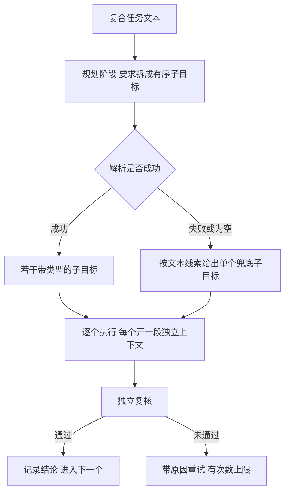
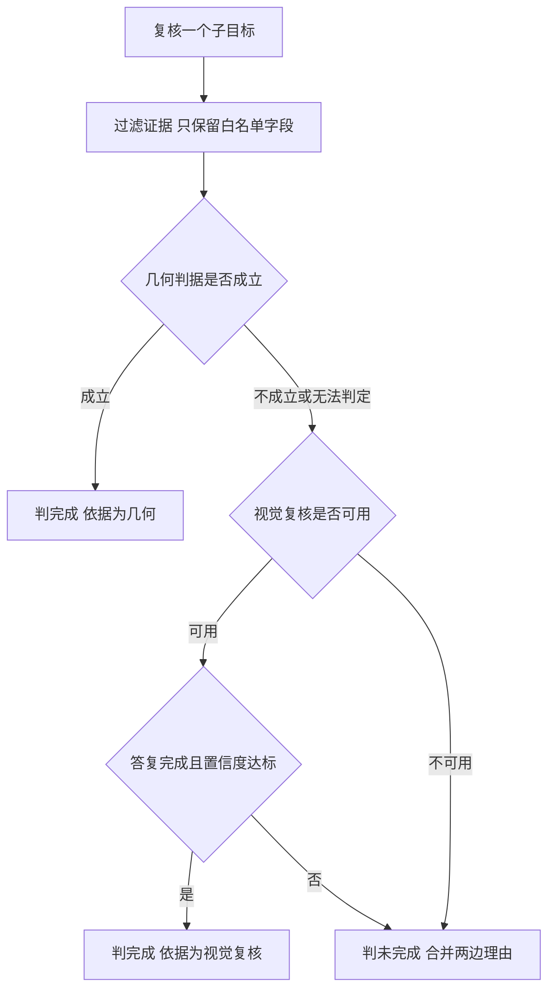

# 子目标分解与独立复核

复合任务的失败常常出在两个地方：模型做完了第一步，却在第二步把上一步的结论当成当前事实；或者它声称做完了，实际没有。前者是上下文边界问题，后者是验证问题。两者都不是靠换一个更强的模型能解决的，需要在结构上分别处理。

下面先讲为什么要在任务中间切一刀，再讲子目标怎么表示与规划，然后讨论复核为什么必须独立、判定顺序如何排、隔离与观察位的约束，最后是重试设计。

## 复合任务为什么要在中间切一刀

一条长链直接跑到底有三个问题。上下文里混着多个阶段的动作与观察，模型难以判断「现在到哪一步」；中途失败时，归因只能落到整条任务上，重试要么全部重来，要么无从下手；进度对外不可见，人只能等到结束才知道结果。把任务拆成有序子目标后，每个子目标有自己的范围、自己的成功判据和自己的重试次数。

| 维度 | 单体长链 | 拆成子目标 |
| --- | --- | --- |
| 上下文 | 全部阶段混在一起 | 每个子目标一段独立上下文 |
| 失败归因 | 落到整条任务 | 落到具体子目标 |
| 重试粒度 | 整体重来或放弃 | 只重试未通过的子目标 |
| 进度可见性 | 只有结束状态 | 每个子目标有结论与依据 |
| 验证方式 | 只能整体判断 | 按类型选判据 |
| 代价 | 结构简单 | 多一次规划调用与一层编排 |

拆分的代价是引入一层编排：规划可能出错，子目标之间的边界可能与物理动作不对齐，跨子目标的信息需要显式传递。这些代价要在设计里被承认，而不是靠「规划得很好」来掩盖。

## 子目标怎么表示

一个子目标需要三部分信息：给执行层看的自然语言指令、给复核层看的类型、给人看的验收说明。

| 类型 | 含义 | 默认复核方式 |
| --- | --- | --- |
| 放进容器 | 把物体放入某个容器内部 | 检测目标色块是否落在容器范围内 |
| 叠放 | 把物体放到另一物体上方 | 检测上下两色块的相邻与重叠关系 |
| 放到指定点 | 把物体放到给定位置 | 无固定几何判据，交视觉复核 |
| 只抓取 | 抓起来即可，不放置 | 技能的夹持证据，缺失时看原位色块是否消失 |
| 自由形式 | 说不清或无法分类 | 交视觉复核 |

类型是复核的入口：它把「怎么算完成」变成一个可枚举的选择，而不是每次重新判断。颜色与类别字段用于颜色分割与指代解析，属于线索而非判据。

## 拆解的两条路径

规划是一次单独的模型调用，与执行阶段分离。规划工具只在规划阶段可用，出现在执行阶段会被判为非法调用。这样做有明确目的：规划一次给出整条计划，执行阶段只负责推进；若允许在执行中重新规划，循环会失去进度概念，也容易在一个子目标里反复重置计划。

模型规划可能给不出可用结果：没有调用规划工具、列表为空、字段缺失、类型非法。这些情况都需要一条确定性兜底，从任务文本里按线索推断出单个子目标。兜底宁可粗，不可错：把复合任务当成一个整体，只会让复核退化到视觉判断；而错误的拆分会让后续步骤在错误前提下执行。

| 文本线索 | 兜底类型 | 理由 |
| --- | --- | --- |
| 出现容器词与放置语义 | 放进容器 | 有明确的几何判据可用 |
| 出现叠放词且点名两种颜色 | 叠放 | 可判断上下关系 |
| 只有抓取语义 | 只抓取 | 无需放置目标 |
| 其余 | 自由形式 | 没有可靠判据，交视觉复核 |

## 每个子目标一段独立上下文

执行每个子目标时都新建一个循环实例，而不是复用同一个。原因在于任务状态的定义方式：循环通过一段任务标识来划分「当前任务」，复用实例会让上一个子目标的观察继续参与当前状态的统计，出现「已经抓过了」这类错误结论。

独立上下文还带来两个副作用。好的方面是失败计数按子目标重置，一个子目标的失败不会拖垮后续子目标；坏的方面是跨子目标的记忆丢失，例如上一步标定出的容器像素在下一步不再可见。解决办法是把这类跨步骤可复用的感知结果放进一份共享缓存，由动作阶段写入、复核阶段只读，并在新任务开始时清空。

## 复核为什么必须用独立证据

模型的自评不能作为完成依据。原因在于它的判断用的是与执行阶段相同的上下文与图像：如果执行阶段的判断错了，自评会沿同一个错误继续；而且它的目标是推进任务，倾向于把「差不多完成」报成完成。

独立证据要求复核与执行在三处不同：输入不同（复核重新渲染当前画面，而不是复用执行时的观察）、机制不同（几何判据与执行时的运动规划无关）、来源不同（复核不读被执行层修改过的中间状态）。

| 证据类型 | 来源 | 强度 | 失效条件 |
| --- | --- | --- | --- |
| 几何判据 | 颜色分割与框关系 | 高，可复现 | 颜色规则失效或目标被遮挡 |
| 技能指标 | 执行层返回的物理量 | 高 | 指标口径与语义不符 |
| 前后对比 | 执行前后的同一视角图像 | 中 | 目标未被遮挡时仍可见 |
| 视觉复核 | 模型看当前画面作答 | 中，带置信度 | 回复为空或置信度低 |
| 模型自评 | 执行过程中的声明 | 低，仅作信号 | 无法证伪 |

几何判据优先级最高，因为它可复现、可解释，并且失败时能给出具体原因。视觉复核排在后面，用于没有固定几何判据的类型，或几何判据无法判定时。

## 判定顺序与弃权语义

判定顺序是固定的：先跑几何判据，通过即完成；不通过或无法判定时，再问视觉复核；两者都不通过才判未完成。任何异常一律判未完成，绝不返回成功。

这里有一处容易被忽略的语义区分：无结论与否定是两回事。复核模型可能因为输出预算被占满而返回空内容，此时既不能说完成，也不能说未完成，而应记为「无法判定」。把无法判定当成否定，会让本来正确的执行被判失败；把它当成肯定，则会谎报成功。正确的处理是保留这一状态，让它消耗一次重试机会但计入可重试。

视觉复核给出完成时还要过一道置信度门槛。门槛的作用是把「可能是」转成「证据不足」。低于门槛的肯定答复按未完成处理，理由里写明置信度不够，供下一轮重试参考。

## 信息隔离

复核过程不能读物体真值位姿，喂给复核模型的证据也要过滤：只保留与判据直接相关的字段，凡是含有坐标、真值、位置语义的键一律丢弃。

| 字段类别 | 是否给复核 | 理由 |
| --- | --- | --- |
| 夹持标志、指间距 | 给 | 与抓取判据直接相关 |
| 抬升与随动证据 | 给 | 物理事实，可兜底图像判据 |
| 接触力、落点高度 | 给 | 支撑接触类判断 |
| 阻挡物与失败原因 | 给 | 帮助解释未完成 |
| 物体位姿、坐标 | 不给 | 等同真值，会让复核变成套话 |
| 场景内部诊断字段 | 不给 | 与判据无关，只是泄漏面 |

隔离的意义在于让复核具备失败的可能。如果复核拿到的输入里已经包含答案，它的通过只说明判据实现没有出错，说明不了感知链路是否可用。把真值挡住之后，复核的失败才指向真实问题。

隔离本身是可检验的：把真值接口换成抛异常的桩，整条闭环仍要跑通；再扫描发给复核的消息，确认其中不出现坐标类字段。

## 复核不能扰动被验证的状态

为了让相机看清结果，复核前通常要把机械臂移出工作区。这条操作在多数情况下无害，在持物时会把物体连同夹爪一起挪走，甚至让物体掉落，于是「复核」这个动作本身破坏了被验证的状态。

规则因此需要加一条前置判断：如果子目标是抓取类，或者当前仍持有物体，就跳过归位；其余情况再移出工作区。更通用的表述是，任何观测动作在执行前都要检查它的副作用是否会改变待观测状态。

观察动作失败或超时也不允许把子目标判死。归位失败只记日志，复核照常进行，复核仍然是唯一判据。

## 重试怎么设计

重试次数要有上限，同时重试必须带信息。第二次尝试的指令里附上上一次复核给出的原因，让模型换一种做法，而不是原样重复。原因通常包含：几何判据的实测值、视觉复核的理由、缺失的证据类型。

还要区分两种未通过：判据明确否定，说明动作确实没成功；无法判定，说明证据不足。前者需要改变动作，后者需要改善观测。把两者分开记入结果，重试时才能选择不同的调整方向。

| 记录字段 | 含义 |
| --- | --- |
| 子目标 | 本条记录对应的子目标 |
| 尝试次数 | 到通过或耗尽为止的尝试数 |
| 是否完成 | 由独立证据给出 |
| 证据类型 | 几何、视觉复核或失败 |
| 原因 | 未通过时的具体依据 |

## 常见判断偏差

| # | 判断偏差 | 表现 | 依据 |
| --- | --- | --- | --- |
| 1 | 把模型自评当完成依据 | 任务报成功但物体未动 | 自评与执行共享同一上下文，无法证伪 |
| 2 | 认为几何判据永远可靠 | 遮挡或颜色失效时误判 | 几何判据依赖分割质量，需要视觉复核兜底 |
| 3 | 把无结论当成未完成 | 正确执行被判失败 | 空答复是证据不足，不是否定 |
| 4 | 复用同一个循环跑所有子目标 | 上一步状态污染当前判断 | 状态按任务边界划分，子目标之间要重置 |
| 5 | 复核前一律归位 | 持物时把物体挪丢 | 观测动作可能破坏被观测状态 |
| 6 | 重试不带原因 | 模型原样重复同一动作 | 重试需要上一轮的具体失败信息 |

## 小结

### 核心概念

- 复合任务拆成有序子目标，是为了限定上下文范围、定位失败、暴露进度与选择验证方式。
- 子目标由指令、类型与验收说明组成，类型决定复核判据。
- 规划由模型完成，解析失败时用确定性单条兜底，宁可粗不可错。
- 每个子目标使用独立的上下文与失败计数，跨步骤可复用的感知结果放共享缓存。
- 复核必须独立：输入、机制与状态来源都与执行阶段不同，模型自评只作信号。
- 判定顺序是几何优先、视觉复核兜底、异常一律判未完成；无结论与否定必须分开。

### 设计权衡

| 权衡点 | 常见选择 | 收益与代价 |
| --- | --- | --- |
| 拆分粒度 | 按语义子目标拆 | 失败可定位、可重试；代价是多一次规划与一层编排 |
| 规划来源 | 模型规划加确定性兜底 | 兼顾灵活与可用；代价是兜底只能给出粗粒度结果 |
| 复核优先级 | 几何优先、视觉兜底 | 结果可复现；代价是需要为每种类型设计判据 |
| 无结论处理 | 单独记状态并允许重试 | 不误判正确执行；代价是多消耗尝试次数 |
| 信息范围 | 只给白名单证据 | 复核能真实失败；代价是证据字段需要逐项审核 |

## 练习

### 基础题

1. 列出把复合任务拆成子目标后获得的四项收益与两项代价。
2. 说明子目标的类型字段为什么是复核的入口。
3. 解释模型自评为什么不能作为完成依据。
4. 写出复核的判定顺序，以及无法判定与否定在处置上的差别。

### 挑战题

5. 为一个「先放到桌上再叠到另一物体上」的任务设计子目标划分，写出每个子目标的类型与判据。
6. 设计一份复核证据白名单，说明每个字段支撑哪条判据，以及哪些字段必须排除。
7. 设计观察位策略：给出「何时可以移出工作区、何时必须保持原位」的判据与检查顺序。
8. 若把重试上限从 3 次提高到 10 次，分析会带来哪些收益与风险，并给出一版更合理的重试策略。

## 附：本页引用的路径

| 路径 | 用途 |
| --- | --- |
| `agent/taskplan.py` | 子目标类型、规划、独立复核与编排 |
| `agent/loop.py` | 单个子目标的执行循环与完成声明处理 |
| `agent/schema.py` | 规划工具与复核工具的定义与校验 |
| `sim/perception.py` | 几何判据：容器内、叠放、消失判断 |
| `tests/` | 隔离检查与子目标闭环回归 |
| 仓库根 | `vlm-admittance`，公开仓库 https://github.com/TC635807/vlm-admittance |
