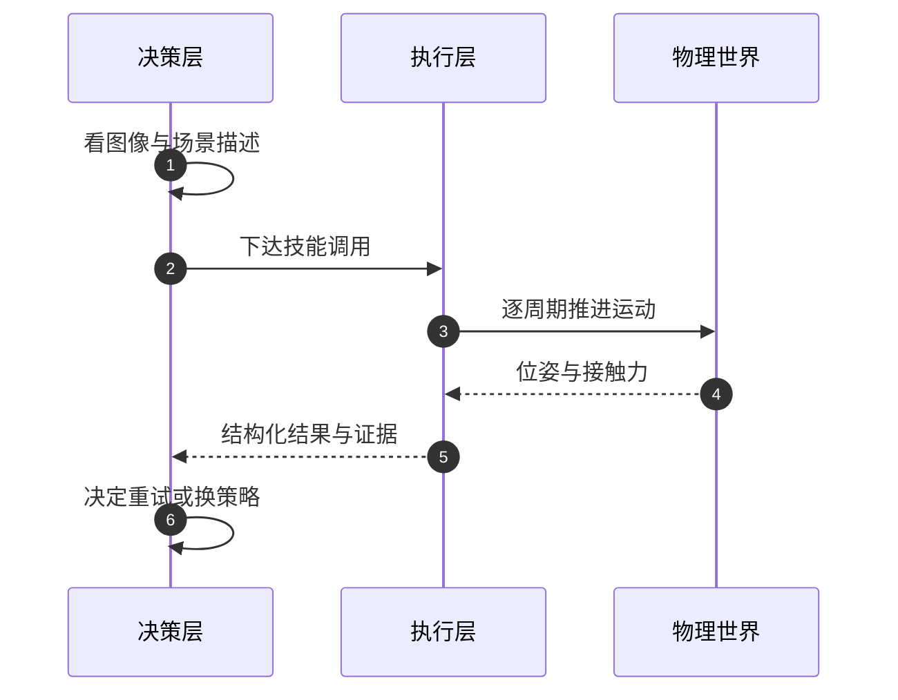
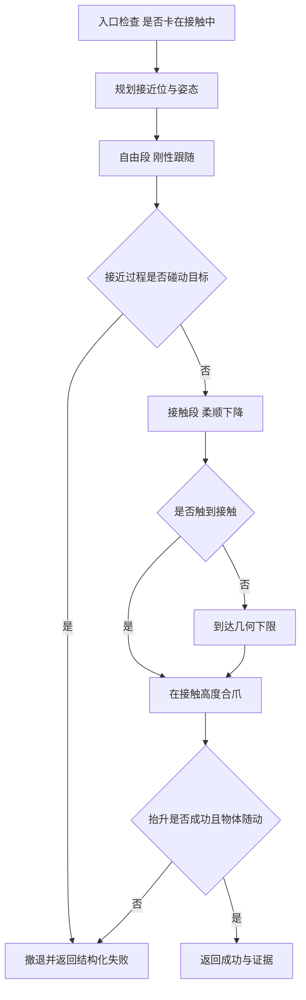
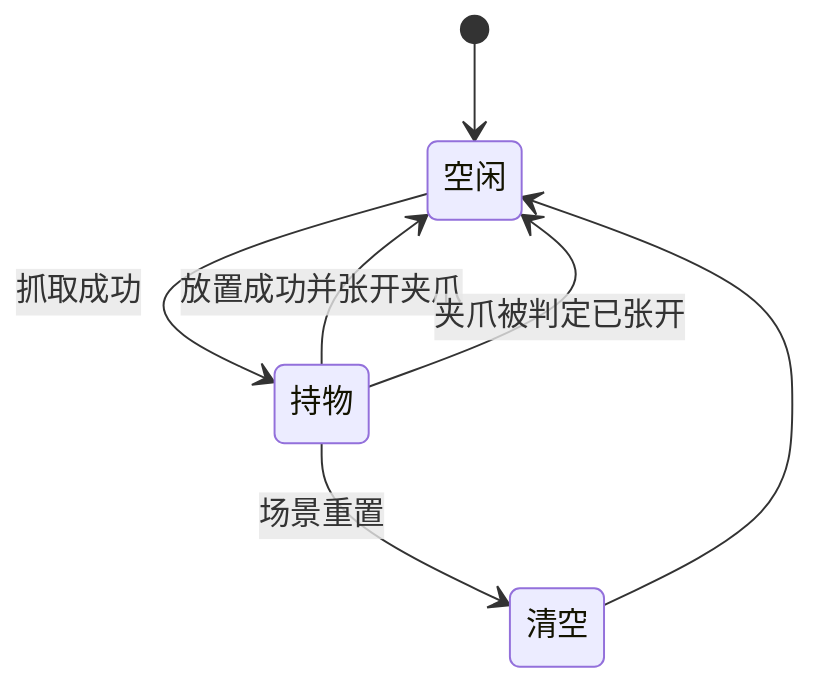
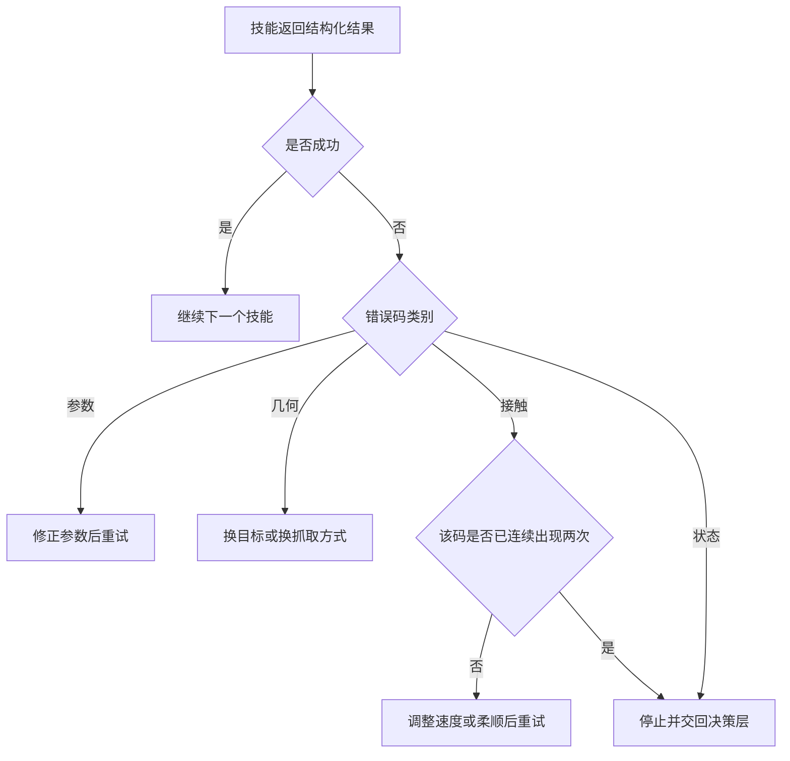

# 技能层的职责边界

把会看图、会对话的模型接到机械臂上，最直接的做法是让模型在每个控制周期输出一条运动命令。接上去之后，两件事会同时暴露：模型的响应以秒计，而控制周期以毫秒计；模型对同一条指令的措辞每次略有不同，而执行层需要的是一段可以复现的动作。分层由这两个约束逼出来，与风格偏好无关。

下面先说明分层要解决的第一个问题是时间尺度，再讨论哪些决定该留给模型、哪些必须由执行层承担，然后讲技能为什么必须是一段确定性序列、跨调用的状态该放在哪里，最后说明错误码怎样从一条报错变成上层可以据此分支的信号。

## 时间尺度先划出分层的位置

决策是事件驱动的：识别出一个物体、一次尝试失败、任务被改口径，才需要重新决策。执行是周期驱动的：物理步进与位置伺服每隔几毫秒走一次，接触力、关节角、末端位姿都在这个尺度上变化。一次决策依赖的模型调用以秒计，与执行周期相差两到三个数量级。

一条必须在毫秒尺度上重算的量，不能来自一次网络调用。反过来，一个需要结合语言、图像与上下文的判断，也不该塞进每毫秒执行一次的循环里。分层的判据可以写成一条规则：按量自身的变化速率归属，与它的重要程度无关。

| 维度 | 决策层 | 执行层 |
| --- | --- | --- |
| 触发方式 | 事件触发，秒级 | 周期驱动，毫秒级 |
| 输入 | 图像、场景描述、历史 | 关节状态、接触力、目标位姿 |
| 输出 | 选哪个技能、用什么参数 | 一串确定的物理动作 |
| 判断依据 | 意图、上下文、歧义 | 几何、时序、接触 |
| 失败呈现 | 换策略或改口径 | 结构化错误码与证据 |



这条环形结构还有一个隐性收益：两层可以各自被验证。执行层不依赖模型也能被脚本化驱动，决策层不依赖真实硬件也能用确定性替身跑通。把两层耦合成一层，任何一次失败都同时牵扯网络、模型与控制器，定位成本会高一个量级。

## 哪些决定留给模型，哪些留给技能

划分依据是这条决定有没有客观上正确的答案。凡是能从当前状态算出来的量，都不该问模型：末端在哪里、法兰到目标的距离、物体有多宽、这段运动要多久、接触力有没有超过阈值，这些问题各自有确定解，模型给出的是估计，而估计比计算更容易错。

反过来，依赖意图与上下文的判断必须由模型承担：三个外形相似的方块里拿哪一个、把物体放到桌上还是放进托盘、一句“轻一点”对应多大的柔顺、这次失败之后是换目标还是换策略。这些问题没有唯一正确答案，需要语言与图像里的语境。

| 决定 | 归属 | 理由 |
| --- | --- | --- |
| 选哪个物体、放到哪里 | 决策层 | 依赖意图与场景语境 |
| 抓取位姿与接近方向 | 执行层 | 由几何关系唯一确定 |
| 夹爪闭合量 | 执行层 | 由物体宽度与标定换算 |
| 柔顺程度 | 决策层给意图，执行层定档 | 意图是描述性的，档位要满足稳定条件 |
| 运动时长与限速 | 执行层 | 由距离、速度上限与接触安全决定 |
| 失败后是否重试 | 决策层 | 需要结合历史与任务目标 |

边界定好之后，决策层的输出就不再是自然语言，而是一个字段固定的小结构：技能名、参数、可选的柔顺意图。参数要过一遍校验：未知字段过滤掉而不是报错，类型与范围不合法才拒绝，最后再检查它与场景是否自洽。校验的收益是把模型的自由发挥限制在参数空间里，而不是让它自由地发明动作。

## 技能为什么必须是一段确定性序列

确定性在这里指同一份调用加上同一份状态，得到同一串有序的物理动作。它换来三件东西。第一是失败归因：一次抓取包含接近、下降、合爪、抬升几段，如果顺序或判据每次不同，失败时无法判断是接近偏了还是合爪没夹住。第二是重试语义：上层只改一个参数再调用，其余环节保持不变，改动才有可比较的基准。第三是安全：什么时候先停住、什么时候先松爪，这些顺序不能交给一次采样决定。

确定性不等于固定轨迹。序列的顺序和每段的进出判据是固定的，段内的轨迹则随测量状态变化：下降在接触时停止，合爪在力升高时停止，抬升在位移不再变化时判定失败。固定的部分是流程，自适应的部分是参数。把两者混为一谈，会得出“要么僵化、要么不可控”的结论。



把这段话落到入口上，就是一个按名字派发、把异常收敛成结果的函数：执行层的对外承诺只有“成功”与“带原因的失败”两种，内部异常不许穿透到决策层。下面这段来自项目的派发入口（节选，省略了耗时统计与日志）。

```python
def __call__(self, call):
    fn = getattr(self, "_skill_" + str(call.skill), None)
    if fn is None:
        res = SkillResult(False, call.skill, "unknown skill", "unknown_skill")
    else:
        try:
            res = fn(call)
        except Exception as exc:
            res = SkillResult(False, call.skill, str(exc), "exception")
    self.history.append({"call": call.to_json(), "result": res.to_observation()})
    return res
```

顺序固定还有一个容易忽略的收益：每一段产出哪一类证据是可以预期的。接触段能给出触地高度，合爪段能给出被阻挡时的开合度，抬升段能给出位移与随动信息。校验环节知道该期待什么，才能判断证据缺没缺。

## 跨调用的状态该放在哪里

技能调用原则上应当无状态，但有两类信息只能跨调用保存。一类是手里拿着什么：放置要知道被放物是什么，否则算不出落点高度；另一类是上一次成功抓取时物体在哪，任务中止时才谈得上放回原处。柔顺档位也属于这一类，它由一次调用设定、被后续调用使用。

状态一旦引入，卫生规则就随之而来。能被物理量重新推导的，就不要只信内部记录：夹爪实际张开到接近全开时，手里的物体已经不在，状态必须随之清空，否则界面与动作会对不上。失败路径要负责把状态清干净，尤其是“场景被重置”这类会让所有旧状态失效的动作。

| 状态 | 为什么需要 | 失效条件 | 卫生规则 |
| --- | --- | --- | --- |
| 手持物体 | 放置要算落点高度与判据 | 夹爪实际张开或场景重置 | 按物理张开度复核后清空 |
| 上次拾取位姿 | 中止时放回原处 | 落点被占或超出桌面 | 放回前重新校验落点 |
| 当前柔顺档 | 一次设定、后续复用 | 任务切换到别的阶段 | 每段运动按需重新指定 |



状态放在执行层而不是决策层，是因为它描述的是物理事实。决策层保存的是任务目标，执行层保存的是“此刻手里有什么”。两者混在一起时，任务切换会留下一个与物理不符的持物标记，后续放置就会对着空气下压。

## 错误码怎样变成可决策的信号

一条报错给人看，一个错误码给分支用。执行层返回的结果需要同时带三样：是否成功、从有限集合里取的一个错误码、以及解释这个码的证据。决策层据此做三种选择中的一种：改参数重试、换技能重试、直接结束。

为什么码要来自有限集合：只有集合有限，终止条件才写得出来。例如同一技能加同一个错误码连续出现两次而决策层仍提议同一技能，说明重试不再产生新信息，应当停止；再比如某些码表示世界已经变了，第二次出现就没有继续的必要。自由文本做不到这一点，因为两次报错的字符串几乎不可能完全一致。

| 错误类别 | 含义 | 上层应有的反应 |
| --- | --- | --- |
| 参数类 | 调用本身不合法，未产生物理动作 | 修正调用，可立即重试 |
| 几何类 | 目标不可达或路径非法 | 换目标点或换抓取档位 |
| 接触类 | 力超限、超时、卡住 | 降速或改柔顺后重试，注意次数上限 |
| 状态类 | 场景已被改动或重置 | 不再重试，重新规划任务 |



证据的作用是让重试有方向。只回一个“抓取失败”，上层能做的只有原样重试；回一个“在接触高度合爪时力超限，受阻物是容器边缘”，上层就知道该换落点或换降速。证据里还会带上建议补充的观测类型，例如需要再看一张图，把“重试”从盲目试参数变成带信息的再决策。

## 模型意图与安全阈值的边界

模型可以表达对柔顺程度的偏好，这种偏好作用于刚度与阻尼，也就是末端让位的幅度。但它不允许降低保护性阈值。力阈值衡量的是“接触是否异常”，正常贴面接触本身就可能接近阈值，把它调低会让正常动作被判成超限。

| 参数类别 | 谁能设定 | 模型能否降低 |
| --- | --- | --- |
| 刚度与阻尼 | 模型意图映射到档位 | 可以 |
| 力阈值 | 执行层基准值 | 不可以，只取下界 |
| 硬上限 | 执行层常量 | 不可以 |
| 目标位姿与姿态 | 模型给出，执行层校验 | 可以，但不可达会被拒 |

硬上限存在的理由是接触力的量级。位置伺服刚性压入时，末端力可以冲到很大的量级，远超正常接触所需的数值；把上限做成可调参数，一次错误的偏好就可能把保护放到没有作用的位置。因此硬上限写成常量，外部传入更大的值会被夹回，并留下一条告警。

## 常见判断偏差

| # | 判断偏差 | 表现 | 依据 |
| --- | --- | --- | --- |
| 1 | 把执行层当成薄封装 | 认为它只是把模型输出转发给控制器 | 它还要承担几何、时序、接触与安全 |
| 2 | 让模型输出末端或关节轨迹 | 秒级延迟进入毫秒级环路 | 两个时间尺度差两到三个数量级 |
| 3 | 用自然语言消息驱动重试 | 上层无法判断该不该继续 | 消息给人看，码给分支用 |
| 4 | 让执行层自行换参数盲重试 | 失败原因被掩盖，观测不再有用 | 结构化证据应交回上层重新规划 |
| 5 | 把确定性理解成固定轨迹 | 放弃接触期的自适应 | 固定的是顺序与判据，变的是段内参数 |
| 6 | 认为柔顺意图可以下调安全阈值 | 正常贴面动作被判超限 | 意图只作用于刚度与阻尼 |

## 小结

### 核心概念

- 分层的第一依据是时间尺度：秒级的决策与毫秒级的执行不能压在同一个循环里。
- 有客观正确答案的量留给执行层，依赖意图与语境的判断留给决策层。
- 技能是一段顺序与判据固定的动作序列，段内轨迹随测量状态自适应。
- 跨调用状态只保存物理事实，并能用物理量复核与清空。
- 错误码取自有限集合，才能表达“同一失败连续两次就停止”这类终止条件。
- 模型的柔顺意图作用于刚度与阻尼，保护性阈值与硬上限由执行层守住。

### 设计权衡

| 权衡点 | 常见选择 | 收益与代价 |
| --- | --- | --- |
| 分层位置 | 按时间尺度切，不按功能切 | 每层可独立验证；代价是接口要先定清楚 |
| 技能粒度 | 一次调用对应一件可完成的物理动作 | 失败可归因；代价是技能数量随动作类型增长 |
| 重试位置 | 上层决策，执行层只给证据 | 观测不被浪费；代价是上层要有像样的重试策略 |
| 状态归属 | 物理事实留在执行层 | 与真实状态一致；代价是需要一套失效规则 |
| 安全参数 | 阈值只取下界、硬上限为常量 | 模型不能削弱保护；代价是柔性略低 |

## 练习

### 基础题

1. 举出三个“有客观正确答案”的决定，说明为什么它们不该交给模型。
2. 说明技能的确定性序列与固定轨迹之间的区别，各举一个例子。
3. 为什么错误码需要来自有限集合？用终止条件的写法说明。
4. 列出执行层需要跨调用保存的状态，并写出每一种的失效条件。

### 挑战题

5. 为“模型给出一句柔顺偏好”设计一条落到执行层的映射规则，要求安全阈值不受影响。
6. 设计一份错误码分类表，并规定每一类在决策层的默认处置与重试上限。
7. 设计一套状态卫生检查清单，覆盖抓取、放置、失败与场景重置四条路径。
8. 如果允许模型直接指定运动时长，会产生哪些可观测的问题？写出替代方案。

## 附：本页引用的路径

| 路径 | 用途 |
| --- | --- |
| `skills/library.py` | 技能派发与各技能的动作序列 |
| `agent/loop.py` | 慢环调度、参数校验与失败回灌 |
| `agent/schema.py` | 工具定义与参数白名单 |
| `core/types.py` | 技能调用、结果与状态的类型定义 |
| `core/config.py` | 柔顺档位与安全阈值常量 |
| `control/motion.py` | 运动执行、错误码与力看门狗 |
| `planning/planner.py` | 关节空间规划与路径校验 |

