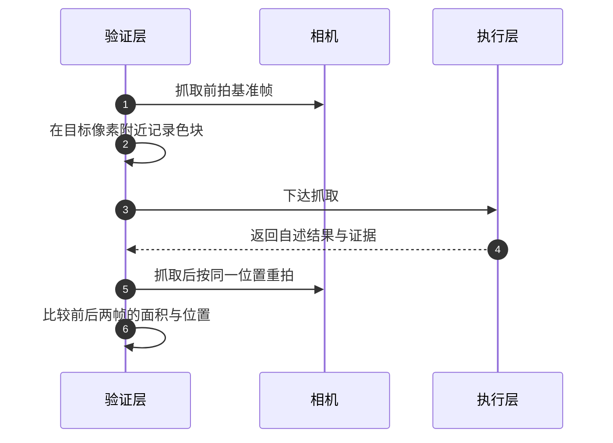
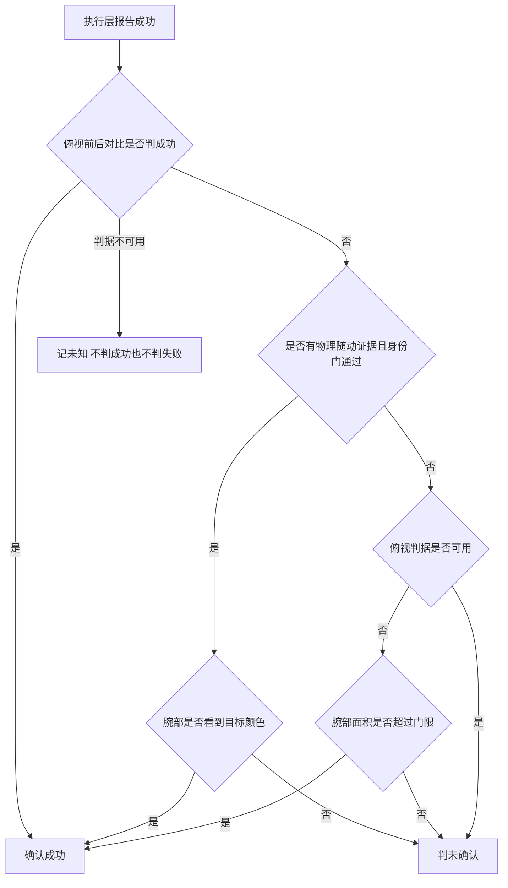

# 纯视觉验证

执行层返回成功，意思是它按既定顺序完成了动作。这个回答没有覆盖一个更基本的问题：物体是否真的离开了原来的位置。合爪可能夹在空气里，抬升可能只是把物体碰了一下，放置可能把它按回了原处。把执行层的自述当成最终结论，任务会在最需要暴露问题的时刻给出肯定回答。验证层的职责，是用独立于执行过程的证据回答那个更基本的问题。

下面先界定验证要回答的是哪一个问题，再列出视觉验证的典型失效模式，然后讨论主判据的选择、多视角的分工、几何证据与物理证据的优先级，最后说明判不出结论时结论该怎么写。

## 验证要回答的是哪一个问题

验证问题是会写错的。写成“夹爪里有没有目标颜色”，回答容易得到，却与任务目标只有弱相关；写成“物体是否还在原位”，才是任务成功条件的直接表述；写成“物体是否随末端一起移动”，问的是物理事实，但它不包含身份信息。选错问题不会让验证报错，只会让它在关键时刻给出没有意义的正确答案。

| 候选判据 | 判读的是什么 | 与目标语义的关系 | 主要风险 |
| --- | --- | --- | --- |
| 夹爪内是否出现目标颜色 | 代理量 | 弱，夹爪停在物体上方也成立 | 近似恒真的假阳性 |
| 单帧里目标是否可见 | 状态量 | 中，物体被挡住就判不出来 | 遮挡下两个方向都会错 |
| 原位置是否仍有目标颜色 | 目标语义 | 强，直接对应“被拿走” | 依赖抓取前的基准帧 |
| 夹爪接触的物体是否离地 | 物理事实 | 强但不含身份 | 不能区分夹的是哪一个 |

判断一个判据是否合格，看它有没有能力给出否定答案。一个几乎总是返回成功的判据，即使偶尔正确也不构成证据；一个在判据失效时返回“不知道”的判据，反而比强行二选一更有用。

## 视觉验证的失效模式

第一类是代理量本身接近恒真。腕部相机挂在夹爪根部朝下看，只要夹爪停在物体正上方就能看到大片颜色，物体并没有被抓起。这类信号在单帧上看起来很显著，在语义上却与成功没有必然联系。

第二类是遮挡造成漏判。物体被真实抓起时，如果它没有被夹爪挡住，俯视图里原位置的色块可能只是略微变化，甚至因为视角变化而面积回升。只按“原位置是否还有颜色”就会把真实成功判成失败。

第三类是几何误差。单目反投影需要一个假定平面，物体越高，透视外推的偏差越大，对细高物体可以到厘米量级。像素点选偏一点，落到世界坐标上就是几厘米的偏移。

第四类是同色干扰。灰、白、黑这类低饱和颜色与桌面、阴影、背景接近，在没有局部先验的情况下全图搜索很难稳定分割，容易给出位置错误的色块。

第五类是双视角没有对准同一特征。两条射线求最近点时，如果两个像素指向的是物体上的不同位置，近点距离会异常，结果是得到一个看起来合理但来源不明的三维点。

第六类是信息泄漏。验证时直接读仿真里的真值位姿，判据会变得永远正确，却无法迁移到没有真值的场景。隔离靠约定守不住，必须由构造保证。

| 失效模式 | 表现 | 设计上的应对 |
| --- | --- | --- |
| 代理量近似恒真 | 夹爪停在物体上方也报有颜色 | 代理量只作反闸，不作主判据 |
| 遮挡导致漏判 | 真抓起但俯视图面积几乎不变 | 允许物理证据在满足身份门时兜底 |
| 几何误差 | 高物体落点偏移随高度增大 | 给高度提示或补第二视角 |
| 同色干扰 | 无先验的全图搜索给出错点 | 低饱和色必须有局部先验才判 |
| 双视角错配 | 三角近点距离异常 | 用残差作为门限，超限直接失败 |
| 信息泄漏 | 判据永远正确但与现场无关 | 证据键白名单与隔离检查 |

## 主判据怎么选

选择顺序可以概括为三句：比状态判读更信变化判读，比代理量更信语义量，判据要能说“否”。状态判读依赖一个在每帧都稳定可分的特征，光照、标定、材质变化都会让它漂移；变化判读看的是同一位置前后两帧的差异，恒定偏置在相减时被消掉，代价是需要一帧基准与一个稳定的参考区域。

以“物体是否被拿走”为例，可行的主判据是抓取前在目标像素附近记下色块，抓取后在原位置重新检测：原色块消失，或者面积掉到原来的三分之一以下，判为拿走；仍然存在则判失败。三分之一这个比值是量级取舍：要求绝对消失会被部分遮挡与边缘抗锯齿误伤，放到接近 1 又会把“轻微移动”当成成功。下面是该项目判据的实现节选，省略了面积下限的分支。

```python
if not before.found:
    return {"ok": False, "why": "subject_not_found_before", "metrics": metrics}
if not after.found:
    return {"ok": True, "why": "subject_gone", "metrics": metrics}
if after.area_px * 3 < before.area_px:
    return {"ok": True, "why": "subject_area_shrank", "metrics": metrics}
return {"ok": False, "why": "subject_still_present", "metrics": metrics}
```

这段判据的每一支都对应一种语义：基准帧找不到物体时直接失败而不是猜测；抓取后找不到色块是最强的成功证据；面积缩到三分之一以下算成功；其余一律判仍在原位。判据宁可漏判成功，也不把失败写成成功，因为前者的代价是一次重试，后者的代价是一个错误的动作序列继续往下走。



## 多视角怎么分工

多视角的价值在于每个视角承担不同角色，而不是把几个视角的结论投票平均。主判据用俯视图的前后对比，因为它能看到“原位置”这个与语义直接相关的区域；腕部视角离得近、能看到夹爪内部，适合做反闸与兜底；斜视视角提供第二组射线用于三维定位；色块面积这类连续量留作诊断，不单独决定成败。

| 角色 | 通常选哪个视角 | 为什么 | 局限 |
| --- | --- | --- | --- |
| 主判据 | 俯视 | 能看到原位置的变化 | 被夹爪遮挡时失效 |
| 反闸 | 腕部 | 离夹爪近，能看夹爪内部 | 停在物体上方也成立 |
| 兜底 | 腕部 | 主判据不可用时仍有信号 | 需要更高的面积门限 |
| 定位 | 俯视加斜视 | 两条射线给出残差 | 需对准同一特征 |
| 诊断 | 任一 | 连续量便于观察趋势 | 不参与成败判定 |

角色分开之后，视角之间的冲突就有明确处理方式：主判据说成功就算成功；主判据说仍在原位，而腕部也看不到目标色块时，不允许用物理证据放行，因为那说明手里夹的多半是别的东西。反过来，主判据不可用时才允许降级到腕部，并且要在结论里标记降级原因。



## 几何证据与物理证据谁兜底

优先级要按证据的硬度排，而不是按实现的方便排。图像前后对比直接回答语义问题，放在第一位。物理随动证据描述的是“夹爪接触着一个可动物体，并且它已经不被支撑面托着”，这个事实比像素更硬，但它不含身份，所以要加一道身份门：被接触的物体必须是本次目标任务，且另一视角没有出现矛盾。

物理证据只在主判据说“仍在原位”时才用来兜底，用来覆盖遮挡造成的漏判。如果两个视角都看不到目标，主判据也失效，此时降级到腕部面积门限；如果连腕部都不可用，结论记成未知，既不判成功也不判失败。这条链的每一级都必须写清降级理由，否则后来读日志的人无法判断结论的可信度。

判据的返回值用三值比用布尔更合适。三值让“证据不足”成为一个可以传递的状态：上层可以据此选择重试、补一张图，或者交给模型复核，而不是被迫在成功与失败之间选一个。把未知折叠成成功会让错误动作继续，折叠成失败会让正常任务反复重试。

## 像素误差与置信门限

单目反投影的几何关系是针孔模型：由竖直视场角算出焦距，把世界点变换到相机系后按深度做除法。假定平面与物体实际高度不一致时，反投影会把点沿视线外推，误差随高度与相机倾角增长。细高物体按桌面平面反投影，偏差可以到厘米量级。

$$u = \tfrac{W}{2} + f\tfrac{p_c[0]}{\text{depth}}, \qquad v = \tfrac{H}{2} - f\tfrac{p_c[1]}{\text{depth}}$$

双目三角把误差变成一个可观测的量：两条射线的最近点距离就是残差，越小说明两个像素越可能对应同一特征。残差超过门限时应当直接判失败，而不是静默回退到单目。回退会让一次本可发现的错配变成一个位置错误的抓取，代价远大于重试。

门限的取值与任务尺度有关：残差在毫米量级时三维点可信，到了厘米量级就已经与物体本身的尺寸相当。低饱和颜色的处理原则类似，缺少局部先验时宁可判为未找到，也不给一个来源不明的点。

## 判不出来时结论怎么写

验证的输出至少要有四种取值：确认成功、未确认、未知与不适用。未知用于判据不可用，不适用用于本次任务根本没有目标颜色这类情况。写清这两者的区别，上层才能区分“需要换判据”和“需要重试”。

结论里还要带上判据本身的名字与关键量：用了哪个视角、前后面积各是多少、是否走了降级路径、物理证据是否参与。这些量在当下像是冗余，事后定位一次误判时它们决定能不能复盘。结论的结构化程度，直接决定验证层能不能被信任。

## 信息隔离要由构造保证

隔离的目标是让验证只用现场可得的观测，而不是仿真里的真值。做法有三层：场景描述本身不携带物体位姿，只给类别、颜色与尺寸；反投影只依赖相机标定与像素；回灌给复核模型的证据走白名单，键名里出现位姿、真值一类词的一律丢弃。

约定会被新代码绕过，构造不会。把真值接口替换成直接抛异常的替身，再跑一遍完整流程，是一种把隔离变成可检查约束的做法：只要有人写了读真值的分支，流程立刻失败。这比在文档里写“不要读真值”更可靠。

| 隔离层 | 做法 | 绕过时的后果 |
| --- | --- | --- |
| 场景描述 | 只给类别、颜色、尺寸 | 模型依赖真值，现场失效 |
| 反投影 | 只用标定与像素 | 定位退化为查表 |
| 证据回灌 | 键名白名单过滤 | 复核拿到不该给的量 |
| 隔离检查 | 真值接口抛异常的替身 | 读真值的分支立刻暴露 |

## 常见判断偏差

| # | 判断偏差 | 表现 | 依据 |
| --- | --- | --- | --- |
| 1 | 用夹爪内是否出现颜色当主判据 | 夹爪停在物体上方也判成功 | 该量与成功只有弱相关 |
| 2 | 用单帧状态代替前后对比 | 遮挡下两个方向都判错 | 变化判读能消掉恒定偏置 |
| 3 | 主判据不可用时静默回退 | 错配被当成可信定位 | 残差超限应当直接判失败 |
| 4 | 把物理证据当成身份证据 | 夹着别的物体也被放行 | 物理事实不含身份，需要身份门 |
| 5 | 判不出来时按成功处理 | 错误动作继续往下走 | 未知应当独立成为结论 |
| 6 | 用真值位姿做验证 | 判据永远正确但与现场无关 | 隔离要由构造保证 |

## 小结

### 核心概念

- 验证要独立于执行层的自述，回答任务成功条件的直接表述。
- 判据的合格标准是能给出否定答案，近似恒真的代理量不构成证据。
- 主判据优先选变化判读与语义量，前后对比能消掉光照与标定带来的恒定偏置。
- 多视角按角色分工：主判据、反闸、兜底、定位与诊断，各自不越权。
- 物理证据比像素硬但不含身份，只在主判据漏判时兜底并加身份门。
- 证据不足时结论记为未知，三值语义让上层能区分重试与换判据。

### 设计权衡

| 权衡点 | 常见选择 | 收益与代价 |
| --- | --- | --- |
| 主判据 | 前后对比而非单帧状态 | 对恒定偏置不敏感；代价是需要基准帧与稳定参考区 |
| 多视角 | 分角色而不是投票 | 冲突有明确处置；代价是接口要区分角色 |
| 物理证据 | 只作兜底并加身份门 | 覆盖遮挡漏判；代价是需要接触信息与身份校验 |
| 置信门限 | 残差超限直接失败 | 不给来源不明的点；代价是错配时多一次重试 |
| 结论取值 | 三值加不适用 | 未知可传递；代价是上层要处理更多分支 |
| 隔离方式 | 构造保证而非约定 | 不会被新代码绕过；代价是要维护替身与检查 |

## 练习

### 基础题

1. 说明“夹爪里是否有目标颜色”与“物体是否离开原位”在语义上的差别，各举一个会判错的例子。
2. 前后对比为什么能抵消一部分光照与标定误差？它需要哪些前提？
3. 双目三角的残差衡量的是什么？残差超限时为什么不应回退单目？
4. 验证结论里的“未知”与“不适用”分别对应什么情形？

### 挑战题

5. 为一项“把物体放进容器”的任务设计一套判据，要求给出主判据、反闸与兜底，并说明各自的失效条件。
6. 设计一份验证降级顺序表，规定每一级的前提、标记方式与上层处置。
7. 给定同色干扰严重的场景，设计一条不依赖真值的判据，并写出它的否定答案长什么样。
8. 设计一套隔离检查方案，说明哪些接口应被替换为抛异常的替身，以及检查应覆盖哪些流程。

## 附：本页引用的路径

| 路径 | 用途 |
| --- | --- |
| `sim/perception.py` | 颜色连通域、几何包含与前后对比判据 |
| `sim/vision.py` | 相机模型、投影与反投影、双目三角 |
| `agent/loop.py` | 抓取验证、降级顺序与证据回灌 |
| `agent/taskplan.py` | 子目标复核的判据顺序与置信门限 |
| `skills/library.py` | 执行层自述与随动物理证据 |
| `sim/env.py` | 末端位姿与接触力查询 |

